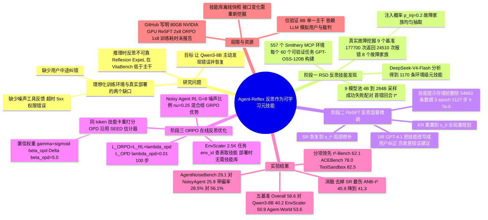

## 一、论文是干什么的？

现在的大模型智能体（agent）已经能帮人订酒店、查数据库、调用各种在线服务。它们调用的这些服务越来越多通过 **MCP**（Model Context Protocol，可以理解为「AI 调用外部工具的统一插座标准」）接入。问题是：**训练时的环境太干净了**。训练用的模拟工具几乎不出错，模拟用户也只会按模板说话；但真实世界里，服务器会返回 503、接口会超时、权限会过期，用户还会在半路插话说「不对，我要的是另一个」。作者在论文图 1 中展示，即使 GPT-5.2、Claude-4.5-Sonnet 这样的强模型，在加入用户噪声或工具噪声后成功率也会明显下降（图 1(c) 的数值未在正文列出，但表 2 给出了 AgentNoiseBench 上对应的下降，例如 GPT-5.2 在 τ² 上从 81.0 降到 61.0 或 72.0）。

打个比方：一个新员工只在「打印机永远不卡纸、老板从不改需求」的理想办公室里培训过，一到真实岗位，打印机一卡纸他就愣住，或者假装打印成功继续往下走。Agent-Reflex 想做的，就是让智能体在训练阶段就见识真实的「卡纸」和「老板改需求」，并且学会**主动反思**：发现哪里不对、判断原因、换一种做法补救。作者把「反思」当成一种可以学习的**元技能**（meta-skill）：先从大量失败案例中把补救经验总结成规则，再通过两阶段训练把这些规则「内化」进模型参数，部署时不需要再给模型看任何提示卡。

最终，基于 Qwen3-8B 训练出的 Agent-Reflex-8B 在五个长程工具使用基准上总分 58.6（比原始 Qwen3-8B 高 18.4 分），在专门测噪声鲁棒性的 AgentNoiseBench 上得到 29.1，均为论文所比较的 7B 到 8B 方法中最高。论文 arXiv 页面的备注写着 Working in progress，说明这还是一份进行中的工作。

## 二、核心方法与创新

整个框架分三个阶段：RSD（发现反思技能）→ ReSFT（反思式监督微调）→ ORPO（在线反思式策略优化）。

### 1. 第一阶段 RSD：在「会出故障的环境」里挖掘反思技能

全称 Environment Reflection Skill Discovery。

**（1）搭建 557 个可执行环境。** 作者从 MCP 服务注册平台 [Smithery](https://smithery.ai/) 中按累计使用次数选出 557 个高使用量的 MCP 服务（比如行情数据、Airtable 表格、酒店预订、Semantic Scholar 文献检索等）作为「主题」。沿用团队此前 Agent-World 的做法：一个配有搜索、浏览器、代码和操作系统工具的「研究智能体」为每个主题挖出一个数据库，并做 3 轮复杂化扩充；再由「编码智能体」生成候选工具和单元测试，只保留能编译、通过全部测试、满足状态转移约束、能被程序自动验证的工具。每个环境配 60 个可验证任务。两个智能体都用 GPT-OSS-120B。

**（2）从真实报错中总结故障类型，再「注入」环境。** 作者没有凭空编造故障，而是在 9 个公开智能体基准（MCP-Atlas、$\tau^{3}$-Bench、AutomationBench、OfficeQA Pro、JobBench、Harvey LAB、GDPval、Workspace-Bench、SkillsBench）上回放智能体，记录了 177,700 次工具返回，其中 24,510 次是报错。按表面形式归纳为 8 个故障家族：

| 故障家族 | 占比 | 典型信号 | 应对思路（论文表 4） |
|---|---|---|---|
| 服务器或网关不可用 | 33.6% | 500/502/503/504 | 有限次退避重试，超过停止规则就换端点 |
| 认证或权限 | 17.9% | 401/403 | 刷新凭证、申请授权或上报，原样重试无效 |
| 超时 | 14.7% | timeout | 先确认状态是否已改变，再重试或缩小请求 |
| 资源不存在 | 10.5% | 404 | 核对标识符，或用搜索、列表工具重新发现 |
| 参数或校验错误 | 10.2% | 400/422 | 修正字段、类型、必填项后再试 |
| 通用执行异常 | 8.3% | operation failed | 看返回证据，选择有针对性的补救 |
| 限流 | 4.5% | 429 | 退避、遵守配额、合并请求 |
| 网络连接 | 0.3% | reset/refused | 当作临时基础设施故障处理 |

（占比按非互斥的模式命中计算，一条报错可能同时计入多个家族。）

注入方式很简单：每次工具返回都以概率 $p_{\mathrm{inj}}$ 被替换成一条与该工具兼容的故障信息，论文设 $p_{\mathrm{inj}}=0.2$：

$$
o_{t+1}^{\mathrm{train}}=\begin{cases}J(o_{t+1}), & b_{t+1}^{\mathrm{inj}}=1\\ o_{t+1}, & b_{t+1}^{\mathrm{inj}}=0\end{cases},\qquad b_{t+1}^{\mathrm{inj}}\sim\mathrm{Bernoulli}(p_{\mathrm{inj}})
$$

其中 $J$ 是「故障渲染器」。为了让罕见故障也有足够样本，故障家族是在 8 类里**均匀**抽取的，而不是按真实频率。

**（3）让一群不同水平的模型去做同一批任务，对比成功和失败。** 只用一个模型反复采样，轨迹会集中在该模型的习惯上。所以作者用了 5 个家族共 9 个模型（4B 到 284B）组成「模型池」，在同样的预算下跑所有任务。然后由分析模型 DeepSeek-V4-Flash 与环境验证器共同判定每条轨迹对错（两者意见不一致的直接丢弃），并标出失败轨迹「第一个出错的回合」 $t^{\star}$ 及当时的环境状态快照 $s_{t^{\star}}$。同一任务的成功与失败轨迹配成对，每个环境至少来自 5 个不同任务。

**（4）总结成「元技能卡片」。** 分析模型对比每一对轨迹，提炼出「坏模式 → 纠正动作」的规则。每个环境存成一条记录 $\zeta_{m}=(d_{m},\mathcal{T}_{m},\mathcal{B}_{m},\mathcal{K}_{m})$，分别是环境描述、工具、观察到的坏模式和反思技能。全部 557 个环境共得到 **1,170 条反思元技能**。

比喻：这就像让一家公司里水平不同的员工都去办同一批业务，然后让资深主管对比「谁办成了、谁搞砸了、搞砸是从哪一步开始的」，最后给每个部门写一张「常见坑与补救办法」清单。例如论文附录中 Airtable 环境的技能是：先按顺序确认 base、table、record 的标识符，精确匹配后再更新，并在写入后重新读一次记录核对。酒店预订环境的技能则提醒：生成支付链接只代表「发起预订」，不代表「已付款」。

### 2. 第二阶段 ReSFT：把技能卡片变成训练数据

全称 Reflective Supervised Fine-Tuning。关键点是：**生成数据时给模型看技能卡片，但存进训练集时把卡片删掉**。这样模型学到的是「遇到这种情况就自己反思」，而不是「看到提示卡才反思」。三种采样策略：

- **自我反思采样**（SR，局部修补）：把环境恢复到第一次出错之前的状态 $s_{t^{\star}}$，在历史后面附上技能 $\kappa$，让 Qwen3-8B 自己续写。只有验证器判定成功的续写才保留。
- **技能恢复采样**（KR，全局重来）：很多失败源于一开始计划就错了，所以把环境重置到初始状态 $s_0$，带着技能从头重做原任务。
- **用户导向反思采样**（UR，用户纠错）：用户模拟器（GPT-4.1）把技能改写成一句自然的用户纠正，比如「你找的不是我要的那家酒店」，插在出错回合之后再续写。因为部署时用户消息本来就看得见，所以这句纠正保留在训练输入里，而技能本身从不进入上下文。作者还特意让模拟器生成部分**故意错误的建议**，让模型学会根据证据判断，而不是盲目服从。

最终数据集由 Qwen3-8B 自己验证成功的轨迹加上三类反思数据组成，共约 54K 条（GitHub 写明为 54,663 条），用标准的负对数似然训练：

$$
\mathcal{L}_{\mathrm{ReSFT}}=-\sum_{(x,y)\in\mathcal{D}_{\mathrm{ReSFT}}}\log\pi_{\theta}(y\mid x)
$$

注意：多样化模型池**只用来挖掘对比经验**，所有真正用于训练的轨迹都由 Qwen3-8B 自己生成。作者强调这是为了与其他 7B 到 8B 方法公平比较。

比喻：教练把录像倒回到你失误前一秒，递给你一张提示卡让你重打一遍；打好之后，把这段「正确示范」剪进教学片，但把提示卡从画面里剪掉。

### 3. 第三阶段 ORPO：在噪声环境里强化学习，并用技能卡做「逐 token 打分」

全称 On-Policy Reflective Policy Optimization。（提醒：这里的 ORPO 是论文自定义缩写，与业界常见的偏好优化方法 Odds Ratio Preference Optimization 同名但完全不同。）

**（1）带噪声的智能体强化学习。** 任务来自 EnvScaler 的 RL 任务池（约 2.5K 个任务，而不是 RSD 合成的任务）。每个任务采样 $G=8$ 条轨迹，其中比例 $\nu=0.25$ 在注入故障的环境里跑，其余在干净环境里跑。验证器给出回报后，在整个混合组里做 GRPO 式的组内标准化：

$$
\widehat{A}_{q,i}=\frac{R_{q,i}-\mu_{q}}{\sigma_{q}+\epsilon}
$$

作者特意不把干净组和噪声组分开标准化，这样真实的失败留在同一个分布里，又不会单独形成对比。目标函数是标准的 clip 目标加 KL 正则（论文式 8），只对智能体自己生成的 token 计算损失，工具返回和模拟用户消息被掩码排除。

**（2）反思式在线蒸馏（OPD）。** 结果奖励只有一个分数，太稀疏：一条 40 回合的轨迹失败了，到底是哪一步错了？ORPO 的办法是：让**同一个模型**在上下文里加上该环境的技能卡，对已经采样好的**同一批 token** 重新打分，得到 $\ell^{\mathrm{skill}}$，再与普通上下文下的打分 $\ell^{\theta}$ 对比：

$$
\Delta=\mathrm{sg}\left[\ell^{\mathrm{skill}}-\ell^{\theta}\right],\qquad \gamma=\mathrm{sigmoid}(\beta_{\mathrm{opd}}\Delta)
$$

$$
\mathcal{L}_{\mathrm{OPD}}(\theta)=\mathbb{E}\left[\chi\,\gamma\left(\mathrm{sg}[\ell^{\mathrm{skill}}]-\ell^{\theta}\right)\right],\qquad \mathcal{L}_{\mathrm{ORPO}}=\mathcal{L}_{\mathrm{RL}}+\lambda_{\mathrm{opd}}\mathcal{L}_{\mathrm{OPD}}
$$

其中 $\mathrm{sg}$ 表示停止梯度，$\chi$ 是有效 token 掩码。直观理解：如果「看了技能卡的自己」更认可某个 token（$\Delta>0$），权重 $\gamma$ 就大，这个 token 被加强；如果技能卡对它没意见甚至反对，权重就小。这个估计器直接沿用 SEED 方法，作者的贡献在于「特权上下文」里放的是从真实故障中挖出来的环境级技能卡，而不是更大的教师模型或针对单条轨迹的事后改写。

比喻：你在真实岗位上实习，偶尔会故意给你一台会卡纸的打印机。你的「另一个自己」手里拿着部门的坑点清单，在旁边对你的每个动作默默打分：「如果我看了清单，也会这么做吗？」它认可的动作就多练，不认可的就少练。

两个工程上的好处：技能卡是按环境编号直接查表 $\kappa_{q}=\mathrm{Lookup}(\mathrm{env\_id}(q),\mathcal{K})$ 得到的，不需要检索；技能分支只做一次前向计算、不与环境交互，所以相比普通智能体 RL，额外开销只是一次前向，而不是一次额外的 rollout。部署时完全不需要技能库。

## 三、使用了哪些模型和计算资源？

### 1. 模型

| 用途 | 模型 | 来源 |
|---|---|---|
| 被训练的主干模型（所有阶段；论文称对比方法也统一用它，但表 1 含 TOUCAN-7B，且多数基线数字引自原论文） | Qwen3-8B | 论文 4.1 节、附录 D.1 |
| 环境构建的研究智能体与编码智能体 | GPT-OSS-120B | 论文附录 D.2 |
| 轨迹采样的模型池（9 个，5 个家族） | Qwen3-4B-Thinking、Qwen3-8B、Qwen3-14B、Qwen3-32B、Qwen3-235B-A22B、Llama-3.1-8B-Instruct、Gemma-4-31B-it、GPT-OSS-120B、DeepSeek-V4-Flash（284B） | 论文表 5 |
| 错误判定与技能提取的分析模型（兼评论模型） | DeepSeek-V4-Flash | 论文附录 D.2 |
| ReSFT 中 UR 的用户模拟器 | GPT-4.1 | 论文附录 D.3 |
| 评测用的用户模拟器、噪声生成器 | gpt-4.1 | GitHub 评测 README |
| 评测裁判（VitaBench、AgentNoiseBench-Vita） | claude-sonnet-4-6 | GitHub 评测 README |
| 对照的闭源参考模型 | GPT-5.2、Claude-4.5-Sonnet、Gemini 3 Pro（表 1），Gemini-2.5-Pro（表 2） | 论文表 1、表 2 |

### 2. 硬件

- **论文正文与附录没有给出 GPU 型号和数量**。
- [GitHub 仓库](https://github.com/RUC-NLPIR/Agent-Reflex) README 写明：需要 **NVIDIA 80 GB 显存 GPU**（未说明具体型号，如 A100 还是 H100），驱动支持 CUDA 12.8；**ReSFT 使用 2 个节点 x 8 张 GPU，ORPO 和评测使用 1 个节点 x 8 张 GPU**。
- 软件栈：SFT 基于 LLaMA-Factory（DeepSpeed ZeRO-3、全参数微调），RL 基于 verl 0.5（FSDP、SGLang 异步多轮 rollout），评测用 vLLM 部署（论文附录 D.1 与 GitHub README）。

### 3. 训练超参数与「完整单元」耗时

| 单元 | 已知信息 | 来源 | 耗时 |
|---|---|---|---|
| 环境构建（557 个环境） | 每个环境 60 个任务，数据库 3 轮复杂化 | 论文附录 D.2 | 暂无相关信息 |
| 技能挖掘（模型池采样 + 分析） | 9 个模型、统一工具调用上限与响应预算 | 论文附录 D.2 | 暂无相关信息 |
| ReSFT 一次完整训练 | 54,663 条数据，3 个 epoch 共 5,127 步，全局 batch 32（每卡 2），lr 为 7e-6，cosine，warmup 0.1，weight decay 0.1，bf16，最大长度 32768 | GitHub `LLaMA-Factory/README.md` | 暂无相关信息 |
| ORPO 一次完整训练 | 共 100 次更新；每次 64 个任务 x 8 条 rollout；actor lr 为 1e-6；KL 系数 0.01；$\lambda_{\mathrm{opd}}=0.01$；$\beta_{\mathrm{opd}}=5.0$；$\nu=0.25$；故障率 0.2；最大提示 8192、最大回复 16384 token；每条轨迹最多 40 回合；采样温度 0.99 | 论文附录 D.4（$G=8$、$\nu=0.25$）；100 步见论文 4.3 节与图 4（算法对比实验）以及 GitHub `ORPO/README.md`；其余来自该 README | 暂无相关信息 |
| 单次评测 | 六个基准；120 个并发任务；单次请求读超时 30 分钟 | GitHub 评测 README | 暂无相关信息 |

### 4. API 使用与成本

- 评测时，除 BFCL 外每个基准都需要外部 LLM（用户模拟器、裁判或噪声生成器），仓库默认通过一个第三方 OpenAI 兼容网关调用 gpt-4.1 和 claude-sonnet-4-6；BFCL 的网页搜索类别需要 Serper 搜索 API。仓库说明训练阶段不需要 API key。
- 数据构建阶段用到 GPT-4.1（用户模拟），但论文没有说明调用方式和用量。
- **API 费用、token 消耗量：暂无相关信息。**

### 5. 一处需要注意的不一致

论文附录 D.5 写「我们测得的每个分数都是三次独立运行的平均」，VitaBench 用 Avg@4；而 GitHub 评测 README 中 τ²-Bench 与 VitaBench 的默认设置写的是「1 trial」，VitaBench 指标写为 pass@1。可能是仓库脚本给的是单次运行的默认配置，但两者的关系论文与仓库都没有说明。

## 四、实验结果

### 1. 五个长程工具使用基准（论文表 1，部分摘录）

评测基准：VitaBench（外卖、到店、OTA 与跨场景）、τ²-Bench（零售、航空、电信）、BFCL V4、ACEBench、ToolSandbox（200 个分层抽样任务）。Overall 是五个基准平均分的简单平均。论文称所有训练方法都从 Qwen3-8B 出发（但表 1 中包含 TOUCAN-7B，且多数基线数字引自原论文）。

| 方法 | VitaBench | τ²-Bench | BFCL V4 | ACEBench | ToolSandbox | Overall |
|---|---|---|---|---|---|---|
| GPT-5.2 | 37.7 | 80.0 | 62.9 | 68.0 | 73.3 | 64.4 |
| Claude-4.5-Sonnet | 38.0 | 84.7 | 73.2 | 82.0 | 85.0 | 72.6 |
| Gemini 3 Pro | 47.6 | 85.4 | 72.5 | 70.0 | 88.4 | 72.8 |
| Qwen3-235B-A22B | 26.8 | 58.5 | 48.0 | 78.0 | 77.1 | 57.7 |
| Qwen3-8B（主干） | 11.4 | 26.2 | 40.4 | 54.0 | 69.1 | 40.2 |
| Reflexion-8B | 6.8 | 34.5 | 42.7 | 64.0 | 75.4 | 44.7 |
| ExpeL-8B | 7.3 | 33.6 | 41.7 | 44.0 | 63.0 | 37.9 |
| NoisyAgent-8B（作者复现） | 15.3 | 42.8 | 35.6 | 52.0 | 71.5 | 43.4 |
| EnvScaler-8B | 15.8 | 37.9 | 47.6 | 72.5 | 80.5 | 50.9 |
| Agent-World-8B（作者复现） | 14.5 | 54.6 | 51.4 | 72.0 | 75.6 | 53.6 |
| **Agent-Reflex-8B** | 17.5 | 62.1 | 52.9 | 78.0 | 82.5 | 58.6 |

大白话解读：

- 相比原始 Qwen3-8B，总分从 40.2 提到 58.6（多 18.4 分）；比同样复用其 RL 任务池的 EnvScaler-8B 高 7.7 分，比表中最强的环境扩展基线 Agent-World-8B 高 5.0 分（论文附录和 README 称 EnvScaler 最强，但表 1 数字显示 Agent-World-8B 更高）。
- 只靠推理时反思（Reflexion、ExpeL）的方法在最难的 VitaBench 上反而低于主干模型（6.8 和 7.3 对 11.4），作者认为这说明「临时让同一个模型自我批评」并不可靠，把反思训练进参数更可靠（论文表述较为谨慎，只说训练可能有帮助；附录 A.1 显示 Reflexion 与 ExpeL 低于主干）。
- τ²-Bench 提升最明显：62.1 对 EnvScaler 的 37.9 和 Agent-World 的 54.6，其中电信领域 71.9，比 Agent-World 的 50.9 高很多。
- ACEBench 的提升主要来自多轮交互：轮级（turn-level）准确率 73.3，而步级（step-level）与 EnvScaler、Agent-World 持平，都是 85.0。
- 8B 模型的总分（58.6）略高于 Qwen3-235B-A22B（57.7），但距离 GPT-5.2（64.4）和 Claude、Gemini（约 72.6 到 72.8）仍有明显差距。
- 并非每个子项都领先：例如 BFCL 的 Web 子项（44.5 对 Agent-World 的 47.0）、τ²-Bench 零售（68.4 对 72.8）都低于 Agent-World-8B。

### 2. 噪声鲁棒性：AgentNoiseBench（论文表 2）

AgentNoiseBench 在 τ²-Bench 和 VitaBench 上分别注入工具噪声和用户噪声，使用「稳定性门控成功率」（只有整条轨迹没被噪声带偏且任务完成才算成功，排除「被带偏但碰巧答对」的情况）。作者强调这个基准对他们来说是分布外的：训练用的故障来自真实报错日志，注入方式不同，训练中没有使用任何 AgentNoiseBench 的环境。

| 方法 | τ² 工具噪声 | τ² 用户噪声 | τ² 平均 | Vita 工具噪声 | Vita 用户噪声 | Vita 平均 | Overall |
|---|---|---|---|---|---|---|---|
| GPT-5.2 | 61.0 | 72.0 | 66.5 | 45.0 | 45.0 | 45.0 | 55.8 |
| Qwen3-8B | 14.1 | 26.2 | 20.2 | 3.3 | 5.5 | 4.4 | 12.3 |
| NoisyAgent-8B（引自原论文） | – | – | 37.6 | – | – | 14.2 | 25.9 |
| EnvScaler-8B | 20.8 | 33.4 | 27.1 | 5.0 | 13.6 | 9.3 | 18.2 |
| **Agent-Reflex-8B** | 38.4 | 53.4 | 45.9 | 9.4 | 15.2 | 12.3 | 29.1 |

Agent-Reflex 总分 29.1，比 NoisyAgent-8B 的 25.9 高。但要注意两点：NoisyAgent 的 VitaBench 平均（14.2）其实高于 Agent-Reflex（12.3）；而且论文说明 NoisyAgent 的这些数字来自其原论文，它是直接在被评测的领域上做 RL 的。另外 29.1 离 GPT-5.2 的 55.8 还很远，VitaBench 噪声场景对所有 8B 模型都极难。

附录 E.1 的细粒度分析（13 个噪声子类，每类 165 个任务，95% 配对 bootstrap 区间）：

- 在所有 13 个子类上 Agent-Reflex 都领先（分数按三个模型的均值归一化为 10）。
- 工具侧只有「误导性诱饵」（13.9，工具侧最高）和「信息不完整」（10.9）这两类，相对两个基线都通过了 95% 区间检验（数值为归一化分数，10 表示三个模型的均值，不是直接的分差）；这两类的返回格式完全正常，只能靠检查内容发现问题；状态码已经说明故障的四类「硬故障」上，相对主干的增益比较均匀（12.3 到 13.5）。
- 用户侧优势最大的是「认知过载」（12.9）。
- 合计两侧，Agent-Reflex 被噪声带偏的 rollout 占 28.5%，EnvScaler-8B 为 44.8%，主干 Qwen3-8B 为 56.1%。

### 3. ORPO 与其他 RL 算法对比（论文图 4）

所有算法都从 Qwen3-8B 出发，在同样的 2.5K EnvScaler 任务上训练 100 步，预算一致。作者报告 ORPO 在 BFCL V4、τ²-Bench 和真实噪声场景上都稳定优于 GRPO、DAPO、REINFORCE++，也优于同样带 OPD 信号的 SEED，以及 NoisyAgent RL（噪声混合式 RL，不带 OPD）；训练奖励曲线上，ORPO 较早与 GRPO 和 SEED 拉开距离，并在二者趋平后继续上升。**具体数值只在图中给出，正文没有以表格或文字列出精确数值，需要从图 4 读取。**

### 4. 消融实验（论文表 3，AgentNoiseBench 平均）

| 变体 | ANB-τ² | ANB-Vita |
|---|---|---|
| 完整 Agent-Reflex | 45.9 | 12.3 |
| 去掉 SR | 41.3 | 8.9 |
| 去掉 KR | 42.4 | 10.2 |
| 去掉 UR | 43.0 | 10.9 |
| 去掉 OPD | 43.7 | 9.5 |
| 去掉置信度权重 | 44.5 | 10.4 |

结论：去掉任何一个组件都会变差；三种数据中去掉 SR 下降最多（作者认为「发现错误并就地修补」是反思能力的基础）；保留技能库但去掉 OPD 也会明显变差，说明收益来自 token 级反思信号，而不只是「让模型见过技能」。附录 D.4 还提到，对噪声比例 $\nu$ 的消融显示结果比较稳定，没有其他取值有一致优势（未给出具体数值）。

## 五、潜在应用与已落地应用

**潜在方向：**

- **MCP 工具助手**：企业内部接了几十个 MCP 服务的助手，最常见的问题就是服务超时、权限过期、分页没读完就下结论。论文的 8 类故障分类和对应的应对思路，本身就可以作为设计智能体错误处理逻辑的清单。
- **公开的技能库可以单独使用**：1,170 条按环境组织的反思技能（中英双语）已经开源，可以作为提示词规则、评审清单，或者作为其他训练方法的特权上下文。
- **框架可替换**：作者在附录 G 中提到三个阶段是模块化的，ORPO 的特权槽位可以换成其他环境级信息（比如验证过的子计划、工具契约）。
- **安全方面的提醒**：作者也承认，会自救的智能体在世界里采取的动作更多，出错时影响也更大，所以技能记录带有「可逆性」和「部分生效」标记，并区分「先问用户」和「自己直接行动」。

**已开源的内容（已核实）：**

- [GitHub 仓库 RUC-NLPIR/Agent-Reflex](https://github.com/RUC-NLPIR/Agent-Reflex)（Agent-Reflex 自有代码与 RSD 技能库采用 MIT 许可，仓库内引入的 LLaMA-Factory、ORPO 等组件保留各自的许可证）：包含 RSD 技能库、ReSFT 训练脚本（LLaMA-Factory）、ORPO 训练代码（基于 verl）、六个基准的评测脚本。本文撰写时约 76 颗星、2 个 fork。
- [Agent-Reflex-8B 模型](https://huggingface.co/dongguanting/Agent-Reflex-8B)（约 16 GB）、[ReSFT 数据 54K](https://huggingface.co/datasets/dongguanting/Agent-Reflex-SFT-54K)、[ORPO 任务 2,550 条](https://huggingface.co/datasets/dongguanting/Agent-Reflex-RL-2K)，汇总在 [Hugging Face 合集](https://huggingface.co/collections/dongguanting/agent-reflex)中。
- Hugging Face 团队已把 BFCL 与 τ²-Bench 两项结果收录到 Papers with Code，作者在 GitHub issue 中确认了数值。

**已知落地：** 论文和仓库都没有提到任何生产环境部署或商业应用案例，暂无相关信息。

## 六、网络上的讨论与评价

- **Hugging Face 论文页**：本文撰写时 193 票。评论区只有第一作者 dongguanting 的介绍帖、Librarian Bot 自动推荐的相似论文，以及 ResearchStudio 机器人自动生成的海报和视频，没有其他读者的实质性讨论。
- **英文博客与资讯**：[AI Weekly](https://aiweekly.co/alerts/agent-reflex-lifts-qwen3-8b-to-586-on-tool-use-benchmarks) 的简讯认为，一个专门在工具故障上训练的 8B 智能体缩小了与大模型的鲁棒性差距，对做 MCP 工具助手的团队有意义；但也指出摘要里没有列出具体基准和逐项基线数字，并且这个方向已经比较拥挤。[explainx.ai 的博客](https://explainx.ai/blog/agent-reflex-reflective-tool-agents-noisy-mcp-qwen3-8b-open-code-2026)肯定了代码、数据和权重全部开源，认为技能库本身就是一份有用的「工具智能体失败目录」；同时提醒：AgentNoiseBench 上 29.1 离解决还很远，结果只在一个 8B 主干上验证过，多个基准依赖 LLM 模拟用户和裁判，复现训练需要多节点 GPU 集群，需要等独立复现。（该博客文末推销了自家产品，这部分不属于评价。）
- **其他**：德国资讯站 [Mind-Verse](https://www.mind-verse.de/news/agent-reflex-fehlertolerante-ki-agenten-mcp-training-ad351da74b8b) 有一篇介绍文章，[hyper.ai](https://hyper.ai/cn/papers/2610.17953) 有多语言摘要页，内容以转述论文与仓库信息为主，没有独立评测或实质批评。
- **未找到讨论的渠道**：通过 Hacker News 的 Algolia 接口按论文名和编号检索，没有相关帖子；Reddit 搜索接口对脚本请求返回了拦截页，没能确认；X/Twitter、知乎、机器之心、量子位在搜索结果中也没有发现相关讨论。
- **综述者的几点观察**（基于论文本身，不是外部评价）：
  - 不少基线是作者自己复现的（Agent-R、NoisyAgent、EnvACE、Agent-World 在表 1 中标了星号），且 Agent-World 和 EnvScaler 的代码仓库都在同一个 RUC-NLPIR 组织下（与本文同一团队），比较时值得留意。
  - 论文没有报告任何 GPU 小时、训练时长或 API 费用；训练用的 GPU 规格只在 GitHub 上写了「80 GB 显存的 NVIDIA GPU」。
  - 技能挖掘依赖 DeepSeek-V4-Flash（284B）这样的强分析模型，作者说明这是因为 Qwen3-8B 自己还不够可靠，因此整套流程的成本不只是训练一个 8B 模型。
  - 作者在局限性中承认，技能库是离线从固定快照中挖出来的，工具接口或服务行为变化后需要重新挖掘；在线更新技能能否泛化也还没有验证。

## 七、思维导图

