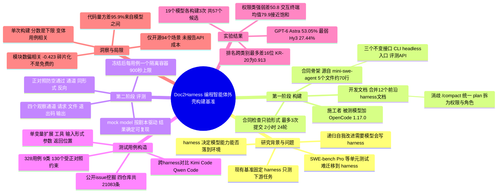

## 一、论文是干什么的？

先解释一个关键词：**harness**（直译「马具、挽具」，这里可以理解为智能体的「外壳」或「驾驶舱」）。像 Claude Code、Codex CLI、Gemini CLI、Aider 这类编程智能体，里面真正「思考」的是大模型，但模型本身只会吐文字；把文字变成读文件、改代码、跑命令，并且管住权限、保存会话、出错后恢复、压缩上下文的，是包在模型外面的这层程序，这就是 harness。论文开头强调：智能体表现得好不好，既取决于模型，也同样取决于 harness。

已有的评测大多是「固定一个 harness，换不同模型去做下游任务」，看的是模型做题的能力；而**让模型自己写出一个 harness**（论文称为 harness engineering）这种能力此前缺少直接、确定性的、按条款逐项的评测（已有工作让模型生成或修改 harness，但都是通过下游任务间接评估）。这件事之所以重要，是因为「递归自我改进」的设想：智能体做完任务、看结果、修改自己的 harness、再用新 harness 做下一个任务。如果模型连 harness 都写不好，这会成为这条路线的重要瓶颈。

Doc2Harness 的做法可以用「装修验收」来比喻：先给施工队（被测模型）一本**装修说明书**（开发文档）和一套**只有承重墙和水电接口的毛坯房**（合同骨架），让它从零装修出一套能住的房子（候选 harness）；装修完把房子「封存」，再请一位**照剧本行事的假住户**（mock model，模拟大模型）进去按固定流程生活一遍，验收员只看四样东西有没有出问题：住户对外发出的请求、屋里的文件、进出门的退出码、屏幕上的输出。最后用通过率给施工队打分。论文测了 19 个前沿模型，最强的 GPT-6 Astra 通过率也只有 53.05%，最弱的 Hy3 为 27.44%。

## 二、核心方法与创新

### 1. 两阶段流程：一个容器里建，另一个容器里验

- **第一阶段：构建（Construction）**。「施工者」= 被测模型 + 一个固定的施工用 harness。论文统一用开源的 **OpenCode** 作为施工 harness，而不用 Claude Code 或 Codex CLI，理由是后两者由模型厂商与自家模型一起开发，可能让 Claude 和 GPT 系列占便宜。模型读开发文档、在合同骨架基础上写出完整的候选 harness，然后主动「提交」。每次提交会做**合同检查**：能否编译安装、必需的命令是否齐全、有没有残留占位桩代码、三个合同接口是否就位。注意它只检查「形式」，不跑任何测试用例。通过就冻结，以后再也不能改；不通过就退回，在配额内继续改。
- **第二阶段：评测（Evaluation）**。冻结的候选 harness 被搬到与构建环境隔离的容器里，**每个测试用例一个容器**，由 mock model 按预设剧本提供回复，驱动 harness 完整跑一个会话。用假模型而不是真模型，是为了排除真实大模型回答不稳定带来的干扰，让评测**确定性**可复现。
- 每个阶段都固定一个组件（第一阶段固定施工 harness，第二阶段固定驱动模型），这样不同候选 harness 之间主要的受控变量就是写它的模型（同一模型的独立构建之间仍有随机差异，论文每个模型做了三次独立构建）。最终排名的是**构建模型**，而不是候选 harness 本身。

### 2. 输入一：开发文档（把 12 个前沿 harness 的说明书揉成一本）

论文爬取了 12 个前沿 harness 的用户文档：Claude Code、Kimi Code、Gemini CLI、Qwen Code、OpenCode、OpenClaw、Codex CLI、Aider、OpenHands、Cline、Crush、Cursor。分三步写成开发文档：

1. **收集功能清单**：先抽取候选功能，再补全调用形式、参数语义和边界行为，合并、去重、剪枝。
2. **把清单变成条款**：每条条款有语法、含义和预期行为。文档章节包括交付物与运行接口、内置工具、顶层命令与子命令、权限模式与角色模式（五种权限模式、五种角色模式、拒绝规则）、全局参数、会话内命令与快捷键、持久记忆、约定文件、一致性规则、退出码等。每个功能的效果都必须能从四个通道之一观察到；除了合同骨架的三个接口，不限制实现方式。
3. **消歧**：语义重叠的命令合并，例如 Claude Code 的上下文压缩叫 `/compact`、Cursor 叫 `/summarize`，文档统一用 `/compact`；同名不同义的概念拆开，例如 plan 在 Claude Code 里是只读的权限模式，在 Aider 里则对应 architect 与 editor 两个角色的分工，文档把「只读」归到权限、把「提议与执行修改」归到角色。

这本文档是「合并重写」出来的，不对应任何一个现有实现，论文的设计意图是减少模型靠背训练数据里的某个开源项目来过关。

### 3. 输入二：合同骨架（只有接口、没有实现）

骨架从 mini-swe-agent 精简改造而来：5 个 Python 源文件（总共大约 70 行），加一个安装脚本、一个入口脚本和一个项目配置。其中三个接口是不可更改的对外合同：**命令行接口（CLI）**、**无头入口（headless entry point）**，以及**驱动自动化评测的 API**。一个有代表性的候选 harness 大约有 30 个 Python 文件、约 16,000 行，其中约 99.6% 是模型自己写的。构建容器是全新的空容器，除了指定的模型网关外不能访问外网；开工前还有预检，确认容器里没有多余文件、OpenCode 能正常启动。

### 4. 测试用例怎么造：三种方法轮流用

每个用例必须锚定开发文档的某条条款，并且能区分不同实现。论文按「哪种方法边际产出下降就换下一种」的节奏轮流使用三种方法：

- **公开 issue 挖掘**：假设是模型写 harness 犯的错，与成熟 harness 多年来暴露的缺陷高度重合。作者拉取了 Claude Code、OpenCode、Gemini CLI、Kimi Code 四个仓库的全部 issue（去掉 PR 后分别为 9,868、5,438、4,831、946 条，共 21,083 条），按与开发文档的相关度排序后人工审阅，按现象聚类，一个簇对应一个候选用例，再去掉与已有用例效果太接近、或无法写成确定性断言的。
- **跨 harness 对比**：把某个候选 harness 的源码按开发文档的功能分组切成模块，对成熟 harness（如 Kimi Code、Qwen Code）的源码做同样切分，逐模块列出差异；只有能追溯到某条条款目的的差异才算候选用例。
- **单变量扩展**：拿一个已经证明有区分度的用例当「种子」，断言不变，每次只改场景里的一个变量：用的工具、输入形式（比如把普通路径换成指向文件的符号链接、指向目录的符号链接、多级符号链接、相对路径符号链接）、出错的参数（比如把数值 0 当成「没传」）、结果出现的位置（标准输出、标准错误或错误文本）。离种子太近的候选丢掉，留下的当作下一轮的种子。

### 5. 正对照（Positive Control）：防止「没干活也能过」

这是论文最巧妙的一点。举论文自己的例子「路径逃逸」：剧本让 harness 用读文件工具去读一个指向工作区外部的符号链接，断言是「外部文件的内容不能出现在发给模型的请求里」。可是内容没出现，可能是 harness 正确拦截了越界读取，**也可能是它的读文件工具根本读不了任何文件**。后者叫**空通过**（vacuous pass）。

好比验收「防盗门能拦住小偷」：小偷没进来，也可能是因为门根本打不开、连主人都进不来。所以还得验证「主人能正常进门」。正对照与被测用例共享场景和初始文件，只换输入或访问路径，去测一个**本该成功**的操作。分三类：

| 正对照类别 | 排除的空通过原因 | 路径逃逸例子中的做法 |
|---|---|---|
| 通道（Channel） | 工具结果根本不进被观察的通道 | 用读工具读一个普通文件，确认内容确实出现在请求里（路径逃逸用例本身不单设此对照，由反向对照覆盖该条件） |
| 同形式（Same form） | 即使没有该约束也会失败 | 同一个符号链接改用 bash 工具访问，确认外部文件可读 |
| 反向（Reverse） | 实现一刀切地拒绝这类输入 | 换成指向工作区内部的符号链接，确认内容仍能读到 |

只要某个用例依赖的任一正对照失败，该用例一律记为 FAIL；正对照本身不计入通过率。

### 6. 四个观察通道

所有判定都只看外部可观察的效果：**发给模型的请求、磁盘上的文件、进程退出码、命令输出**。项目主页的说法是：评的是 harness 实际做了什么，而不是它自称做了什么。这让「被拒绝的操作不得发生」这类约束也能逐条判定。

## 三、使用了哪些模型和计算资源？

**被测的 19 个构建模型**（来自 11 家厂商，见论文第 3 节）：

| 厂商 | 模型 |
|---|---|
| Anthropic | Claude Opus 4.6、Opus 4.7、Opus 4.8、Opus 5 |
| OpenAI | GPT-5.5、GPT-5.6-sol、GPT-6 Astra |
| 阿里云 | Qwen3.8 Max 0902 |
| 月之暗面 | Kimi K3 |
| 智谱 Z.ai | GLM 5.2、GLM 5.3 |
| DeepSeek | DeepSeek V4 Pro、DeepSeek V4.1 Flash |
| 腾讯混元 | Hy3、Hy4 preview |
| 字节 Seed | Doubao Seed 2.1 Pro |
| 小米 | MiMo-V2.6-Flash |
| xAI | Grok 4.7 |
| 阶跃星辰 | Step 5 Preview |

每个模型独立构建 3 次，共 57 个被打分的候选 harness。第二阶段驱动 harness 的不是真实大模型，而是按剧本回复的 mock model。

**其他软件组件：**

- 施工 harness：OpenCode 1.17.0，以单个编译好的可执行文件装进构建容器，通过非交互入口 `opencode run` 运行（论文第 3 节）。
- 合同骨架来源：mini-swe-agent（论文 2.2.2 节）。
- 模型网关：论文只说构建容器只能访问「指定的模型网关」；开源仓库 README 说明用的是本地 LiteLLM 网关、需要用户自己的 API key。

**计算资源：**

- 两个阶段都在同一台服务器上运行：AMD EPYC 7K83 处理器，48 个逻辑核，128 GB 内存（论文第 3 节）。
- GPU：论文未提及任何 GPU。被测模型应是通过网关以 API 方式调用（由「模型网关」与 README 的 API key 说明推断，论文未明说），具体 GPU 暂无相关信息。
- API 调用费用、token 消耗：论文与 README 均未给出，暂无相关信息。

**每个完整单元的耗时：**

| 单元 | 论文给出的限制或数据 | 来源 |
|---|---|---|
| 一次构建（第一阶段） | 墙钟上限 2 小时；最多 24 轮对话（用 `--continue` 续接同一会话）；最多 3 次提交；任一耗尽即结束；上下文用到模型窗口的 80% 时自动压缩 | 论文第 3 节 |
| 一次构建的实际用时 | 论文未报告实际平均用时；开源 README 写「真实构建约 15 分钟」，这是仓库说明，并非论文对 19 个模型的统计 | [GitHub README](https://github.com/YuyaoGe/doc2harness) |
| 一个测试用例（第二阶段） | 每个用例在独立容器中只跑一次，超过 900 秒即终止并记为 FAIL | 论文第 3 节 |
| 开源子集全量评测 | 94 个场景在并发 12 下约 25 到 90 秒（只适用于开源子集） | [GitHub README](https://github.com/YuyaoGe/doc2harness) |
| 全部实验总耗时 | 暂无相关信息 | 无 |

## 四、实验结果

### 1. 总榜（全部 328 个用例，3 次构建的均值与标准差，论文 Table 2）

| 排名 | 模型 | 通过率（%） |
|---|---|---|
| 1 | GPT-6 Astra | 53.05 ± 0.25 |
| 2 | Opus 5 | 46.65 ± 1.80 |
| 3 | Qwen3.8 Max | 45.83 ± 0.14 |
| 4 | GPT-5.6-sol | 43.80 ± 2.44 |
| 5 | Grok 4.7 | 43.50 ± 2.49 |
| 6 | GLM 5.3 | 42.07 ± 1.39 |
| 7 | MiMo-V2.6-Flash | 41.87 ± 3.29 |
| 8 | Step 5 Preview | 40.75 ± 3.29 |
| 9 | DeepSeek V4.1 Flash | 40.24 ± 0.86 |
| 10 | Hy4 preview | 38.92 ± 1.46 |
| 11 | Kimi K3 | 38.31 ± 1.28 |
| 12 | Opus 4.8 | 38.01 ± 0.87 |
| 13 | GPT-5.5 | 34.65 ± 1.42 |
| 14 | Doubao Seed 2.1 Pro | 32.62 ± 1.51 |
| 15 | Opus 4.7 | 32.22 ± 1.66 |
| 16 | DeepSeek V4 Pro | 31.91 ± 1.23 |
| 17 | Opus 4.6 | 28.25 ± 0.14 |
| 18 | GLM 5.2 | 27.64 ± 1.01 |
| 19 | Hy3 | 27.44 ± 0.43 |
| | 平均 | 38.30 |

大白话：第一名和最后一名差了约 26 个百分点，说明这套题既没被「做满」，也能拉开差距；但连第一名也有将近一半用例没过。

**前两名的差别在边界场景**：在普通场景上 Opus 5 反而领先（80.68% 对 GPT-6 Astra 的 72.46%）；在边界场景上 GPT-6 Astra 领先（48.97% 对 37.02%）。

### 2. 分类别结果（论文 Table 2、Table 3）

用例分 9 类：会话状态 84 个、文件操作 75 个、权限 61 个、无头模式 40 个、直接驱动 33 个、交互终端 20 个、产物检查 7 个、启动 7 个、扩展发现 1 个。

| 类别 | 用例数 | 平均通过率（%） | 强弱差（百分点） | 全军覆没的用例 | 全员通过的用例 | 有区分度的用例 |
|---|---|---|---|---|---|---|
| 会话状态 | 84 | 29.9 | 28.6 | 14 | 0 | 70 |
| 文件操作 | 75 | 39.6 | 20.9 | 3 | 0 | 72 |
| 权限 | 61 | 43.7 | 50.8 | 10 | 0 | 51 |
| 无头模式 | 40 | 26.4 | 41.7 | 9 | 0 | 31 |
| 直接驱动 | 33 | 18.8 | 29.3 | 17 | 0 | 16 |
| 交互终端 | 20 | 79.9 | 33.3 | 0 | 7 | 13 |
| 产物检查 | 7 | 100.0 | 0.0 | 0 | 7 | 0 |
| 启动 | 7 | 63.4 | 42.9 | 2 | 2 | 3 |
| 扩展发现 | 1 | 0.0 | 0.0 | 1 | 0 | 0 |
| 合计 | 328 | 38.30 | | 56 | 16 | 256 |

要点：

- **权限类最能拉开差距**（强弱差 50.8 分）；交互终端平均 79.9%，接近饱和。
- 有 56 个用例**所有候选 harness 都没过**，主要集中在直接驱动、会话状态、权限和无头模式。
- **排名随类别大幅波动，最多相差 16 位**：Grok 4.7 在文件操作排第 1、会话状态排第 11；Opus 4.6 在直接驱动排第 3、权限排第 19；Hy4 preview 会话状态第 5、直接驱动第 19。GPT-6 Astra 领跑 6 个主要类别中的 4 个。
- 但 6 个主要类别两两之间 15 个相关系数**全是正的**，均值 +0.521。论文的解读是：能力大体是「一维的」，模型主要差在总体水平，而不是各有专长。
- 测试集可靠性：在 57 个候选 harness 上算出的 KR-20 内部一致性系数为 0.913。

### 3. 解剖 57 个候选 harness 的源码（论文 4.3 节、Table 4）

- **代码规模主要由模型决定**：各模型平均代码量从 1,271 行（GPT-5.5）到 16,681 行（Qwen3.8 Max）；57 个构建中最少 1,062 行、最多 19,208 行。代码行数的方差有 95.9% 来自模型之间，同一模型三次构建的变异系数平均只有 12.7%。
- 代码行数与通过率的相关系数：57 个构建上为 0.614，按模型均值为 0.629。
- **拆得越碎分越低**：控制代码行数后，模块数与通过率的偏相关为 -0.423（留一模型检验时在 -0.484 到 -0.309 之间）；每模块行数的偏相关为 +0.504（同一检验下 0.312 到 0.649）。论文结论是「碎片化不是免费的」，并指出失败集中在横切功能被拆到多个模块的地方。下面的权限检查例子和「容易漏掉某处」的解释是综述者的举例，论文并未给出具体机制：同一个横切功能（比如权限检查要在多个工具里生效）被拆到太多模块里，就可能漏掉某处。项目主页明确说这只是相关、不做因果断言。
- 几个直观例子：第一名 GPT-6 Astra 平均 7,964 行、12.3 个模块；Doubao Seed 2.1 Pro 平均 41.7 个模块，每模块只有 162 行；GPT-5.5 平均只有 2.7 个模块，最大模块占了 78% 的代码。

## 五、潜在应用与已落地应用

**潜在用途（论文立场与综述者推测）：**

- 衡量模型「从说明书写出一整套智能体系统」的长程软件工程能力，作为 SWE-bench 一类「改补丁」评测的补充。论文认为 harness 出现时间短、更新快，这种设定旨在更强调对泛化能力的考察（论文并未证明它测得比别的方式更好）。
- 为「智能体修改自己 harness」的自我改进研究提供一把确定性的尺子：因为用假模型驱动、逐条断言，分数不会混入下游任务里「多给搜索预算」带来的提升。
- 正对照思想可以迁移到其他「断言某事不发生」的安全测试中，用来区分「真拦住了」和「本来就坏了」。（此条是综述者的延伸，并非论文结论。）

**已公开的资源：**

- 代码仓库 [YuyaoGe/doc2harness](https://github.com/YuyaoGe/doc2harness)（Apache 2.0；查询时约 60 星、0 fork）。仓库是**部分开源**：论文 328 个计分用例中公开了 53 个，连同把关它们的 41 个正对照，共 94 个场景，其余用例保留不公开，README 明说排行榜分数无法仅用这部分复现。仓库提供第一阶段构建镜像 `ghcr.io/yuyaoge/doc2harness-builder` 和第二阶段评测框架，只依赖 Python 标准库和 Docker。
- [项目主页](https://geyuyao.com/doc2harness/)含交互式排行榜、按类别排名、源码模块可视化、正对照案例练习等。
- 仓库唯一的 issue 是「Release Doc2Harness benchmark on Hugging Face」，目前尚未在 Hugging Face 上发布数据集。

**已落地应用：** 暂未发现有公司或产品采用该基准的公开报道。

## 六、网络上的讨论与评价

- **Hugging Face 论文页**：99 票，列入 2026 年第 42 周热门论文。评论区只看到一作 Yuyao Ge 本人贴的摘要，没有其他读者的实质讨论。
- **Hacker News**：通过 Algolia 检索接口搜索 Doc2Harness，结果为 0 条。
- **Reddit**：搜索接口和 Playwright 无头浏览器访问都被 Reddit 的网络安全页拦截，无法确认；其他搜索引擎也没有返回相关 Reddit 帖子。
- **X/Twitter、知乎、微信公众号（机器之心、量子位等）、博客**：用英文名和中文关键词做了网页搜索，只找到 [Paperium](https://paperium.net/article/en/25595/doc2harness-benchmarking-llms-on-long-horizon-harness-engineering-of-codingagents)（2026-10-14）上一篇 AI 风格的二手评述页，内容是转述论文要点（最强模型约 53% 用例通过，最弱模型远低于此），并带有少量方法学上的局限评论，但没有独立复现；其余渠道未找到专门讨论这篇论文的内容。搜索结果里有不少「harness engineering」话题的文章，但都没提到 Doc2Harness。
- 结论：截至 2026-10-16，除 Paperium 的自动生成评述页外，**暂未发现人类社区的公开讨论**，论文发布才两天，这也不意外。

**综述者基于原文的几点观察（不是外部评价）：**

- 作者自己承认的局限：①只测「单次构建」，最多三次提交，不是「构建、评测、修复」的迭代循环；合同检查只看形式，所以提交早的模型分数只是**下限**；②单变量扩展出来的变体彼此相关，一个缺陷可能同时导致好几个用例失败。
- 施工 harness 统一用 OpenCode 虽然公平，但各家模型对 OpenCode 的适配程度可能不同，分数测的其实是「模型加 OpenCode」这一组合的构建能力。
- 论文没有报告 API 花费、token 消耗和每次构建的实际用时，复现成本难以估计；而且 328 个计分用例中有 275 个未公开，外部无法完全复现排行榜。
- 每模块行数偏相关的数值，论文正文是 +0.504，项目主页写的是 +0.503，属于小的舍入差异，本文以论文为准。
- 这篇工作与本站之前综述过的 HarnessDev（让模型创建并进化自己的 harness，看下游任务表现）不同：Doc2Harness 不看下游任务，而是逐条款验收 harness 本身的行为。

## 七、思维导图

