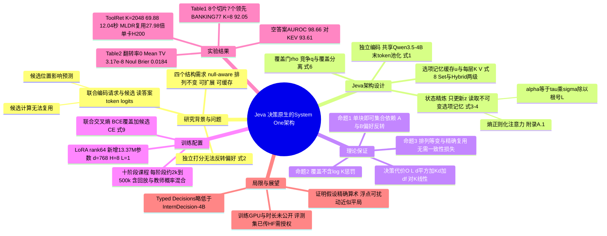

## 一、论文是干什么的？

先解释背景概念 **System One 模型**（系统一模型）。这个说法借用了心理学里「系统一（快思考）与系统二（慢思考）」的区分：很多大模型请求其实不需要写长篇推理，只需要一个**紧凑的决策**，比如「这张客服工单该交给哪个团队」「这句话是不是真的」「按评分标准打几分」。System One 模型不生成文字理由，而是直接返回带概率的结构化答案。论文引用的 TypeSafe AI 的 Jev 就是这类模型，这类系统一模型常采用三种类型化问题：Choice（从候选中选一个）、Noul（判断一句话为真的概率）、Score（按评分标准给出期望分数）。

论文指出，目前很多开源 System One 模型的做法是：把请求和所有候选项拼成一段文字，一起塞进语言模型，再从答案 token 的 logits 或一个专门的预测头读出决策。打个比方，这就像每来一位顾客问「我该找哪个窗口」，前台都要把所有窗口的说明书从头念一遍，而且念的顺序还会影响判断。作者认为这种设计忽略了决策问题本身的四个结构性要求：

- **Null-aware**（空答案感知）：要能区分「没有一个候选合适」和「几个候选之间拿不准」。
- **Permutation-invariant**（排列不变）：候选换个顺序，决定不应该变。
- **Option-scalable**（候选可扩展）：候选数量变多，不应该要求重新定义输出空间。
- **Cacheable**（可缓存）：与请求无关、反复出现的候选（工具库、文档库、标签表）的计算应该能跨请求复用。

Jeva 就是为同时满足这四点而设计的「决策原生」架构。作者训练的 Jeva-4B 以 Qwen3.5-4B 为骨干，加了两个投影层和一个决策块，并用 LoRA 微调骨干。

## 二、核心方法与创新

### 1. 独立编码，集体决策

一个请求包含状态 $x$（比如工单内容）、问题 $\iota$、决策类型 $t$ 和候选集合 $\mathcal{O}=(o_1,\ldots,o_K)$。Jeva 用两个文本模板分别格式化：请求模板 $T_x(t,\iota,x)$ 包含类型、问题和状态；候选模板 $T_o(t,o_i)$ **只包含**类型和候选文本本身，不含当前问题、状态、候选序号或其他候选。两者用同一个语言骨干 $E_\theta$ 编码，取最后一个非填充 token 的隐藏状态，再经无偏置投影（式 1）：

$$
z_0 = P_x E_\theta(T_x(t,\iota,x)),\qquad u_i = \mathrm{nrm}\left(P_o E_\theta(T_o(t,o_i))\right)
$$

类比：每个窗口的说明书只需要被「读一遍」做成一张卡片，存起来；顾客的问题单独做成一张卡片。卡片之间互不干扰，所以候选卡片可以反复使用。

### 2. 为什么要「精炼状态」而不是直接打分？

最简单的做法是独立打分：每个候选和请求算一个相似度再 softmax。论文用式 2 指出它的根本局限：两个候选 $i$、$j$ 的概率比只取决于它们自己的分数差，

$$
\log\frac{q_i(\mathcal{O})}{q_j(\mathcal{O})}=\frac{g(x,\iota,o_i)-g(x,\iota,o_j)}{\tau}
$$

所以增加或删除其他候选，永远**无法反转** A 与 B 之间的偏好。但现实中「有没有别的选项」会影响判断（比如出现了一个更具体的选项后，原来两个选项的相对优劣也可能改变）。

Jeva 的做法是：候选向量固定不动，组成一个「不可变的选项记忆」；只让请求状态 $z$ 通过注意力去「读」这些候选，并更新自己。每个决策块有 $H$ 个头，查询来自状态，键和值来自候选（式 3），状态经过两次残差更新（式 4）：

$$
\widetilde{z}_\ell = z_\ell + \alpha_\ell m_\ell,\qquad z_{\ell+1} = \widetilde{z}_\ell + L^{-1/2}F_\ell(\mathrm{RMSNorm}(\widetilde{z}_\ell))
$$

其中 $F_\ell$ 是无偏置的 SwiGLU 网络，$\alpha_\ell=\tau_\ell\sigma(\gamma_\ell)/\sqrt{L}$。论文还证明这些注意力权重恰好是「熵正则化的证据分配」的唯一最优解（附录 A.1）。类比：顾客拿着自己的问题卡片，扫一眼桌上所有窗口卡片，调整一下自己的想法，然后再去挑窗口；窗口卡片本身从不被改写。

**命题 1**（单块即可产生集合依赖的偏好）：作者构造了一个具体的二维例子，$z_0=(1,0)$、$A=(4,3)/5$、$B=(4,-3)/5$、$C_\pm=(3,\pm4)/5$，取 $\tau=3/20$，在集合 $(A,B,C_+)$ 中唯一选 A，在 $(A,B,C_-)$ 中唯一选 B，而任何独立打分器都做不到。附录 B.1 说明这个构造可以嵌入实际部署的 $d=768$、$H=8$ 结构中。论文也强调这只说明「有这种表达能力」，不保证每次换候选都会反转偏好。

### 3. 竞争与覆盖分开算：显式的「都不对」

最终分数 $s_i=z_L^\top u_i$，候选间的条件概率 $q=\mathrm{softmax}(s/\tau_{\mathrm{dec}})$。但 softmax 只表达「相对偏好」，所有分数同加一个常数，$q$ 不变，所以它无法回答「到底有没有合适的候选」。Jeva 另设一个**覆盖门**（coverage gate）估计「至少有一个可接受候选」的概率（式 6）：

$$
\rho=\sigma\left(\frac{\max_i s_i - b_{\mathrm{cov}}}{\tau_{\mathrm{cov}}}\right),\qquad p_\bot = 1-\rho,\qquad p_i=\rho q_i
$$

类比：先问「这个大厅里有没有能办你业务的窗口」（覆盖），再问「如果有，是哪一个」（竞争）。**命题 2** 进一步指出：在最终分数固定时，加入低于当前最高分的候选不改变 $\rho$；而常见的「把 None 当成一个额外候选放进 softmax」的做法，空答案概率会被强制带上一个 $-\log K$ 项，候选越多越不敢说「都不对」。

同一套计算统一了三种输出：Choice 直接选候选；Noul 读「true」这个候选的概率 $q_{i^+}$；Score 输出期望 $\sum_i q_i v_i$（$v_i$ 是评分档位对应的数值）。

### 4. 对称性、复用与线性扩展

- **选项记忆**（式 8）：$\mathcal{M}_t(o_i)=\left(u_i,\{k^h_{\ell i},v^h_{\ell i}\}_{\ell,h}\right)$，即每个候选的语义向量连同每层的键值投影一起缓存。它不含任何请求信息，所以可以跨请求复用。
- **两级缓存**：Set 缓存存整个有序候选元组；Hybrid 缓存还能在新组合的候选集中复用单个候选。无论哪种，请求编码、状态精炼和输出概率**每次都重新计算**，缓存的只是候选侧计算，从不缓存旧答案。
- **命题 3**：在精确算术下，打乱候选顺序只会相应地打乱候选概率，$z_L$、空答案概率和 Noul/Score 输出完全不变；用缓存条目替换重新计算也不改变任何输出。不需要排列增强或顺序一致性损失。
- **复杂度**：在候选记忆已准备好的情况下，决策部分代价为 $O(L(d^2+Kd+df))$，对候选数 $K$ 线性；$M$ 个候选的库存储 $O(M(L+1)d)$ 个数。不构造 $K\times K$ 交互矩阵，每个候选文本有自己的编码长度预算，不需要把整个候选列表塞进一个上下文窗口。

### 5. 训练目标

开放集合（允许空答案）下的主损失是联合交叉熵（式 9），可以拆成覆盖的二元交叉熵加候选竞争的交叉熵：

$$
\ell=\mathrm{BCEWithLogits}(g,c_y)-\sum_i y_i\log q_i
$$

其中 $g=\mathrm{logit}(\rho)$，$c_y=\sum_i y_i$。好处是：全空的样本只监督「有没有」，不会强加一个虚假的候选排名。附录 B.4 证明期望超额损失恰好分解为覆盖误差加上以 $\rho^\star$ 加权的竞争误差。Score 和 Noul 还有阶段性辅助损失（附录 B.8）。

## 三、使用了哪些模型和计算资源？

**骨干模型与结构**（来源：论文 3.5 节、附录 B.7）：

| 项目 | 数值 |
|---|---|
| 语言骨干 | Qwen3.5-4B（BF16），池化宽度 2560 |
| 决策块 | $L=1$，$H=8$ 个头，每头宽 96，决策宽度 $d=768$，SwiGLU 宽度 $f=3072$ |
| 新增参数 | 两个 2560 到 768 的投影加决策核心，共 13,370,117 个参数（约 13.37M） |
| 微调方式 | LoRA，rank 64，scaling 128，dropout 0.05，作用于注意力、门控线性注意力和前馈层 |
| 数值精度 | 查询键归一化、兼容分数、候选 softmax 和覆盖在 FP32 下计算 |
| 温度初始化 | $\tau_{\mathrm{set}}=0.15$，$\tau_{\mathrm{dec}}=\tau_{\mathrm{cov}}=0.10$ |
| 优化器 | 分组 AdamW，全局梯度裁剪阈值 1.0 |

**训练数据**（附录 C.1）：分阶段课程学习，各阶段规模依次约为 80k（基础类型化决策、意图识别、动作选择）、500k（偏好比较、语义判断、通用推理）、250k（反事实与验证，含回放）、60k（证据支撑与开放集合）、20k（阅读与逻辑推理）、60k（难例混合与回放，其中约 15k 按 7:3 混合原始标签与教师概率；教师指引只有在两种打乱的候选顺序下，教师的最高预测都与原始标签一致时才被采用）、10k（定向能力精炼）、80k（长文本与大候选池）、2k（能力保持）、70k（以打分为主的最终阶段；其中 2k 的能力保持阶段在最终阶段之前出现，也可能在最终阶段中再次出现）。另外论文还提到约 30k 的回放样本，按一半原始标签、一半前一阶段模型的概率混合（相当于自蒸馏）。论文说明这些是各阶段训练集规模并包含回放；按综述者自行相加约为 113 万条，但因为含回放，不等于独立样本数。论文没有说明教师模型具体是哪个模型，暂无相关信息。

**评测中的基线模型**（Table 1、2）：Jev-1.13.0（TypeSafe 的商用模型）、JevK5、InternDecision-4B/2B/0.8B、Re·Flex-4B、SemiF-4B、KEV-4B（BF16 与 FP32）、CLM-8B、Valen-Preview-2B、Laya-English，以及 Qwen3.5-4B 与 Qwen3.5-2B 的标签 logit 探测（label LP）基线。

**计算资源与耗时：**

- 推理延迟测量：在**一张 NVIDIA H200** 上用设备同步计时，不含模型加载时间（论文第 4 节、附录 C.4）。
- 典型推理耗时（论文 4.3、4.4 节）：2,048 个候选时，按长度批处理后中位延迟约 12.040 秒（分块编码时为 94.459 秒）；1,024 个候选时为 7.519 秒（原 31.730 秒）。Typed Decisions 共享候选库时中位延迟从 93.1 毫秒降至约 46.6 毫秒；MLDR 长文档候选完全复用时从 2,102.0 毫秒降至 75.1 毫秒。
- 训练所用 GPU 型号与数量、单次训练总时长、每个 epoch 耗时、GPU 小时数：论文正文与 GitHub README 均未给出，暂无相关信息。
- API 调用与费用：Jeva 本身是本地模型，论文没有报告 API 成本；评测商用基线 Jev-1.13.0 时的调用费用也未给出，暂无相关信息。
- GitHub 仓库给出的运行环境：Linux x86_64、NVIDIA GPU、PyTorch 2.9.1 与 CUDA 12.8；README 的微调示例命令为 3 个 epoch、batch size 1、梯度累积 8，但这只是使用示例，不是论文训练配置。

## 四、实验结果

**评测设置**：Typed Decisions（2,000 个测试决策，其中 600 Choice、600 Noul、800 Score）、BANKING77 与 MASSIVE（各取 8 或 16 个候选，含有答案与无答案请求）、Mind2Web 三个切片（从 16 个候选中选择）。准确率采用 first-argmax，开放集合下包括空答案。不支持空答案的基线用两种适配：JevK5 和 CLM 加一个显式 None 候选；Jev、InternDecision、KEV 等额外回答一个「是否至少有一个候选适用」的 Noul 问题。

### 1. 通用类型化决策准确率（Table 1，部分）

| 模型 | Typed | BANKING77 K=8 | BANKING77 K=16 | MASSIVE K=8 | MASSIVE K=16 | Mind2Web 跨任务 | 跨网站 | 跨领域 |
|---|---|---|---|---|---|---|---|---|
| Jev-1.13.0 | 74.10 | 86.14 | 82.50 | 84.63 | 81.61 | 66.26 | 59.97 | 62.47 |
| InternDecision-4B | 78.70 | 80.78 | 75.03 | 81.20 | 75.79 | 48.02 | 41.17 | 43.61 |
| KEV-4B (BF16) | 66.00 | 83.47 | 82.47 | 76.60 | 73.54 | 40.32 | 34.17 | 35.62 |
| JevK5 | 62.30 | 78.18 | 69.03 | 80.16 | 69.70 | 51.47 | 43.30 | 45.60 |
| Qwen3.5-4B label LP | 50.85 | 49.84 | 43.12 | 47.31 | 41.63 | 18.14 | 15.30 | 18.34 |
| **Jeva-4B** | 78.30 | 92.05 | 91.62 | 91.09 | 90.22 | 79.99 | 62.25 | 66.23 |

大白话：Jeva 在 8 个切片中 7 个领先；唯一没赢的是 Typed Decisions，78.30% 略低于 InternDecision-4B 的 78.70%。在 BANKING77 和 MASSIVE 上都超过 90%。

### 2. 打分保真度与顺序稳定性（Table 2，部分）

| 模型 | Noul Brier（越低越好） | Score MAE | Score RMSE | 翻转率 Flip | 全顺序准确率 | Mean TV |
|---|---|---|---|---|---|---|
| Jev-1.13.0 | 0.0342 | 0.3744 | 0.4795 | 17.00% | 66.67% | 0.0858 |
| InternDecision-4B | 0.0340 | 0.2488 | 0.3208 | 22.67% | 64.50% | 0.106 |
| JevK5 | 0.0987 | 0.4370 | 0.5935 | 26.17% | 47.83% | 0.116 |
| **Jeva-4B** | 0.0184 | 0.2315 | 0.3222 | 0.00% | 76.67% | $3.17\times10^{-8}$ |

在 600 个 Choice 样本上，每个样本测试原顺序、倒序和最多三种随机顺序。Jeva 一次决策都没有翻转，原顺序准确率和全顺序准确率同为 76.67%。其他模型换个顺序就有 17% 到 84.5% 的样本改变决定（Qwen3.5-4B label LP 翻转率 84.50%）。Score RMSE 上 Jeva（0.3222）与 InternDecision-4B（0.3208）基本持平。

### 3. 空答案检测

在 3,080 个 BANKING77 K=16 请求（2,492 个有答案、588 个无答案）上，Jeva 的空答案检测 AUROC 为 98.66%，KEV-BF16 为 93.61%，InternDecision-4B 为 84.27%，JevK5 为 79.44%。在误报率 5.02% 时，Jeva 能检出 93.88% 的无答案情况。

### 4. 大候选集（ToolRet 诊断集）

500 个请求分成 6 组，候选数 $K$ 分别为 32、128、256、512、1024、2048。Jeva 覆盖全部请求，总体准确率 78.40%（K=32 时 86.90%，K=2048 时 69.88%）；JevK5 依靠递归选择也能覆盖全部，总体 64.00%。两个 InternDecision 变体在 K=32 时只支持 65/84 个请求，更大的组超出接口上限。K=2048 时 JevK5 为 67.47%，延迟约 28 秒，Jeva 为 12.04 秒。在 83 个固定查询、候选从 32 嵌套扩展到 2,048 的测试中，Jeva 在每个规模都答对的查询有 58 个，JevK5 为 48 个，CLM 为 7 个。

### 5. 跨请求复用（缓存）

| 场景 | Cache-Off 中位延迟 | 复用后 | 加速 |
|---|---|---|---|
| MLDR 新组合候选集，约 50% 候选复用（Hybrid） | 未单独报告 | 未给出具体毫秒数（论文 §4.4 只写 Set 模式保持在约 2.1 秒） | 1.95 倍 |
| MLDR 新组合候选集，100% 候选复用（Hybrid） | 2,102.0 ms | 75.1 ms | 27.98 倍（成对中位加速 27.86 倍） |
| Typed Decisions 共享候选库 | 93.1 ms | 46.6 ms（Set）/ 46.7 ms（Hybrid） | 约 2 倍（按中位延迟自行计算），免去 99.2% 候选编码 |
| MLDR 共享库（预热后） | 2,097.3 ms | 73.9 / 74.2 ms | 约 28 倍（按中位延迟自行计算） |

新组合的候选集永远命中不了 Set 缓存，所以 Set 模式在 MLDR 上一直停在约 2.1 秒，只有 Hybrid 能享受加速。所有条件下决策都没有变化，概率最大绝对差为 0.00736。需要注意：MLDR 的预热（priming）时间单独计时并被排除在报告延迟之外。

## 五、潜在应用与已落地应用

**论文与仓库提到的应用场景：**

- 工具选择：请求从共享的工具注册表中挑工具，工具说明可以缓存。
- 文档检索与选择：不同查询复用同一批长文档的编码。
- 基于评分标准的评估：不同回答对照同一个评分标准打分。
- 客服工单路由、意图识别、事实判断等需要快速、低延迟决策的场景。

**作者开源的内容：**

- [GitHub 仓库 LiQiiiii/Jeva](https://github.com/LiQiiiii/Jeva)：Apache-2.0 协议，提供 `Jeva.from_pretrained`、`system_one`（同时问 Choice、Noul、Score）、`rank`、Hybrid 缓存示例、`jeva-evaluate` 评测命令和 `jeva-finetune` 微调命令（`head` 模式冻结编码器只训练决策模块，`lora` 模式同时更新适配器）。查询时有 79 个 star、3 个 fork。
- [Hugging Face 模型 LIQIIIII/Jeva-4B](https://huggingface.co/LIQIIIII/Jeva-4B)：包含骨干权重、LoRA 适配器与决策头 `head.pt`。查询时 Hugging Face API 显示该模型未设访问门槛（gated 为 false），有 24 个点赞、47 次下载。
- [项目主页](https://liqiiiii.github.io/Jeva/)：中英双语，有交互式动画演示编码、精炼、读出流程和不同缓存场景。
- 评测数据集：Hugging Face 员工在 GitHub 开了一个 issue 请作者把评测数据集上传到 Hugging Face，该 issue 查询时仍开放且无回复；但作者已在 2026-10-15 把评测集上传为 [LIQIIIII/Jeva-Eval](https://huggingface.co/datasets/LIQIIIII/Jeva-Eval)（含 Banking77、MASSIVE、Mind2Web、MLDR、ToolRet 等切片和协议文件），该仓库设为需同意条件的授权访问（自动审批），本综述未登录，没有下载内容。

**落地情况：** 论文和仓库都没有给出任何生产部署案例。模型卡写明 Jeva 面向研究与决策支持，重大决策应保留人工监督。

## 六、网络上的讨论与评价

- **Hugging Face 论文页**：查询时 285 票。评论区有作者 Qi Li 的介绍帖（带有若干表情反应），Librarian Bot 推荐了相关论文（如 Permutation-Robust Decision Modeling、FastJEV、JevOut 等），ResearchStudio Bot 自动生成了海报和视频。唯一一条非作者、非机器人的评论认为它处理了「没有正确选项」「选项重排后决策一致」「候选集扩大」这些实际问题，并希望看到真实应用中的表现；但这条评论中夹带了一个与论文无关的外部链接，参考价值有限。
- **媒体报道**：德文 AI 资讯站 [Mind-Verse](https://www.mind-verse.de/news/jeva-architektur-system-one-entscheidungsmodelle-e7b5d3c7bf3f)（标注为 AI 辅助撰写）做了总结，并指出几点保留：所有数字来自作者手稿，暂无独立第三方基准；命题 1 只是可行性证明；27.98 倍加速排除了预热时间，实际收益取决于候选库有多稳定；2,048 候选的 ToolRet 结果是诊断实验。该文称模型权重需要授权访问，但本综述查询 Hugging Face API 时显示模型未设门槛，两者不一致，以查询结果为准。另有 [AI Weekly](https://aiweekly.co/alerts/jeva-posts-2786x-reuse-speedup-9205-on-banking77-k8) 和日文站 [st-hakky](https://book.st-hakky.com/news/jeva-first-principles-system-one-model) 的简讯，内容大多复述论文数字；其中 AI Weekly 也加了自己的保留意见：论文没有与基于大模型的分类器做同等延迟对比，完全复用只是上限情形而不是典型情形（部分复用只有 1.95 倍）；st-hakky 的摘要自称由 AI 生成。
- **Hacker News**：用 Algolia 接口按 Jeva 和 arXiv 编号检索，没有找到关于这篇论文的帖子（检索到的 jeva.cpp、jevals 等是与本文无关的项目）。
- **Reddit、X/Twitter、知乎、机器之心、量子位**：网页搜索未发现相关讨论；Reddit 搜索接口对脚本请求返回拦截页。暂无发现公开讨论。
- **背景提醒**：网上大量搜索结果关于 TypeSafe AI 的商用模型 Jev（2026 年 9 月推出），它与本论文的 Jeva 是不同的工作。Jeva 同样采用 Choice、Noul、Score 这类类型化接口（论文并未明说这套接口由 Jev 定义，此处不作归属），并在论文中把 Jev-1.13.0 作为基线。
- **综述者的观察**（非论文结论）：
  - 结构性保证（零翻转、缓存一致）来自架构本身的数学性质，这一点比单纯的经验结果更可靠；但缓存实验中决策虽然完全一致，概率值并非逐位相同（最大差异约 0.00736）；但论文附录 B.5 也说明，这些证明假设精确算术，浮点归约和批处理变化可能扰动几乎打平的分数。
  - 基线大多通过适配器（额外的 Noul 问题或 None 候选）来支持空答案，这不是它们原生的接口，空答案检测的对比可能对基线不太有利。
  - Typed Decisions 上 Jeva 并不是第一，论文对此也如实报告。
  - 论文没有公开训练硬件和训练时长，复现成本难以估计。

## 七、思维导图

