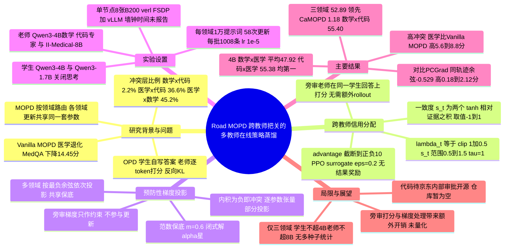

## 一、论文是干什么的？

先从最基础的概念讲起。

**知识蒸馏**（knowledge distillation）就是让一个小模型（学生）去模仿一个大模型或专家模型（老师）。传统做法是让老师先写好标准答案，学生照着抄。问题是：考试时学生得自己从头写，一旦前面写偏了一步，后面就是老师从没示范过的局面，学生不知道怎么办。

**在线策略蒸馏**（On-Policy Distillation，简称 OPD）换了个思路：让学生自己先写一份答案，然后老师逐字（逐 token）批改，告诉学生「这个词我也会这么写」或者「这个词我绝不会这么写」。好比练书法时，不是让你描红，而是你自己写一张，老师在每个字上画圈打叉。这样学生学到的正是自己真实会走到的那些局面，而且每个 token 都有反馈，比强化学习里「整篇答对才给一分」的稀疏奖励密集得多。

**多教师在线策略蒸馏**（Multi-teacher OPD，简称 MOPD）更进一步：数学题找数学老师批改，代码题找代码老师批改，医学题找医学老师批改，最后把这些本事都装进同一个学生脑袋里。这种做法叫「按领域路由」（domain routing），已经被一些大模型的后训练流程采用。

这篇论文发现了一个问题：**分开批改，不代表能和平共处**。三位老师各自批改的作业虽然不同，但最后修改的都是同一个学生的同一套参数。作者在 Qwen3-4B 上实测：数学加代码一起训练时，只有平均 2.2% 的网络层出现梯度方向相反（冲突）；但医学加代码、医学加数学一起训练时，冲突层比例平均高达 36.6% 和 45.2%，而且医学成绩明显掉了下来，比如医学加数学联合训练后，MedQA 比单独训练医学低了 14.45 个百分点（论文 PDF 图 1）。打个比方：数学老师要求「多验算、多犹豫」，医学老师要求「干脆利落给出诊断」，两位老师各自都没错，但学生同时听两个人的，就会左右为难，最后吃亏的往往是较弱的那一方。

Road MOPD（全称 **Cross-Teacher Guarding for MOPD**，论文没有解释这个缩写的来源，只写作 Cross-Teacher Guarding for MOPD）的做法是：批改某个领域的作业时，不只让对口老师看，还请其他领域的老师当「旁审」，在同一份学生答案上也打分。旁审老师的意见不直接用来教学生做这道题，而是用来提醒「这处修改会不会伤到我那个领域的能力」。

## 二、核心方法与创新

Road MOPD 有两个层面的「把关」：token 层面的「信用分配」和梯度层面的「预防性投影」。

### 1. 预备知识：把 OPD 写成「相对奖励」

论文先沿用 ExOPD（Yang et al., 2026b）的推导，把标准 OPD 的反向 KL 目标改写成一个「相对奖励最大化加 KL 惩罚」的形式。设学生为 $\pi_\theta$，老师为 $\pi_T$，再引入一个冻结的参考模型 $\pi_{\mathrm{ref}}$（就是训练前的学生本身），目标是：

$$
\mathcal{J}_{\lambda}(\theta)=\mathbb{E}_{\theta}\left[\lambda\log\frac{\pi_{T}(y\mid x)}{\pi_{\mathrm{ref}}(y\mid x)}-D_{\mathrm{KL}}\left(\pi_{\theta}(\cdot\mid x)\,\|\,\pi_{\mathrm{ref}}(\cdot\mid x)\right)\right]
$$

直白地说：老师比「原来的学生」更喜欢某个 token 多少，这个差值就是老师给的「相对奖励」。当 $\lambda=1$ 时就是标准 OPD；$\lambda>1$ 会放大老师的纠正（这就是 ExOPD），$\lambda<1$ 则减弱。

在多教师设定里，对目标领域 $d$，对口老师记作 $T_{\mathrm{r}}$（routed），其他领域的旁审老师记作 $T_{\mathrm{a}}$（auxiliary）。两位老师和参考模型都对同一条学生回答逐 token 打分（teacher forcing，不需要额外生成），得到对数概率 $\ell_t^{\mathrm{r}}$、$\ell_t^{\mathrm{a}}$、$\ell_t^{\mathrm{ref}}$。

### 2. 跨教师引导的信用分配（Cross-Teacher-Guided Credit Assignment）

原来的 $\lambda$ 是一个全局常数，对每个 token 一视同仁。但一份回答里，有的 token 是各领域通用的好习惯，有的是只对本领域有用、甚至伤害其他领域的「偏方」。Road MOPD 给每个 token 计算一个**老师一致度**：

$$
s_{t}=\tanh\left(\frac{\ell_{t}^{\mathrm{r}}-\ell_{t}^{\mathrm{ref}}}{\tau}\right)\times\tanh\left(\frac{\ell_{t}^{\mathrm{a}}-\ell_{t}^{\mathrm{ref}}}{\tau}\right),\qquad s_{t}\in[-1,1]
$$

- 两位老师都比参考模型更喜欢这个 token（或都更不喜欢），$s_t>0$，说明「英雄所见略同」；
- 一个喜欢一个讨厌，$s_t<0$，说明存在分歧；
- 任何一位老师对这个 token 没什么态度，$s_t$ 接近 0。

然后把全局 $\lambda$ 换成逐 token 的系数：

$$
\lambda_{t}=\mathrm{clip}\left(1+\rho_{\mathrm{g}}s_{t},\lambda_{\min},\lambda_{\max}\right)
$$

论文实际取 $\tau=1$、$\rho_{\mathrm{g}}=0.5$、$[\lambda_{\min},\lambda_{\max}]=[0.5,1.5]$。也就是说，两位老师都认可的纠正最多放大到 1.5 倍，两位老师意见相反的纠正最多减弱到 0.5 倍。类比一下：班主任批改作文时，如果语文老师和历史老师都说这句写得好，就多表扬；如果历史老师说这句事实有问题，语文老师的表扬就打个折扣。

有了 $\lambda_t$，每个 token 的优势值（advantage）是 $\lambda_t(\ell_t^{\mathrm{r}}-\ell_t^{\mathrm{ref}})-(\ell_t^{\theta}-\ell_t^{\mathrm{ref}})$，再截断到 $[-10,10]$ 并停止梯度，放进 PPO 风格的截断代理损失（裁剪参数 $\epsilon_{\mathrm{PPO}}=0.2$）里训练。注意：这里没有任何「答对与否」的结果奖励，纯靠老师打分。超过两个领域时，把所有旁审老师的一致度取平均即可。

### 3. 预防性多教师梯度投影（Preventive Multi-Teacher Gradient Projection）

token 层面意见一致，不代表参数更新方向一定不冲突，因为所有 token 的信号最终都要汇总到同一套参数上。所以第二道防线在梯度层面。

做法是：在同一批领域 $d$ 的学生回答上，算两个梯度。

- **目标梯度** $g_d$：用对口老师加上一致度加权的损失算出来，这是真正要用来更新的；
- **旁审梯度** $g_d'$：把对口老师换成旁审老师、关掉一致度加权，算出的普通 OPD 梯度。它表示「旁审老师希望学生在这份回答上往哪个方向改」，只用来当约束，永远不直接拿来更新参数。

对每个参数张量分别检查：如果两个梯度的内积 $\langle g,g'\rangle<0$，说明按目标梯度走一步，会让旁审老师那边的损失上升，即存在冲突。经典的 PCGrad 方法会把冲突分量整个减掉（投影到与 $g'$ 正交的平面上）：

$$
g_{\mathrm{full}}=g-\frac{\langle g,g'\rangle}{\|g'\|_{2}^{2}}g'
$$

但如果两个梯度几乎正好相反，整个减掉之后目标梯度就所剩无几，本领域也学不到东西了。Road MOPD 加了一个**范数保底**：修正后的梯度长度至少要保留原来的 $m$ 倍（论文取 $m=0.6$），在这个约束下尽量多去掉冲突。解出来是一个「部分投影」：

$$
\widetilde{g}=g-\alpha^{\star}\frac{\langle g,g'\rangle}{\|g'\|_{2}^{2}}g',\qquad\alpha^{\star}\in[0,1]
$$

记两梯度的余弦为 $c$，闭式解是：没冲突（$c\ge0$）时 $\alpha^\star=0$；完全投影后长度仍不低于 $m$（即 $\sqrt{1-c^2}\ge m$）时 $\alpha^\star=1$；否则 $\alpha^\star=1-\sqrt{1-(1-m^2)/c^2}$，此时修正后梯度长度正好等于 $m\|g\|_2$。

类比：你要往东走，旁审说往东会踩到他的花坛。PCGrad 的做法是「只准沿着花坛边走」，可是如果花坛正好挡在正东，你几乎就原地不动了；Road MOPD 的做法是「尽量绕开花坛，但至少要保证往前走六成的路」。

论文特别强调这和 PCGrad 的区别：PCGrad 是「事后手术」，比较的是两个领域各自在自己数据上算出的梯度；Road MOPD 是「事前预防」，比较的是**同一条学生回答**上，对口老师与旁审老师给出的梯度。作者认为前者在两个领域整体梯度看起来不冲突时，会漏掉局部的冲突。

多于两个领域时，对每个参数张量依次挑余弦最负的旁审老师投影、重新计算余弦、再挑下一个，直到没有冲突为止，并且所有投影共享同一个相对于原始梯度的范数保底（论文附录式 24），而不是每一步都各保 60%（那样会连乘缩水）。

### 4. 整体训练流程

一个优化步大致是（论文算法 1）：

1. 学生对一批混合领域的提示词各生成一条回答；
2. 所有老师和参考模型在同一批回答上打分，不需要额外生成；
3. 对每个领域：算一致度加权的目标梯度、算各旁审梯度、做带保底的投影；
4. 把各领域投影后的梯度平均，做全局梯度裁剪（阈值 1.0），走一步 AdamW。

工程上，梯度快照用 BF16 存储，内积与范数用 FP64 计算并在数据并行组之间规约，保证同一张量的不同分片使用相同的投影系数。

## 三、使用了哪些模型和计算资源？

**模型**（来源：论文 4.1 节与附录 B.1）

| 角色 | 模型 |
|---|---|
| 学生 | Qwen3-4B、Qwen3-1.7B（关闭思考模式，全参数训练） |
| 数学老师 | Qwen3-4B-Non-Thinking-RL-Math-Step500（来自 ExOPD 论文的专精检查点） |
| 代码老师 | Qwen3-4B-Non-Thinking-RL-Code-Step300（同上） |
| 医学老师 | II-Medical-8B（基于 Qwen3-8B 的强化学习检查点，Intelligent Internet 发布） |
| 参考模型 | 学生初始化的冻结副本（4B 实验用 Qwen3-4B，1.7B 实验用 Qwen3-1.7B） |

所有模型共用 Qwen3 的分词器和词表，因此老师可以直接对学生生成的相同 token ID 打分。老师和参考模型全程冻结，只负责打分。

**训练数据**（附录 B.2）：每个领域 10,000 条提示词，两领域设定共 20,000 条。数学来自 DeepMath（难度不低于 6 级，候选池 57K），代码来自 Eurus-RL-Code，医学由 MedMCQA 训练集 4,000 条、MedReason 3,000 条、Medical-R1-Distill-Data 2,000 条、m23k 1,000 条组成。不使用标准答案做奖励。

**计算资源**（附录 B.3）：

- 硬件：两领域和三领域实验都在**一个节点、8 张 NVIDIA B200 GPU** 上完成。
- 分工：6 张 GPU 放 FSDP 训练的学生和 3 个张量并行度为 2 的生成副本；另外 2 张 GPU 负责老师打分。两领域时，一个 4B 老师和参考模型共享一张卡；三领域时，数学老师、代码老师和参考模型共享一张卡，医学老师独占另一张。
- 软件框架：verl（FSDP 学生）加 vLLM（生成与老师打分），开启梯度检查点、去除填充和动态批处理。
- 未使用任何商业 API，论文也没有提到 API 费用（暂无相关信息）。

**训练规模与耗时**：

| 项目 | 数值（来源） |
|---|---|
| 每个生成批 | 1,008 条提示词，每条 1 个回答，1 个 PPO epoch，即每批对应 1 次优化更新（表 6） |
| 两领域一次完整训练 | 58 次优化更新（表 6、附录 C.4） |
| 三领域一次完整训练 | 116 次优化更新（每批每领域 336 条，表 6 与附录 B.3） |
| 最大回答长度 | 训练与评测均为 16,384 token |
| 学习率 | $10^{-5}$，常数，无预热；AdamW，betas (0.9, 0.999)，权重衰减 0.01 |
| Qwen3-4B 单领域 OPD 参照 | 每个领域 10,000 条提示词训练 3 个 epoch（表 8） |
| Qwen3-1.7B 单领域 OPD 参照 | 从原始模型训练 50 步（附录 B.3） |
| 每次完整训练的墙钟时间、GPU 小时 | 暂无相关信息（论文全文未给出） |
| 相对 Vanilla MOPD 的额外开销比例 | 暂无相关信息（论文附录 D 只定性说明旁审打分和梯度处理带来额外开销，复用学生回答免去了额外生成） |

按上表推算（综述者自行计算，非论文原文）：两领域训练共处理约 58 乘 1,008，即 58,464 条回答，相当于把 20,000 条提示词过了约 2.9 遍。

**评测设置**（附录 B.5）：离线用 vLLM 生成，温度 1.0、top-p 1.0。数学每题采样 32 次报告 Avg@32，代码每题 4 次报告 Avg@4，医学每题 1 次报告 Avg@1。评测本身的耗时同样暂无相关信息。

## 四、实验结果

**评测基准**：共 11 个。数学 4 个（AIME 2024、AIME 2025、HMMT 2025 二月、HMMT 2025 十一月），代码 3 个（HumanEval+、MBPP+、LiveCodeBench v6），医学 4 个（MedQA、MedXpertQA、MedMCQA、SuperGPQA-Med）。

**基线**：Vanilla MOPD（纯按领域路由）、ExOPD（外推系数 1.25）、Open-MOPD（token 份额平衡加奖励刷新）、CaMOPD（区分能力恢复与领域保持的更新）。另外列出 Single OPD（只训单个领域）作为参照。

### 1. 高冲突设定：医学加数学、医学加代码（领域平均分，%）

| 学生 | 设定 | 方法 | 数学或代码 | 医学 | 两领域平均 |
|---|---|---|---|---|---|
| Qwen3-4B | 数学 x 医学 | 原始学生 | 15.37 | 41.01 | 28.19 |
| | | Single OPD | 44.27 | 47.90 | 46.09 |
| | | Vanilla MOPD | 45.97 | 39.45 | 42.71 |
| | | ExOPD | 47.19 | 43.87 | 45.53 |
| | | CaMOPD | 46.64 | 47.75 | 47.20 |
| | | **Road MOPD** | **47.60** | **48.23** | **47.92** |
| Qwen3-4B | 代码 x 医学 | Vanilla MOPD | 60.53 | 40.75 | 50.64 |
| | | Open-MOPD | 60.83 | 47.34 | 54.09 |
| | | **Road MOPD** | **63.02** | **47.75** | **55.38** |
| Qwen3-1.7B | 数学 x 医学 | Vanilla MOPD | 28.36 | 31.18 | 29.77 |
| | | ExOPD | 28.44 | 33.01 | 30.72 |
| | | **Road MOPD** | 27.21 | **36.89** | **32.05** |
| Qwen3-1.7B | 代码 x 医学 | Vanilla MOPD | 51.07 | 30.93 | 41.00 |
| | | ExOPD | 54.16 | 29.77 | 41.97 |
| | | **Road MOPD** | 53.22 | **36.51** | **44.86** |

用大白话说：

- **Vanilla MOPD 真的会把医学「练坏」**：Qwen3-4B 联合训练后医学平均分从原始的 41.01 掉到 39.45（数学 x 医学）和 40.75（代码 x 医学），比没训练还差。
- **Road MOPD 把医学救了回来**：4B 学生医学达到 48.23 和 47.75，与只训医学的 47.90 持平或接近（一高一略低）；相对 Vanilla MOPD，四个设定的医学平均分提升 5.58 到 8.78 个百分点（论文摘要表述为 5.6 到 8.8）。
- **两领域平均分四个设定全部第一**，领先最强基线 0.72 到 2.89 个百分点。
- **也有代价**：在 1.7B 学生上，Road MOPD 的数学和代码平均分分别比 ExOPD 低 1.23 和 0.94 分；1.7B 数学 x 医学设定下数学平均 27.21 还略低于 Vanilla MOPD 的 28.36。它是靠医学大幅提升换来更高的总平均分。

### 2. 低冲突与三领域设定（Qwen3-4B）

| 设定 | 方法 | 数学 | 代码 | 医学 | 平均 |
|---|---|---|---|---|---|
| 数学 x 代码 | Vanilla MOPD | 46.12 | 61.24 | 无 | 53.68 |
| | ExOPD | 48.28 | 61.82 | 无 | 55.05 |
| | **Road MOPD** | 47.73 | **63.07** | 无 | **55.40** |
| 数学 x 代码 x 医学 | Vanilla MOPD | 46.98 | 61.26 | 41.03 | 49.76 |
| | CaMOPD | 45.96 | 60.97 | 48.20 | 51.71 |
| | **Road MOPD** | **47.29** | **62.94** | **48.45** | **52.89** |

在本来就比较「合得来」的数学加代码上，Road MOPD 平均分只比 ExOPD 高 0.35，说明它在该设定下（单次运行）没有看到明显的负面影响，但收益也小。三领域联合训练时，它在三个领域都是多领域方法中最好的，总平均领先 CaMOPD 1.18 分。

### 3. 消融实验（Qwen3-4B，领域平均分）

| 配置 | 数学 x 医学（数学 / 医学 / 平均） | 代码 x 医学（代码 / 医学 / 平均） |
|---|---|---|
| 去掉信用分配 | 45.78 / 47.74 / 46.76 | 59.54 / 47.46 / 53.50 |
| 去掉梯度保护 | 47.19 / 48.11 / 47.65 | 63.01 / 46.87 / 54.94 |
| 去掉自适应保底（改为完全投影） | 45.78 / 48.40 / 47.09 | 62.85 / 47.03 / 54.94 |
| 完整 Road MOPD | 47.60 / 48.23 / 47.92 | 63.02 / 47.75 / 55.38 |

去掉 token 级信用分配，数学和代码分别掉 1.82 和 3.48 分；去掉梯度保护，代码 x 医学的医学掉 0.88 分；把保底改成完全投影，两领域平均分别降 0.83 和 0.44。三个组件都有贡献，但单个组件的差距多在 1 分上下。

### 4. 机制验证

- **老师分歧与梯度冲突呈正相关**：在固定检查点上，把批次按老师分歧程度分成五组，分歧越大，对口老师与旁审老师梯度余弦为负的比例越高，数学从 24% 升到 40%，医学从 46% 升到 76%。这是固定检查点上的探索性分析，论文自己也称其为探索性，不能据此推断因果或预测能力。
- **token 级可视化**：例如数学回答里的 Alternatively、医学回答里的 The 这类 token 因两位老师意见相反被减弱；perhaps、Maybe 这类 token 因意见一致被放大。
- **对比 PCGrad**：在训练第 39 到 58 步，同一回答上对口与旁审梯度的平均层余弦为负（数学 x 医学 -0.529，代码 x 医学 -0.391），而 PCGrad 比较的两个领域独立梯度平均余弦为正（+0.076 和 +0.033）。也就是说「两个领域整体看没冲突，但在同一份回答上看有冲突」。Road MOPD 的四个领域平均分都比 PCGrad 高 0.18 到 2.12 分。需要注意：论文 4.3 节说这组对比中两者都保留跨老师功劳分配和同一套范数保留机制；附录 B.4 则说明 PCGrad 的实现本身是对称投影加全局梯度裁剪，表 7 中存档的 PCGrad 运行另外启用了奖励一致度调制（表中以匕首号标注）。附录没有说明 PCGrad 是否使用 Road MOPD 的自适应范数保底，两处表述的细节不完全一致。
- **范数保底确实在起作用**：数学 x 医学的数学分支中，58 次更新里有 40 次如果完全投影，梯度长度会低于原来的 60%，最低只剩 0.253；有了保底后最低维持在 0.600。

### 5. 值得留意的地方（综述者观察）

- 论文没有报告多次随机种子的方差或置信区间，许多差距在 1 分以内（如低冲突设定领先 0.35 分），统计显著性无法判断。
- 论文附录 B.3 坦承，各基线的「优化更新次数」并不完全对齐：Open-MOPD 每批拆成 4 个小批，两领域共 232 次更新；CaMOPD 还改变了各领域的提示词分配。生成预算一致，但更新次数不同。
- 只在 Qwen3 家族、4B 与 1.7B 两种学生规模、三个文本推理领域上验证。

## 五、潜在应用与已落地应用

**潜在应用：**

- **通用大模型后训练**：现在不少模型先分别训练数学、代码、智能体等专家，再用多教师蒸馏合成一个模型。Road MOPD 针对的正是「某些领域合不来」这一痛点，比如把医学、法律这类风格与数理推理差异大的领域合并进来时。
- **垂直行业模型**：企业想在一个小模型里同时保留通用推理能力和行业知识（如医疗问答、客服），又不想为每个领域单独部署一个模型时，可以参考这种「旁审」思路减少能力互相拖累。
- **作为诊断工具**：论文中「老师分歧率」与「梯度冲突率」的关联，或许可以作为判断领域组合是否适合放在一起训练的诊断信号来探索；但论文只在数学与医学等有限设定上给出了探索性关联，没有做过按领域对提前选择的验证，这一用法属于综述者的设想。

**已落地情况：**

- 第一作者在 Hugging Face 论文页留言称，这是**京东 OxygenVLM 团队与南京大学**的合作工作，代码「正在走公司内部开源审批，预计 1 到 2 个月内发布」。
- GitHub 上已有一个名为 [jokersio-tsy/RoadMOPD](https://github.com/jokersio-tsy/RoadMOPD) 的仓库，描述为该论文的官方代码，但查询时（2026-10-16）仓库为空，没有任何文件，0 星标。该账号资料显示为 Shi-Yu Tian（南京大学，附 LAMDA 主页），与第一作者一致；仓库创建于 2026-10-15，但 HF 论文页没有关联这个仓库。
- Hugging Face 上没有与本论文关联的模型或数据集；唯一引用本文的 Space 是通用的每日论文票数追踪工具 paper-pulse，并不是本论文的 Demo。
- 论文没有提到任何生产环境部署，也没有说明京东内部产品是否使用了该方法，暂无相关信息。

## 六、网络上的讨论与评价

- **Hugging Face 论文页**：查询时有 240 票，是当周（2026-W42）高票论文之一。评论区只有两条：一条是第一作者 Shi-Yu Tian（kevin715）的介绍帖（内容见上节），另一条是 Librarian Bot 自动推荐相似论文，没有其他读者的实质讨论。
- **Hacker News**：通过 Algolia 检索接口按 arXiv 编号与 Road MOPD 查询，没有相关帖子。
- **Reddit**：接口与 Playwright 无头浏览器访问均被 Reddit 拦截，未能检索，暂无法获取。
- **X/Twitter、知乎、微信公众号（机器之心、量子位等）、博客**：用英文标题、arXiv 编号、Road MOPD 及中文关键词（京东、多教师蒸馏等）做了多轮网页搜索，均未找到人类社区的专门讨论。不过 [Pith](https://pith.science/paper/2610.13521) 有一页 AI 自动评审（由 deepseek-v4-flash 于 2026-10-12 阅读后回答固定问题，总体评价是方法扎实、识别出真实的失败模式，但一致度信号本身的机理不如实验收益清楚，并提出了关于一致度打分、训练时长和超参数敏感性的方法学异议），属于自动评审而非人类社区反馈。除此之外搜索结果中只出现了原始 MOPD 方法及其在小米 MiMo、NVIDIA NeMo RL 文档中的相关介绍，与本文无直接关系。
- **综述者的几点评价**（非外部评论）：
  - 选题抓得准：多领域蒸馏中「医学被数学或代码拖累」的现象，论文用冲突层比例和逐项分数下降给出了清晰证据，这比单纯提出新方法更有价值。
  - 方法设计较为克制：旁审老师只当约束，不直接参与更新；投影带保底，避免把本领域信号削没。闭式解简单，易于在现有 verl 框架中实现。
  - 不足在于训练开销未量化（只说「有额外开销」），没有多种子统计，验证规模局限在学生不超过 4B、老师不超过 8B 的模型与三个领域；代码尚未公开，暂时无法复现。该预印本标注为 Paper Under Review，未见已发表的同行评审版本信息。

## 七、思维导图

