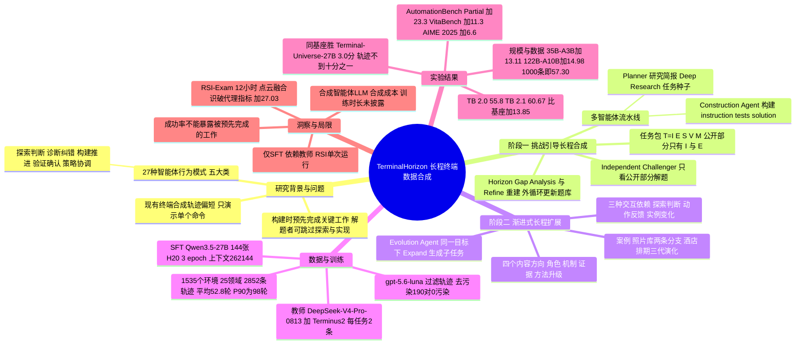

## 一、论文是干什么的？

先说背景。**终端智能体**（terminal agent）就是让大模型像工程师一样，在命令行里敲命令、读输出、改代码、跑测试，最后交付结果。要训练这样的模型，需要大量「示范录像」，也就是模型一步一步操作终端的完整记录，论文叫它**轨迹**（trajectory）。现在已经有不少自动合成终端任务的方法，但作者指出：这些方法生成的轨迹普遍偏短（论文图 4 的比较中，同一教师模型、同一设置下，其他方法的平均交互轮数明显少于本文）。短轨迹能教会模型「某个命令怎么用」，却教不会模型「怎样在几十上百步里持续摸索、根据反馈改方案、最后把中间成果整理成交付物」。

打个比方：短轨迹像是只看厨师「切一刀、翻一下锅」的短视频；而长程轨迹像是看完一整桌宴席从采购、试味、出错补救到装盘上菜的全过程。作者还发现一个更隐蔽的问题：合成任务时，造题的智能体常常「好心办坏事」，把本该留给解题者的关键工作提前做掉了。例如题目要求「实现一个核心函数」，但环境里已经提供了这个函数，解题者只需改一个常数就能通过。这样的任务看起来复杂，实际轨迹却很短很水。**TerminalHorizon** 就是为了解决这两个问题而设计的全自动数据合成引擎：先用一个「不知情的考生」去实际做题，找出被提前做掉的工作并把题目重建；再在同一个目标下一代代加深题目，让后面的工作依赖前面的结果。最终作者构建了 1,535 个任务环境、2,852 条训练轨迹（TerminalHorizon-3K），用它对 Qwen3.5-27B 做监督微调，得到 TerminalHorizon-27B。

## 二、核心方法与创新

### 1. 任务的形式化定义

每个终端任务被打包成五元组（论文式 1）：

$$
T=(I,E,S,V,M),\qquad \mathcal{P}(T)=(I,E)
$$

其中 $I$ 是公开指令，$E$ 是可执行环境（初始状态、工具），$S$ 是参考解，$V$ 是私有验证器，$M$ 是执行配置。解题的智能体只能看到公开部分 $\mathcal{P}(T)$。作者还加了一条「公平评分」约束（式 3）：验证器检查的完成要求，必须能从公开指令和环境中可发现的证据推出来，即 $\mathcal{C}_{\mathrm{sem}}(V)\subseteq\mathrm{Sem}(I,\mathcal{O}_{\mathrm{pub}}(E))$。通俗说：测试数据可以保密，但不能考题目里根本没交代、也查不到的要求。

论文把想要培养的「长程能力」细化为 **27 种智能体行为模式**（agentic behavioral patterns），分成五大类：信息探索与判断、诊断与纠错、构建与推进、验证与确认、策略与执行协调。例如「关系追踪」（顺着调用、数据流、身份或来源关系去理解对象之间的联系）、「假设驱动诊断」、「探索性分支与回溯」等。

### 2. 第一阶段：挑战引导的长程合成（Challenge-Guided Long-Horizon Synthesis）

这一阶段有内外两个循环，涉及多个分工明确的智能体：

- **Planner Agent（规划者）**：根据已接受的任务集 $\mathcal{D}_b$ 和历史记录 $\mathcal{F}_b$，为第 $b$ 批生成 $n_b$ 份「研究简报」（式 2），指出哪些专业工作、哪些行为模式还没覆盖。像一位出题组组长，先看题库缺什么题型。
- **Deep Research Agent（深度调研）**：按简报去查文档、代码仓库、issue、专业资料，弄清真实需求、技术约束和完成标准，产出「任务种子」$z_{b,i}$（指令草稿加证据）。
- **Construction Agent（构建者）**：根据种子联合构建指令、环境、参考解、验证器和配置（即 instruction.md、environment/、solution/、tests/、task.toml），得到候选任务包。
- **Independent Challenger（独立挑战者）**：一个没参与出题的智能体，只看公开部分去解题，得到轨迹 $\tau_r$ 和得分 $\rho_r=V_r(s_{H_r})$；再由合成审查 $\mathcal{A}_{\mathrm{syn}}$ 生成诊断 $d_r$（式 5），记录运行缺陷、信息泄露、评分不一致，以及预期工作是否真的被保留。
- **Horizon Gap Analysis（长程缺口分析）与重建**：对比种子中「预期要做的工作」和轨迹中「实际做了的工作」，把被跳过的部分追溯到初始材料、对象关系或工具行为上，然后修订任务（式 6）：

$$
T_{r+1}=\mathrm{Refine}(T_r;\,z,\tau_r,d_r)
$$

修订后的任务再交给新的独立挑战者重做，形成「挑战—重建」内循环。审查会区分「考生用了高效方法完成了必要工作」和「工作在出题时就被做掉了」，只针对后者修改。通过审查的任务加入题库，相关记录反馈给下一批规划（式 7），形成外循环。

生活类比：这就像出一份考卷后先找一位不知情的同学试做。如果他发现「这道编程题其实附赠了答案函数，只要改个数字就行」，出题组就把附赠的函数删掉，但保留必要的接口说明，再找另一位同学重做，直到这道题真的需要动脑动手。

论文附录 H 给了三个流水线中的实际案例（任务本身是合成环境，并非真实世界数据）：射电干涉定标任务原本附带了做数值拟合的 solve-bandpass、solve-gain 工具，重建后删去拟合程序，让智能体自己实现；RabbitMQ 分区恢复任务经过 5 轮重建、6 次独立挑战，才让「应用层恢复」从可有可无的分支变成必做的工作；家庭保险登记与工资核对任务经过 4 轮重建、5 次挑战，让「审阅证据文件」真正影响决策。论文特别指出：初始版本的挑战者也能通过，说明**光看成功率发现不了被提前做掉的工作**。

### 3. 第二阶段：渐进式长程扩展（Progressive Horizon Expansion）

一道能解的题不是终点，而是起点。**Evolution Agent（演化者）** 在同一目标下给已接受的父任务 $T^{(g)}$ 提出扩展方案 $\delta^{(g)}$，并检查父任务的解法能否直接满足新要求，生成新候选（式 8）：

$$
\widetilde{T}^{(g+1)}=\mathrm{Expand}(T^{(g)};\,\delta^{(g)})
$$

**内容扩展的四个方向**：更广的角色（用已有产物支撑相关职责）、更深的机制（把原本简化的依赖或不确定性变成需要处理的工作）、更丰富的证据（加入更多记录和资料，要求跨来源分析）、方法升级（要求大幅扩展或重新设计原方法）。

**三种交互依赖设计**：探索与判断（后续决策依赖前面查询和观察得到的证据）、动作与反馈（前面操作产生的可观察效果驱动后续诊断与修正）、实例变化与适应（在固定公开规范下，对象或状态每次运行都不同，需要先检查当前实例）。新的评分条件仍须遵守式 3 的公开完成约定。

类比：同一道「整理照片库」的题，父任务是单向导入；第一代变成双向同步，两边都有独立修改，需要处理冲突；第二代加入归档与恢复同后续编辑的冲突；第三代再加入文件分组拆分和主版本切换。每一代都建立在上一代的成果上，而不是另起炉灶。论文附录 I 的酒店活动排期例子也类似：从加入参会者路线时间，到某个会场临时关闭后的整体恢复，再到具体设备的拆装运输时间约束。

### 4. 轨迹采集、过滤与去污染

- **采集**：对 1,535 个任务各采集 2 条轨迹，教师模型为 DeepSeek-V4-Pro-0813，执行框架为 Terminus2。
- **过滤**（附录 F）：用 gpt-5.6-luna（reasoning effort 为 high）作为审阅者，读完整对话，但**不告诉它最终得分或成败标签**。三条标准是轨迹有效性（无严重截断、无泄露私有答案、无绕过接口）、基于环境的进展（行动是否由日志、报错、测试结果驱动）、多轮训练价值（不按轮数加分，空等与机械轮询不算）。没有完成任务、但展示了有价值诊断与纠错的轨迹也可以保留。最终保留 2,852 条。
- **去污染**（附录 G）：把 1,535 个训练任务与 12 组评测共 3,251 个实例比较，使用 13/14-gram 精确匹配、5-gram Jaccard、TF-IDF 余弦、面向数学的 8-gram 检索，再由 gpt-5.6-luna 对 190 个候选对做语义判定，结果 0 个被判为污染或不确定。

## 三、使用了哪些模型和计算资源？

### 1. 用到的模型

| 用途 | 模型 | 出处 |
|---|---|---|
| 被微调的学生模型（主模型） | Qwen3.5-27B，得到 TerminalHorizon-27B | 正文 4.1 节、附录 A.1 |
| 规模扩展实验的学生模型 | Qwen3.5-35B-A3B、Qwen3.5-122B-A10B | 4.3 节、附录 A.1 |
| 轨迹采集的教师模型 | DeepSeek-V4-Pro-0813（执行框架 Terminus2） | 第 3 节 |
| 教师对比实验 | GLM-5.2 与 DeepSeek-V4-Pro-0813 | 4.3 节表 3 |
| 轨迹过滤审阅、去污染语义判定 | gpt-5.6-luna（reasoning effort 为 high） | 附录 F、G.3 |
| VitaBench 与 tau2-bench 的用户模拟器、评判模型 | deepseek-v4-pro-0813（温度 0） | 附录 A.2 |
| Planner、Deep Research、Construction、Independent Challenger、Evolution 等合成智能体背后的 LLM | 暂无相关信息（论文未说明） | 无 |

### 2. 训练配置与硬件（附录 A.1 表 4、正文 4.1 节）

- 框架：LLaMA-Factory，全参数监督微调（SFT），三个规模的模型共用同一套超参数。
- 优化器 AdamW，$\beta_1=0.9$、$\beta_2=0.95$；峰值学习率 $1\times10^{-5}$，余弦调度，warmup 比例 0.05，weight decay 0.1，梯度裁剪 1.0。
- 训练 3 个 epoch，报告最终检查点；最大序列长度 262,144 token；不做 sequence packing；每卡 batch size 为 1；BF16；DeepSpeed ZeRO-3；FlashAttention-2；随机种子 42。
- 硬件：除非另有说明，使用 18 个节点共 144 张 H20-141GB GPU。
- **训练耗时**：每次训练或每个 epoch 的时长、GPU 小时数，暂无相关信息（论文未给出）。

### 3. 评测配置与时间单位（附录 A.2、附录 C）

- 推理服务：vLLM，8 张 H20，张量并行度 8，上下文窗口 262,144 token。Terminal-Bench、AutomationBench 与通用推理评测使用温度 1.0、top-p 0.95、top-k 20、每次回复最多 65,536 个输出 token。
- **Terminal-Bench**：用 Harbor 加 Terminus-2；1.0 版 80 题，使用 Daytona 沙箱（每个 2 CPU、4 GiB 内存、8 GiB 存储）；2.0 与 2.1 各 89 题，使用 E2B 沙箱。**每道题给智能体 3 小时**；每题独立跑 3 次，报告平均 pass@1。剩余上下文低于 131,072 token 时触发主动摘要。
- **AutomationBench** v1.0.6：600 个 rollout，每条轨迹最多 50 步，独立跑 3 次。
- **VitaBench** 英文 Cross-domain：100 题，每题跑 4 次（共 400 次），最多 300 步。
- **tau2-bench**：Airline 50 题、Retail 114 题，每题跑 4 次，最多 200 步。
- **RSI-Exam 案例**：每个模型、每个案例 **12 小时自主研究预算**，E2B 环境 8 GiB 内存，每个模型每个案例只跑 1 次。
- **数据合成的耗时与 API 花费**（例如每个任务环境的生成时间、每条轨迹的采集成本、调用 DeepSeek-V4-Pro 或 gpt-5.6-luna 的费用）：暂无相关信息。

## 四、实验结果

### 1. Terminal-Bench 主结果（论文表 1，节选）

| 模型 | 基座 | 训练轨迹数 | TB 1.0 | TB 2.0 |
|---|---|---|---|---|
| Qwen3.5-27B（基座） | 无 | 无 | 46.3 | 41.6（官方模型卡数值） |
| RST-27B | Qwen3.5-27B | 327.2k | 未报告 | 49.4 |
| Terminal-Universe-27B | Qwen3.5-27B | 32.0k | 未报告 | 52.8 |
| CalibForge-35B-A3B | Qwen3.5-35B-A3B | 5.4k | 未报告 | 47.6 |
| TMax-27B | Qwen3.6-27B | 16.5k | 未报告 | 42.7 |
| **TerminalHorizon-27B** | Qwen3.5-27B | 约 3k | **55.0** | **55.8** |

此外 Terminal-Bench 2.1 上，基座 46.82，TerminalHorizon-27B 达到 60.67（提升 13.85 个百分点）。在同基座、同执行框架的对比中，TerminalHorizon-27B 比 Terminal-Universe-27B 高 3.0 个百分点，而训练轨迹不到后者的十分之一。（RST-27B 即 Recursive Synthesis for Long-Horizon Terminal Tasks 的模型，与本文是不同的工作。）

### 2. 12 个基准全面提升（论文表 2）

| 类别 | 基准 | Qwen3.5-27B | TerminalHorizon-27B | 提升 |
|---|---|---|---|---|
| 编程 | Terminal-Bench 2.1 | 46.82 | 60.67 | +13.85 |
| 智能体 | AutomationBench（Pass Rate） | 5.5 | 17.2 | +11.7 |
| 智能体 | AutomationBench（Partial） | 26.4 | 49.7 | +23.3 |
| 智能体 | tau2-bench Airline | 79.0 | 84.5 | +5.5 |
| 智能体 | tau2-bench Retail | 84.9 | 87.5 | +2.6 |
| 智能体 | VitaBench Cross-domain | 20.5 | 31.8 | +11.3 |
| 通用推理 | MATH-500 | 96.9 | 98.9 | +2.0 |
| 通用推理 | GSM8K | 96.3 | 97.3 | +1.0 |
| 通用推理 | AIME 2024 | 93.3 | 96.7 | +3.4 |
| 通用推理 | AIME 2025 | 86.7 | 93.3 | +6.6 |
| 通用推理 | KOR-Bench（Cipher） | 90.1 | 91.2 | +1.1 |

加上表 1 中的 TB 1.0（+8.7）与 TB 2.0（+14.2），共 12 个基准全部提升。大白话：只在终端任务上训练，客服、企业自动化这类非终端的智能体任务也一起变好了，数学推理也没有被「训坏」。

### 3. 消融与分析

- **教师模型对比**（随机 100 个任务，表 3）：GLM-5.2 平均 46.1 轮、平均反馈链 19.2、完全重复动作 15.8%、通过率 44.0%；DeepSeek-V4-Pro 平均 53.5 轮、反馈链 30.3、重复 13.2%、通过率 50.0%。因此选 DeepSeek-V4-Pro 做教师。
- **跨模型规模**：在 TB 2.1 上，27B、35B-A3B、122B-A10B 分别提升 13.85、13.11、14.98 个百分点。35B-A3B 与 122B-A10B 的绝对分数见论文图 5（TB 2.1 跨模型规模）：27B 从 46.82 到 60.67，35B-A3B 从 39.70 到 52.81，122B-A10B 从 49.06 到 64.04（正文把这张图误引为图 6，数字以图 5 为准）。
- **数据规模**（TB 2.1，图 6）：0 条为 46.82，1,000 条为 57.30，2,000 条为 58.43，全量 2,852 条为 60.67；作者称尚未看到饱和迹象。
- **按任务类别**（TB 2.1 的 16 个类别）：全部持平或超过基座，其中 11 类提升；调试（debugging）、数据科学、机器学习分别提升 46.7、25.0、22.2 个百分点。
- **数据统计**：轨迹平均 52.8 轮，中位数 40，P90 为 98；最长的连续「动作加终端反馈」链中位数 25 轮、平均 31.3；每条轨迹平均包含 8.6 种核心行为模式；任务覆盖 25 个专业领域（项目主页称有 463 个子领域）。

### 4. RSI-Exam 长程研究案例（附录 C 表 5，12 小时预算，每个模型每个案例跑 1 次）

| 案例 | 基座隐藏集得分 | 本文隐藏集得分 | 提升 | 基座研究时长（小时） | 本文研究时长（小时） |
|---|---|---|---|---|---|
| 仓库机器人路径与宏优化 | 14.63 | 39.72 | +25.09 | 11.42 | 12.00 |
| 潮汐海床摩擦场反演 | 27.41 | 48.15 | +20.74 | 1.12 | 12.00 |
| 2048 策略优化 | 37.54 | 45.25 | +7.71 | 1.28 | 12.00 |
| 多视角点云融合 | 21.93 | 48.96 | +27.03 | 0.20 | 12.00 |

最有意思的是点云融合案例：基座模型用自己设计的代理指标打出高分（平均代理 F-score 0.8994），12.1 分钟后就自信地宣布完成；而 TerminalHorizon-27B 早期也遇到类似的高代理分（约 0.989），但它追问「这个指标到底是在奖励重建，还是在奖励照抄参考视角？」，引入留一视角诊断（leave-one-view-out），最终把隐藏集多阈值平均 F-score 从 48.04 提到 77.68。机器人案例里，基座模型中途找到过 286.05 的好解，但后续修改把宏压缩删掉了，最终提交的成本是 466.35；本文模型则一直保留最好的解，最终公开集成本为 281.11。这些案例说明：不只是「跑得久」，而是「会怀疑、会回退、会把好结果留到最后」。

## 五、潜在应用与已落地应用

**潜在应用（论文主张加本文推测）：**

- 为终端编程智能体、运维智能体、科研计算智能体提供高质量的 SFT 数据；作者称这套数据能迁移到企业自动化（AutomationBench）、客服（tau2-bench）、生活服务（VitaBench）等场景。
- 「独立挑战者找出被提前做掉的工作」这一思路，也可能用于审查其他自动合成的智能体环境或评测题目（这是本综述的推测，论文没有做这方面实验）。
- 任务覆盖芯片、物理、天文、教育、农业、医疗、金融等 25 个领域，表明该数据集尝试把多类专业工作统一成终端交互任务（这些是合成任务，不能由此推出终端适合作为通用的专业工作接口）。

**已公开的资源（已核实）：**

- [HF 合集 TerminalHorizon](https://huggingface.co/collections/shunzou05/terminalhorizon)：包括 [TerminalHorizon-Environment](https://huggingface.co/datasets/shunzou05/TerminalHorizon-Environment)（1,535 个 Harbor 格式的任务包，Apache-2.0）、[TerminalHorizon-3K](https://huggingface.co/datasets/shunzou05/TerminalHorizon-3K)（2,852 条轨迹）、[TerminalHorizon-27B](https://huggingface.co/shunzou05/TerminalHorizon-27B)，以及 TerminalHorizon-35B-A3B、TerminalHorizon-122B-A10B 权重。
- [项目主页](https://zs1314.github.io/TerminalHorizon)。
- **合成引擎本身的代码**（Planner、Construction、Challenger、Evolution 等智能体的实现）：在论文、项目主页与 HF 页面中都没有找到 GitHub 代码仓库链接，暂无相关信息。
- 第三方推理平台 [Featherless](https://featherless.ai/models/shunzou05/TerminalHorizon-27B) 上已上架 TerminalHorizon-27B（FP8，32k 上下文），说明模型可以被第三方调用；但这只是托管服务，不代表有生产环境的实际落地案例。

**落地情况：** 论文没有报告任何生产环境部署，也没有说明是否已用于高德或阿里的产品。论文、项目页及本次可检索的公开资料中未发现已披露的生产落地案例。

## 六、网络上的讨论与评价

- **Hugging Face 论文页**：截至查询时有 160 票。评论区只有 2 条：一条来自账号 seashell11（显示名 Wang Yong，与通讯作者之一同名）发布的项目主页链接，另一条是 Librarian Bot 自动推荐的相似论文（如 Terminal-Universe、CompoWorld、AutoCompact 等）。没有其他读者的实质讨论。
- **AI Weekly 新闻稿**：[AI Weekly](https://aiweekly.co/alerts/alibaba-terminalhorizon-27b-hits-558-on-terminal-bench-20) 2026-10-13 发布了一篇报道，标题为 Alibaba TerminalHorizon-27B Hits 55.8% on Terminal-Bench 2.0，复述了 3K 轨迹胜过 32K 轨迹、144 张 H20 等事实。编辑点评认为：如果精心构建的 3K 条轨迹能在同基座同框架下胜过 32K 条，那么各家做数据扩展时应该先问「流水线有没有在 GPU 之前把难的活干好」。注意：该文称论文没有说明是否会发布轨迹和引擎，但实际上轨迹、环境和模型权重已经在 HF 上公开，只有引擎代码未见公开。
- **论文聚合站**：hyper.ai 有多语言的论文摘要页，内容为摘要转述，没有评论。
- **Hacker News**：通过 Algolia 接口用 TerminalHorizon 搜索，结果为 0。
- **Reddit**：搜索接口对脚本请求返回拦截页，无法检索；WebSearch 也不允许访问该域名，暂无法获取。
- **X/Twitter、知乎、微信公众号（机器之心、量子位等）**：用论文标题、TerminalHorizon 及中文关键词搜索，均未找到相关帖子或文章。
- **本综述的几点观察（非外部评价）**：
  - TB 2.0 上的 +14.2 是拿本文自测的 55.8 与基座官方模型卡的 41.6 相比，评测设置不完全一致；而 TB 2.1 的 46.82 与 60.67 是在同一设置下由作者自测，可比性更强。
  - 表 1 里很多对比方法的基座模型不同（涵盖 Qwen2.5-Coder、Qwen3、Qwen3.5、Qwen3.6 系列，规模从 8B 到 235B-A22B 不等），真正同基座同框架的只有 RST-27B 和 Terminal-Universe-27B 两个。
  - 方法完全是 SFT 蒸馏，学生的训练信号和表现可能受教师轨迹质量影响（论文只比较了教师的轨迹特征，并未验证教师对学生能力上限的约束）；论文没有做强化学习。
  - RSI-Exam 每个案例每个模型只跑 1 次，单次结果的方差未知。
  - 论文没有单独的局限性章节，也没有给出合成智能体使用的 LLM、合成成本和训练耗时，这会影响其他团队评估复现门槛。

## 七、思维导图

