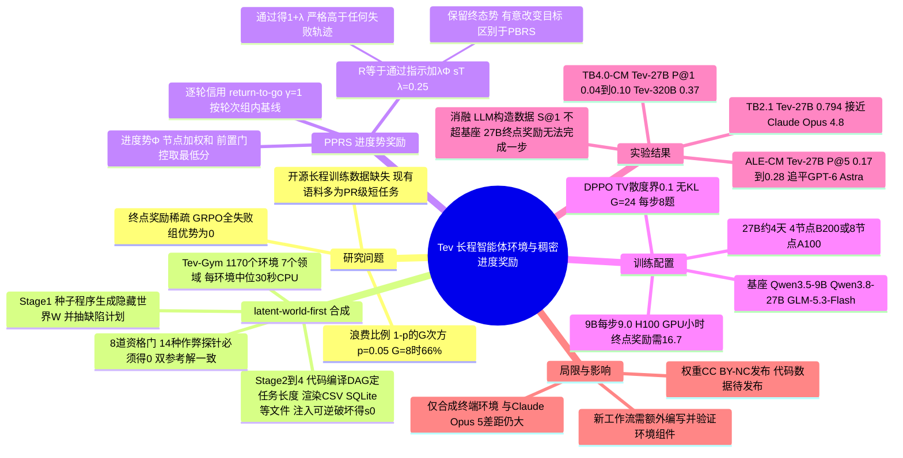

## 一、论文是干什么的？

先说一个背景：**长程智能体**（long-horizon agent）指的是能在终端里连续干几十步、几十分钟甚至更久的 AI，比如清洗一个乱七八糟的零售数据仓库、排查一次 Kubernetes 线上故障、合并一个被打乱的分布式模型检查点。闭源前沿模型（论文里对比的是 GPT-6 Astra、Claude Opus 5、Claude Fable 5 等）在这类任务上已经不错，而训练前的开源基座模型差距明显（论文的结果是，训练后的 Tev-27B 在部分基准上已追近领先的闭源模型，但在最难的长程基准上仍有差距）。作者认为原因有两个：

1. **没有长程训练数据**。现有开源训练集（SWE-Smith、TMAX、Endless Terminals、CLI-Gym、SETA、Terminal-Universe）规模是几千到几万个环境，但每个任务大约只相当于一个 PR 大小的修复或一次短终端会话；真正的长程任务只存在于人工编写的小型评测集里（几十到几百题，每题要专家花数周），只能拿来考试，不能拿来训练。
2. **奖励太稀疏**。长任务通常只在最后交卷时给一个「对或错」。打个比方：让一个新手学徒装修整套房子，只在最后告诉他「验收不合格」，却不告诉他水电做对了、瓷砖贴歪了——他几乎学不到东西。

这篇论文同时解决这两件事：先用一种「**先造隐藏世界**」（latent-world-first）的方法批量生成 1,170 个可验证的长程训练环境，组成 **Tev-Gym**；再利用这个隐藏世界给出每一步的「完成进度」，把它变成稠密奖励（称为 **PPRS**，progress-potential reward shaping），用强化学习训练出 Tev-9B、Tev-27B 和 Tev-320B。作者来自 Adobe Research 与 UCLA（论文作者栏与项目主页页脚均如此标注）。

## 二、核心方法与创新

### 1. 先造标准答案，再出题：latent-world-first 合成

普通做法是让大模型「出一道题、配一个输入、写一个判卷脚本」，但这三样东西各自生成，可能互相对不上（论文称为 artifact drift，环境、任务、验证器各自看着都对，描述的却不是同一个问题）。Tev 反过来做：

- 类比：出题老师先写好一份完美的「标准账本」，再故意把它抄乱（漏几行、重复几行、改改列名），把抄乱的版本发给学生，让学生恢复原样。因为老师手里握着原本，判卷就是精确比对。

具体分成几个阶段（论文 2.1 节）：

| 阶段 | 做什么 |
|---|---|
| Stage 0 任务来源 | 训练数据瞄准 ALE-CM（Agents' Last Exam 的计算与数学部分），分成 7 个领域；从互联网、MLE-bench（82 个 Kaggle 竞赛）或公开参考资料（量子计算领域用 MQT Bench、Qiskit Experiments 手册、TeNPy 的 DMRG 例子）里随机抽取任务规格，围绕每个规格重新写一个生成器，不复用原题的提示、输入、答案或判卷文本 |
| Stage 1 构造世界 | 每个生成器是带随机种子的程序，按种子和规模档位生成隐藏世界 $W$（例如零售仓库的客户、商品、交易），并校验不变量；同时抽好「缺陷计划」：哪些记录、分片或字段之后会被破坏 |
| Stage 2 工作流图 | 用代码（没有模型参与）把工作流编译成有向无环图 DAG，比如 profile-sources → reconcile-facts / normalize-dimensions → load-facts → aggregate-validate → package-sidecars；最长依赖链即任务的「长度」，各阶段也是后面进度奖励的骨架 |
| Stage 3 渲染文件 | 把 $W$ 投影成 CSV、TSV、JSON、SQLite、safetensors 分片、去符号二进制或基础设施清单等真实格式文件，并要求能从这些文件精确还原 $W$ |
| Stage 4 受控破坏 | 按缺陷计划注入 schema 漂移、重复和缺失记录、类别漂移、分片索引打乱、过期缓存等，被破坏后的文件树 $s_0$ 就是交给智能体的任务 |
| Stage 5 与 6 | 生成公开任务说明 $x$；另外封存一套隐藏测试：语义不变改写（不应改变得分）和「看似合理但错误」的反事实输出（必须判错） |

于是一个环境的所有组成部分都是同一个 $W$ 的函数（论文式 1）：

$$
E = \bigl(x,\ s_0,\ \mathrm{ver}_W,\ \Phi_W\bigr)
$$

其中 $x$ 是任务提示，$s_0$ 是输入文件树，$\mathrm{ver}_W$ 是严格的通过或不通过验证器，$\Phi_W$ 是下面要讲的进度势。

**质量控制**：每个环境要通过 8 道自动「资格门」才能入库，包括奖励因果性（破坏某个成果，对应分数必须下降）、抗作弊（14 种作弊探针，如空输出、只写合法 schema、照抄输入、单种子硬编码、路径穿越等，全部必须得 0 分）、角色独立（参考解、备用解、验证器、进度评分器代码互不引用）、两个独立参考解输出完全一致、进度有效性、语义不变性、至少 6 个种子生成不同世界、公开内容不泄露答案。多样性方面，每个环境标注 19 个覆盖维度，并要求任意两个维度的取值组合都至少出现一次（strength-2 covering array）。难度由规模档位（unit、small、full）和 DAG 深度加缺陷类别数共同控制。

**成本**：生成器代码由编程智能体一次性编写、作者审核；之后每生成一个环境（含运行两个参考解、封存隐藏测试、预览进度势）中位数只需 30 秒 CPU 时间（90 分位 82 秒），**不调用任何模型**。

### 2. 为什么只给终点奖励会「饿死」GRPO

论文用的是 GRPO 一类的组内相对优化：同一题采样 $G$ 条轨迹，每条的优势是（式 2）：

$$
\hat{A}_i = \frac{R_i - \mathrm{mean}(R_{1:G})}{\mathrm{std}(R_{1:G}) + \epsilon}
$$

如果奖励只有「通过记 1、否则记 0」，一组里全部失败时每条优势都是 0，这组数据对梯度毫无贡献。若模型解出某题的概率为 $p$，被浪费的组比例为 $(1-p)^G$：$p=0.05$、$G=8$ 时为 66%，$p=0.01$ 时为 92%（附录 B 补充：$G=16$、$p=0.05$ 时仍有 44%）。而在长程任务上，未训练的开源模型成功率大约只有一成甚至更低。类比：全班 8 个同学都考 0 分，老师无从判断谁更接近正确，也就没法表扬或纠正任何人。

### 3. 进度势 $\Phi$：用隐藏世界给「半成品」打分

每个环境自带一份「进度合同」：一组节点 $V$（每个节点是输出工作区中可检查的一个状态，来自工作流 DAG），每个节点权重 $w_v>0$ 且 $\sum_v w_v = 1$，并有前置条件集合 $\mathrm{pre}(v)$。部分评分器 $c_v(s)\in[0,1]$ 直接拿当前工作区 $s$ 跟隐藏世界比对。关键是「**前置门控**」：$\tilde{c}_v(s)$ 取 $v$ 及其所有直接、间接前置节点中最低的分数。进度势为（式 3）：

$$
\Phi(s) = \sum_{v \in V} w_v\, \tilde{c}_v(s) \in [0,1]
$$

类比：盖房子时，如果地基不合格，楼上装修做得再漂亮也不给分——论文原话是「在错误事实表上算出的正确聚合不得分」。以零售仓库环境为例，节点依次是 `readable`、`schema`、`dimensions`、`facts`、`normalization`、`relations`、`aggregates`、`quality_report`、`summary`；对记录类输出用集合精确率和召回率打分，对数值用声明的容差。

$\Phi$ 被设计为三条性质（都由资格门保证）：**锚定**（原始输入和所有作弊探针得 0，且当且仅当严格验证器通过时 $\Phi=1$）、**单调**（完成节点就上升，破坏已完成工作就下降）、**独立**（评分器代码与验证器、参考解互不相干，而且都不出现在交给智能体的文件中）。它不需要人工步骤标注、训练出来的奖励模型或 LLM 裁判。

### 4. PPRS：把进度变成奖励

设轨迹的工作区状态为 $s_0,\dots,s_T$，$\Phi(s_0)=0$。每步塑形奖励 $r_t=\Phi(s_t)-\Phi(s_{t-1})$，整条轨迹奖励为（式 4）：

$$
R(\tau) = \mathbb{1}[\tau\ \mathrm{passes}] + \lambda \sum_{t=1}^{T} r_t = \mathbb{1}[\tau\ \mathrm{passes}] + \lambda\, \Phi(s_T)
$$

所有实验固定 $\lambda=0.25$，未调参。几个要点：

- **故意改变目标**：经典的势函数奖励塑形（PBRS，Ng 等 1999）会把终态势归零，从而不改变最优策略；PPRS 保留 $\lambda\Phi(s_T)$，有意让「做到一半」也有分。
- **保持排序**：因为 $\Phi\le 1$，任何通过的轨迹得 $1+\lambda$，严格高于任何失败轨迹（最多 $\lambda$），所以不会鼓励「为了进度分放弃交卷」。附录 B 给出随机策略下偏好可能反转的界：只有当两策略成功率之差 $p_2-p_1 < \lambda(1-p_1)/(1+\lambda)$ 时才可能，在 $\lambda=0.25$ 时这个上限是 0.2。
- **只看结果状态**：奖励只取决于最终工作区，用不同顺序或实现达到同一状态的轨迹得分相同；没提交就耗尽预算的轨迹只拿 $\lambda\Phi(s_T)$。
- **全组失败也有梯度**：此时各轨迹奖励为 $\lambda\Phi(s_T^{(i)})$，只要进度深浅不同，优势就非零。作者在仓库环境的 12 个种子上、对未训练与训练后的 27B 模型各跑 $G=8$，共 24 组 192 条轨迹：终点奖励全部为 0（24 组优势全为 0），而按 $\Phi$ 每组都有方差，轨迹停在 0.05、0.26、0.69、0.78、0.90、1 等平台上。
- **训练中的信用分配**：第 $t$ 轮得到增量 $\lambda r_t$，最后一轮再加终点项；用回报到终点（return-to-go，$\gamma=1$），优势是该轮回报减去组内同一轮次的均值（per-turn-index baseline）。

## 三、使用了哪些模型和计算资源？

### 1. 被训练的基座模型（backbone）

| 产出模型 | 基座 | 训练数据 | 来源 |
|---|---|---|---|
| Tev-9B | Qwen3.5-9B | Tev-Gym 中 unit 档位的 264 个任务子集 | 论文 4.1 节 |
| Tev-27B | Qwen3.8-27B（模型卡标注为约 27B 稠密、bf16） | Tev-Gym 全量 1,170 个环境 | 论文 4.1 节、HF 模型卡 |
| Tev-320B | GLM-5.3-Flash（模型卡标注 320B 总参数、18B 激活的 MoE：288 个路由专家，每 token 选 8 个，外加 1 个共享专家） | 论文只说「同样配方」，未写明数据子集 | 论文 4.1 节、HF 模型卡 |

### 2. 构造环境、做对照所用的模型

- **生成器代码**：由「编程智能体」（coding agents）编写、作者逐一审核（论文 AI use statement、附录 A.2）。具体是哪个编程智能体或模型、调用了多少次：暂无相关信息。
- **环境生成本身**：零模型调用，每个环境中位 30 秒 CPU（附录 A.2）。
- **数据消融的两个对照组**（公开视角验证器、先写提示的 Prompt-first）：用 GPT-5.6（sol，xhigh 推理强度）替换相应构造步骤（4.3 节）。
- **难度与耗时对比的固定评估者**：Gemini 3.6 Flash（附录 A.8）。
- **挑选 Terminal-Bench 的 CM 子集**：让 Claude 逐题判断是否属于计算与数学领域（4.1 节、附录 C.2），未写明具体型号。
- 论文声明：没有任何生成式模型参与判卷或产生训练奖励。

### 3. 训练算法与超参数（附录 C.1，表 11，所有 RL 运行共用）

- 算法：DPPO（Qi 等 2026），组内中心化优势，策略比率的总变差（TV）散度上界 0.1，不加 KL 约束（$\beta=0$）；奖励方差为 0 的组被丢弃并主动补采样，保证每步有 8 个有效组。
- 每题 $G=24$ 条轨迹，每步 8 道不同任务（每步 192 条轨迹）。
- AdamW，学习率 $10^{-6}$，常数调度，每批一个 epoch；采样温度 1.0；随机种子 42。
- 预算：提示 2,048 token，回复 65,536 token，每轮 16,384 token，每条轨迹最多 64 次工具调用；只有一个 bash 工具，运行在基于 python:3.13-slim 镜像的容器中。
- 精度与并行：bf16，LM head 用 fp32；ZeRO-3；9B 用序列并行 4。

### 4. 硬件与时间（按「完整单位」整理）

| 单位 | 数值 | 来源 |
|---|---|---|
| Tev-27B 一次完整训练 | 4 个 B200 节点或 8 个 A100 节点，约 4 天 | 论文 4.1 节，模型卡同 |
| 27B 的 64 卡运行 | 16 张 learner GPU 加 48 个推理引擎 | 表 11 |
| 32 卡运行（9B 消融配方） | 16 张 learner GPU 加 16 个推理引擎 | 表 11 |
| Tev-9B 每个训练步 | 9.0 H100 GPU 小时（论文以 H100 GPU 小时计：单步平均耗时乘以该配方的 32 张卡）；若这 32 卡就是 H100，单步约 17 分钟（本综述推算，非原文数字；论文是否在别的硬件上做了折算并不明确） | 表 5 |
| 消融各配置每步 | 只用终点奖励 16.7，PPRS 改为整条轨迹归一化 10.9，直接加性奖励 9.7，公开视角验证器 22.3，Prompt-first 11.8（单位均为 H100 GPU 小时每步） | 表 5 |
| 生成一个环境 | 中位 30 秒 CPU，90 分位 82 秒 | 附录 A.2 |
| 一条 Tev-Gym 轨迹（Gemini 3.6 Flash） | 墙钟中位 12.4 分钟、均值 14.8 分钟（中位 41 次工具调用，最多 145 次） | 表 1、附录 A.8 |
| 未训练 Qwen3.8-27B 一条轨迹 | 中位 19 次工具调用、生成约 30k token，52% 的轨迹在提交前耗尽 65,536 token 上下文 | 附录 A.7 |
| 一道长程评测任务 | 评测最长可达 8 小时；TB 3.0、4.0 的每题约需专家 8 小时工作 | 4.1 节、4.2 节 |
| Tev-320B 评测部署 | SGLang v0.5.20，4 张 B300 张量并行 | Tev-320B 模型卡 |

**找不到的信息**：训练总步数、Tev-9B 与 Tev-320B 的总训练时长和 GPU 型号、Tev-320B 的训练硬件、评测前沿模型的 API 费用、用编程智能体写生成器的 API 费用、整体 GPU 小时总量，均为「暂无相关信息」。另外表 11 写「32 卡」「64 卡」，但没有逐一说明 4 节点 B200 与 8 节点 A100 分别对应哪种卡数。

## 四、实验结果

### 1. 数据集本身有多难（表 1，统一用 Gemini 3.6 Flash 评估）

| 数据集 | 规模 | 领域数 | 每条轨迹耗时 中位/均值（分钟，固定样本上测得） | 有逐步进度奖励 | P@1 | P@8 |
|---|---|---|---|---|---|---|
| SWE-Smith | 50.1k | 1 | 2.0 / 2.4 | 否 | 47% | 52% |
| TMAX-15K | 14.6k | 3 | 1.3 / 2.1 | 否 | 74% | 80% |
| SETA | 4.5k | 4 | 1.2 / 2.1 | 否（只有测试通过比例） | 80% | 88% |
| Endless Terminals | 3.3k | 2 | 0.5 / 0.7 | 否 | 83% | 89% |
| CLI-Gym | 1.7k | 4 | 1.9 / 2.3 | 否 | 69% | 74% |
| **Tev-Gym** | 1,170 | 7 | 12.4 / 14.8 | 是 | 29% | 40% |

Terminal-Universe（32.0k）未公开环境，无法测时间和难度。在固定的 92 个环境样本上，用 Gemini 3.6 Flash 测得 Tev-Gym 每条轨迹的中位/均值墙钟时间为 12.4/14.8 分钟，约为此前最耗时语料的 6 倍，通过率最低。未训练的 Qwen3.8-27B 单次探测只完全解出 3.2% 的环境（平均得分 0.06）。

### 2. 领域内：ALE-CM（18 题，表 2）

S@1 是平均得分，P@1 是完全解出的比例（每题 5 次取平均），S@5、P@5 是 5 次取最好。

| 模型 | 执行框架 | S@1 | S@5 | P@1 | P@5 |
|---|---|---|---|---|---|
| GPT-6 Astra | Codex | 0.62 | 0.63 | 0.28 | 0.28 |
| Claude Fable 5 | Claude Code | 0.58 | 0.63 | 0.29 | 0.33 |
| Claude Opus 5 | Claude Code | 0.58 | 0.60 | 0.28 | 0.28 |
| Gemini 3.7 Flash | Gemini CLI | 0.52 | 0.54 | 0.22 | 0.22 |
| Qwen3.8-2.4T-A95B | Vanillux2 | 0.32 | 0.46 | 0.14 | 0.28 |
| DeepSeek-V4-pro | Vanillux2 | 0.29 | 0.41 | 0.11 | 0.22 |
| Qwen3.5-9B（基座） | Vanillux2 | 0.25 | 0.33 | 0.06 | 0.06 |
| **Tev-9B** | Vanillux2 | 0.29 | 0.40 | 0.07 | 0.11 |
| Qwen3.8-27B（基座） | Vanillux2 | 0.33 | 0.43 | 0.12 | 0.17 |
| **Tev-27B** | Vanillux2 | 0.40 | 0.54 | 0.16 | 0.28 |

大白话：Tev-27B 的 P@5 从 0.17 提到 0.28（提升 65%），与 GPT-6 Astra、Claude Opus 5 持平，达到 Claude Fable 5（0.33）的 85%；P@1 多解出 33%，并在同一框架下超过 Qwen3.8-2.4T-A95B。Tev-9B 的 S@1 提升 16%，P@5 提升 83%（0.06 到 0.11）。提升最大的是 Math & Science 类：Tev-27B 的 P@5 从 0.25 翻倍到 0.50。

### 3. 更长程、零样本：Terminal-Bench 3.0 与 4.0 的 CM 子集（表 3）

| 模型 | TB 3.0-CM P@1 | TB 3.0-CM P@5 | TB 4.0-CM P@1 | TB 4.0-CM P@5 |
|---|---|---|---|---|
| Claude Opus 5 | 0.53 | 0.64 | 0.52 | 0.72 |
| Claude Fable 5 | 0.41 | 0.64 | 0.46 | 0.61 |
| GPT-5.6 (sol) | 0.41 | 0.55 | 0.39 | 0.61 |
| Claude Opus 4.8 | 0.19 | 0.50 | 0.27 | 0.50 |
| GLM 5.2 | 0.04 | 0.18 | 0.03 | 0.13 |
| Gemini 3.7 Flash | 0.07 | 0.18 | 0.09 | 0.17 |
| Qwen3.8-27B（基座） | 0.09 | 0.24 | 0.04 | 0.19 |
| **Tev-27B** | 0.14 | 0.27 | 0.10 | 0.25 |
| GLM-5.3-Flash（基座） | 0.20 | 0.50 | 0.29 | 0.56 |
| **Tev-320B** | 0.27 | 0.55 | 0.37 | 0.56 |

- Tev-27B：TB 3.0 P@1 提升 56%，TB 4.0 P@1 提升到 2.5 倍，超过榜单上最强的开源模型 GLM 5.2；但与 Claude Opus 5 仍差很远。
- Tev-320B：TB 3.0 P@1 从 0.20 到 0.27，TB 4.0 从 0.29 到 0.37，安全类提升最大（TB 3.0 安全类 0.22 到 0.45）；在 TB 4.0 上仅次于 Claude Opus 5、Claude Fable 5 和 GPT-5.6 (sol)。作者自己指出：P@5 在 TB 3.0 只涨 0.05、在 TB 4.0 不变，说明训练主要让模型更稳定地做出原本就够得着的题，而不是解锁新题。
- 子集代表性：在榜单模型上，子集与全集的 Pearson 相关系数为 $r=0.96$（TB 3.0 P@1）和 $r=0.97$（TB 4.0 P@1）。

### 4. 中程、零样本：TB 2.1（89 题，表 4）

Tev-9B 的 Pass@1 从 0.178 到 0.227（提升 28%），Pass@5 从 0.292 到 0.348；Tev-27B 的 Pass@1 从 0.764 到 0.794、Pass@5 从 0.864 到 0.884，与 Claude Opus 4.8（0.789）相当，仍落后于 Claude Fable 5（0.838）和 GPT-6 Astra（0.874）。在本文两种模型规模、一个中程基准（TB 2.1，89 个任务）上，长程训练没有显示出对中程能力的损害，分数还有所提升。

### 5. 消融实验（9B，表 5）

| 方法 | 每步 H100 GPU 小时 | S@1 | S@5 | P@1 | P@5 |
|---|---|---|---|---|---|
| Qwen3.5-9B 基座 | 不适用 | 0.25 | 0.33 | 0.06 | 0.06 |
| **Tev-9B（完整方法）** | 9.0 | 0.29 | 0.40 | 0.07 | 0.11 |
| 公开视角验证器（LLM 只看智能体可见文件写验证器） | 22.3 | 0.24 | 0.35 | 0.04 | 0.06 |
| Prompt-first（LLM 先写题再配输入） | 11.8 | 0.23 | 0.32 | 0.06 | 0.06 |
| 只用终点奖励 | 16.7 | 0.25 | 0.32 | 0.06 | 0.06 |
| PPRS 但整条轨迹归一化 | 10.9 | 0.28 | 0.35 | 0.06 | 0.06 |
| 直接加性奖励（$\gamma=0$） | 9.7 | 0.29 | 0.35 | 0.06 | 0.06 |

- **隐藏世界是关键**：两种让 LLM 代替构造步骤的数据都没有超过基座的 S@1；公开视角验证器版本在训练中有 88% 的采样组被丢弃。
- **稠密奖励更好也更省**：PPRS 比只用终点奖励 S@1 高 0.04，且每步算力 9.0 对 16.7 GPU 小时。直接加性奖励会反复奖励高进度状态而不回传信用，导致更多轨迹在提交前耗尽上下文。
- **27B 上差距更大**：只用终点奖励时几乎所有组优势为 0，连一个优化步都没完成；PPRS 能完整训练。

### 6. 定性例子

在 ALE-CM 的 `k8s_payment_api_root_cause_analysis` 任务上，Tev-27B 与 Claude Fable 5 都得 0.97，GPT-6 Astra 得 0.75，Qwen3.8-27B 基座得 0.70。差别在于 Tev-27B 把存活探针失败的原因落实到「缓存预热 6.67 秒超过 5 秒初始延迟」这一测量，并判断回滚是安全的；基座和 GPT-6 Astra 只引用症状，拒绝回滚，丢掉了关键得分项。

## 五、潜在应用与已落地应用

**潜在方向（作者主张或可合理推出）**：

- 为开源社区提供可规模化的长程智能体 RL 训练环境：生成器写好后可按种子和规模档位持续批量产出新环境，不需再调用模型。
- 把「隐藏世界加进度势」的思路推广到其他专业工作流：附录 A.10 展示了同一流水线生成的三个额外环境。其中第一个（带账单仪表盘截图的多模态 AWS 成本优化）仍属于 Tev-Gym 现有七个领域之一，只是展示了多模态输入；真正扩展到新领域的是后两个：EnergyPlus 建筑闭环控制（能源工程）和基于 SEC 风格文件重建财务报表（会计）。
- 作为不依赖 LLM 裁判、人工步骤标注或奖励模型的过程奖励来源。

**已发布的内容（截至 2026-10-16 核查）**：

- 模型权重：[gordonhu/Tev-27B](https://huggingface.co/gordonhu/Tev-27B) 与 [gordonhu/Tev-320B](https://huggingface.co/gordonhu/Tev-320B) 已在 Hugging Face 公开，许可证为 CC BY-NC 4.0（仅限非商业用途）。两份模型卡都注明「仓库中的权重是复现版本，不是在 Adobe 训练的官方权重」。Tev-27B 只含语言模型和 `lm_head`，没有视觉塔与 MTP 头；模型卡给出了 vLLM 部署命令和单 bash 工具的调用示例。
- 代码与数据：[项目主页](https://tev-agent.github.io/)显示「Code soon」「Data soon」，并写明正在内部审批、将在 7 天内发布；查询时 GitHub 上未找到 Tev-Gym 仓库，Hugging Face 上该作者名下也没有数据集。Tev-9B 未发布。
- 真实落地：论文与模型卡均未提及任何生产部署案例，暂无相关信息。

## 六、网络上的讨论与评价

- **Hugging Face 论文页**：103 票。评论区只有第一作者 Wenbo Hu 的宣传帖和 Librarian Bot 自动推荐的相似论文（如 Terminal-Universe、CompoWorld、T1、DRACO 等），没有其他读者的实质性讨论。
- **X/Twitter**：第一作者 2026-10-14 发布的介绍推文，查询时约 207 个赞、28 次转发、11 条回复、约 3.5 万次浏览；推文称 Tev-320B 在 TB 4.0-CM 的 P@1 上是最强开源模型，仅比 GPT-5.6 sol 低 0.02（与论文表 3 的 0.37 对 0.39 一致）。回复内容需要登录才能看到，本文未能读取。
- **新闻聚合站**：AI Weekly 以「Adobe-UCLA Tev Lifts Terminal-Bench 4.0 Pass@1 150% Over Base」为题报道，编辑按语认为开源模型与 Opus 级智能体的差距「现在看来是奖励塑形问题，而不是算力问题」；日本 Hakky 网站有一篇自称由 AI 工具生成的摘要；deeplearn.org 有收录页。这些基本是对摘要的复述，没有独立评测。
- **Hacker News、Reddit、知乎、机器之心、量子位**：通过 Hacker News 的 Algolia 接口按标题、模型名和 arXiv 编号检索，无结果；Reddit 对脚本和 Playwright 无头浏览器都返回拦截页，无法检索；在机器之心、量子位、知乎上没有找到专门报道，但中文社区 [智柴网](https://zhichai.net/topic/178635972)（2026-10-14）有一篇科普式的长文，用 GPS 导航类比解释进度奖励，并在末尾列了四条局限：隐世界合成依赖领域知识、七个领域的多样性边界未讨论、数据只到十几分钟级别（离「小时到天」还远）、代码与数据尚未发布。另有 [Pith](https://pith.science/paper/2610.18868) 的 AI 评审（由 deepseek-v4-flash 阅读后回答固定问题，给出 3 条主要异议和 5 条次要异议，总体评价为奖励塑形核心可靠、迁移结论比标题说得更弱），以及 [Paperium](https://paperium.net/article/en/25499/tev-scaling-long-horizon-agentic-environments-with-dense-progress-rewards) 的 AI 生成摘要页。这些页面主要是转述或 AI 评述，没有独立复现实验。
- **综述者的观察（不是外部评价）**：
  - ALE-CM 只有 18 道题，分数颗粒度很粗：0.28 大约相当于 18 题中解出 5 题，「与 GPT-6 Astra 持平」也就是在同一题数上打平。Coding & System 类几乎所有模型的 P@1 都是 0.20，ML 类约半数模型（含两个基座模型与两个 Tev 模型）P@1 为 0，这一类上的比较区分度有限。
  - 前沿模型使用各自原生框架（Codex、Claude Code、Gemini CLI），Qwen 系列使用单 bash 的 Vanillux2，作者说明这对前沿模型最有利，但二者并非完全同条件。
  - Tev-Gym 的生成器明确以 ALE-CM 的领域为目标。作者做了去污染检查（与所有评测集都没有共享的 13-gram 或 8-gram，最近邻 Jaccard 中位数在 ALE-CM 上为 0.22、TB 3.0 与 4.0 上为 0.13），但「领域内」提升本身带有对齐目标评测的成分；TB 子集则由 Claude 判定是否属于计算与数学领域。
  - 作者自述的局限：只覆盖合成终端环境；在最难的基准上与顶尖前沿智能体仍有明显差距；支持新工作流需要额外编写和验证环境组件。

## 七、思维导图

