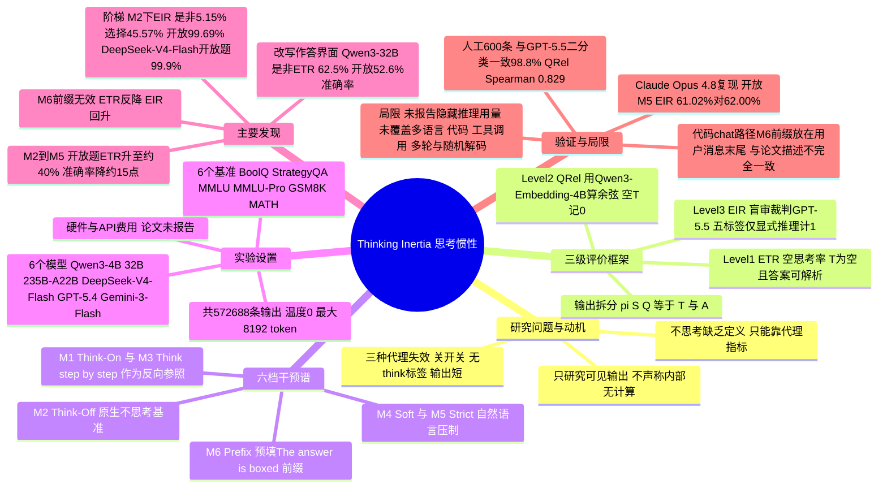

## 一、论文是干什么的？

现在的大模型普遍带有「思考模式」：回答前先写一大段推理（chain-of-thought），再给答案。厂商也提供了对应的开关，比如 Qwen3 的 `enable_thinking=False`、GPT 的 reasoning effort 设为 none、DeepSeek 的关闭思考选项。大家默认：**开关一关，模型就不思考了**。

这篇论文质疑的正是这个默认假设。打个比方：你对一个习惯边写边算的学生说「这题直接报答案，别写过程」，结果他嘴上答应，草稿还是写在了答题纸上，只是没有标题叫「草稿」。论文发现大模型也是这样：即使关掉思考模式、即使明确要求「不要任何推理，直接给答案」，模型依然会在答案前面写出与题目相关的推理步骤。作者把这种现象叫做**思考惯性**（Thinking Inertia），并且发现它有规律：是非题最容易直接作答，选择题居中，开放式题目（比如数学计算题）最难关掉（原生关闭时几乎无一直接作答，即使在严格指令下仍有约六成回答含显式推理）。

论文的贡献有两部分：第一，给「不思考」（no-thinking）下了一个可以测量的定义，并设计了三级指标；第二，在 6 个模型、6 个基准、6 种提示干预下做了大规模测试（全部输出共 572,688 条），总结出思考惯性、「不思考与准确率的权衡」、以及「答案空间决定能否直接作答」三条规律。论文已被 NeurIPS 2026 接收（arXiv 备注栏写明 Accepted by NeurIPS 2026，GitHub README 写明是 Poster）。

## 二、核心方法与创新

### 1. 为什么现有的「不思考」判断方法不靠谱

论文总结了业界常用的三种判断方法（论文称为代理指标，proxies），并逐一指出反例：

- **看提示或开关**：模型处在 no-think 设置下就算不思考。反例：关掉开关后，模型仍在普通回答通道里写解释。
- **看格式**：输出里没有 `<think>` 标签或单独的推理字段，就算不思考。反例：推理只是换了个地方，用普通文字写在答案前面。
- **看长度**：输出短就算不思考。反例：一个很短的等式（论文图 2(b) 的例子：「3x=9，所以 x=3」）就是一步实打实的推理。

反过来，「让我想一想，答案是……」这种套话虽然有字，却没有任何与题目相关的内容，按长度判断会被误算成思考。所以作者认为，应该直接看**输出内容本身**。

### 2. 把每个回答拆成「答前文本」和「最终答案」

论文的形式化很简单。设模型为 $\pi$，题目为 $Q$，外部干预（比如加一句「直接回答」）为 $S(\cdot)$，模型输出被拆成两部分：

$$
\pi\bigl(S(Q)\bigr)=(T,A)
$$

其中 $A$ 是最后一个可解析的最终答案，$T$ 是答案之前所有可读的可见文本（无论它在推理字段、普通回答里，还是一句引导语）。题目写成 $Q=(q,c,\mathcal{A})$：问题、可选上下文、答案空间。是非题的答案空间是 yes/no，选择题是 A/B/C/D，开放题则是自由生成。

需要强调：论文只研究**可见输出**，不声称模型内部没有在计算。这是作者反复说明的边界。

### 3. 三级评价指标

可以把这三级指标理解为一层比一层更细的「安检」：

**第一级：空思考率**（Empty-Thinking Rate，ETR）。最严格的检查：输出里除了规定格式的答案，有没有任何别的实质内容？

$$
e_i=\mathbf{1}\{|T_i|=0\},\qquad \mathrm{ETR}=100\%\times\frac{1}{N}\sum_{i=1}^{N}e_i
$$

只有答案能被解析、且整个输出（包括答案之后）没有多余文字时，$e_i$ 才为 1。

**第二级：题目与答前文本的相关度**（Question–Pre-answer Relevance，QRel.）。如果有答前文本，它跟题目有多相关？用带指令的嵌入模型 Qwen3-Embedding-4B 编码题目和答前文本，算余弦相似度；空文本记为 0：

$$
\mathrm{QRel.}(Q_i,T_i)=\begin{cases}0, & |T_i|=0\\ \cos\bigl(\phi(Q_i),\phi(T_i)\bigr), & |T_i|>0\end{cases}
$$

查询指令是「给定一个问题，检索包含与回答该问题相关推理的答前文本」。论文强调 QRel. 只衡量「相关」，不等于「推理」：复述题目也可能得高分。

**第三级：显式推理率**（Explicit Inference Rate，EIR）。请一个看不到模型身份、干预方式、最终答案和正确与否的「盲审裁判」GPT-5.5，只看 $(Q_i,T_i)$，从五个互斥标签里选一个，并摘出支撑证据：

| 编号 | 标签 | 判定标准 |
|---|---|---|
| 1 | 套话或离题 | 通用引导语、格式文字，没有针对题目的推理 |
| 2 | 仅复述 | 复述题目或已知条件，没有推理连接 |
| 3 | 相关但非推理 | 给出相关事实、定义或直接断言答案，没有推理步骤 |
| 4 | 显式推理 | 含推导、计算、比较、排除、套用规则、由证据到结论或因果 |
| 5 | 不确定 | 仅凭可见文本无法可靠判断 |

只有标签 4 计 1 分，其余计 0 分，空文本不送审直接记 0：

$$
\mathrm{EIR}=100\%\times\frac{1}{N}\sum_{i=1}^{N}\mathrm{Judge}(Q_i,T_i)
$$

三级指标配合使用，就能把「纯答案」「相关但没推理的文字」和「真正的推理」区分开。最终答案是否正确则用准确率单独评估。

### 4. 六档干预「强度谱」

作者设计了六种模式（M1 到 M6），从鼓励思考到最强压制：

| 模式 | 名称 | 思考开关 | 额外指令 |
|---|---|---|---|
| M1 | Think-On | 开 | 无 |
| M2 | Think-Off（原生不思考，基准） | 关 | 无 |
| M3 | CoT | 关 | Think step by step. |
| M4 | Soft | 关 | A very short lead-in is allowed, but do not explain. |
| M5 | Strict | 关 | Give the final answer directly without any reasoning. |
| M6 | Prefix | 关 | 预填 The answer is 加 `\boxed{` 前缀 |

M1 和 M3 是「反方向」的参照，M2、M4、M5、M6 构成不思考干预空间。论文把 M6 当作单独分支：它不是靠说服，而是想直接把答案框塞到生成开头。

### 5. 改写答案空间的对照实验

为了排除「开放题本来就更难」的解释，作者把同一批数值型 MMLU/MMLU-Pro 题目改写成三种形式：原选择题、是非验证（给出一个候选答案让模型判断对错）、开放数值生成。题目内容不变，只换「作答界面」，看行为怎么变。这就像同一道算术题，问「是不是 323」和问「等于多少」，前者可以凭直觉点头，后者往往得动笔。

## 三、使用了哪些模型和计算资源？

这是一篇**评测论文，没有训练任何模型**，主要开销是大量推理调用和裁判调用。

**被测模型**（论文 Table 3 与附录 B.2）：

| 模型 | 规模 | 思考控制 | 运行方式 |
|---|---|---|---|
| Qwen3-4B | 4B | `enable_thinking` true/false | 本地 checkpoint |
| Qwen3-32B | 32B | `enable_thinking` true/false | 本地 checkpoint |
| Qwen3-235B-A22B | 235B | API 推理控制：high / 不推理 | API |
| DeepSeek-V4-Flash | 284B | 高强度 / 关闭 | API |
| GPT-5.4 | 未公开 | reasoning effort high / none | API |
| Gemini-3-Flash-Preview | 未公开 | reasoning effort high / minimal | API |

注意 Gemini 的 minimal 被论文视为「接近关闭」而非严格关闭。所有模型温度 0（凡接口支持），所有模式统一最大输出 8,192 token，论文称在核心对比中最多 0.35% 的输出触到上限。前沿模型结果来自随机种子 20260502 的 8,192 token 重跑。

**评价用模型**：

- 第二级 QRel.：Qwen3-Embedding-4B（last-token pooling，最大序列长度 32,768）；对照编码器 all-MiniLM-L6-v2、BGE-base-en-v1.5、E5-base-v2。
- 第三级 EIR：主裁判 GPT-5.5（温度 0）；交叉验证裁判 Claude Opus 4.8，两者都跑了全部语料。

**数据规模**（附录 B.1、E）：BoolQ 验证集 3,270 条、StrategyQA 测试集 687 条、MMLU 测试集 14,042 条、MMLU-Pro 测试集 12,032 条、GSM8K 测试集 1,319 条、MATH 测试集 5,000 条。本地 Qwen3-4B/32B 跑全量（各约 218,100 条输出）；四个 API 模型每种模式在 BoolQ、MMLU、MMLU-Pro、GSM8K、MATH 各抽 1,000 条，加上全部 687 条 StrategyQA，即每模式 5,687 条、六模式共 34,122 条。全部成功输出共 572,688 条。人工研究抽 600 条输出，5 名标注者独立标注其中 402 条非空答前文本。

**硬件与耗时**：

- GPU 型号与数量：论文正文和附录均未说明，**暂无相关信息**。本地 Qwen3-4B/32B 用什么推理框架，论文也未写明；公开代码的评测脚本说明文字写的是「针对本地 vLLM 端点」，并支持 OpenRouter 的推理参数，但论文没有说明实际 API 调用是否经由 OpenRouter，这里只能说代码支持，**不能确认**实验实际使用的服务商。
- 单次基准运行耗时、整体实验耗时、GPU 小时：**暂无相关信息**。
- API 调用费用（被测模型约 13.6 万条 API 输出，以及 GPT-5.5 与 Claude Opus 4.8 两个裁判各审全部语料）：论文未报告，**暂无相关信息**。

## 四、实验结果

### 1. 关掉思考开关，并不等于不思考（Q1）

在原生 Think-Off（M2）下，大部分模型在是非题上 ETR 约 80% 到 100%；选择题差异很大，ETR 从接近 0 到 95% 不等；开放题上 ETR 几乎全部塌到 0，EIR 仍然很高。附录 H.1 的前沿模型 M2 数据：

| 模型 | ETR 是非/选择/开放（%） | EIR 是非/选择/开放（%） |
|---|---|---|
| Qwen3-235B-A22B | 86.4 / 24.6 / 0.0 | 12.2 / 68.7 / 99.7 |
| DeepSeek-V4-Flash | 93.2 / 1.1 / 0.0 | 5.5 / 81.0 / 99.9 |
| GPT-5.4 | 99.9 / 94.7 / 0.2 | 0.0 / 5.3 / 99.5 |
| Gemini-3-Flash-Preview | 0.0 / 0.0 / 0.0 | 24.2 / 88.9 / 99.7 |

最醒目的数字：DeepSeek-V4-Flash 在关闭思考时，99.9% 的开放题回答仍带有显式推理。全语料上（GPT-5.5 裁判），M2 的 EIR 是非题 5.15%、选择题 45.57%、开放题 99.69%，呈现「是非低于选择低于开放」的**阶梯**。

M3（关掉开关但加一句 Think step by step）能把 QRel. 和 EIR 拉回接近 M1 的水平，说明普通提示就能重新「唤醒」可见推理；GPT-5.4 是例外，在是非题和选择题上仍保持高 ETR、低 EIR。但即使在 M3 下，阶梯顺序也不变。

### 2. 越使劲压，越可能答错（Q2）

在有完全关闭思考选项的五个模型上，从 M2 到 M5（严格只答答案），开放题的平均 ETR 从接近 0 升到约 40%，平均准确率下降约 15 个百分点。全语料 EIR 在开放题上从 99.69% 降到 62.00%；是非题从 5.15% 降到 0.12%，选择题从 45.57% 降到 25.39%，而这两类的准确率基本不变（是非题准确率在四种不思考变体下都约 85%）。作者把这叫做**不思考与性能的权衡**。

个别数据点更极端（附录 G.2，从 M2 到 M5 的准确率变化）：Qwen3-32B 在 GSM8K 上下降 49.0 个百分点（93.4% 到 44.4%），DeepSeek-V4-Flash 在 GSM8K 上下降 25.1 个百分点，GPT-5.4 在 MATH 上下降 28.5 个百分点。一个例子：Qwen3-4B 在一道 MATH 题上，M2 写了 61 词推理答对了 $-9$，M5 直接作答却给出 $9$，漏掉了题目中「最小」这个约束。

**M6 前缀强制反而没用**：从 M5 到 M6，选择题和开放题的平均 ETR 下降，QRel. 和 EIR 在三类答案空间里都回升，开放题 ETR 回到接近 0，准确率回到 M2 附近。也就是说，往开头塞答案框并不是「更强版的 Strict」。

### 3. 领域与答案空间的影响（Q3）

**准确率高不等于容易直接作答**。固定为四选一的 MMLU，在 M2 下 STEM 领域准确率最高，但 ETR 最低（四个模型 0.3% 到 36.4%），QRel.（0.509 到 0.784）和 EIR（59.7% 到 85.5%）最高。

**只换作答界面，行为就大变**（Qwen3-32B，M2，数值型 MMLU/MMLU-Pro 匹配子集）：

| 作答形式 | 准确率 | ETR | QRel. | EIR |
|---|---|---|---|---|
| 原选择题 | 77.8% | 10.5% | 0.709 | 86.95% |
| 是非验证 | 78.9% | 62.5% | 0.314 | 36.90% |
| 开放数值生成 | 52.6% | 0% | 0.810 | 90.14% |

同样的题，给出候选答案让模型核对时，它更愿意也更能直接作答；在 M2 下，去掉候选让它自己生成时，可见推理几乎无法避免，准确率也明显下降。附录还检查了打乱选项顺序、把字母标签换成数字标签，变化较小（ETR 最多变动约 8 个百分点），不支持「标签名或选项顺序」造成这一现象的解释；是非验证中模型对正确与错误候选的判断准确率分开统计，说明它不是一味说「是」。

### 4. 规模与指标可靠性

- **模型规模**：Qwen3 从 4B 到 32B 到 235B，准确率上升，但阶梯结构不变。M2 下的 EIR（是非/选择/开放）：4B 为 1.26%/49.30%/99.86%，32B 为 0.00%/37.11%/99.56%，235B 为 12.15%/68.70%/99.70%。
- **人工验证**：ETR 的自动判断与人工检查在 600 条中有 565 条一致（94.2%，其余 35 条差异来自答案格式能否解析的额外要求）；QRel. 与 5 名标注者相关度评分的平均 Spearman 相关为 0.829（MiniLM 为 0.809）；人工推理标签与 GPT-5.5 裁判的二分类一致率平均 98.8%，与 Claude Opus 4.8 为 96.7%。标注者间 Krippendorff's $\alpha$：五分类 0.873，二分类 0.948，相关度评分 0.919。
- **跨裁判复现**：Claude Opus 4.8 在全语料上得到的 EIR 与 GPT-5.5 十分接近，例如开放题 M5 为 61.02% 对 62.00%；两裁判在共同输出上二分类一致率 97.30%。
- **复述审计**：近似逐字复述题目的输出只有 301 条（0.053%），被判为「仅复述」的只有 355 条（0.06%），不足以影响结论。

## 五、潜在应用与已落地应用

**论文自己提出的含义：**

- 「不思考」应被视为一种需要单独评估、并可作为训练目标的能力，而不是思考模式的默认反面。
- 建议做**按任务路由**：作答界面能提供足够支撑时（例如有候选答案）直接回答，压制推理会损失准确率时保留推理。
- 未来方向：训练「校准过的停止」而非一刀切压制，同时优化准确率、只答答案的合规性、可见相关度与推理、延迟和真实推理 token 成本；扩展到多语言、代码、工具调用、多轮与随机解码场景；分析内部状态，看计算是真的消失了、转移到了隐藏通道，还是只是没写出来。
- 作者也提醒：可见输出变短，不等于推理成本降低，因为隐藏推理可能仍在进行；在高风险场景里，解释对核查错误仍然重要。

**已公开的资源：**

- 代码：[GitHub 仓库 thinking-inertia/code](https://github.com/thinking-inertia/code)，MIT 许可，包含数据下载脚本、六模式评测脚本 `eval_thinking_spectrum`、QRel. 与 EIR 指标代码。模型服务需要用户自己提供兼容 OpenAI 接口的端点。查询时 6 星、0 个 issue。
- 数据：[Hugging Face 数据集 thinking-inertia/llm-nothinking-trajectories](https://huggingface.co/datasets/thinking-inertia/llm-nothinking-trajectories)，按模型分别提供六个模型的输出轨迹压缩文件（每条记录含题目、答前文本、最终答案、干预模式与打分字段）。
- [项目主页](https://thinking-inertia.github.io/)，含交互式示例（预先计算好的演示，不是实时模型调用）和讲解视频。

**落地情况：** 没有发现任何生产环境部署或商业应用报告。以下为本综述的推测，不是论文结论：对需要「只要答案」的场景（如批量标注、结构化抽取、需要解析纯答案的流水线），这套 ETR、QRel.、EIR 指标可以作为评估框架的起点，用来检验所用模型的不思考开关是否真的有效，但需要按任务、语言、答案解析规则和裁判协议重新校准。

## 六、网络上的讨论与评价

- **Hugging Face 论文页**（查询时 245 票）：一作 Dianqiao Lei 发了介绍帖。用户 urroxyz 提出质疑：「模型被训练去思考，它当然会思考；训练数据里哪有『不要用推理 token』这种指令？」另一位用户 nunezboettiger 回复说这正是论文的意义：模型也应被训练成在简单问题上避免过度思考，但如何量化任务难度、多少推理 token 算合理，本身就是新问题。
- **一条有价值的技术评论**：用户 yflantmy 提到该用户早先的工作 Zero-CoT Probe 遇到过同样现象，并指出：在公开代码的 chat 调用路径里，M6 的答案前缀似乎被放在**用户消息末尾**，而不是作为助手回复的开头预填；该用户在开源模型上用助手端预填的方式，在 MATH 和 GSM8K 上能较好地引出直接答案。该用户还说对闭源模型（GPT、Claude）用严格只答答案的提示，有的模型有效有的无效，与本文结论一致。**本综述核对了公开代码**：`eval_thinking_spectrum.py` 的 chat 路径确实把 The answer is 加 `\boxed{` 拼在提示词末尾，以单条 user 消息发送；而论文正文描述 M6 是「在生成开头预填答案模板，完全绕过指令遵循通道」。两者不完全一致，这说明公开代码和已发布轨迹中实际评测的 M6 提示，是把模板放在用户消息里，与论文「在生成开头预填」的措辞不一致。没有做过助手端预填的对照实验，所以 M6 结果的成因无法确定，本综述不把它归因于这一差异。补充佐证：公开的 Hugging Face 数据集中，GPT-5.4 的 5,687 条 M6 记录的 input_prompt 都以 `The answer is \boxed{` 结尾（本综述抽查该数据分片，未重新统计其他模型）；另外 GPT、Gemini 等闭源 API 通常不支持助手端预填。论文未就此做说明。
- **X/Twitter**：项目负责人 Kevin Qinghong Lin 发帖介绍（James Zou 转发），AI 博主 Rohan Paul 发了概述，强调 DeepSeek-V4-Flash 关闭思考后 99.9% 的开放题仍写出推理；AK（_akhaliq）也发帖分享了 HF 论文页。以上内容通过 [Digg 的聚合页](https://digg.com/ai/y0f16d3v) 和 [另一个聚合页](https://digg.com/ai/rkj3w7iq) 看到，后者显示 AK 的帖子有 20 条评论，但评论内容无法获取。
- **英文媒体与博客**：[AI Weekly](https://aiweekly.co/alerts/thinking-inertia-llms-keep-reasoning-under-no-think-controls) 和 [Mervin Praison 的博客](https://mer.vin/news/thinking-inertia-why-reasoning-llms-keep-thinking-when-told-to-stop/)（另有 explainx.ai、opentrain.ai 等论文介绍页）做了内容转述，均为复述论文结论，没有独立评测。
- **其他渠道**：Hacker News（通过 Algolia 检索论文标题、编号与项目主页）未找到相关帖子；Reddit 搜索接口对脚本请求返回拦截页，网页搜索也未发现 Reddit 讨论；截至 2026-10-16，在检索的知乎、机器之心、量子位页面中未见专门报道；另发现 hyper.ai 的多语言摘要页、Dawei Li 的中文每日速递博客（[2026-10-13 条目](https://shinnaaa.github.io/posts/2026/10/2026-10-13-intel/)，用一两句话点评本文，提醒按关闭思考省 token 做成本优化的方案需要重新测实际消耗），以及 [Pith](https://pith.science/paper/2610.11765) 上的 AI 评审页（由 deepseek-v4-flash 阅读后回答固定问题，总体认为测量框架扎实、主要结果站得住）。

**本综述的几点观察（非外部评价）：**

- 论文的「推理」完全由 GPT-5.5 裁判判定，虽然有人工和 Claude Opus 4.8 交叉验证，但判定标准是「一步推理即算」，因此一个简短等式也会计入 EIR。这符合论文定义，但读者不应把 EIR 理解为「长篇推理」的比例。
- Gemini-3-Flash-Preview 的 minimal 不是真正的关闭，它在所有答案空间 M2、M5 的 ETR 都是 0，论文在计算 M5 平均 ETR 时只纳入有完全关闭选项的模型。
- 论文未报告隐藏推理 token 的用量（服务商给出的推理信号只用于判定 ETR），因此「可见推理减少」与「实际成本下降」之间的关系仍是开放问题；作者也提醒可见输出变短不等于成本降低，并把实际推理 token 成本列为未来工作。

## 七、思维导图

