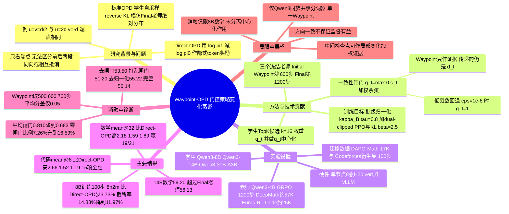

## 一、论文是干什么的？

先铺垫三个背景概念。

**强化学习（RL）后训练**：一个大模型做数学题、写代码，答对给奖励、答错不给，反复练习上千步之后，模型会悄悄改变自己的「下笔习惯」，比如更爱先验算、少说废话。问题是 RL 非常贵：要反复生成答案、验证答案、再更新模型。如果每个新模型都要从头 RL 一遍，成本很高。所以自然会想：**能不能把一个模型 RL 学到的东西，直接「转交」给另一个模型？**

**在线策略蒸馏（On-Policy Distillation，OPD）**：传统蒸馏像「抄标准答案」，学生看老师写好的解答去模仿。在线策略蒸馏则是「学生自己先做题，老师在旁边逐字批改」：学生生成一段回答，在学生实际写到的每一个位置上，老师说出自己在这里会怎么下笔，学生据此调整。好处是学生在自己真实会犯错的地方得到纠正。但它有个缺点：学生学的是老师的**绝对水平**，老师本身的局限也一并被学走了。

**策略变化蒸馏（policy-shift distillation，代表方法 Direct-OPD）**：换个思路，不学老师「现在怎么写」，而是学老师「RL 前后**口味变了多少**」。具体做法是在同一个位置上，用「RL 后老师给某个词的对数概率」减去「RL 前老师给它的对数概率」。差值为正，说明 RL 让老师更喜欢这个词；为负，说明 RL 让老师不那么喜欢了。这个差值被当作给学生的奖励。打个比方：不是让学生模仿一位老厨师的整套手艺，而是告诉学生「这位厨师上了一期进修班之后，少放了盐、多放了醋」，学生把这些**改变**学过来。这样甚至允许老师比学生更小（本文就是 4B 老师教 8B、14B、30B 学生）。

本文要解决的问题是：Direct-OPD 只看**起点（RL 前）和终点（RL 后）两个快照**，看不到中间过程。可是同样的净变化，可能是一路稳步朝同一方向走过来的，也可能是先往东走了 2 公里、又往西折回 1 公里。前者说明这个改变是 RL 持续认可的「真趋势」，后者说明 RL 中途改主意了，这个改变就不那么可靠。阿里云团队提出的 **Waypoint-OPD** 就是在 RL 途中再存一个「途经点」（Waypoint）检查点，用它把总变化拆成「前半程变化」和「后半程变化」，**两段方向一致就放行，方向相反就把这条信号关掉**。

## 二、核心方法与创新

### 1. 三个老师快照

在同一次老师 RL 训练中保留三个冻结的检查点：

- Initial（$\pi_0$）：RL 开始之前；
- Waypoint（$\pi_m$）：RL 中途（本文是第 600 步）；
- Final（$\pi_1$）：RL 结束（第 1200 步）。

学生记为 $\pi_\theta$，它的初始版本记为 $\pi_S$。三个老师和学生必须使用相同的分词器，这样才能对同一个 token 直接比较概率。

### 2. 先回顾 Direct-OPD 的信号

在学生生成的某个前缀 $s_t$（题目加上学生已经写出的部分）上，对候选 token $a$，Direct-OPD 的信号是终点相对起点的对数概率差：

$$
\delta_t(a)=\log\pi_1(a\mid s_t)-\log\pi_0(a\mid s_t)
$$

论文提到，在理想化的、带 KL 正则的 RL 最优点上，整句的这种对数比可以恢复出奖励（相差一个正比例和一个只与题目有关的常数），这是 Direct-OPD 把它当作「隐式奖励」的理论动机；但作者也明确说明，并不假设有限步的老师 RL 真的达到了这个最优点。

### 3. 拆成前后两段，并只比较「相对偏好」

Waypoint-OPD 把总变化拆成两段，二者相加正好等于总变化：

$$
\delta^{(1)}_t(a)=\log\pi_m(a\mid s_t)-\log\pi_0(a\mid s_t),\qquad \delta^{(2)}_t(a)=\log\pi_1(a\mid s_t)-\log\pi_m(a\mid s_t)
$$

**只看学生最可能写的几个候选**：在每个位置上，取学生概率最高的 $k$ 个 token（本文 $k=16$），记为 $\mathcal{K}_t$，并把学生在这些候选上的概率归一化成权重 $q_t(a)$。这样比较集中在学生真正可能走的路上。

**中心化（centering）**：如果某一段变化让所有候选的对数概率都同时加了同一个常数，那么候选之间的相对排名其实没变，但它会干扰两个向量之间的夹角计算。因此先减去按 $q_t$ 加权的平均值：

$$
C_{q_t}[z](a)=z(a)-\mathbb{E}_{b\sim q_t}[z(b)]
$$

记 $u_t=C_{q_t}[\delta^{(1)}_t]$（前半程）、$v_t=C_{q_t}[\delta^{(2)}_t]$（后半程）、$d_t=C_{q_t}[\delta_t]=u_t+v_t$（中心化后的总变化）。打个比方：比较两位评委的打分时，不关心谁整体打分偏高，只关心谁把哪道菜排得更靠前。

### 4. 一致性闸门（agreement gate）

用学生概率加权的余弦相似度衡量前后两段是否同向：

$$
c_t=\frac{\langle u_t,v_t\rangle_{q_t}}{\lVert u_t\rVert_{q_t}\lVert v_t\rVert_{q_t}},\qquad \langle u_t,v_t\rangle_{q_t}=\sum_{a\in\mathcal{K}_t}q_t(a)u_t(a)v_t(a)
$$

闸门取 $g_t=\max(0,c_t)$，取值在 0 到 1 之间：两段完全同向时 $g_t=1$，信号全额保留；夹角越大保留越少；方向相反（$c_t\le 0$）时 $g_t=0$，这个位置的信号直接关掉。若任一段的加权范数小于等于 $\varepsilon=10^{-8}$（变化太小、方向无从谈起），就退回 $g_t=1$，保留原信号。

论文给的例子很直观：对同一个总变化 $d$，若 $u=v=d/2$，则 $c=1$、$g=1$；若 $u=2d$、$v=-d$，则 $c=-1$、$g=0$。两种情况 $u+v$ 都等于 $d$，只看终点的 Direct-OPD 完全分辨不出来，这正是「往东 1 公里」和「往东 2 公里再往西 1 公里」的区别。

需要强调：**Waypoint 只当「证据」，不当「模仿目标」**。真正传给学生的仍然是中心化后的总变化 $d_t$，Waypoint 只决定它的权重。论文附录 A.1 证明，在固定的学生前缀和权重下，加入 Waypoint 不改变 $d_t$ 本身，闸门也不会把信号的正负号翻转。作者同时坦言：方向一致并不保证这条监督一定有益。

### 5. 批级归一化

由于闸门普遍小于 1，会让整体信号变弱，而且不同批次的平均闸门不同。作者对每个批次 $B$ 乘一个共同系数，让平均闸门对齐到目标值 $\tau$（本文 0.8）：

$$
\kappa_B=\mathrm{clip}\left(\frac{\tau}{\max\left(\bar{g}_B,\varepsilon_{\mathrm{num}}\right)},\kappa_{\min},\kappa_{\max}\right)
$$

其中 $\bar{g}_B$ 是该批所有有效前缀上 $g_t$ 的平均值，裁剪区间为 $[0.75,1.5]$，$\varepsilon_{\mathrm{num}}$ 是防止除零的极小数（float32 最小正规数，约 $1.18\times 10^{-38}$）。这个系数对同一批的所有位置相同，所以不会改变各位置闸门之间的相对大小，被关掉的位置（$g_t=0$）仍然保持为 0。

### 6. 最终训练目标

每个候选 token 的最终系数为（$\mathrm{sg}$ 表示不回传梯度）：

$$
A_t(a)=\mathrm{sg}\left[\kappa_B\,q_t(a)\,g_t\,d_t(a)\right]
$$

学生最大化 $\sum_t\sum_{a\in\mathcal{K}_t}A_t(a)\log\pi_\theta(a\mid s_t)$，同时减去 $\beta$ 倍的 KL 惩罚（让学生不要离初始版本 $\pi_S$ 太远，本文 $\beta=2.5$）。因为中心化，同一位置上所有候选的 $A_t(a)$ 加起来等于 0（附录 A.2），相当于只在候选之间「此消彼长」地调整偏好。实际实现用的是逐候选的 dual-clipped PPO，在采样时刻与上式梯度一致。

**额外开销**：相对 Direct-OPD，只多一个冻结老师（Waypoint）的打分前向，不需要训练新老师、不新增可训练参数、不增加学生采样次数，也不调用答案验证器。

## 三、使用了哪些模型和计算资源？

**模型（来源：第 4.1 节、附录 C 表 6）：**

| 角色 | 模型 |
|---|---|
| 老师（三个检查点） | Qwen3-4B 的同一次 RL：Initial（RL 前）、Waypoint（第 600 步）、Final（第 1200 步）；数学和代码各训一套，均为 non-thinking RL |
| 学生 | Qwen3-8B、Qwen3-14B、Qwen3-30B-A3B（覆盖稠密与 MoE 两种结构） |
| 对比方法 | Base 学生、标准 OPD（模仿 Final 老师）、OPD2、Direct-OPD |

注意这里老师比学生小：论文明确说该迁移目标「不要求老师强于学生」。

**数据（来源：第 4.1 节、附录 C）：**

- 老师 RL：数学用 DeepMath-103K 中难度不低于 6 的约 57K 条；代码用 Eurus-RL-Code 约 25K 条；算法 GRPO。
- 学生迁移：数学用 DAPO-Math-17K 题目；代码用一个 Codeforces 衍生的题目集。
- 评测：数学 7 个基准（AIME 2024/2025/2026、HMMT 2025 年 2 月、HMMT 2025 年 11 月、HMMT 2026 年 2 月、AMC 2023），指标 mean@32；代码 5 项（MBPP、MBPP+、LiveCodeBench v4/v5/v6），指标 mean@8。两个领域都用 AIME 2024 作为验证集来挑学生检查点。

**关键超参数（来源：附录 C 表 4、表 5）：**

| 项目 | 老师 GRPO | 学生迁移 |
|---|---|---|
| 批大小 | 128 | 256（mini batch 64） |
| 每题采样数 | 8 | 1 |
| 最大回答长度 | 16,384 | 16,384 |
| 学习率 | $10^{-6}$ | $10^{-6}$ |
| 训练步数 | 1,200 | 100 |
| KL 系数 | 0.0 | 2.5 |
| 其他 | 温度 1.0，top-p 1.0 | $k=16$，$\tau=0.8$，缩放裁剪 $[0.75,1.5]$ |

评测解码：温度 0.7、top-p 0.95、最长 16,384 token。

**计算资源（来源：附录 C、附录 H）：**

- 框架：verl（FSDP 训练）加 vLLM（采样）。
- 硬件：训练与推理都在**单节点 8 张 NVIDIA H20 GPU** 上进行。
- 答案判分器只用于评测，学生迁移阶段不调用验证器（论文原话为 no new teacher training or verifier calls）。

**耗时（来源：附录 H 表 9，Qwen3-8B 数学，100 步完整训练，8 张 H20，不含评测）：**

| 方法 | 总时长 | 每步 | GPU 小时 |
|---|---|---|---|
| Direct-OPD | 8 小时 21 分 3 秒 | 300.63 秒 | 66.81 |
| Waypoint-OPD | 8 小时 2 分 21 秒 | 289.41 秒 | 64.31 |

有意思的是，Waypoint-OPD 虽然多一次打分，总时间反而少了 18 分 42 秒（3.73%）。论文给出的伴随现象是：它训练时学生的回答更短（100 步中有 87 步平均长度更低），被截断的比例平均从 14.83% 降到 11.97%；论文没有明确把时间缩短归因到哪一项，这里的联系是综述者的推测。

**暂无相关信息：** 老师 Qwen3-4B 两次 GRPO（各 1,200 步）的训练时长与 GPU 小时；14B 与 30B-A3B 学生的训练时长；评测（mean@32、mean@8）所需时间；Waypoint 额外打分前向单独占用的时间。

## 四、实验结果

### 1. 数学（表 1，mean@32，7 个基准平均）

| 学生 | Base | OPD | OPD2 | Direct-OPD | Waypoint-OPD |
|---|---|---|---|---|---|
| Qwen3-8B | 26.04 | 51.04 | 51.46 | 53.96 | **56.14** |
| Qwen3-14B | 27.32 | 56.17 | 52.83 | 57.61 | **59.20** |
| Qwen3-30B-A3B | 28.03 | 51.22 | 52.68 | 55.96 | **57.85** |

老师参考：Initial 24.84、Waypoint 51.82、Final 56.13。

- 相对最强基线 Direct-OPD，三个学生分别提高 2.18、1.59、1.89 个百分点；21 个「学生 x 基准」对比中赢了 19 个，两个例外是 14B 的 HMMT 2025 年 11 月（47.60 对 47.08）和 30B-A3B 的 HMMT 2026 年 2 月（33.05 对 32.77）。
- 学生「青出于蓝」：14B 和 30B-A3B 平均分分别比 Final 老师高 3.07 和 1.72 分，8B 基本持平（56.14 对 56.13）；14B 在 7 个数学基准上全部超过老师。

### 2. 代码（表 2 与附录表 7，mean@8，5 项平均）

| 学生 | Base | OPD | OPD2 | Direct-OPD | Waypoint-OPD |
|---|---|---|---|---|---|
| Qwen3-8B | 41.03 | 43.91 | 51.21 | 50.59 | **53.25** |
| Qwen3-14B | 47.72 | 51.66 | 55.60 | 56.30 | **57.82** |
| Qwen3-30B-A3B | 50.33 | 51.91 | 55.96 | 56.35 | **57.54** |

老师参考：Initial 37.64、Waypoint 52.22、Final 55.37。

- 相对 Direct-OPD 分别提高 2.66、1.52、1.19 分，15 项代码对比全部提升。
- 小提醒：在 8B 代码上最强的基线其实是 OPD2（51.21），Waypoint-OPD 比它高 2.04 分；另外 OPD2 在 14B 的 LCB v5、30B-A3B 的 MBPP 与 MBPP+ 单项上更高。
- 14B 和 30B-A3B 学生的代码平均分也分别比 Final 老师高 2.45 和 2.17 分。

### 3. 训练过程（图 3，Qwen3-8B 数学）

在第 20、40、60、80、100 步的评测中，Waypoint-OPD 在 15 次对比里赢了 13 次（两次例外出现在训练早期），从第 60 步起三个基准全部领先。第 100 步时的领先幅度为 AIME 2025 4.17 分、AIME 2026 3.13 分、HMMT 2025 年 11 月 0.10 分。

### 4. 消融（表 3，Qwen3-8B 数学平均分）

| 变体 | 平均分 | 说明 |
|---|---|---|
| Waypoint-OPD 完整版 | 56.14 | |
| 去掉归一化（$\kappa_B=1$） | 55.22 | 降 0.92，但仍比 Direct-OPD 高 1.26 |
| 去掉闸门（$g_t=1$） | 53.50 | 降 2.64，7 个基准全降 |
| 打乱闸门（批内随机分配） | 51.20 | 降 4.94，比不加闸门还差，甚至低于 Direct-OPD |
| Direct-OPD | 53.96 | 参考 |

最有说服力的是「打乱闸门」：闸门的分布、平均值都没变，只是没对上原来的位置，效果反而比完全不加闸门还差。这说明起作用的不是「随便把信号调小一些」，而是**每个位置拿到属于自己的一致性判断**。作者也提醒：这些差距是在保留其他组件的条件下测得的，不能简单相加；「去掉闸门」仍保留了中心化，所以中心化本身的作用没有被单独分离出来。

### 5. Waypoint 放在哪里重要吗？（附录 F）

把 Waypoint 从第 600 步换成第 500 步或第 700 步，8B 数学平均分为 56.18、56.14、56.13，相差只有 0.05 分，三者都比 Direct-OPD 高 2.17 到 2.22 分。至少在相邻位置上，结果对 Waypoint 的选择不敏感。

### 6. 闸门诊断（附录 G）

训练过程中，平均闸门从前 20 步的 0.810 降到后 20 步的 0.683，被完全关掉的位置比例从 7.26% 升到 16.59%；归一化系数 $\kappa_B$ 在 0.955 到 1.223 之间，前 16 步小于 1、之后大于 1。也就是说，随着学生变化，越来越多的位置被判定为「老师前后口径不一致」。

## 五、潜在应用与已落地应用

**潜在方向：**

- **复用昂贵的 RL 成果**：一个团队花大量算力把一个小模型 RL 好之后，可以把「RL 带来的改变」迁移到同族更大的模型上，而不必对大模型再做一遍完整 RL。本文就是 4B 老师迁移给 8B 到 30B 学生。
- **只需多存一个检查点**：对已经在做 Direct-OPD 的团队来说，改动很小，只要在老师 RL 中途多保存一个检查点，迁移时多做一次前向打分。
- 作者结论里提出的更一般的观点：老师训练过程中的中间检查点可以作为「给局部变化加权」的证据，而不只是被丢弃的中间产物。

**已开源内容：** 代码发布在 [GitHub 仓库 hhhbxloveai/WaypointOPD](https://github.com/hhhbxloveai/WaypointOPD)，包含打过补丁的 verl 运行时、DAPO-17K 训练数据与 AIME24 评测数据，以及单节点 8 卡训练脚本 `run/train_waypoint_opd_qwen.sh`。README 说明**不包含模型权重**，需要自行准备 Qwen3-4B 的第 600 步与第 1200 步检查点；README 还注明依赖来自原始 Ubuntu/CUDA 环境，在全新环境中的安装未经验证。2026-10-16 的两次查询里仓库分别显示 2 个和 1 个 star（数值很小且在变），0 个 fork、0 个 issue，未设置许可证。Hugging Face 上未检索到相关的模型或演示。

**已落地应用：** 论文没有报告任何生产部署，暂未发现已落地的应用案例。

## 六、网络上的讨论与评价

- **Hugging Face 论文页**：2026-10-16 查询时有 179 个赞（之后仍在上涨，写作后复查已到 181），只有 1 条评论（用户 Nothing2Say 发布的一句方法简介），没有实质性讨论。
- **Hacker News**：通过 Algolia 检索接口按 Waypoint-OPD 和 arXiv 编号查询，均无结果。
- **Reddit**：脚本请求被拦截，WebSearch 结果中也未出现相关帖子。
- **中英文网页搜索**：用英文标题、arXiv 编号和中文关键词（中间检查点、在线策略蒸馏、阿里云）搜索，除论文的 arXiv 与 Hugging Face 页面以及作者的官方 GitHub 仓库外，只找到几个自动生成或转述性质的页面：[AI Weekly](https://aiweekly.co/alerts/alibaba-clouds-waypoint-opd-gates-rl-distillation-using-mid-run-teacher)（2026-10-16 发布，摘要加一段编辑评语，建议有 RL 教师蒸馏路线的团队可以在自己的 8B 到 30B Qwen3 栈上试用这种中间检查点监督，无需再做一次 RL），以及 AGI Hunt 与 TamilTech 上各有一篇介绍页（这两个站对脚本请求返回 403，本综述未能读取正文，仅凭搜索结果得知其存在）；这些页面都没有独立复现或实质批评；X/Twitter、知乎、机器之心、量子位等未发现专门讨论。论文 10 月 15 日刚发布，暂无公开的社区评价。

**综述者的几点观察（不是外部评价）：**

- 优点：想法简单、开销小，消融里「打乱闸门比不加闸门还差」是一个比较干净的证据，说明位置级的一致性信息确实有用。
- 提升幅度不算大：相对 Direct-OPD 平均提升 1.2 到 2.7 分，且每个设置只报告了一次训练结果，论文没有给出多次随机种子的方差。
- 消融只在 Qwen3-8B 数学上做，代码和更大学生上没有消融；中心化的单独贡献也没有分离。
- 学生检查点用 AIME 2024 挑选，而 AIME 2024 同时也出现在数学评测表中，这一列的分数会略微偏乐观（其他 6 个数学基准受影响较小；所有方法用同一套选择规则，这能缓解不公平的担忧，但不能排除选择偏差对各方法影响不同；严格来说应把 AIME 2024 视为仅用于验证）。
- 实验只覆盖同一家族（Qwen3）、共享分词器的老师与学生，只用了一个 Waypoint；跨家族或多个 Waypoint 的情形论文没有讨论。
- 作者自己强调：方向一致只是加权依据，并不保证监督一定正确。

## 七、思维导图

