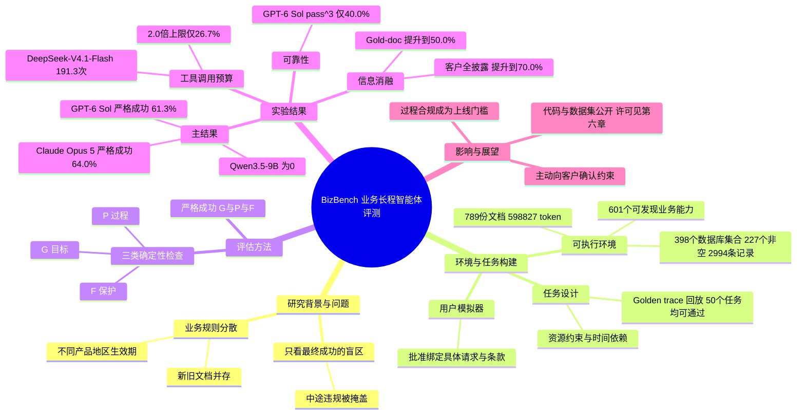

> 说明：HF 页面标题与摘要写作 BizBench，arXiv 全文 v2 与 GitHub 仓库中的名称是 BizAgentBench，两者指同一个基准。下文统一写 BizBench（原文正文用 BizAgentBench）。v1 于 2026-10-14 提交，v2 于 2026-10-18 修订，arXiv 摘要页标题现为 BizAgentBench，HF 仍为 BizBench。HF 票数以 HF 官方接口抓取时的 494 为准。

## 一、论文是干什么的？

想象你雇了一个新员工去支付公司的客服岗位：客户说「帮我给两个供应商付款，还要核对税款」。如果这个员工最后把钱付对了，但中途有一步先动用了不该动的钱、或者没经过客户批准就先下了单，哪怕事后补救了，公司也会认为这是一次**违规**。现实业务里，过程比结果更重要。

现有的长程智能体评测不少只看最终任务有没有做成。这篇论文提出 BizBench，一个基于「一家全球领先的支付公司」真实业务流程改造的评测基准。它既检查**目标有没有达成**，也检查**中间过程有没有违反规则**。论文原文把这类问题称为「执行有效性」（execution validity）。

## 二、核心方法与创新

**1. 构造一个可执行的「业务模拟世界」。** 论文的环境包含 789 份知识文档（合计 598,827 个 token）、601 个可被发现的业务能力（工具）、398 个可查询的数据库集合（其中 227 个非空，为初始共享数据库）和 2,994 条数据库记录。智能体始终可用的工具只有 9 个，需要通过它们去发现并调用那 601 项业务能力。另有一个由 LLM 扮演的「客户模拟器」（拥有 10 个工具），负责提供客户的私有信息并在关键操作前给出批准。每次运行都使用一份独立的数据库副本。

**2. 文档里故意放入「过期」和「冲突」的规则。** 好比公司内部有新旧两版制度同时挂在网上，有些看似冲突其实只是适用于不同产品、地区或生效期。智能体必须判断哪条才是现在适用的。

**3. 任务之间互相牵连。** 不同流程共享资金、授权额度和时间窗口。论文举的例子：账户里有 60 美元、要求全程至少留 20 美元，如果先付 60 美元的预付款，账户瞬间归零，就算后来退款把余额补回来，中间那一刻也已经违规。

**4. 三类确定性检查，不用 LLM 当裁判。** 任务成功的定义是（论文公式 1）：

$$\mathrm{Success}_i(\tau)=G_i(\tau)\land P_i(\tau)\land F_i(\tau)$$

其中 $\tau$ 是整段执行历史，$G_i$ 检查目标与允许的终止状态，$P_i$ 检查执行过程要求（如批准在执行之前、储备金始终不低于下限），$F_i$ 检查受保护对象与禁止的副作用。三者同时满足才算 strict success。评估器不要求智能体照抄标准答案路径，只要合规，不同做法都可以。

**5. 数据构建的五个阶段。** 把业务文档整理成 SOP（算法 1：抽取候选流程、分组成流程计划、生成 SOP、对照证据审核、排除无法解决的冲突、改写敏感内容）；构建可执行任务；配置用户模拟器；构造并回放 Golden trace（标准参考执行，50 个任务各有一条能通过的）；用替代路径、违规轨迹和条件变化做验证，并由 5 名研究者加业务专家团队评审。

## 三、使用了哪些模型和计算资源？

| 项目 | 内容（均来自论文原文或官方 GitHub README） |
|---|---|
| 被评测模型 | Claude Opus 5、GPT-6 Sol、GLM-5.3-Flash、DeepSeek-V4.1-Flash、DeepSeek-V4-Pro、Muse Spark 1.3、Qwen3.8-27B、DeepSeek-V4-Flash、Qwen3.5-397B-A17B、Qwen3.5-9B |
| 用户模拟器 | 默认 DeepSeek-V4.1-Flash；稳健性实验还比较了其他模拟器模型，并用 Qwen3.8-27B 作智能体 |
| 运行次数 | Claude Opus 5 和 Muse Spark 1.3 每个任务跑 1 次，其余模型每个任务跑 3 次（每个模型 150 次） |
| GPU / API | 论文正文未说明 GPU 型号或 API 花费，暂无相关信息。README 只说明智能体与模拟器既可用托管 API，也可用自建的 OpenAI 兼容服务 |
| 单次运行耗时 | 论文只说明运行有「墙钟超时」和工具错误阈值，未给出平均耗时。官方 README 的配置模板里单局超时为 5,400 秒，工具错误阈值为 16 |
| 其他限制 | 不限制累计 token、工具调用次数和调度步数；README 示例中单次回复输出上限：智能体 262,144、模拟器 393,216 个 token |

这是评测论文，没有训练过程，所以没有训练时长。论文给出的运行规模是：Golden trace 平均每任务 111.8 次智能体工具调用，DeepSeek-V4.1-Flash 平均每次运行 191.3 次。

## 四、实验结果

**主结果（论文表 1，单位为百分比）**

| 模型 | 目标 $G$ | 过程 $P$ | 保护 $F$ | 中途失败 IF | 严格成功 |
|---|---|---|---|---|---|
| Claude Opus 5 | 64.0 | 96.0 | 98.0 | 4.0 | 64.0 |
| GPT-6 Sol | 64.7 | 94.7 | 100.0 | 5.3 | 61.3 |
| GLM-5.3-Flash | 48.0 | 79.3 | 87.3 | 29.3 | 43.3 |
| DeepSeek-V4.1-Flash | 46.7 | 92.0 | 96.7 | 9.3 | 43.3 |
| DeepSeek-V4-Pro | 41.3 | 85.3 | 88.7 | 24.7 | 39.3 |
| Muse Spark 1.3 | 38.0 | 94.0 | 98.0 | 6.0 | 38.0 |
| Qwen3.8-27B | 42.0 | 74.0 | 93.3 | 28.0 | 32.7 |
| DeepSeek-V4-Flash | 7.3 | 53.3 | 95.3 | 47.3 | 5.3 |
| Qwen3.5-397B-A17B | 1.3 | 46.7 | 93.3 | 56.7 | 0.7 |
| Qwen3.5-9B | 0.0 | 18.7 | 89.3 | 83.3 | 0.0 |

要点：

- 最强的 Claude Opus 5 严格成功率只有 64.0%（表 1 脚注说明只有 Claude Opus 5 与 Muse Spark 1.3 每题只跑 1 次，其余模型每题 3 次，所以 Opus 5 是 $n=50$ 的单次结果，GPT-6 Sol 的 61.3% 是 3 次运行的平均；两者相差 2.7 分，论文只称 Opus 5 最高，并未声称差距显著，在 50 个任务上这点差距不一定可靠）。Qwen3.8-27B 目标达成率 42.0%，严格成功降到 32.7%，说明只看结果会掩盖无效执行。
- 所有模型的过程通过率都低于保护通过率（$P$ 为 18.7% 到 96.0%，$F$ 为 87.3% 到 100.0%）。
- 稳定性差：GPT-6 Sol 在三次运行中全部成功的任务只占 40.0%（$\mathrm{pass}^3$），DeepSeek-V4.1-Flash 为 26.0%，GLM-5.3-Flash 为 22.0%。
- 违规实例：DeepSeek-V4.1-Flash 有 5 次达成目标却违规，其中 4 次中途跌破现金储备下限后又补回，1 次在批准前尝试执行被拒。Qwen3.5-9B 的 150 次运行里有 122 次过程违规，其中 88 次是未批准就执行。

**信息消融（DeepSeek-V4.1-Flash 严格成功率）**

| 条件 | 严格成功 |
|---|---|
| 默认 | 43.3% |
| 直接给出相关文档（Gold-doc） | 50.0% |
| 客户信息一开始全部披露 | 70.0% |

论文推断，向客户问出关键约束并在执行中记住，比找文档更难（仅在 DeepSeek-V4.1-Flash 上测试，且该条件同时去掉了用户模拟器，两项干预并非严格同口径）；即使信息全给，仍有 30.0% 的任务做不对。

**工具调用与预算。** DeepSeek-V4.1-Flash 平均 191.3 次调用，是 Golden trace（111.8 次）的 1.71 倍，多出的主要是数据库查询（111.1 对 59.2）和文档检索（43.3 对 11.5）。论文 5.4 节是事后筛选，并非带上限重跑：对已有的三次运行，只统计工具调用数不超过参考次数 1.2 倍、1.5 倍、2.0 倍的运行，严格成功分别从无上限的 65/150（43.3%）降到 1/150（0.7%）、10/150（6.7%）、40/150（26.7%）。调用多不代表进展多：GLM-5.3-Flash 用 118.3 次调用达到同样的 43.3%；Qwen3.5-9B 平均每次运行收到 101.6 条工具错误，其中 71% 来自访问非公开资源。

**模拟器可靠性。** 原提示词下有 4 个任务出现协议违规（如批量批准），修订提示词后为 0。换用不同模拟器时，Qwen3.8-27B 的平均严格成功率在 30.7% 到 36.0% 之间波动，最大偏差 3.3 个百分点。

## 五、潜在应用与已落地应用

**有据可查的现状（论文与仓库原文）：** 任务来自一家全球领先支付公司的真实业务流程（论文没有点名，作者单位为 Ant International，GitHub 组织为 ant-intl），但原文对敏感业务做了抽象与改写，属于评测基准，论文没有声称已有生产部署。数据与代码已公开（见第六章链接）。

**我的判断（非原文）：**

- 可作为金融、支付、客服类智能体上线前的体检工具，重点看过程违规率而不只是成功率。
- 「过程检查加受保护对象检查」的思路可迁移到报销、风控、合同审批等需要批准在先的流程。
- 信息消融提示：产品设计上应让智能体更主动地向客户确认约束，而不是自行猜测。

## 六、网络上的讨论与评价

- 官方代码与数据：[GitHub ant-intl/BizAgentBench](https://github.com/ant-intl/BizAgentBench)（2026-10-23 重新查询为 38 星、9 个 fork、0 个 issue，GitHub 页面与 API 的读数一致；代码 MIT（README 限定 payment/runtime 与 tools 目录，内置的 tau2 保留自己的 MIT）；HF 数据集卡标注 MIT。含任务数据、知识文档、模拟数据库、工具和评分规则，README 提供评测脚本）；数据集：[Hugging Face ant-intl/BizAgentBench](https://huggingface.co/datasets/ant-intl/BizAgentBench)。
- 论文页面：[Hugging Face Papers](https://huggingface.co/papers/2610.20424)。
- 新闻转述：[AI Weekly：Claude Opus 5 Leads BizBench Payments Agent Test at 64%](https://aiweekly.co/alerts/claude-opus-5-leads-bizbench-payments-agent-test-at-64)，内容复述摘要数字并附编辑按语（称今后凡引用只看目标成功率的支付自动化宣传，都应追问严格成功率）。
- 摘要页：[Code415 Radar 10 月 20 日](https://code415.dev/d/2026-10-20) 第 6 条专讲 BizBench，除复述摘要数字外，强调只看结果会掩盖执行问题（Qwen3.8-27B 目标达成 42.0% 但严格成功仅 32.7%，DeepSeek-V4.1-Flash 平均 191.3 次工具调用），并附阅读与上手运行仓库的步骤。
- 摘要页：[Daily Papers Digest 2026-10-19](https://gnust-company.github.io/daily_papers_digest/docs/2026/10/daily_digest_2026-10-19/)（越南语）分问题、方法、结论和延伸研究构想几段概述本文，内容基本是论文摘要与结论的转写。
- HF 数据集仓库有 2 条 discussion（一条 bot 的 Parquet 转换，一条 Niels Rogge 的元数据 PR，见 [HF discussions 接口](https://huggingface.co/api/datasets/ant-intl/BizAgentBench/discussions)），GitHub 0 个 issue、9 个 fork，均非实质讨论。
- [Pith 评议页](https://pith.science/paper/2610.20424)：这是 AI 审稿模型 deepseek/deepseek-v4-flash 在 2026-10-15 生成的评议（站内标为 T0 级，页面注明尚无人类专家复核），不是正式同行评审，以下是该站的观点。肯定方面：基准构建扎实（50 个长程任务、789 份文档、601 个可发现工具、不依赖 LLM 评判的确定性评分），消融实验最干净（披露全部客户信息比提供标准文档提升更大，+26.7 个百分点对 +6.7 个百分点），四种用户模拟器下结果差距较窄（30.7% 到 36.0%）。保留方面：主要质疑是“部署级”结论依赖重构后仍保留真实难度，而论文没有量化剔除未解决冲突（降低难度）与加入组合约束（提高难度）的净效应；页面认为排名前两位的模型都只跑了一次，因此 64.0% 与 61.3% 在 n=50 时难以区分，可靠性分析（pass^k）也未覆盖被称为最佳的模型，并要求补跑 3 次或报告方差。但论文表 1 脚注显示只有 Claude Opus 5 与 Muse Spark 1.3 是单次，GPT-6 Sol 跑了三次，所以“前两名都是单次”是 Pith 对论文的误读（或对 v1 的读法）；该页面另一处写的是“Claude Opus 5 与 Muse Spark 1.3 的单次运行没有误差条”，与脚注一致，自相矛盾。Opus 5 单次、没有误差条这一点属实。另有 5 条次要意见（超时与错误阈值的报告、§5.5 与附录 D.3 的运行数对齐、模型引用、调用上限表的回溯性、排版）。该站总体评价为“精心构建的商业智能体基准”，并称部署层面的表述比结果更软，处置建议是“I'd send it out”（建议送审）。
- [Extrapolator AI](https://extrapolator.ai/2026/10/20/bizagentbench-llm-agents-fail-1-in-3-payment-policy-compliance-tasks/)（2026-10-20）：这篇不只是转述摘要，还有一节 Critical Observations，讨论了三点。一是领域泛化，789 份文档和 601 个工具只编码了一家机构的支付政策，结论能否迁移到医疗、物流、法律场景没有检验；二是样本量与方差，50 个任务且未报告逐任务结果和置信区间，Claude Opus 5 与 GPT-6 Sol 相差 2.7 分在任务分布噪声之内，排名只是提示性的；三是确定性检查器可能过于僵化（原文 Checker brittleness is an unexamined risk），若检查隐含了特定顺序，换一种合理顺序的解法会被误罚，且没有消融分离出是检索、选工具、状态跟踪还是冲突消解造成严格成功与目标达成的差距。页面署名为 Extrapolator AI，没有个人作者，其他文章同样是批量的新闻快讯格式，无法确认是否人工撰写，从行文看不排除由模型生成。它没有提到 Opus 5 单次而 GPT-6 Sol 三次的区别。
- 除上面的 Pith AI 评议与 Extrapolator 外，在我查到的范围内，检索到 AI Weekly、Code415、Daily Papers Digest 等转述或摘要，未发现独立的人工撰写的深入技术批评或读者讨论。我查过的页面包括：HN Algolia 搜索（BizAgentBench、BizBench long-horizon agents 均 0 条命中；按 arXiv ID 搜索只命中一条与本文无关的评论）、Reddit 搜索（按 BizAgentBench 与 2610.20424 搜索，直接请求和用 Playwright 无头浏览器重试均返回 403 拦截页，未能取得结果）、HF 论文页（有 3 条评论，其中 1 条是作者 Yongqi Tong 的介绍，另 2 条是 ResearchStudio 与 Librarian Bot 的自动消息，无实质讨论）、通用网页搜索（得到上面几篇转述或摘要，其余是其他电商基准）。X/Twitter、知乎未能检索。

## 七、思维导图

