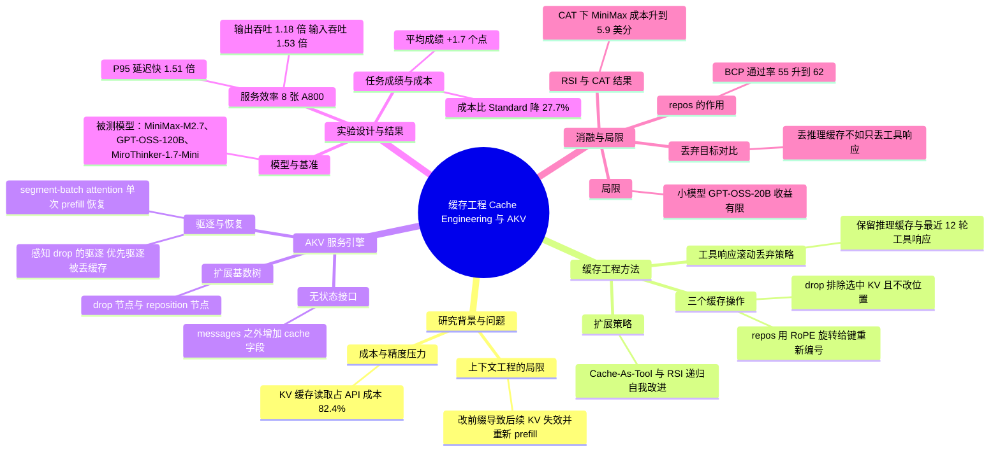

## 一、论文是干什么的？

现在的 LLM 智能体（比如帮你上网查资料、修代码的 AI）一干就是几十上百轮：想一想、调个工具、读一堆网页或日志、再想一想。这条「聊天记录」越来越长。为了不让模型每一轮都把整本「聊天记录」重新读一遍，推理服务会把已经算过的中间结果存下来，这就是 **KV 缓存**（Key-Value cache）。可以把它想成「读书时做的笔记」：笔记越攒越厚，每次翻阅（读缓存）就越慢、越贵。论文指出，在其成本统计（来自 BCP 基准上的实验）中，读缓存就占了总成本的 82.4%。

目前的常规做法叫**上下文工程**（context engineering）：当聊天记录太长时，把老消息删掉或写成摘要。问题在于，这相当于「改了书的前几页」，后面所有笔记都作废，得把保留下来的内容重新读一遍（重新 prefill）。所以大家只好等到长度快撑爆才一次性大幅压缩，只留最近几轮，结果容易把中间有用的信息也丢了。

这篇论文提出**缓存工程**（cache engineering）：不改聊天文本，而是直接在「笔记」上动手，把某些笔记标记成「以后不再翻阅」（drop），再把剩下笔记的页码重新编号（repos），其余笔记原样复用，不用重算。论文同时做了一个配套的服务引擎 **AKV**，让这套操作能在真实的推理服务里高效、正确地运行。

## 二、核心方法与创新

### 2.1 三个缓存操作

论文把对缓存的操作形式化为三种（原文第 3.3 节）：

- **append**：普通的追加，新 token 算出新的 KV 加到缓存末尾。
- **drop**：把选中的 KV 条目从「以后的注意力」里排除。已保留条目的内容、位置编码和文字历史都不变。类比：用荧光笔把某几页笔记划掉，但不撕页、不改页码。
- **repos**：重新给保留下来的键（key）分配位置编码，让位置变成 0 到 $r-1$（$r$ 为保留条目数），下一个新 token 从 $r$ 开始。对 RoPE 位置编码，把键从位置 $p$ 搬到位置 $q$，只需做一次旋转：$K \leftarrow R(q)R(p)^{-1}K$，值（value）不变，不用重算。类比：划掉若干页后，把剩下的页码重排成连续的，免得页码一直涨到「书的页数上限」。

为什么需要 repos？因为只 drop 的话，位置编号仍然一路上涨，即使缓存很小也可能碰到模型的位置上限。论文的消融实验里，加上 repos 让 BCP（BrowseComp-Plus）通过率从 55% 升到 62%。

### 2.2 一个简单而有效的策略：工具响应滚动丢弃

论文的主要示范策略是**工具响应滚动丢弃**（tool-response rolling drop）：保留全部推理（assistant）消息的缓存和最近 12 轮工具响应的缓存，更老的工具响应缓存逐步 drop。依据是论文测得的注意力分布：越老的 token 被关注得越少，而且工具响应得到的注意力比同等位置的助手消息更少。注意丢掉的只是「以后不再看」，被保留的缓存里仍可能带着来自被丢掉历史的信息（论文图 1 用嵌套色块表示）。

### 2.3 难点：缓存状态依赖历史

普通推理服务有个基本假设：前缀 token 相同，缓存就相同，所以能做前缀匹配复用。缓存工程打破了这一点：同样保留 B 和 C，如果「先追加 C 再丢 A」与「先丢 A 再追加 C」，C 的 KV 是在不同可见范围下算出来的，数值不同（论文图 5）。所以服务器必须同时记录 token 历史和操作历史。

### 2.4 AKV 服务引擎

AKV 基于 SGLang（v0.5.20）实现，原则是「无状态接口，有状态服务」：

1. **无状态接口**：兼容现有聊天 API，论文图 6 用 cache 字段示意，当前开源实现则在 messages 之外加顶层的 drop_message 与 reposition 字段，都按「在第几条消息之后执行」的写法指明操作（消息序号从 0 起）。例如 README 示例中 "drop_message": {"4": [2]}, "reposition": [4] 表示处理完第 4 条消息后丢弃第 2 条的 KV，再压缩剩余 token 的位置；整个请求体直接 POST 到 SGLang 的 /v1/chat/completions。每个请求都完整描述自己需要的缓存状态，服务器就算把缓存驱逐了也能完整恢复。
2. **扩展基数树**（extended radix tree）：在前缀树里增加 drop 节点和 reposition 节点，并给 token 节点标记当前编码的位置，这样只有「token 和操作历史都匹配」时才复用。附录还给出两种匹配：精确匹配，以及忽略位置编号、靠旋转键来复用的 retrigger 匹配。
3. **感知 drop 的驱逐**：一条缓存只有在没有任何进行中的计算需要它时才可驱逐；优先驱逐被 drop 的缓存，其次才是已完成请求的缓存（后者更可能被下一轮复用）。
4. **分段批注意力**（segment-batch attention）：当缓存被驱逐、需要恢复时，在 drop 和 repos 的触发点把查询切成多段，每段只对各自可见的缓存做因果注意力，全部在一次前向（prefill）里完成；只对注意力分段，FFN 仍整批计算，以免重复读取 FFN 权重。

### 2.5 额外亮点

因为缓存操作是「可编程」的，论文还试了让智能体自己改进缓存策略（递归自我改进，RSI），以及把缓存管理做成一个工具让智能体自己决定何时丢（Cache-As-Tool，CAT）。

## 三、使用了哪些模型和计算资源？

**被测 LLM（原文第 5.1 节、附录 A.4.4）：**

| 模型 | 规模（原文） | 备注 |
|---|---|---|
| MiniMax-M2.7 | 总参数 230B，激活 10B | 思考模式 |
| GPT-OSS-120B | 激活 5.1B | 高推理强度；服务实验使用该模型 |
| MiroThinker-1.7-Mini | 总参数 30B，激活 3B | 思考模式；成本按其基座 Qwen3-30B-A3B 的价格算 |
| GPT-OSS-20B | 附录补充实验 | 高推理强度 |

另外，GLM-5.2 被用作答案评审（BCP、GAIA-Text、xbench-DS）以及 xbench-DS 的网页信息抽取；BCP 检索用 Qwen3-Embedding-8B。SWE-bench Verified 用官方测试脚本评分，不用 LLM 评审。

**计算资源：**

- 服务实验使用 8 张 NVIDIA A800-80GB GPU：4 张做 prefill、4 张做 decode，张量并行均为 4（TP4）；由于 A800 不原生支持 MXFP4，所有模型权重展开为 BF16。KV 传输用 Mooncake（机内 NVLink），注意力后端 Triton，预填充分块 8192 token，静态显存比例 0.85。
- 基线同样运行在 SGLang 上（AKV 的基础系统）。
- 基准测试的成本不是实际花的钱，而是按公开价格折算的「等价 API 成本」，单位是每百万 token 的美元价格（缓存未命中、缓存命中、输出）：MiniMax-M2.7 为 0.300、0.060、1.200；GPT-OSS-120B 为 0.150、0.075、0.600；MiroThinker-1.7-Mini 为 0.200、0.040、2.400。AKV 的 repos 也按缓存命中价计费，作者称这是刻意高估键旋转成本的保守算法。

**每个完整计算单位的耗时：**

- 单次请求：在 GPT-OSS-120B、Top-80 SWE-Verified 回放负载上，并发 8 时 AKV 平均请求延迟 7.79 秒（P95 为 25.93 秒）；各并发度的完整数字见第四章。
- 单个任务的墙钟耗时：论文没有给出每个任务（一次完整智能体轨迹）的平均耗时，只在图 9(a) 画了通过率随 GPU 小时变化的曲线，正文没有给出具体数值，故写「暂无相关信息」。
- 每任务平均成本见第四章（单位为美分，是折算的 API 价格）。
- 智能体步数上限：BCP 100、SWE-bench Verified 250、GAIA-Text 200、xbench-DS 100。

## 四、实验结果

**设置**：两个基线是「标准」（Standard，超过阈值就做摘要，GPT-OSS-120B 与 MiniMax-M2.7 的阈值为 96K token，MiroThinker 为 192K）和「文本工程」（Text Engineering，同样的摘要策略但阈值降到 48K）。AKV 用上述保留最近 12 轮工具响应的滚动丢弃，repos 阈值与 Standard 的摘要阈值一致。基准：BrowseComp-Plus（BCP）、xbench-DeepSearch-2510（xbench-DS）、GAIA 文本验证子集（103 题）、SWE-bench Verified。

### 4.1 任务成绩与成本（原文表 1，平均列）

| 模型 | 方法 | 平均通过率 % | 平均每任务成本（美分） |
|---|---|---|---|
| MiniMax-M2.7 | Standard | 52.4 | 5.0 |
| MiniMax-M2.7 | Text Engineering | 52.8 | 5.7 |
| MiniMax-M2.7 | AKV | 53.7 | 4.4 |
| GPT-OSS-120B | Standard | 51.0 | 11.2 |
| GPT-OSS-120B | Text Engineering | 48.3 | 10.2 |
| GPT-OSS-120B | AKV | 53.1 | 7.3 |
| MiroThinker-1.7-Mini | Standard | 44.1 | 20.4 |
| MiroThinker-1.7-Mini | Text Engineering | 37.1 | 18.1 |
| MiroThinker-1.7-Mini | AKV | 45.8 | 14.8 |

论文称：AKV 在三个模型上平均成绩都最高；相对 Standard 平均提升 1.7 个点（三个模型分别为 1.3、2.1、1.7，这是我按表中数字算的），成本相对 Standard 平均降低 27.7%，相对 Text Engineering 降低 21.9%。成本下降主要来自：缓存读取费用相对 Standard 降低约 17%，以及相对 Text Engineering 少了重新 prefill，缓存未命中的输入成本降低约 48%（BCP、GPT-OSS-120B）。

准确率提升的解释：在 BCP 前 100 题上，三种方法在 48K 逻辑 token 以内准确率相当；而 Text Engineering 在 48K 到 96K 区间最低，Standard 在 96K 以上最低，与它们各自摘要造成的信息丢失吻合；滚动丢弃是逐步进行的，没有这种突降。

### 4.2 服务效率（原文表 2 节选，GPT-OSS-120B，Top-80 SWE-Verified）

| 并发 | 方法 | 平均请求延迟 s | P95 延迟 s | 输入吞吐 tokens/s | 输出吞吐 tokens/s |
|---|---|---|---|---|---|
| 8 | Standard | 12.16 | 43.57 | 25200 | 217 |
| 8 | AKV | 7.79 | 25.93 | 39227 | 245 |
| 12 | Standard | 12.39 | 43.16 | 33832 | 313 |
| 14 | Standard | 30.16 | 108.86 | 12767 | 146 |
| 14 | AKV | 9.09 | 28.49 | 51837 | 369 |
| 16 | Standard | 36.50 | 229.90 | 10866 | 138 |
| 16 | AKV | 10.32 | 30.63 | 50817 | 369 |

上表为节选，略去了 Text Engineering 以及并发 10、12 的 AKV 等行。注意：Standard 在并发 14、16 的数字是按固定 1 小时窗口统计的，截止时仍有部分请求没有完成（附录 A.1.4）。

在各自的峰值吞吐设置下（AKV 并发 14 对 Standard 并发 12），AKV 的平均与 P95 请求延迟分别快 1.36 倍和 1.51 倍，输入、输出吞吐分别是 Standard 的 1.53 倍和 1.18 倍。并发越高优势越大，因为 Standard 的 KV 显存压力导致大量重复 prefill。解码加速主要来自全注意力时间的减少：同批大小下，全注意力时间降 59.8%，整个解码步骤时间降 16.0%。

在线任务测试（图 9(a)，GPT-OSS-120B，前 100 个 SWE-bench Verified 任务）中，AKV 以最少的 GPU 时间达到最高的最终通过率。

### 4.3 消融与其他策略

- 表 3（GPT-OSS-120B，各基准前 100 题）：只丢工具响应且带 repos，BCP 通过率 62.0、成本 10.9，SWE 通过率 41.0、成本 9.5；去掉 repos 则 BCP 为 55.0。在 SWE 上，这一设置与 Standard 的通过率相同（都是 41.0），但成本差异大（9.5 对 19.1）。丢推理缓存（单独或与工具响应一起）在两个基准上通过率都不如只丢工具响应（SWE 上分别为 36.5 和 34.5，BCP 上均为 56.5，对 62.0）。（原文正文把这张表写成「Table 4」，疑为笔误，这里按表内容称表 3。）
- 递归自我改进：用 MiniMax-M2.7 在 20 道 BCP 任务上迭代改进策略，再在 100 道留出任务上评估，第 3 和第 6 轮策略相对 Standard 每任务成本分别降低 15.6% 和 17.8%，同时保持 Standard 的准确率；摘要中说相对专家手工设计再降 7.1%（正文没有给出 7.1% 的明细，只见于摘要和引言，引言注明是在留出任务 on held-out tasks 上）。
- 缓存管理做成工具（CAT，表 4，BCP 100 题）：GPT-OSS-120B 通过率 61.0（Standard 52.1），成本 12.1 美分（Standard 13.4）；MiniMax-M2.7 通过率 64.0（Standard 56.0），但成本升到 5.9 美分（Standard 5.4），因为多执行了轮次。
- 与现有框架 Pi 结合：在 BCP 上，对 GPT-OSS-120B 与 GPT-OSS-20B，加入 AKV 比无压缩的 Pi 准确率高 3%，比带压缩的 Pi 高 4%。
- GPT-OSS-20B（表 7）：AKV 平均通过率 45.2%（Standard 44.0%，Text Engineering 38.2%），平均成本 4.8 美分（Standard 6.2，Text Engineering 4.6）。作者承认小模型收益有限，更容易受缓存修改影响。

**局限（原文第 6 节）**：更多缓存工程策略的探索、在该方案下训练智能体、以及把服务支持扩展到线性注意力模型，都留作未来工作。另外值得注意（我的判断）：服务效率实验是用各方法自己跑出的轨迹回放的，工具响应并不重新执行，且只在 GPT-OSS-120B 一个模型、一种 GPU 配置上测过。

## 五、潜在应用与已落地应用

**已有据可查的开源情况：**

- 代码已开源：[thu-nics/AKV](https://github.com/thu-nics/AKV)（Apache-2.0 许可，仓库创建于 2026-09-28，2026-10-23 查询为 48 颗星）。自述为论文官方实现，包含 `akv.agent`（决定丢哪些消息、何时 repos 的策略部分）和 `akv.system`（通过兼容 OpenAI 聊天接口的 SGLang 执行缓存操作）；快速上手示例用 GPT-OSS-120B，提供 `CachePolicy`，由 trigger、selector、reposition 三部分组成。另有[项目主页](https://fuvty.github.io/thinking_yard_project_page/projects/akv/)。
- 论文附录表明 AKV 已能与开源智能体框架 Pi 集成并在 BCP 上评估（见上一章）。
- 除此之外，我没有查到任何公司把它用于生产环境的公开资料。

**潜在应用（论文结论与我的判断的结合）：**

- 深度研究、网页浏览、代码修复等需要几十到上百轮的长任务智能体：直接减少「读缓存」的开销。
- 自托管开源模型的推理服务：把「谁来管缓存」从服务器内部的启发式变成智能体与服务器协作的接口。
- 智能体自己学会管理缓存（CAT、RSI）：论文把在此机制下训练智能体列为未来方向。
- 限制（我根据论文设计做出的判断）：需要自己部署基于 SGLang 的服务引擎，对只能调用闭源 API 的用户不适用；对线性注意力模型的支持也尚未实现。

## 六、网络上的讨论与评价

我实际查过的页面和结果如下。未发现人类专家撰写的正式同行评审；但有一篇署名的个人博客长文（Sai Teja Pusuluri，发布于 2026-10-22），以及 Pith 上由 AI 审稿模型生成的评议、daiwk 站点上像是自动化研究流程生成的记录页（没有做本地实现或实验）；其余多为自动化日报或聚合类转载（以下只代表我查到的范围，不是对全网的断言）：

- [Sai Teja Pusuluri 的博客文章](https://saiteja.ai/blog/cache-engineering-for-agents)：署名明确，发布于 2026-10-22，约 6 分钟阅读。作者以第一人称写道，自己把长时运行的智能体用于生产环境，总会撞上上下文变长后的同一堵墙（原文开头：Every long-running agent I have put into production eventually hits the same wall）。文章先复述论文的三个缓存操作（append、drop、repos）、AKV 服务引擎和主要结果（滚动丢弃策略平均成本降低 27.7%，成绩略有提升），并认为论文把活跃缓存当作需要感知历史的一等对象，比只管理转录文本更干净。在「My read」部分，他指出收益真实但不均匀，部分模型与基准组合持平或略差；成本是按公开 token 价格估算而非实际账单；对 repos 的数值结果与重新计算并不逐位一致，论文也承认这一点；最大的限制在于使用门槛：该技术需要能接受缓存操作的推理引擎，目前只适合自托管，闭源 API 只开放提示缓存而不开放缓存本身，线性注意力模型也不受支持。他建议自己运行开源权重智能体的团队，在下一个摘要阈值之前先对工具输出试一试滚动丢弃策略。这是作者对论文的解读和使用建议，并非独立复现实验。

- [daiwk/auto-research 的论文记录页](https://daiwk.github.io/auto-research/agent-research/2610.28577-cache-engineering/)：从站点结构（自动研究平台、审查水位、可晋级 Evolve 映射等栏目）看，像是自动化研究流程生成的记录。它核对了论文和官方仓库，复述了 drop 与 repos 两种操作和主要结果，并指出作者报告的成绩是论文中的智能体和推理服务评测，「不是生产线上 A/B」，也不是该站实测；它还指出原文推理服务配置使用 8 张 A800-80GB 和多个大模型，单张 A100、A30 或 Mac 无法低成本复现，因此结论是「成本过高，不复现（审查 DONE）」，没有做本地实现或实验。

- [Hugging Face 论文页](https://huggingface.co/papers/2610.28577)：票数通过 API 核对为 127（2026-10-23 查询，票数会变动）；页面仅有 1 条评论，由作者本人（fuvty，即 Tianyu Fu）于 2026-10-22 发布，是介绍性质，无第三方评论。作者之一 Tianyu Fu 提交了这篇日报论文，页面关联了项目主页和 GitHub 仓库，Hugging Face 上暂无关联的模型、数据集和 Space。
- GitHub issue 搜索（2026-10-23 用 GitHub 搜索接口查询，查询式为 q=2610.28577）：共返回 7 条结果，其中 5 条是 issue、2 条是 PR（pull request），从标题看均为自动化日报或聚合页。我实际打开了其中 4 条：[Information-gathering 第 14740 号](https://github.com/fulfulggg/Information-gathering/issues/14740)（转载日文翻译的摘要）、[rollysys/agents-radar 第 1516 号](https://github.com/rollysys/agents-radar/issues/1516)（机器人生成的日报，一两句概述）、[kouweizhu/agents-radar 第 602 号](https://github.com/kouweizhu/agents-radar/issues/602)（机器人生成的论文列表，仅列标题）、[diclogic/ai-daily-digest 第 191 号](https://github.com/diclogic/ai-daily-digest/issues/191)（日报中有一小段摘要式介绍，复述摘要中的数字，并注明机构信息来自第三方摘要，无独立评价）。其余 1 条 issue 和 2 条 PR 我没有逐一打开。
- Hacker News：用 Algolia 搜索接口查论文 ID 和完整标题，均为 0 条结果。
- Reddit：搜索接口被拦截（需要登录），用无头浏览器（Playwright 的 Python 版）重试仍显示被网络安全拦截，所以无法确认。
- [Pith 论文页](https://pith.science/paper/2610.28577)：这是 Pith 站点上的「AI review」（T0 档），由 AI 模型 deepseek/deepseek-v4-flash 于 2026-10-21 阅读论文后生成，页面注明尚无人类专家复核，因此不是正式同行评审，以下均为该站（该模型）的观点。总评称这是一篇严肃、工程扎实的系统论文，drop/repos 的缓存控制「真实且有用」；若这些关键检查成立，则是「accept-quality work」（达到可接收水平的工作）；页面上没有看到数值评分。肯定意见：核心思路合理（智能体控制缓存丢弃与重定位，服务系统记录操作历史）；评测覆盖 3 个模型、4 个基准、消融和留出的 RSI 评测，价格与阈值有披露并附代码（审稿模型未运行代码）；该评议称 1.7 分与 27.7% 的平均值可由表 1 推出，1.18 倍与 1.51 倍的服务端结果可由表 2 在所述并发设置下推出；并认为「主要是已有工作」的怀疑框架过强（原文 too strong）。保留意见共 8 条（3 条主要、5 条次要）。主要意见：（1）repos 的语义有效性未测量：附录 A.1.2 的证明只说明复用等价，不能证明旋转后的键等同于在新位置重新计算的键，建议与重新 prefill 对比并测量输出偏差，因为 repos 使 BCP 从 55.0 升到 62.0；（2）1.7 分的提升没有方差和显著性检验，部分单元格差值为负或持平；（3）27.7% 的节省假设被丢弃的 token 不计费，而完整历史仍在传输，需要在缓存命中与未命中价格下做敏感性分析。次要意见：摘要的 1.2 倍吞吐与 1.5 倍延迟需与 5.3 节的 1.18 倍和 1.51 倍（并发水平不同）在一处对齐（评议认为数字本身一致）；摘要中「比专家设计低 7.1%」无法由 5.4 节推出（该节报告相对 Standard 的 15.6% 与 17.8%），即 7.1% 的计算明细未给出；表 2 在高并发（C=14、C=16）延迟测量中存在不对称的截断；第 2 节的「首个服务系统」说法需结合附录 A.5 的 SideQuest 加以限定；图 13 的成本构成需与表 1 总计核对，并说明基线摘要调用的处理方式。该评议还建议做一个对照：每次 drop 后都重算剩余缓存，若重算结果不差于复用结果，则收益来自服务效率而非缓存保真度。
- X/Twitter、知乎：用通用搜索引擎做了两次检索（标题加 arXiv 编号、标题加 AKV 关键词），没有返回任何指向本文的页面；DuckDuckGo 页面报错，Bing 只返回无关的清除浏览器缓存结果，所以无法确认那里有无讨论。
- Paperium：我打开了其首页和站内文章搜索页（共约 2.4 万条记录，只看到第一页），没有看到本文页面，但无法排除其他页面存在，因此不能断言没有。
- GitHub 仓库的 [README](https://github.com/thu-nics/AKV)：这是作者团队的官方实现资料（仓库自称是论文 Cache Engineering for Agents 的官方实现），属于第一方资料。

这篇论文发布才 3 天，目前查到的第三方内容以 AI 生成的评议、自动化记录和转载为主；在我查到的来源中，人工撰写的深入讨论较少，仅发现上面这篇 Sai Teja Pusuluri 的署名博客长文（仅限我查到的范围）。

## 七、思维导图

