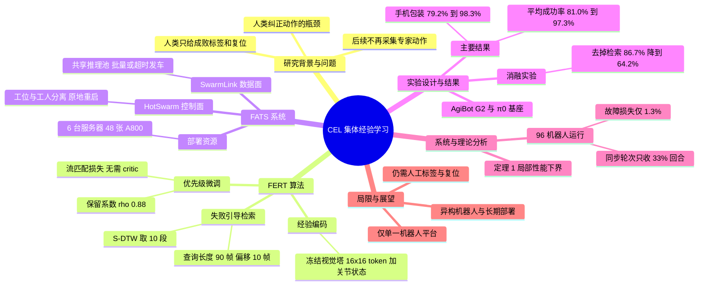

## 一、论文是干什么的？

想象一家连锁快餐店有 96 个新手店员，每个人都在不停地做同一道菜。传统做法是：每个新手旁边站一位师傅，一出错师傅就接手示范正确动作。店员越多，需要的师傅就越多，师傅很快就不够用了。

这篇论文提出的做法是：**让店员们互相学习**。某个店员在某个步骤上搞砸了，系统就去翻其他店员「做成功了」的录像，找出做同一步骤的成功片段，让大家照着这些成功片段多练几遍。师傅只需要告诉大家「这一份做成功了还是失败了」以及帮忙收拾桌面，不需要再手把手示范。

论文把这个范式叫做**集体经验学习**（Collective Experience Learning，CEL）：部署在现场的机器人把各自的执行经验汇集起来，共同改进一个共享策略，更新后的策略再发回给所有机器人。论文由清华大学、智元机器人（AgiBot）和无问芯穹（Infinigence AI）合作完成，最大规模的训练使用了 96 台真实机器人。论文标注星号的共同贡献者为 Chao Yu（清华）、Shu'ang Yu（清华）、Hao Lin（无问芯穹）、Hongzhi Zang（清华）、Yuxiang Yan（智元）和 Chenxi Jiang（智元），其中 Chao Yu 是总项目负责人；通讯作者为 Maoqing Yao（智元）和 Yu Wang（清华）。

补充说明：arXiv 上 v1 的标题为「Learning from Fleet Experience: A Collective Learning Paradigm for Robots」（HF 页面沿用此标题），v2（2026 年 10 月 21 日）的标题改为「Learning from Fleet Experience: Collective Experience Learning Across 96 Robots」。

## 二、核心方法与创新

论文由三个部分组成，可以用「教学方法 + 教学设备」来理解。

### 1. CEL：范式本身

动作监督（也就是「正确动作从哪来」）的来源有三种：人类示范、专家纠正、机器人集群自己的经验。从左到右，对专家动作的需求逐渐减少。CEL 在用专家数据完成初始化之后，后续不再采集新的专家示范或纠正动作。需要注意的是，论文的实现里**人类仍然提供每条轨迹成功或失败的二值标签，并负责复位环境**（原文明确保留了这两项）。

### 2. FERT：失败引导的经验检索微调

FERT（Failure-guided Experience Retrieval Fine-Tuning）分四步，像「错题本 + 标准答案库」：

1. **异步采集经验**。每条完整轨迹都有成功或失败的标签。成功轨迹进入共享的「集体经验缓冲区」（滚动窗口），作为动作监督的来源。失败轨迹只当作「查询线索」，它的动作不会被模仿。
2. **经验编码**。用策略模型视觉塔的一个冻结副本提取图像特征（每个相机得到 16×16 的视觉 token，再用 4×4 平均池化压成 4×4 网格），与归一化后的关节状态拼接，形成每一帧的向量。冻结是为了让新旧经验始终处在同一个特征空间里。
3. **失败引导检索**。因为失败标签说不清「具体哪一刻出错」，FERT 取失败轨迹终点之前的一小段（最长 $L=90$ 帧，终点偏移 $\delta=10$ 帧，30Hz 下约 3 秒）作为查询，用带斜率约束的子序列动态时间规整（S-DTW）在每条成功轨迹里找最相似的片段，选出代价最低的 $K=10$ 个，并向前后各扩展 30 帧。类比：拿着「我在这一步翻车了」的录像，去成功录像库里找「别人做这一步」的片段。
4. **优先级微调**。被检索到的片段提高采样优先级，优先级按 $w_i^{(n)}=\rho w_i^{(n-1)}+\ldots$ 的形式累积并衰减（$\rho=0.88$），然后按优先级采样成功动作块，用模型自带的流匹配损失做监督更新。整个过程**不需要学习价值函数、critic 或优势估计**。

论文还给出了一个局部理论保证（定理 1）：在一定假设下（原文限定为单步均值梯度更新，并采用当前策略回放近似），足够小的步长时 $J(\theta_{\mathrm{FERT}})>J(\theta_{\mathrm{unif}})>J(\theta_0)$，即检索加权比均匀回放更好，均匀回放又比不更新更好。这是局部分析，不等于对真实系统的全局保证（此句为本综述的解读）。

### 3. FATS：容错异步训练系统

机器人会没电、断网、关节超限，还要等人复位，所以不能让所有机器人同步等待。FATS 基于 RLinf 和 Ray 构建，分成两个层面：

- **SwarmLink（数据面）**：把所有机器人的推理请求汇到共享的云端推理池，满足批大小或超时就发车；轨迹数据边执行边流式上传，云端按「机器人、回合、步数」编号拼装，等完整回合和结果标签到齐后才交给训练。交互流量优先，大数据分块传输。
- **HotSwarm（控制面）**：把「工位（station）」和「工人（worker）」分开。机器人坏了，只在原地重启对应的环境进程，其他机器人继续采集；怀疑某进程出问题就直接终止它，不去等它是否恢复，让每次故障都有确定结果。训练进程则定期存档、从最新存档恢复。

类比：像一个大型工厂，某条流水线工位出故障，只维修那个工位，而不是整个工厂停工重启。

## 三、使用了哪些模型和计算资源？

| 项目 | 内容（均出自论文原文） |
|---|---|
| 基座策略 | $\pi_0$，一个基于流匹配的视觉-语言-动作（VLA）模型；先做 SFT，再做多机器人 HG-DAgger 得到统一初始化 |
| 机器人 | AgiBot G2，双臂；观测为 1 路头部相机、2 路腕部相机（共 3 张 224×224 RGB）加本体状态；动作为双臂关节位置增量 |
| 机器人规模 | 部署现场最多支持 100 台，最大训练集群 96 台；评测使用 2 台未参与训练数据采集的机器人 |
| 云端 GPU | 6 台服务器，每台 8 张 NVIDIA A800，共 48 张，用于推理和策略优化 |
| 网络 | 机器人现场与云端之间一条专用 30 Gbps 链路 |
| 训练超参 | AdamW，余弦学习率，最大学习率 $2.5\times10^{-5}$，全局批大小 1024，预热 80 步，调度周期 10000 步，梯度裁剪 4.0，权重同步间隔 500 步，训练进程与机器人比例 0.25 |
| 机器人端算力、训练 GPU 小时数 | 暂无相关信息（原文未给出机器人本体计算平台，也未给出总 GPU 小时数） |

**计算单位的耗时（原文数字）：**

- 每次 FERT 训练：约 7 到 8 小时的在线训练，取收敛时的检查点用于最终评测。
- 96 机器人的那次运行：从 10:37 持续到 18:30，其中 12:00 到 13:00 午休暂停，共约 660 机器人小时，完成 9,834 个回合。
- 单个回合：中位数约 3.2 分钟，各机器人中位数在 0.6 到 4.2 分钟之间；手机包装任务一个回合约 3,500 个时间步、1.58 GB 数据，机器人约每 4 分钟完成一个回合。
- 任务时长：叠衣服约 40 秒，手机包装约 2 到 3 分钟。
- 评测：每个策略每个任务 120 次试验（两台测试机器人各 60 次）。
- 每台机器人的固定采集时长具体是多少：暂无相关信息（原文只说明「每台机器人采集时间固定」，我没有在正文里找到具体数值）。

## 四、实验结果

**任务**：插花（Flower Arrangement）、叠 T 恤（Clothes Folding）、手机充电（Phone Charging）、组装凳子（Stool Assembly）、手机包装（Phone Packaging）。

**对比方法**：RLT（单机器人在线强化学习，冻结 VLA 上学残差 actor-critic）、RECAP（多机器人离线强化学习，学价值函数做优势条件）、人类遥操作参照（6 名操作员各 20 次，共 120 次）。RLT 和 RECAP 后续学习中都使用了人类纠正动作，FERT 没有。

**主要结果（均为原文数字，评测用未参与训练的机器人）：**

| 任务 | FERT 使用的训练机器人数 | 初始化策略成功率 | FERT 成功率 |
|---|---|---|---|
| 插花 | 16 | 98.3% | 99.2% |
| 叠衣服 | 16 | 85.8% | 98.3% |
| 手机充电 | 16 | 60.0% | 97.5% |
| 组装凳子 | 32 | 81.7% | 93.3% |
| 手机包装 | 96 | 79.2% | 98.3% |

（成功率由原文表 3 的失败率换算得到：1 减去失败率。）

- 多机器人 HG-DAgger 把五个任务平均成功率从 36.3% 提升到 81.0%；FERT 再提升到 97.3%，提升 16.3 个百分点，平均失败率相对下降 86.0%。
- FERT 在五个任务上都高于 RLT 和 RECAP，平均分别高 12.3 和 11.5 个百分点；也在五个任务上都高于人类遥操作参照，平均高 16.7 个百分点。
- **规模效应**：在每台机器人采集时间固定时，FERT 的成功率整体随机器人数增加而上升，例如手机包装从 16 台的 86.7% 升到 96 台的 98.3%。但小规模时可能反而退步：8 台机器人时，组装凳子和手机包装的成功率低于初始化策略。论文推测是小集群的成功经验不够丰富，覆盖不了各种失败情境。多机器人 HG-DAgger 则在手机充电、手机包装上出现饱和，在组装凳子上出现下降。
- **消融实验**（手机包装、16 台机器人，完整配置 86.7%）：去掉失败引导检索降到 64.2%；不扩展检索片段（前后各 0 帧）降到 57.5%；同步间隔 100 步降到 75.0%、1500 步降到 80.0%；$\rho=0.8$ 为 70.8%，$\rho=0.95$ 为 82.5%。
- **系统结果**（96 机器人运行）：记录到 30 次故障事件，涉及 22 台机器人，合并后为 19 个故障事件，约每 22 分钟一次；故障共损失 8.3 机器人小时，占 660 机器人小时的 1.3%；故障发生后的 10 分钟内，中位数情形仍完成故障前 99% 的回合（仅限 14 个距离午休和运行首尾均至少 10 分钟的故障事件，最低不少于 88%）。若改用同步轮次，只能收集到实际回合数的 33%；若每次故障全系统重启，重启 2、5、10 分钟分别保留 92%、86%、74% 的回合。通信方面，Env-to-Rollout 有 95.18% 的操作在 20 毫秒内完成。

**论文自己承认的局限**：只评测单一机器人平台上的任务专用策略；仍依赖人类提供成败标签和环境复位；更广泛的任务分布、异构机器人和长期部署留待未来。

## 五、潜在应用与已落地应用

**已落地或有据可查的部分**：论文的所有实验都在真实 AgiBot G2 机器人上完成（96 台、一个收集现场），属于真实世界实验，但论文没有提到商业落地或产线部署。项目主页的「Code」按钮指向 [RLinf](https://github.com/RLinf/RLinf) 仓库（FATS 构建于其上），截至 2026-10-23，我检查了 RLinf main 分支（commit d844e64，2026-10-22）的全仓库内容，搜索 FERT、FATS、HotSwarm、SwarmLink、collective experience、2610.25736、cel-robot 均无命中；项目主页的 Code 按钮只指向这个通用框架仓库，Video 按钮为禁用状态；论文与 HF 页均未声明数据集或模型发布，HF API 的 linkedModels、linkedDatasets、linkedSpaces 均为空，且返回里没有 githubRepo 字段。故**论文专用代码和数据未见发布**（只检查了 main 分支，未逐个检查 dev/dynarl、dev/geniesim、dev/physical-agent、release/v0.1 至 v0.4 等其他分支）。

**潜在方向（以下为本综述的判断，并非论文已验证）**：

- 仓储、电子产品装配、服务业等需要大量同款机器人重复执行同一流程的场景：成功经验可以在整个机器人队伍内共享。
- 把人力从「现场示范」转为「判断成败和复位」，降低规模扩张时对遥操作员的需求；如果以后成败判断也能自动化，才有可能进一步减少人力，这是论文未验证的延伸。
- FATS 的「局部恢复」思路，对其他需要大量物理设备参与的分布式训练同样有借鉴意义。

## 六、网络上的讨论与评价

截至 2026-10-23，我找到的带实质性个人批评的第三方内容只有一篇中文精读；此外有一篇中文媒体转述，以及 Hyper.ai、AIMap、Papers with Code 等摘要或索引页，我没有在这些页面里看到独立评价；另有一条来自 Pith 的 AI 生成评议（见下）。这只是我检索到的范围，不代表英文第三方报道不存在。下面分类列出。

**带个人观点的解读或批评：**

- [Ying Wang 的「每日论文精读」（2026-10-20）](https://yingwang.github.io/paper-reads/papers/2026-10-20-fleet-experience-collective-learning-robots/)：一篇中文长文精读，除复述方法和实验外，在「4.2 读者能看出来的潜在问题」里列了七条批评。一是**数据与人力预算并不对等**：FERT 的主结果来自 16 到 96 台机器人、每次 7 到 8 小时的在线训练，而 RECAP 新采集的数据只有 48 到 559 条轨迹，RLT 只在单台机器人上用了 30 到 100 个回合，所以主表的领先混合了算法差异与数据量差异；作者举的旁证是手机包装上单机 RLT 的 85.0% 与 16 台 FERT 的 86.7% 几乎相同，并建议在相同机器人时间或相同人工时间下比较。二是统计证据偏薄：每个配置只训练一次，120 次试验的置信区间约正负 6 个百分点，16 台手机包装的提升与初始化区间重叠。三是「不需要专家动作」不等于「不需要人」，人工转移到了成败标注和场景复位，论文没给总人工时间对比。四是 FERT 本质上是按优先级加权的成功过滤行为克隆，难以发现初始策略从未成功过的做法，对初始化成功率有要求。五是查询只取失败前约 3 秒，对「病根在前、症状在后」的失败可能定位不到真正出错的阶段。六是评测机器人与训练机群同型号，没有换场地、物体或光照，检验的不是跨场景泛化。七是需要 100 台机器人场地、48 张 A800 和 30 Gbps 专线，可复现门槛很高，且未给出 FERT 或 FATS 的代码链接。该文还指出，去掉检索的均匀回放（64.2%）低于初始化（79.2%），与定理部分引理的局部结论方向相反，论文没有专门讨论。

**新闻或转述（以复述论文为主，不含批评）：**

- [36 氪《96台机器人共同进化，成功率反超人类，清华、智元机器人、无问芯穹联合提出“集体经验学习”》（2026-10-22）](https://www.36kr.com/p/4036442835145862)：转载自微信公众号「学术头条」（作者张佳怡，36 氪经授权发布）。正文按论文顺序复述 CEL、FERT 四步、FATS 双平面架构和实验数字，并照录了论文自述的局限。编辑性内容主要是结尾的总结：CEL 带来一种新的部署逻辑，机器人越多不只是产能越大，还能越学越好，而且不受专家监督供给的制约。这是对论文主张的正面概括，没有提出质疑。
- [hyper.ai 论文页](https://hyper.ai/en/papers/2610.25736)（另有中、日、法、德、阿拉伯语等多语言版本）：只是摘要的转载，不含独立评价。
- [AIMap 论文页](https://aimap.page/en/learn/papers/2610.25736/)（该站 [今日列表](https://aimap.page/en/today/) 也收录了此文）：站点自己说明一句话要点由 AIMap 根据摘要撰写，页面主要是元数据、HF 票数（125）和索引，没有评价。
- [Papers with Code 论文页](https://paperswithcode.co/paper/2610.25736)：显示 v1 标题、作者、摘要和项目主页链接，属于纯索引，没有评价。

**AI 生成的评议：**

- [Pith 评议页](https://pith.science/paper/2610.25736)：这是 AI 审稿模型 deepseek/deepseek-v4-flash 在 2026-10-22 生成的评议（站内标为 T0 级，页面注明尚无人类专家复核），不是正式同行评审，以下是该站的观点。肯定方面：96 台真机的规模新，有留出评测和每个条件 120 次试验，消融覆盖检索、优先级保留、同步间隔和片段扩展，FATS 容错设计有故障轨迹验证（停机 1.3%），行文清晰、工程贡献具体。保留意见共 6 条（页面标为 2 条 major、4 条 minor）。major 两条：一是检索消融是整体去掉检索，没有说明失败引导的检索是否优于任何非均匀优先级（如按新近度或随机加权）；二是检索质量只有附录 H.3 的定性示例，没有 precision@K 等定量指标，而引理 2 依赖检索对齐条件。minor 四条：理论分析假设较强（单步梯度、采用当前策略回放、分阶段模型、固定回放分布），与实际训练不同；消融只在 16 台机器人的手机包装任务上做；超参数很多，但敏感性只研究了部分参数（同步间隔、片段扩展、rho）且只在一个任务上；通信延迟图没有区分网络传输、排队和 GPU 计算。该站总体评价为扎实的工程论文，但检索机制相对更简单的优先级方案的优势没有完全隔离出来，建议补充与更简单优先级方案的对比。

**论文方自己的渠道与社区平台：**

- [Hugging Face 论文页](https://huggingface.co/papers/2610.25736)：票数为 126（用 API 核对），讨论区（用 HF 页 data-props 核对）共有 2 条评论：一条是作者 ysa2001（Shu'ang Yu）自己发的摘要与项目主页链接，另一条是 2026-10-20 由 researchstudio-bot 自动发出的 ResearchStudio Reel 链接（署名链接指向 microsoft.github.io 的 ResearchStudio 项目），均不是独立的人工评价。
- [arXiv 摘要页](https://arxiv.org/abs/2610.25736) 与 [项目主页](https://cel-robot-learning.github.io)：为论文方自己的介绍。
- Hacker News（通过 Algolia 接口按 arXiv 编号搜索，0 条结果；按标题关键词搜索只命中无关帖子）。
- Reddit 搜索接口、WebSearch 的中英文关键词搜索（含「智元 清华 无问芯穹 96台机器人」「集体经验学习 FERT」「Collective Experience Learning FERT」），除上述页面外只返回 hyper.ai 镜像页和无关页面，没有找到 X、知乎或英文博客上的讨论。Reddit 接口未返回可用内容，所以 Reddit 的情况无法确认。

## 七、思维导图

