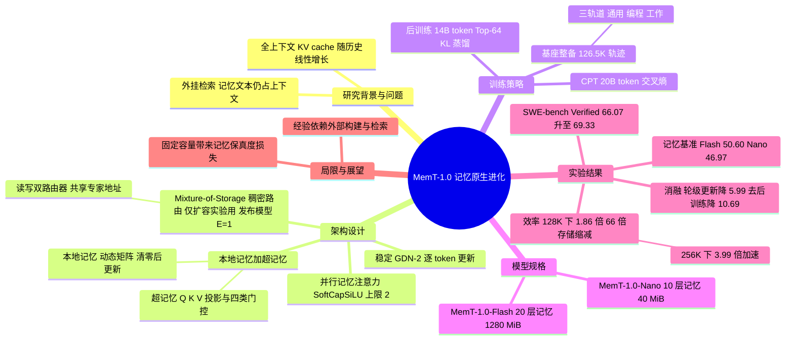

## 一、论文是干什么的？

现在的大模型有个老毛病：它没有真正的「记性」。你和它聊了一百轮，想让它记住前面的事，通常只有两条路。第一条是把全部聊天记录原封不动塞进输入里（叫 full context，全上下文），记录越长越慢、越占显存。第二条是外挂一个「小笔记本」，需要时去翻（检索增强，如 RAG、Mem0、MemOS 这类系统），但翻出来的文字还得再塞回输入里。

这篇论文提出的 MemT-1.0 走第三条路：让模型自己长出一块「海马体」。就像人不会把一辈子的对话录音带在身上，而是把经历压缩成印象存在脑子里，MemT-1.0 在模型每个选定的层里加了一块固定大小的「记忆矩阵」，每聊完一轮就把新信息写进去，回答问题时再从里面读出来。不管历史多长，这块记忆的大小不变。论文把这种能力叫「原生记忆」（native memory），把这类模型叫「记忆基础模型」（memory foundation model）。

论文来自 MemTensor 团队，是他们此前工作 Metis 的升级版。官方发布了两个模型：MemT-1.0-Nano（总参数 36B，激活 3B）和 MemT-1.0-Flash（总参数 288B，激活 17B）。

## 二、核心方法与创新

**1. 双层记忆结构：本地记忆加超记忆。** 沿用 Metis 的设计：

- **本地记忆**（local memory）：每层一个动态矩阵，形状是「通道数 × 键维度 × 值维度」，对话开始时清零，随互动不断更新。可以类比成一块会被不断擦写的小白板。
- **超记忆**（hyper memory）：一组可训练的参数，包括记忆的查询、键、值投影，以及擦除门、写入门、遗忘门、输出门。它不随对话变化，类比成「怎么用白板」的使用说明，是训练出来的本事。

**2. 并行的记忆注意力。** 在选定的 Transformer 层里，原来的注意力照常工作，旁边再并联一路「记忆注意力」，两路输出相加。原模型的前后处理一概不动，所以原有能力得以保留。记忆读出时，先用查询去读记忆矩阵，再经过 RMSNorm 和一个带上限的门控（SoftCapSiLU，默认上限参数为 2）。

**3. 稳定的逐 token 更新（基于 Gated DeltaNet-2）。** Metis 用「挑选 token」的方式写记忆，MemT-1.0 改为每个 token 都更新一次记忆矩阵，更新规则基于 Gated DeltaNet-2（GDN-2）。要点是「写之前先擦」：新信息写入前，先按擦除门擦掉与之冲突的旧内容，再按遗忘门做整体衰减。论文还指出原始 GDN-2 的更新有发散风险，于是提出一个「对称化修正」的稳定机制（论文附录 C）。类比：往笔记本上记东西，每写一个字都先用橡皮轻擦同一位置，避免越写越乱。

**4. Mixture-of-Storage（MoS，存储专家混合）。** 想要更大的记忆容量，就把一个记忆块扩成 $E$ 个并行的「记忆专家」。和普通 MoE 的稀疏路由不同，MoS 是稠密路由：所有专家都参与，两个路由器（一个管读、一个管写）共享同一套「专家地址」，用 softmax 概率决定信息往哪些专家里写、从哪些专家里读。类比：从一块白板换成一面白板墙，写和读各有一位管理员按地址分配。需要注意：论文附录 B（表 6）写明，发布的 Nano 和 Flash 每个记忆层都只有 1 个记忆块（$E=1$），并没有用到 MoS；MoS 只用于 5.4 节和附录 F 的容量扩展实验，是一个单独验证过的扩展设计，不是已发布模型的组成部分。

**5. 先整备基座，再训练记忆。** Flash 的基座不是直接用 DeepSeek-V4-Flash 原版，而是先做了一轮后训练（论文称 backbone preparation）：按通用能力、智能体编程、智能体工作三条轨道，先让模型反复做题，判断它是「稳定会、偶尔会、不会」，再针对失败原因（缺约定、缺流程、缺知识）合成不同数据。最终数据混合含 126.5K 条轨迹（2.4B token），整备后的基座在监控的六个基准上平均比公开版高 6.3 分。论文的态度是：知识缺口交给检索和原生记忆，不靠后训练去补。

**6. 两阶段训练加全上下文蒸馏。**

- 第一阶段 CPT（继续预训练）：把序列切成 2K token 的段，每段当作一步，前面的内容只能通过记忆状态获取，用交叉熵损失训练，让模型学会「带着记忆做语言建模」。
- 第二阶段后训练：以带完整文本历史的原始基座作为老师，学生只能通过记忆读历史，用前向 KL 散度（保留老师 Top-64 个 token，温度为 1）去逼近老师。梯度会穿过记忆读取和更早的写入，让模型学会「该记什么」。MoS 训练另加路由器负载均衡的辅助损失。
- 只训练记忆相关参数，基座冻结。

**7. 数据。** 共 34B token：CPT 数据 20B，后训练数据 14B（记忆原生语言建模数据、记忆存储与利用任务数据如摘要、续写、压缩，以及长程记忆任务数据）。部分数据基于 MemOS 的匿名内部真实交互模式。

**8. 智能体应用：经验写进记忆。** 用 Scale-SWE 的 41,057 条成功编程轨迹，总结出 1,040 条可复用的编程经验。做任务时用 BGE-M3 检索经验，不是塞进提示词，而是通过一次专门的「记忆写入」前向传播存入 MemT-1.0-Nano 的记忆，后续行动时由记忆注意力读取。

## 三、使用了哪些模型和计算资源？

**使用的 LLM（论文原文）：**

| 角色 | 模型 |
|---|---|
| MemT-1.0-Nano 的基座 | Qwen3.6-35B-A3B（原版直接使用） |
| MemT-1.0-Flash 的基座 | 经过后训练整备的 DeepSeek-V4-Flash（论文称整备后基座为 284B 总参数、13B 激活参数；发布的 Flash 模型整体为 288B 总参数、17B 激活参数；这是我的推断，即 284B 加约 3.61B 记忆参数约等于 288B，13B 加约 3.61B 约等于 17B，论文未直接拆解） |
| 全上下文蒸馏的老师 | 冻结的原始基座（Nano 用 Qwen3.6-35B-A3B，Flash 用整备后的基座） |
| 评测裁判（LLM-as-a-Judge） | gpt-4.1-mini，配 OmniMemEval 提示词 |
| 智能体实验的基座 | Qwen3.6-35B-A3B，框架用 AweAgent |
| 经验检索 | BGE-M3 |

**模型规模（论文附录表 6）：**

| 项目 | Nano | Flash |
|---|---|---|
| 解码器层数与隐层宽度 | 40 层，2048 | 43 层，4096 |
| 加记忆的层 | 10 层（全注意力层） | 20 层（压缩稀疏注意力层） |
| 记忆通道数与键值维度 | 16，256 | 64，512 |
| 可训练记忆参数 | 450,931,360（约 451M） | 3,608,608,000（约 3.61B） |
| 每条轨迹的记忆状态元素 | 10,485,760 | 335,544,320 |
| FP32 状态大小 | 40 MiB | 1280 MiB |
| 每个记忆层的记忆块数（$E$） | 1 | 1 |

注：表中两个发布模型都是单专家（$E=1$），Mixture-of-Storage 没有用在已发布的模型里，只用于容量扩展实验。

**训练配置（论文原文）：**

- Nano：CPT 1 个 epoch 后接后训练；全局 batch 为 64 个打包序列，每包最长 64K token，存储步长（段长）2K token；AdamW，基座用 BF16，RMSNorm、Softmax、记忆状态和优化器状态用 FP32；WSD 学习率调度，CPT 预热 600 步到 1e-4，后训练预热 500 步到 1e-4 并在最后 1,000 步余弦衰减到 5e-6。
- Flash：全局 batch 192 个包，其他同上，峰值学习率 8e-5，预热 100 步。
- 训练框架：Megatron-Core 与 Megatron Bridge，对基座 MoE 层使用专家并行，通信后端为 DeepEP；记忆更新用分块 WY 表示的算子，MoS 用「完整步窗口」加反向重算节省显存。

**GPU 型号、数量、训练总时长：** GPU 型号、数量和总训练时长论文都没有披露；表 7 给出了并行配置（Nano：TP/PP/CP/EP 为 1/1/1/8，逻辑 DP 为 64；Flash：1/4/2/8，逻辑 DP 为 12），可以看出训练是大规模并行的，但设备总数没有明说，无法由此可靠推算（致谢中仅感谢 Shanghai Kupas Technology Co.,Ltd. 和 INESA (Group) Co., Ltd. 的支持，没有说明是算力支持）。

**每个完整计算单位的耗时：**

- 单次训练阶段（CPT、后训练）的耗时：暂无相关信息。
- 单个 MoS 记忆块的显存与时间权衡：论文在单 GPU 上用 32K token 的包测过（论文表 1），但 GPU 型号未写明，此处不展开。
- 推理（论文原文）：评测用 HF 推理，两张 GPU 独占，层分布在两卡上，并发为 1、批大小为 1，生成固定 128 个 token。Nano 的查询首 token 时间（TTFT，不含历史准备）稳定在约 104 到 112 毫秒，全上下文在 128K 时约 257 毫秒、256K 时约 445 毫秒。端到端耗时相对全上下文：32K 时基本持平，64K 约 1.20 倍，128K 约 1.86 倍，256K 约 3.99 倍加速；历史很短时 Nano 反而更慢。两张 GPU 的具体型号：暂无相关信息。
- 智能体实验中的 API 开销：暂无相关信息。

## 四、实验结果

**1. 记忆能力（11 个基准的平均分，论文表 2）。** 评测时模型不能看到历史原文，只能依赖记忆状态。基准按历史长度分组，包括 MemBench、ImplicitMemBench、PersonaMem、PS-Bench、LoCoMo、PerMemSafe、Memora、MemOps、LongMemEval-S、MemoryAgentBench、BEAM-1M。

| 方法 | 类别 | 平均分 |
|---|---|---|
| MemOS（DeepSeek 基座 / Qwen 基座） | 文本记忆 | 68.55 / 68.46 |
| Mem0 | 文本记忆 | 65.53 / 65.98 |
| 全上下文 | 文本记忆 | 64.98 / 66.27 |
| OpenViking | 文本记忆 | 65.09 / 65.43 |
| DenseRAG | 文本记忆 | 57.28 / 56.49 |
| Graphiti | 文本记忆 | 49.43 / 45.72 |
| **MemT-1.0-Flash** | 参数化记忆 | 50.60 |
| **MemT-1.0-Nano** | 参数化记忆 | 46.97 |
| Temp-LoRA | 参数化记忆 | 38.08 |
| δ-mem | 参数化记忆 | 31.20 |
| Doc-to-LoRA | 参数化记忆 | 30.93 |
| LiveMem-RL | 参数化记忆 | 29.74 |
| SHINE | 参数化记忆 | 25.55 |
| MemoryLLM | 参数化记忆 | 25.26 |
| ICAE | 参数化记忆 | 22.87 |

大白话：在「不给原文」的同类选手里，Flash 和 Nano 排第一和第二，分别领先最强的参数化基线 12.5 分和 8.9 分。但论文 6.2 节自己也承认，最强的文本记忆系统仍明显更高，尤其在 LongMemEval-S 和 BEAM-1M 上。对照表 2 看：Flash（50.60）比最强文本系统 MemOS（DeepSeek 基座 68.55）低约 18 分；比 DenseRAG 低约 6.7 分（DeepSeek 基座 57.28），Nano（46.97）比 DenseRAG 低约 9.5 到 10.3 分（Qwen 基座 56.49，DeepSeek 基座 57.28）。不过 Flash 的 50.60 高于 Graphiti（DeepSeek 基座 49.43），Nano 的 46.97 高于 Graphiti（Qwen 基座 45.72），Flash 在 PerMemSafe 单项上的 33.47 也高于全上下文（DeepSeek 基座）的 32.27。我的判断：摘要里说的「与检索增强方法有竞争力」只对弱到中等的检索基线（Graphiti 等）成立，对 DenseRAG 仍有 7 到 10 分差距，对 MemOS 等强系统差距更大，更准确的说法是「已超过其他参数化记忆，距顶级文本记忆仍有差距」。

**2. 通用能力是否被破坏（噪声设置，论文表 3）。** 先往记忆里灌无关信息，再测通用基准（MMLU-Pro、GPQA Diamond、IFEval、LongBench v2、BigCodeBench-Hard、LiveCodeBench v6）。表中的 0.0 和 -0.9 是相对「同样注入了噪声的基座」算出的差值，不是相对没加噪声的原始基座。Flash 相对注入噪声的 DeepSeek-V4-Flash 平均变化为 0.0；Nano 相对注入噪声的 Qwen3.6-35B-A3B 平均下降 0.9 分，其中下降最多的是 LiveCodeBench v6（降 5.8 分），IFEval 则升 3.3 分。所以「通用能力基本保持」对 Flash 比较干净，对 Nano 要留意代码能力有明显下降。

**3. 消融（Nano，论文表 4）。**

| 变体 | 平均分 | 相对完整模型 |
|---|---|---|
| 完整 MemT-1.0-Nano | 46.97 | 0 |
| 去掉稳定机制（回到 GDN-2） | 46.43 | 降 0.54 |
| 换成 GDN | 46.72 | 降 0.25 |
| 加双向编码（BE） | 45.43 | 降 1.54 |
| 改成轮级更新而非 token 级（TL） | 40.98 | 降 5.99 |
| 不做 CPT | 44.85 | 降 2.12 |
| 不做后训练 | 36.28 | 降 10.69 |

结论：更新粒度（逐 token）影响最大，更新规则的细节影响很小，后训练比 CPT 更关键。

**4. 效率与存储。** 128K 历史下，Nano 相对全上下文端到端约快 1.86 倍，每条轨迹的持久存储约少 66 倍；64K 时逻辑状态约小 33 倍。Nano 的记忆状态大小恒定。但论文也指出，历史很短时 DenseRAG 存文本块更省空间。

**5. 缩放规律。** 后训练两个 epoch，平均分从 36.65 涨到 46.80，LoCoMo 从 40.39 涨到 57.53；MoS 专家从 2 个增到 4 个，在 200、3,400、5,500 步时平均分分别多 0.41、2.01、2.69 分。低秩分解实验（SVD 取不同秩 $k$）显示，保留的秩越高效果越好，但收益递减，PersonaMem 上更早饱和。

**6. 智能体编程（论文表 5，三次独立运行）。**

| 基准与注入时机 | 方法 | $\mathrm{pass}^3$ | 平均成功率 |
|---|---|---|---|
| SWE-bench Verified（500 题），执行前 | 无经验 | 54.00 | 66.07 |
| 同上 | 文本经验 | 61.60 | 68.87 |
| 同上 | MemT-1.0-Nano 原生记忆 | 61.60 | 69.33 |
| SWE-bench Verified，触发式 | MemT-1.0-Nano 原生记忆 | 62.80 | 69.73 |
| SWE-bench Multilingual（300 题），执行前 | 无经验 | 45.33 | 60.00 |
| 同上 | 文本经验 | 56.33 | 64.22 |
| 同上 | MemT-1.0-Nano 原生记忆 | 53.67 | 62.89 |
| SWE-bench Multilingual，触发式 | MemT-1.0-Nano 原生记忆 | 55.33 | 63.56 |

其中 $\mathrm{pass}^3$ 指三次运行全部做对的任务比例。大白话：把经验存进记忆，相比不给经验，三次都做对的稳定性明显提高；$\mathrm{pass}@3$（至少一次做对）没有稳定提升。与文本经验相比整体接近：Verified 上持平或略优（执行前 $\mathrm{pass}^3$ 均为 61.60，平均成功率 69.33 对 68.87），Multilingual 执行前略低于文本经验（$\mathrm{pass}^3$ 为 53.67 对 56.33，平均成功率 62.89 对 64.22）。要注意设置并不完全对等：文本经验在 Verified 执行前用 top-3 经验，其余设置只用 top-1（论文表 5 脚注）。训练数据方面，生成了 18,820 条原始轨迹，评估 199,500 个断点加经验的干预变体，其中 45,481 个成功，过滤后得到 42,403 条训练样本。

## 五、潜在应用与已落地应用

**潜在应用方向（论文提及或可合理推断）：**

- 长期陪伴型助手与个性化对话：论文评测了 PersonaMem、LoCoMo 等个性化与长期对话基准（论文原文）。
- 自进化的编程智能体：把过往轨迹总结成经验存进记忆，不占用上下文（论文第 7 章实验）。
- 大量并发用户的服务：每个用户只保存一个固定大小的状态（Nano 为 40 MiB 的 FP32 状态），便于保存、迁移和恢复会话（论文第 6.6 节讨论）。这一点的商业价值是我的推断。
- 论文展望的「潜在反思」和把本地记忆巩固进超记忆参数，属于未来研究方向，尚未实现。

**已落地情况（有据可查）：**

- 模型权重已公开：[MemT-1.0-Nano](https://huggingface.co/MemTensor/MemT-1.0-Nano)（Apache-2.0 许可，基于 Qwen3.6-35B-A3B）和 [MemT-1.0-Flash](https://huggingface.co/MemTensor/MemT-1.0-Flash)（MIT 许可，基于 DeepSeek-V4-Flash），均为 transformers 自定义代码格式；截至 2026-10-23 核查，下载量分别约 2.7K 和 2.9K。
- 代码仓库：[MemTensor/MemT-1.0](https://github.com/MemTensor/MemT-1.0)（HF 页面显示约 361 星，GitHub API 当前约 365 星，页面可正常访问）。
- 许可范围要分开看：仓库代码采用 PolyForm Noncommercial 1.0.0，禁止商用（README 明说，商用需联系作者另行授权）；论文采用 CC BY-NC-SA 4.0（arXiv 页首）；README 还说明模型权重、数据集等不在上述许可之内，权重以 HF 页面各自的 Apache-2.0 或 MIT 为准。所以不能把「权重许可宽松」理解成整套代码和材料都可商用。
- 在真实产品中的部署：暂无相关信息（论文称部分训练数据来自 MemOS 的匿名内部真实交互模式，但未说明 MemT-1.0 已用于线上产品）。

## 六、网络上的讨论与评价

我检索到的讨论以转载、二次报道为主，另有少量个人博客式评论和若干技术解读（如 alphaXiv），但未发现独立复现或独立定量评测：

- [Hugging Face 论文页](https://huggingface.co/papers/2610.26825)：HF 页面当前显示 171 票；HF 页面显示约 361 星（GitHub API 当前约 365）。
- [AI Weekly 报道](https://aiweekly.co/alerts/memt-10-memory-native-llms-cut-kv-storage-66x-at-128k-tokens)：概述 66 倍存储缩减等数字，并带有编辑评论：更正了原始提示中的 MIT 许可说法（代码实为 PolyForm 非商用，论文为 CC BY-NC-SA），也指出摘要没有拆解 12.5 分的领先幅度。
- [36Kr 报道](https://eu.36kr.com/en/p/4033688545760388)：介绍 SWE-bench Verified 上 66.07% 提升到 69.33% 以及训练样本数。
- [alphaXiv 论文页](https://www.alphaxiv.org/abs/2610.26825)：有一篇较完整的技术解读，页面标注为「AI Overview」，即站方 AI 生成，不是人工评审。它也讨论了局限，例如指出 MoS「是扩大配置容量的机制，不证明容量无限」，SWE-bench 上原生记忆与文本经验「基本持平，不是决定性胜出」，128K 下的加速主要来自历史准备开销、不代表所有部署都省总算力。
- [hyper.ai 论文页](https://hyper.ai/en/papers/2610.26825)：论文摘要与参数转述。
- [LLMReference 模型页](https://www.llmreference.com/model-family/memt-1.0)：2026-10-23 查看时，页面只有极简的模型家族元数据。页面把整个家族的许可标成单一的 MIT 并写明允许商用，正文才分别提到 Nano 基于 Apache 2.0 的 Qwen、Flash 基于 MIT 的 DeepSeek，容易让人误以为全部可商用（实际上两个权重分别是 Apache-2.0 与 MIT，仓库代码为 PolyForm 非商用，论文为 CC BY-NC-SA 4.0）；页面写的 10 月 20 日是它对模型家族的发布日期，而论文在 arXiv 上首发于 10 月 19 日。
- 个人评论文章：[人人都是产品经理文章](https://www.woshipm.com/?p=6481415)（作者赛博禅心，2026-10-21）是带个人判断的长文，有自己的评价与展望，并引用 Temp-LoRA 在 128K 历史下准备加作答耗时 700.82 秒、对比全文 30.07 秒；它不是论文转述，但属于个人观点，不是严格评测。
- [Pith 评议页](https://pith.science/paper/2610.26825)：这是 AI 审稿模型 deepseek/deepseek-v4-flash 在 2026-10-21 生成的评议（站内标为 T0 级，页面注明尚无人类专家复核），不是正式同行评审，以下是该站的观点。肯定方面：架构新颖（对称化 Gated DeltaNet-2 更新加 Mixture-of-Storage），评测覆盖 11 个记忆基准和 6 个通用基准，公开代码与模型，轮级与 token 级的消融（约 6 分差距）证据清晰，常数大小的记忆状态在推理效率与存储开销上的优势也被评议认为展示得有说服力。保留方面：8.9 与 12.5 分的平均领先只有点估计，没有置信区间或显著性检验；没有量化学生模型与全上下文教师的差距，难以分开记忆机制与蒸馏目标的贡献；智能体训练用 537 个仓库而 SWE-bench Verified 只涉及 12 个，没有评估仓库分布偏移；记忆专家从 2 个增到 4 个只涨 2 到 3 分；Nano 在 LiveCodeBench v6 的噪声设定下相对基座掉 5.8 分，评议认为“通用能力基本保留”需要定量支撑（没有置信区间或显著性检验）；代理式编码的收益也没有稳定带动 pass@3。页面共列 5 条主要意见与 6 条次要意见（次要意见多为平均值算法、图表可读性、术语解释等表述问题，此处未逐条转述）。该站建议用不同随机种子重训两个同规模模型并在 LoCoMo 上评测，检验方差是否超过与最强参数化基线的差距。该站结论是值得送审，但对头条结论“不会在现有形式下引用”，会借鉴架构思路。
- [Reddit r/LocalLLaMA 帖子](https://www.reddit.com/r/LocalLLaMA/comments/1xbl751/paper_memt10_towards_memorynative_evolution/)：确有此帖，标题为 [Paper] MemT-1.0: Towards Memory-Native Evolution，由用户 pmttyji 于 2026-10-21 发布，正文是论文摘要的原文转贴，附 arXiv、PDF、GitHub 与 HuggingFace 合集链接，没有发帖人自己的评价。网页被 Reddit 拦截，我只通过帖子的 RSS 读到 3 条评论（不排除还有未读到的）：一条说现在速度更快但某些方面准确率仍不足，一条说延迟看起来很好、也许适合实时应用，一条指出存储图表是容易被忽略的亮点（记忆在 256K 与 1M token 下都保持 40 MiB，加速比随长度增长，128K 时 1.86 倍、256K 时约 4 倍），同时说相对普通 RAG 召回仍参差，并希望有人在 1M token 聊天记录上测试 Nano。均为个人看法，没有独立的复现数据。
- 我专门查过但没有找到的：独立复现或独立定量评测；Hacker News（用 Algolia 检索 MemT-1.0 与 2610.26825，命中数为 0）、X/Twitter、知乎（网页搜索未返回相关结果，未直接登录检索，不排除遗漏）。

我的整体评价（个人判断，不是论文原文）：思路扎实，亮点是把「逐 token 写记忆」「恒定状态」「全上下文蒸馏」结合起来，并诚实地披露了与文本记忆的差距与固定容量带来的记忆保真度问题。需要保留的地方：多数对比基线来自作者自己的评测设定，GPU 和训练成本未披露，难以评估复现门槛。

## 七、思维导图

