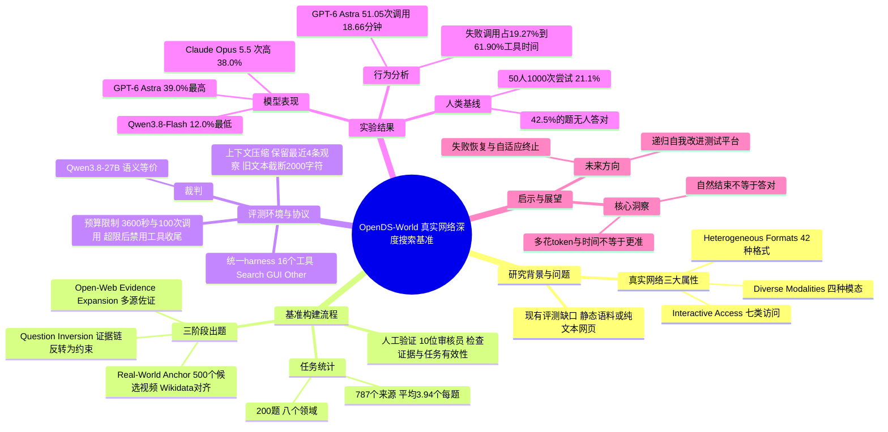

## 一、论文是干什么的？

想象你拿到一段 YouTube 视频，只给你一个问题：视频里那个人所在博物馆的某件展品，它的作者出生的城市，今年的人口是多少？你得先认出视频里的人或物，再去搜索网页，打开 PDF，点开一个交互式的虚拟参观，下载一份数据表，最后把几条线索串起来才能得到唯一答案。这就是**深度搜索**（Deep Search）：让 AI 像研究员一样，自己在互联网上一步步找证据。

现有的评测大多在静态语料库里做，或者只考文字网页。这篇论文指出，真实网络有三个难点：信息有多种**模态**（文字、图片、音频、视频）、多种**格式**（HTML、PDF、XML、Parquet 等）、还需要**交互式获取**（翻页、输入参数、拖动时间轴、下载文件）。作者据此提出 OpenDS（Open-Web Deep Search）任务，并构建了 OpenDS-World 基准：200 道题，每道题都从一段视频出发，在真实开放网络上多步搜索，最终得到唯一的事实答案。结果很有挑战性：12 个前沿模型中最好的 GPT-6 Astra 只有 39.0%，而 50 位人类参与者（共 1000 次独立尝试）的单次准确率只有 21.1%。

论文发布于 2026 年 10 月 19 日（arXiv 分类 cs.IR），作者来自香港科技大学（广州）、复旦、斯坦福、耶鲁、微软研究院等 14 家机构（见论文作者栏）。论文页面见 [arXiv](https://arxiv.org/abs/2610.30181)，[Hugging Face 论文页](https://huggingface.co/papers/2610.30181) 在 2026-10-23 查询 API 时显示 142 票。

## 二、核心方法与创新

这篇论文的核心是怎么出题和怎么公平地考，不是提出新模型。

### 1. 任务定义

OpenDS 是一个事实问答任务：给定问题和初始线索（一段视频），智能体必须自己探索开放网络，搜索、访问、处理并连接来自不同来源的证据，最终给出唯一且可验证的答案。证据在哪里、怎么拿，都不会提前告诉它。

### 2. 三个维度

- **多种模态**：文字、图片、音频、视频。
- **异构格式**：HTML、PDF、WebP、MP3、MP4、RSS/XML、Parquet 等，整个基准共涉及 42 种格式。
- **交互式获取**：论文把获取证据的操作分成七类：立即观察（O）、超链接跳转（N）、参数化状态更新（P，比如选年份、选地区）、时间索引（T，在视频里找时间点）、图形界面操作（G，比如虚拟参观）、声明式查询（Q，比如 API 或查询语言）、文件转移（X，下载文件再读取）。

### 3. 三步出题流水线（类比：倒着编一条寻宝路线）

出题像先走完一条寻宝路线，再把路线倒过来写成谜语：

1. **真实世界锚点**：专家从八个领域（文化、日常生活、科学、经济、历史、自然、社会、技术）里挑出 500 个候选公开视频，结合画面和声音确定一个必须靠视听内容才能识别的实体，并且要对应到一个有效的 Wikidata 条目。这样可以防止直接靠网页文字搜索作弊。
2. **开放网络证据扩展**：标注员用 Google 搜索，一步步从当前节点找到下一个来源、抽取新实体，每个节点都要被多个独立网页佐证，直到得到唯一稳定的终点，也就是参考答案。
3. **问题反转**：把整条证据链反转为一组相互依赖的约束，中间节点不直接说出，而是用间接描述，任何单条线索都不会直接暴露答案。

### 4. 人工验证

共有 10 位独立审核员复查整条证据链，检查**证据有效性**（事实正确、可访问、可独立验证）和**任务有效性**（问题清晰、约束一致、答案唯一）。有问题的题目直接剔除，最终保留 200 题。

### 5. 统一评测环境（harness）

所有模型使用同样的任务输入、系统提示词、工具和预算。工具共 16 个，分三类：

- 搜索类：`text_search`、`image_search`、`open_page`、`youtube_search`。
- 浏览器 GUI 类：`browser_navigate`、`browser_get_markdown`、`browser_get_clickable_elements`、`browser_click`、`browser_form_input_fill`、`browser_press_key`、`browser_scroll`、`browser_screenshot`、`browser_get_download_list`、`browser_get_download_content`。
- 其他：`youtube_read_video`（抽帧看视频）、`youtube_read_subtitle`（读字幕）。

每题搜索阶段最长 3600 秒，所有工具合计最多 100 次调用。超限或没给出有效答案时，进入禁用工具的收尾阶段，只凭已收集的证据作答（最多 2 次请求，共 5000 token 输出预算）。上下文管理采用确定性压缩（不用额外摘要模型）：最近 4 条工具观察保持原样，更早的搜索结果只留前 2 条，文本截断到 2000 字符，图片默认最多保留 250 张。答案由 Qwen3.8-27B 作为裁判，与参考答案做语义等价判断。

### 6. 人类基线设置

200 题分成 10 组、每组 20 题，每组由 5 位互不交流的人类解题者独立完成，共 50 人。他们只能用普通浏览器（如 Chrome）搜索，不能用任何 LLM 工具，没有统一时限，自己觉得无法继续时可以放弃，并给出 0 到 5 的难度评分。参与者都没有参与过出题或筛选。

## 三、使用了哪些模型和计算资源？

**被评测的 12 个模型**（论文原文列出）：GPT-6 Astra、GPT-5.6 Sol、Claude Opus 5.5、Claude Fable 5.1、Gemini 3.8 Flash、Qwen3.8-Max、Qwen3.8-Flash、DeepSeek-V4.1-Flash、DeepSeek-V4-Pro、Kimi K3、GLM-5.3-Flash、GLM-5.3。其中 DeepSeek-V4-Pro 与 GLM-5.3 在表中标注为纯文本模型。裁判模型为 Qwen3.8-27B。

**GPU 型号、API 调用方式、金钱成本**：论文正文与附录中未找到相关说明（API 调用方式一项未逐段核对），暂无相关信息。

**全部 200 题汇总的耗时与 token 消耗**（论文原文数字）：Table 1 直接给出各难度及 Overall（全部 200 题）的总耗时（/h）与总 token 消耗（/M），表头只写 Token.；下表取 Overall 两列，备注栏另列正文给出的每题均值。

| 模型 | 全部 200 题总耗时（小时） | 总 token（百万） | 备注 |
|---|---|---|---|
| GPT-6 Astra | 62 | 187 | 平均 51.05 次工具调用、18.66 分钟每题；中位数 14.35 分钟 |
| GPT-5.6 Sol | 30 | 186 | 平均 52.42 次调用、8.99 分钟每题；中位数 7.22 分钟 |
| Claude Opus 5.5 | 65 | 339 | Table 1 给了总耗时与总 token，但没有给每题平均调用数，仅见附录 Fig. 15(b) 的范围 42.8 到 89.9 |
| Claude Fable 5.1 | 110 | 481 | Table 1 给了总耗时与总 token，但没有给每题平均调用数，仅见附录 Fig. 15(b) 的范围 42.8 到 89.9 |
| Gemini 3.8 Flash | 59 | 976 | token 约为 GPT-6 Astra 的 5.22 倍 |
| Qwen3.8-Flash | 75 | 752 | 平均 89.94 次调用每题 |
| DeepSeek-V4-Pro | 148 | 297 | 平均 44.47 分钟每题，中位数 45.28 分钟 |
| GLM-5.3 | 145 | 345 | 平均 43.36 分钟每题，中位数 51.15 分钟 |

各模型平均每题工具调用数在 42.8 到 89.9 之间（附录 E），论文指出远多于每题标注的 3.94 个来源。人类方面：50 位参与者做完 20 题平均 12.92 小时（中位数 9.44 小时），总计约 646 小时，平均每次尝试约 38.8 分钟。

## 四、实验结果

### 主要结果（总体准确率，200 题）

| 模型 | 总体准确率 | 低难度（54 题） | 中难度（61 题） | 高难度（85 题） |
|---|---|---|---|---|
| GPT-6 Astra | 39.0%（78 题） | 59.26% | 40.98% | 24.71% |
| Claude Opus 5.5 | 38.0%（76 题） | 53.70% | 40.98% | 25.88% |
| Gemini 3.8 Flash | 36.5%（73 题） | 51.85% | 34.43% | 28.24% |
| Claude Fable 5.1 | 33.5%（67 题） | 48.15% | 32.79% | 24.71% |
| GPT-5.6 Sol | 28.0%（56 题） | 46.30% | 31.15% | 14.12% |
| Qwen3.8-Max | 25.5%（51 题） | 40.74% | 26.23% | 15.29% |
| GLM-5.3-Flash | 23.5%（47 题） | 42.59% | 16.39% | 16.47% |
| DeepSeek-V4.1-Flash | 20.5%（41 题） | 33.33% | 13.11% | 17.65% |
| Kimi K3 | 17.5%（35 题） | 27.78% | 14.75% | 12.94% |
| GLM-5.3 | 13.5%（27 题） | 22.22% | 6.56% | 12.94% |
| DeepSeek-V4-Pro | 12.5%（25 题） | 27.78% | 11.48% | 3.53% |
| Qwen3.8-Flash | 12.0%（24 题） | 22.22% | 13.11% | 4.71% |

难度按 5 位人类里答对的人数划分：低（至少 2 人答对）54 题，中（1 人）61 题，高（0 人）85 题。12 个模型平均准确率从低难度的 39.66%，降到中难度 23.50%、高难度 16.76%。即使最强模型也有 122 题（61.00%）答错。

### 人类表现

1000 次尝试中 211 次正确，准确率 21.10%。200 题里有 115 题（57.50%）至少一人答对，85 题（42.50%）无人答对；只有 1 题五人全对，29 题（14.50%）至少三人答对。平均难度评分 3.884/5，43.00% 的尝试给了最高分 5。

### 成本、工具与错误分析

- **花得多不等于答得好**：GPT-6 Astra 与 GPT-5.6 Sol 总 token 几乎一样，准确率却差 11.00 个百分点；DeepSeek-V4-Pro 的总耗时约为 GPT-6 Astra 的 2.39 倍，准确率只有 12.50%。
- **工具偏好不同**：GPT-5.6 Sol 把 74.50% 的调用给了搜索、17.77% 给 GUI；Claude Opus 5.5 与 Qwen3.8-Flash 分别有 51.52% 和 49.42% 用于 GUI，但准确率为 38.00% 和 12.00%。
- **自然结束不等于答对**：GPT-6 Astra、GPT-5.6 Sol、Claude Opus 5.5 自然结束的比例分别为 69.0%、65.0%、60.5%；Qwen3.8-Flash 只有 6.5% 自然结束，80.0% 撞到调用上限。
- **工具失败很耗时**：失败调用只占全部调用的 2.83% 到 9.42%，却占工具执行时间的 19.27% 到 61.90%。失败后最常见的反应是换工具（Claude Opus 5.5 约 83%，Gemini 3.8 Flash 约 81%，GPT-5.6 Sol 约 79%）。
- **预算耗尽**：至少触达一种上限的题目比例，从 Claude Opus 5.5 的 16.5% 到 Qwen3.8-Flash 的 81.5%。
- **题目统计**：787 个标注来源，平均每题 3.94 个；覆盖 4 种模态、42 种格式、7 种访问类型；82.5% 的题涉及至少两种模态，96.0% 涉及至少两种格式，95.5% 涉及多种访问类型；56.0% 的题以至少 10 分钟的视频起步。

论文的判断是：瓶颈在于信息源选择、工具协调、策略调整和长程执行管理，而不是单纯多调用工具。

## 五、潜在应用与已落地应用

**已落地（有据可查）**：论文本身是评测基准，没有产品落地案例。公开资源包括：[GitHub 仓库](https://github.com/Yu-xm/OpenDS)（Apache-2.0 许可，含评测 harness、配置、示例和测试；截至 2026-10-23 约 18 个 star）和 [Hugging Face 数据集 Yu2020/OpenDS-World](https://huggingface.co/datasets/Yu2020/OpenDS-World)（200 行问答 CSV 加对应视频）。

**潜在方向**：

- 论文提出的方向：把 OpenDS-World 作为研究递归自我改进（Recursive Self-Improvement）的测试平台，让智能体从失败轨迹中学习搜索策略、工具选择、错误恢复与资源分配；也可作为诊断长程搜索智能体的评测平台。
- 本文作者的判断（非论文原文）：这类能力若成熟，可用于调研助理、事实核查和跨来源资料整理；基准暴露的工具失败耗时问题也提示工程上应优先优化失败恢复与提前终止。

## 六、网络上的讨论与评价

截至 2026-10-23（论文发布后第四天）我没有找到公开的第三方讨论。检查过的页面：

- [Hugging Face 论文页](https://huggingface.co/papers/2610.30181)：145 票（2026-10-23 查询 API 的值，票数会变动）。论文页只有作者本人的 1 条评论，内容是标题，没有第三方评论。
- [Hugging Face 数据集页](https://huggingface.co/datasets/Yu2020/OpenDS-World)：Community 有 1 条，是 parquet-converter 机器人发的“[bot] Conversion to Parquet”，不是人的讨论；[GitHub 仓库](https://github.com/Yu-xm/OpenDS)的 open issues 为 0。
- Hacker News（通过 Algolia 搜索 API，查询 2610.30181、OpenDS-World、论文标题）：无相关结果，返回的都是无关帖子。
- Reddit 搜索（OpenDS-World、2610.30181）：被反爬页面拦截，因此 Reddit 与 X/Twitter 未能确认，不能断定没有讨论。
- 通用网络搜索（论文标题加 arXiv 号）：只返回另一个无关项目 Open Deep Search，没有本文相关页面。
- 知乎、博客、Paperium：未能检索到（Paperium 没有用可靠方式核实）。
- [Pith 页面](https://pith.science/paper/2610.30181)：站内页面存在，仅有 classifier-1.13.0 于 2026-10-23 生成的摘要层分类标签（页面注明 no language-model review），没有 AI 评议，也没有人类专家复核；页面没有 T0 标签。页面另编排了论文摘要里的句子（200 个任务、最佳模型 39.0%、人类 21.1% 等），页面注明这些句子是论文自己的原句，只有分类标签由分类器生成；这些内容不是评议，也不是对论文结论的核实。

## 七、思维导图

