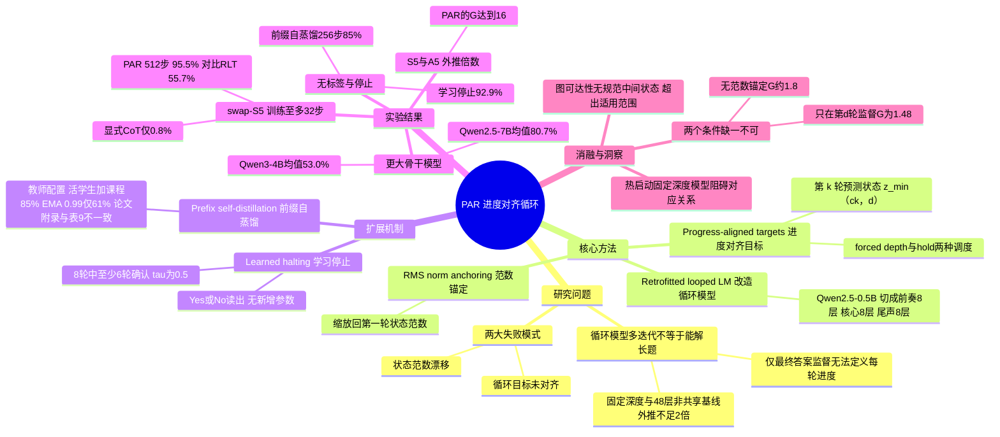

## 一、论文是干什么的？

想象你教一个孩子玩「换杯子」游戏：桌上有 5 个杯子，每个杯子下藏着一个不同的小玩具，你每次交换两个杯子的位置，最后问「第 3 个杯子下面是什么？」。如果孩子只练过最多 32 次交换，那么当你一口气交换 512 次时，他还能答对吗？这就是论文研究的「长度泛化」问题：在短题上训练，能不能解出同类型的长题。这类「每一步操作都会更新一个状态，后面的步骤依赖前面的结果」的任务叫**状态追踪**（state tracking），论文用它作为受控的实验场。

一种让模型「想得更久」的办法是**循环语言模型**（looped language model）：把同一段 Transformer 层反复使用多次，不需要把每一步写成文字（不用思维链），就能在隐藏状态里多算几轮。但论文指出，光是多循环几次并没有用。作者归纳出两个原因：一是只用最终答案监督时，没人告诉每一轮「应该往前走多远」；二是反复使用同一个模块，隐藏状态的大小（范数）会逐渐漂移。于是他们提出 **PAR**（Progress-Aligned Recurrence，进度对齐循环），一句话概括：让第 $k$ 轮循环刚好对应「前 $k$ 步操作后的状态」，同时把每轮状态的大小锚定住。以下「论文原文」的数字均来自 [arXiv 全文](https://arxiv.org/html/2610.27628)，但其中表 1 的 Transformer 与 RLT 两行是该文转引自他人论文的数字，并非 PAR 作者自己的实验（见第四章）。

## 二、核心方法与创新

**1. 底座：把预训练模型改造成循环模型。** 论文沿用 McLeish 等人的做法，把 Qwen2.5-0.5B 的 24 层切成三段：前奏 $P$（第 1 到 8 层）、权重共享的核心 $C$（第 9 到 16 层）、尾声 $Q$（第 17 到 24 层）。核心块被反复调用：$s_k = C(W[e; s_{k-1}])$，其中 $e=P(x)$ 是固定的输入特征，$s_0=e$。适配器 $W$ 初始化为 $[0 \mid I]$，所以只循环 1 次时模型与原模型完全等价。类比：就像一个流水线工人，每一轮都拿着「原始订单 $e$」和「上一轮的半成品 $s_{k-1}$」再加工一次。

**2. 进度对齐目标。** 设一道题有 $d$ 步，$z_j$ 表示前 $j$ 步之后的答案。训练损失为 $\mathcal{L}_{\mathrm{PAR}}=\sum_{k\in\mathcal{K}}\mathrm{CE}(Q(s_k), z_{\min(ck,d)})$，步长 $c=1$。意思是：第 1 轮要答出「走完 1 步后的状态」，第 2 轮答出「走完 2 步后的状态」，走完全部步骤后就一直保持最终答案（这只对 hold 调度成立；论文默认的 forced depth 在完成后没有监督，循环次数 $R$ 超过题目步数 $L$ 后，几步之内准确率就会退化到接近零，见论文 5.3 节）。这像是爬楼梯，每一轮必须刚好上一级台阶；而传统做法是每一轮都被要求直接报出顶层答案，模型会学到「抄近路」的捷径，捷径没法随长度扩展。论文把这种「深度（循环次数）与长度（操作数）一一对应」称为深度与长度对应（depth-length correspondence）。有两种深度安排：默认的 forced depth（每个批次固定一个深度 $d$，循环 $\lceil d/c\rceil$ 次）和 hold（循环次数从重尾分布抽取，超过的部分保持 $z_d$）。

**3. 状态范数锚定。** 外推时核心块要被使用成百上千次，状态的大小如果慢慢变大或变小，核心块的「含义」就变了。PAR 在每轮结束后，把每个 token 的状态重新缩放到它第一轮状态的 RMS 范数：$s_k \leftarrow s_k\cdot \mathrm{rms}(s_1)/\mathrm{rms}(s_k)$，对参考值停止梯度。类比：每次复印文件都把亮度调回原稿水平，免得复印多次后越来越黑或越来越淡。此外还有**位置拉伸**（positional stretch）：短暂微调时把位置索引乘以 $s\sim U[1,s_{\max}]$（$s_{\max}$ 从 1 升到 8），测试时用普通位置，主要用于无标签版本。

**4. 学习何时停止。** 在进度对齐下，「是否算完」是可监督的：让尾声的输出层在 $ck\ge d$ 时把概率放到 Yes，否则放到 No，不新增参数。推理时使用「8 轮中至少 6 轮」的确认窗口（$\tau=0.5$，$k=6$，$m=8$），首个触发的迭代即作为答案。

**5. 前缀自蒸馏。** 现实数据往往没有中间步骤标签。但一道题的前 $j$ 步本身就是一道更短的题，答案恰好是 $z_j$。因此让教师模型读取截断后的短题，给学生模型对应的第 $k$ 轮提供 KL 散度目标，只需最终答案标签。教师可以是学生的指数滑动平均（EMA）或当前学生本身。论文表 9 中，「当前学生加深度课程」配置在 $d=256$ 上准确率为 85%（表 5 采用的就是它），而 EMA（衰减 0.99）教师只有 61%；但附录写的是标签无关模型使用 EMA 衰减 0.99 的教师，与表 5 采用的配置不一致，论文自身有出入。

**训练设置：** AdamW，学习率 $2\times10^{-5}$（适配器 $10^{-4}$），200 步预热，一个 epoch，约 40 万个样本，训练和测试时都不生成中间 token。

## 三、使用了哪些模型和计算资源？

| 项目 | 论文原文信息 |
|---|---|
| 主要模型 | Qwen2.5-0.5B（改造成循环结构）；扩展实验用 Qwen2.5-1.5B、3B、7B 和 Qwen3-0.6B、1.7B、4B |
| 是否使用商用 LLM API | 未使用，论文只训练开源模型 |
| GPU | Qwen2.5-0.5B 与 Qwen3-0.6B：两张 RTX 4090 或 3090；Qwen2.5-1.5B、3B、7B 与 Qwen3-1.7B、4B：八张 H200 |
| 训练方式 | bf16，DeepSpeed ZeRO-2 |
| 数据量 | 约 40 万个合成样本，训练 1 个 epoch；学习停止的微调变体 0.3 个 epoch，前缀自蒸馏 0.6 或 1 个 epoch，位置拉伸微调 0.5 个 epoch |
| 单次训练或运行耗时 | 暂无相关信息（论文附录只给了 GPU 型号，没有给出 GPU 小时或墙钟时间） |

说明：评估时每个长度用 1,024 条序列，主结果取多个随机种子的均值（$S_5$ 为 3 个种子，$A_5$ 为 2 个，swap-$S_5$ 为 6 个）。

## 四、实验结果

**任务设定（论文原文）：** swap-$S_5$ 中每步要么是恒等，要么是 10 种互换之一，在 5 个盒子上进行；$A_5$ 中每步是 3-轮换。单个查询的随机猜测准确率为 20%。swap-$S_5$ 协议下，训练长度最多 32 步，测试到 512 步，且 5 个盒子全部答对才算对（full-state accuracy）。外推倍数 $G=d_{50}/d_{\mathrm{train}}$，其中 $d_{50}$ 是准确率首次低于「随机与满分中点」的测试深度；训练深度为 16、测试最长 256 时，$G=16$ 是可测量的最大值。

**主结果（论文表 1）：**

| 方法 | swap-$S_5$ 256 步（8倍） | swap-$S_5$ 512 步（16倍） | $S_5$ 的外推倍数 $G$ |
|---|---|---|---|
| Transformer† | 0.85 ± 0.30 | 0.85 ± 0.30 | 未报告 |
| RLT† | 97.3 ± 2.8 | 55.7 ± 25.8 | 未报告 |
| 显式思维链 CoT | 0.8 | 0.8 | 1.247 |
| 固定深度（$R=1$） | 未报告 | 未报告 | 1.62 |
| 4 倍核心层数的非共享模型（48 层） | 未报告 | 未报告 | 1.76 |
| 随机循环次数的循环模型 | 未报告 | 未报告 | 1.95 |
| **PAR** | 99.5 ± 1.2 | 95.5 ± 11.0 | 16 |

† 转引自 Zhang 等人 arXiv 2610.07591；RLT 取其最佳切分 4+4、3 个种子；二者是 8 层从头训练的小模型，骨干与 PAR 的 Qwen2.5-0.5B 不同，因此是跨骨干对比。

在 $S_5$ 与 $A_5$ 上，PAR 所有种子都达到最大可测外推倍数 $G=16$；其他基线都低于 2 倍。显式 CoT 在训练范围内完美，但到 8 倍就掉到随机水平。

**更大与不同的模型（论文表 2、表 3）：** 在 $S_5$ 的 256 步（16 倍）上，Qwen2.5 的 1.5B、3B、7B 固定深度基线均值分别为 22.2、21.3、18.2，PAR 均值分别为 71.7、57.8、80.7，但标准差高达 33 到 43，最佳种子都是 100。Qwen3 的 0.6B、1.7B、4B 在 256 步下 PAR 分别为 36.2、38.8、53.0，固定深度仅 22.0、19.2、17.7。也就是说，更大模型上的效果波动大，论文自己也承认没有证明随模型尺寸单调变好。

**学会停止（表 4、表 8）：** 不告诉模型题目长度，6 个种子，PAR 加学习停止在 16 倍处的准确率为 92.9 ± 16.2，知道真实长度的版本为 93.2 ± 16.3，RLT 为 55.7。停止规则对比：单次判断 77.8，连续 8 次 90.3，「8 中取 6」为 92.9。

**无中间标签（表 5）：** 仅用最终答案的 PAR 加前缀自蒸馏（教师为当前学生加深度课程，EMA 0.99 教师为 61%，见第二章），在 $S_5$ 的 256 步上达到 85% 准确率，$G\ge16$；其他仅用最终答案的做法外推倍数大多在 4 倍以内。在 swap-$S_5$ 上，经位置拉伸微调的无标签模型 16 倍处最高达 99.7%（表 12）。

**消融（表 7，$S_5$）：**

| 变体 | 外推倍数 $G$ | 256 步准确率 |
|---|---|---|
| 每一轮都预测最终答案 | 2.14 / 1.99 | 21 / 21 |
| 只在第 $d$ 轮预测最终答案 | 1.48 | 15 |
| 同上加范数锚定 | 小于 4 / 小于 4 / 8 | 26 / 19 / 36 |
| 进度目标但无范数锚定（hold） | 1.84 | 16 |
| 进度目标但无范数锚定（forced） | 1.81 | 20 |
| PAR-hold | 16 / 12 | 75 / 30 |
| **PAR（forced）** | 16 / 16 / 16 | 100 / 100 / 99 |

结论：进度对齐目标和范数锚定缺一不可。另外，论文发现从「已学会一次性解题」的固定深度模型热启动会阻碍对应关系的形成（$G$ 约 1.4），用额外迭代让完成状态变成吸收态也会让 16 倍准确率跌到 1% 以下。

**其他基准与边界：** 规则表链任务（训练最多 8，测试到 64）PAR 的 $G=6.0$，PAR-hold 达 $G\ge8$；图可达性任务（可并行扩展前沿，没有规范的中间状态）所有方法都低于 3.5 倍，论文承认这超出了方法适用范围。自然语言版「追踪打乱的物体」中，训练最多 16 次交换，PAR-hold 加位置拉伸在 32 次时 94% 到 96%，64 次时 79%。

## 五、潜在应用与已落地应用

**论文明确提到的方向（原文）：** 在合成算法任务和模板化状态追踪任务上验证；作者把「扩展到开放式自然语言推理」列为未来工作。伦理声明里提到，由于每一轮都可以被解码成它所持有的中间答案，这为检视潜在推理过程提供了一种方式。

**我的判断（非论文原文）：** 潜在的相关场景包括需要逐步更新状态的任务，例如跟踪变量赋值的程序执行、棋类或游戏的局面推演、对话中的实体状态跟踪等；不过论文并未在这些场景验证，且仅在小规模和合成任务上有证据。

**已落地应用：** 截至 2026-10-23，我没有查到有据可查的产品或系统落地。HF 论文页没有作者发布的模型、数据集或 Space（仅有第三方点赞统计 Space），也没有项目主页或 GitHub 链接。

## 六、网络上的讨论与评价

- [Hugging Face 论文页](https://huggingface.co/papers/2610.27628)：票数 158（已用 HF API 核对），由 Yongqi Tong 提交到每日论文。页面有 2 条评论：作者 Yongqi Tong 于 2026-10-21 发的推介帖，复述摘要中的任务与数字；Librarian Bot 于 10-22 发的自动相似论文推荐。没有找到更多独立评测。
- [AI Weekly 的报道](https://aiweekly.co/alerts/ant-internationals-par-hits-16-extrapolation-on-swap-s5-task)（2026-10-21）：主要复述论文数字，编者按认为 0.5B 的 PAR 模型在步数外推上超过 7B 固定深度模型，暗示监督方式比扩大参数更廉价。这是二手摘要，不是独立评测。
- [hyper.ai 论文页](https://hyper.ai/en/papers/2610.27628)：收录摘要及站方 AI 生成的分节解读（One-sentence Summary、Key Contributions、Method、Experiment 等），非独立评测。
- [Pith 评审页](https://pith.science/paper/2610.27628)：该站由 AI 审稿模型（deepseek/deepseek-v4-flash）于 2026-10-21 生成的评议，页面标为 T0 档（仅 AI 评议，未做审计、计算、形式化或证明），注明尚无人类专家复核，页脚也提示 Pith reviews are machine-made and fallible，以下均为该站观点。肯定方面：认为这是一篇执行良好的实证论文，其结论摘要称论文为进度对齐目标与范数锚定做出了清楚的实证论证；编者按称 The experiments are thorough（有受控消融、多随机种子、多骨干模型），并认为论文坦率交代了局限。保留意见：唯一的主要异议是学习停止的超参数（$\tau=0.5$，$k=6$，$m=8$）似乎是在全部评估序列上选定的，论文未说明使用留出验证集，可能使 16 倍处 92.9% 的结果偏乐观，要求作者澄清或给出基于验证集的估计；页面共 1 条主要、6 条次要意见，此处只列相关两条：停止规则有三个超参数却称「无参数」容易误导；以及大模型种子方差高（Qwen2.5 在 16 倍处标准差达 33 至 43 个点），不宜宣称各尺寸一致提升。页面结论是验证集问题解决后 claims 站得住，建议送同行评审。
- 查过但没有相关结果：Hacker News（Algolia 搜索 2610.27628 和 Progress-Aligned Recurrence，均 0 条）、Reddit 搜索接口（返回网页而非结果，未找到帖子）。GitHub 上未找到作者发布的实现仓库，仅有收录或索引类仓库。X/Twitter 与知乎没有通过通用网页搜索找到相关页面。另有三个二手介绍页，均不是独立评测：[Paperium 分析页](https://paperium.net/article/article/26001/par-progress-aligned-recurrence-for-length-generalization-in-state-tracking)（标题为 Analysis, Review & Summary，页面自注配图为 AI 生成，内容是对摘要的复述加问答式小结，含方法讲解如 progress-aligned targets 与 RMS norm anchoring，没有独立实验或评测，评分与评论均为 0）；[Daily Paper Cast 的专集](https://www.podscan.fm/podcasts/daily-paper-cast/episodes/par-progress-aligned-recurrence-for-length-generalization-in-state-tracking-1)（2026-10-21 发布，约 21 分钟，附文字稿；该节目说明写明 Both the podcast scripts and audio are generated by AI，内容围绕 HF 日榜论文的摘要展开）。[PicX 的可视化摘要页](https://picx.dev/p/7pHvfZ)（页面标题为 Visual Summary，带 Whiteboard 与 Full text PDF 标签，内容是按摘要与论文结构自动整理的分节概述，含 Theoretical and Practical Implications、Limitations and Future Directions 等小节，文风像 AI 生成的摘要，没有独立实验或评测，页面也未注明作者；其中 Theoretical Implications 等小节只是复述论文论点）。在我查到的范围内，这三个页面之外没有找到更多独立评测。另有 [alphaXiv](https://www.alphaxiv.org/abs/2610.27628) 页面和 Awesome-Loop-Models 仓库列表（[huskydoge/Awesome-Loop-Models](https://github.com/huskydoge/Awesome-Loop-Models) 仅列出论文链接）等索引或镜像页，没有独立评论。
- 代码：[arXiv 摘要页](https://arxiv.org/abs/2610.27628)与 HF API 均未提供代码或项目主页链接，目前没有证据表明代码或数据已发布。
- 局限（论文自述）：只在算法与模板化任务上评估；swap-$S_5$、学习停止和前缀自蒸馏只在 Qwen2.5-0.5B 上测试；大模型的种子方差大，且结果不随模型尺寸单调提升。

## 七、思维导图

