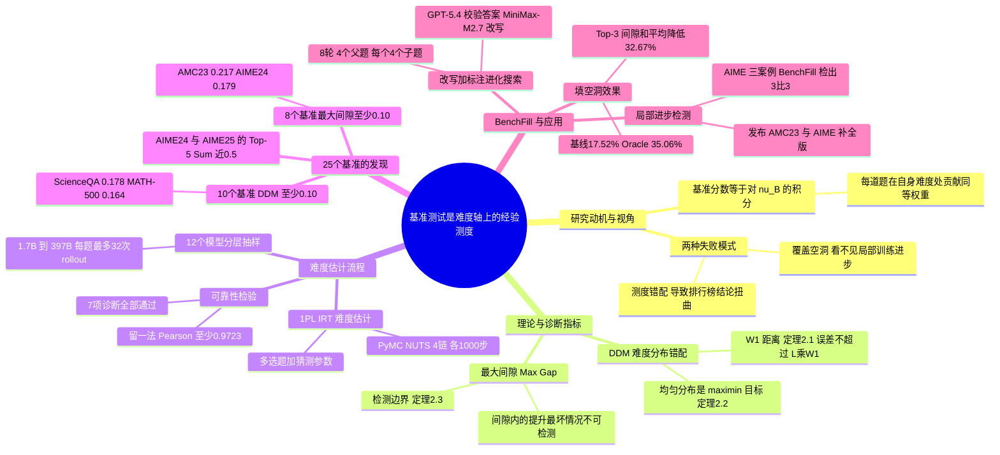

## 一、论文是干什么的？

想象一场体育课的体能测试：老师想比较两个同学谁更强，但整套测试 90% 的项目都是「慢跑一圈」这种很轻松的内容，只有一两个项目真正拉开差距。两个同学在轻松项目上成绩几乎一样，总分就几乎打平，可如果测试换成「更偏难」的内容，他们会被清楚地区分开。另一种情况是：一个同学经过训练，在「中等偏难」这一档进步很大，但测试里恰好一道这一档的题都没有，总分完全看不出他进步了。

论文要说的就是这两件事。作者提出一个看法：**基准测试**（benchmark）不只是一堆题目，它还天然定义了一个关于「题目难度」的**经验测度**（empirical measure）：每道题在它自己的难度位置上贡献同样大小的一份权重。分数就是模型在难度轴上的表现曲线，按这个权重分布做加权平均。基于这个视角，论文形式化了两种失败模式。

- **测度错配**（measure mismatch）：基准的难度分布和我们真正想要的难度分布不一样，排行榜上的结论就可能被扭曲，甚至排名翻转。
- **覆盖空洞**（coverage gaps）：难度轴上有一段区间没有任何题目，模型在这一段取得的真实进步，基准分数完全看不出来。

论文给出两个对应的诊断指标和理论保证，用项目反应理论估计题目难度，分析了跨 7 个领域的 25 个常用基准，最后提出 **BenchFill**：用大模型改写已有题目，专门去填补难度轴上的空洞。以下「论文原文」的数字均来自 [arXiv 全文](https://arxiv.org/html/2610.29927)，「我的解读」会明确标出。

## 二、核心方法与创新

**1. 把基准看成难度轴上的测度。** 论文把题目难度记为连续变量 $z\in[0,1]$，越大越难；模型 $\theta$ 在难度 $z$ 的题上的期望表现记为 $s_\theta(z)$（例如 pass@1）。一个含 $n$ 道题的基准 $B$，其分数为 $S_B(\theta)=\frac{1}{n}\sum_{i=1}^{n}s_\theta(z_i)$，等价于对经验测度 $\nu_B=\frac{1}{n}\sum_{i=1}^{n}\delta_{z_i}$ 做积分。类比：每道题是难度刻度尺上的一颗钉子，分数就是在所有钉子位置上的平均成绩。

**2. 测度错配与 DDM 指标。** 两个模型的真实差距 $\Delta(z)=s_{\theta'}(z)-s_\theta(z)$ 随难度变化。基准看到的差距是 $D_B=\int\Delta\,d\nu_B$，而我们想要的是 $D_\mu=\int\Delta\,d\mu$，其中 $\mu$ 是目标难度分布。论文用 1-Wasserstein 距离（可以理解为「把一堆沙子从基准的形状搬成目标形状的最小搬运量」）定义**难度分布错配**（DDM）：$\mathrm{DDM}(B,\mu)=W_1(\nu_B,\mu)$。定理 2.1：若 $\Delta$ 是 $L$ 利普希茨的，则 $|D_B-D_\mu|\le L\cdot W_1(\nu_B,\mu)$；并且只要 $|D_\mu|>L\cdot W_1(\nu_B,\mu)$，基准给出的排序就一定与目标排序一致，不会翻转。附录还给出了带有限采样误差的版本（定理 B.2，多出一项由 Hoeffding 不等式给出的 $\sqrt{2\log(2/\delta)/(nk)}$）。

**3. 没有先验时为什么用均匀分布做目标。** 定理 2.2：当完全不知道模型差距出现在难度轴的哪里、只知道平均差距为 $\rho$ 时，均匀分布是唯一的 maximin（最坏情况最优）目标。论文特别强调这并不是说均匀分布永远最好，只是在没有先验信息时作为「不偏袒任何难度区间」的中立默认值。

**4. 覆盖空洞与最大间隙。** 把所有题的难度排序，加上端点 0 和 1，**最大间隙**定义为 $G(B)=\max_{0\le j\le n}\bigl(z_{(j+1)}-z_{(j)}\bigr)$，即没有任何题目的最长难度区间。定理 2.3 把它与假设检验联系起来：要检测「某个宽度为 $w$ 的难度区间内，模型表现至少提升 $a$」，若 $w\le G(B)$，任何水平为 $\alpha$ 的检验的最坏情况功效就只有 $\alpha$（等于瞎猜），无论重复采样多少次；若 $w>G(B)$，重复采样次数 $k\to\infty$ 时最坏情况功效趋于 1。所以最大间隙恰好是检测边界。类比：尺子的某一段没有刻度，那一段里发生的长度变化尺子永远量不出来。

**5. 难度怎么估：项目反应理论（IRT）。** 论文没有用「平均失败率」，因为题目难度应该相对于模型能力来看（被强模型做错的题比被弱模型做错的题更难）。他们采用 1PL 模型：$\Pr(Y_{ij}=1)=\sigma(\theta_j-b_i)$，$b_i$ 就是题目难度；选择题再加一个猜测概率参数 $g_i$。参数用 PyMC 的 NUTS 做贝叶斯推断，先验都是 $\mathcal{N}(0,1)$，4 条链，每条 1,000 步预热加 1,000 个后验样本。估出的难度做 min-max 归一化到 $[0,1]$，再与同样大小的经验均匀分布比较（等价于 ECDF 之间的 $L_1$ 距离，即 $\mathrm{DDM}=\frac{1}{n}\sum_i|z_{(i)}-u_i|$，$u_i=(i-\tfrac12)/n$），并另外汇报最大间隙和最大五个间隙之和（Top-5 Sum）。

**6. BenchFill：用改写题目填空洞。** 对某个空洞 $[z_L,z_R]$，目标难度取中点 $z^\star=(z_L+z_R)/2$。算法是一个「改写加标注」的进化搜索：维护一个记忆库，里面存「题目和已标注难度」的配对，初始为难度最接近该空洞的现有题目。每一轮取 4 个难度最接近目标的「父题」，让改写模型（rewriter）结合目标难度和最多 16 条附近的「题目加难度」参考，把每个父题改写成 4 道「子题」；用 GPT-5.4 当有效性裁判检查参考答案是否正确；有效的子题再用 12 个模型做若干次试答，在已拟合的 IRT 下只拟合新题的难度参数 $\hat b(x)=\arg\max_b\sum_j[c_j\log\sigma(\hat\theta_j-b)+(K_j-c_j)\log(1-\sigma(\hat\theta_j-b))]$，这样不用重新拟合整个模型就能把新题放到同一难度刻度上；子题回到记忆库。最多 8 轮，若最佳子题与目标的差不超过 $\tau=0.01$ 就提前停止，最后取离目标最近的有效子题，并经过至少 3 位人类专家审核后才加入基准。给改写模型看的难度会放大到 0 到 10 的尺度，因为作者担心模型分不清 0 到 1 尺度上的微小差别。

**7. 附录里的另一个应用：基准校准（剪枝）。** 用「分位数匹配」的贪心剪枝，在目标分布的 $k$ 个等概率区间中点上，各挑一道最接近的未选题，让保留下来的子集更接近目标分布。这只是论文附录里的辅助实验。

## 三、使用了哪些模型和计算资源？

**论文原文给出的信息：**

- **被测评、用来估计难度的 LLM（非智能体基准）：** 共 12 个，规模从 1.7B 到 397B，来自 Text Arena 排行榜的分层抽样。论文对这个抽样有两段描述，细节略有出入：附录的一段写的是按总分分成 10 个等宽分数档、每档随机取 1 个，再额外加入榜首和榜尾各 1 个，合计 12 个；另一段则写成按能力排名分成若干个大致相等的区间、每个区间取 1 个，并额外加入头尾「几个」模型。本综述按前者转述。它们是：Qwen3.5-397B-A17B、GLM-4.6（357B）、GLM-4.5-Air（110B）、Qwen3-Next-80B-A3B-Instruct、QwQ-32B、Olmo-3.1-32B-Think、gpt-oss-20b、phi-4（14B）、Llama-3.1-8B-Instruct、vicuna-7b-v1.5、Llama-3.2-3B-Instruct、SmolLM2-1.7B-Instruct。每个模型用各自推荐的温度和 top-$p$。
- **被测评的 LLM（智能体基准）：** 没有自己跑，直接使用 HAL（Holistic Agent Leaderboard）报告的 15 到 66 个前沿闭源模型的结果，论文列举了 Claude Sonnet 4.5、Claude Opus 4.1、GPT-5、Gemini 2.0 Flash 等例子，完整名单论文未在正文列出。
- **每题采样次数（rollouts）：** AMC23、AIME24、AIME25、AIME26 为 32 次；MATH-500、Minerva-Math、OlympiadBench、Gaokao2023en 为 8 次；HumanEval、MBPP+、MMLU-Pro 三科、GPQA-Diamond、ScienceQA、IFEval、BBH 三个子集、ZebraLogic、MedQA 为 4 次；GAIA、CORE-Bench Hard、SWE-bench-Mini、USACO 为 1 次。
- **BenchFill 的改写模型：** MiniMax-M2.7，温度 1.0。
- **有效性裁判模型：** GPT-5.4（检查改写题的参考答案是否正确）。
- **BenchFill 难度标注：** 沿用上面 12 个模型和同样的生成配置，每题试答次数 $K_j$ 论文正文未给具体值。
- **局部进步检测实验中被微调的模型：** Olmo-3.1-32B-Think（AIME24 案例）、Phi-4（AIME25 案例）、Llama-3.1-8B-Instruct（AIME26 案例），做的是论文所说的 mild SFT（轻度监督微调）。
- **GPU：** 论文附录写明实验在 NVIDIA L40S（48GB）和 NVIDIA RTX PRO 6000 Blackwell Server Edition（96GB）上完成；每种各用多少张、分别用于哪一步，论文未报告。致谢里感谢 Modal 的 Modal for Academics 算力资助。
- **API 使用：** 使用了 GPT-5.4 作为裁判；智能体基准的结果来自 HAL 公开榜单。API 总花费论文未报告。

**每个完整计算单位的耗时，论文均未报告：**

- 一次 IRT 拟合（MCMC）的耗时：论文未报告（只给了采样设置和诊断结果）。
- 一个基准完成全部模型试答的 GPU 小时：论文未报告。
- BenchFill 填一个空洞的耗时或成本：论文未报告。按原文数字只能推算出搜索上限：每轮最多 $4\times4=16$ 道子题，最多 8 轮，所以填一个空洞最多生成 128 道候选子题（按原文数字推算）；论文只规定达到容差 $\tau$ 时可提前停止，实际平均跑了几轮未报告。
- 对比用的基线按相同预算设置：每个空洞生成 $16\,T_g$ 道子题，$T_g$ 为 BenchFill 在该空洞实际运行的轮数。

## 四、实验结果

**1. 25 个基准的诊断（论文表 1）。** 难度估计所用的 IRT 通过了全部 7 项诊断检查（响应矩阵 4 项加 MCMC 3 项）。论文设定的「偏大」阈值为 DDM ≥ 0.10、最大间隙 ≥ 0.10、Top-5 Sum ≥ 0.30。

- 10 个基准的 DDM ≥ 0.10：MATH-500（0.164）、Minerva-Math（0.122）、MMLU-Pro 的 Biology（0.125）、Chemistry（0.114）、Physics（0.121）、ScienceQA（0.178）、HumanEval（0.148）、MBPP+（0.163）、IFEval（0.159）、MedQA（0.157）。
- 8 个基准的最大间隙 ≥ 0.10：AMC23（0.217，40 题）、AIME24（0.179）、AIME25（0.158）、AIME26（0.119）、HumanEval（0.165）、CORE-Bench Hard（0.113）、SWE-bench-Mini（0.149）、BBH-5 objects（0.128）。
- 9 个基准的 Top-5 Sum ≥ 0.30。AIME24 和 AIME25 的 Top-5 Sum 分别为 0.502 和 0.492，接近 0.5；论文的说法是这让难度轴上的大片区域缺少局部分辨能力（五个最大空洞加起来约占难度轴的一半，是按定义的直接推算）。
- 论文强调覆盖空洞不只是小基准的问题：HumanEval（164 题）和 BBH-5 objects（250 题）也有明显间隙，而且 ScienceQA、MedQA、ZebraLogic 的最大间隙是同样大小均匀抽样基线的 18.8 倍、11.3 倍、5.9 倍（中位数比值 3.85 倍）。

**2. 估计是否可靠（附录 C）。** 去掉任意 1 个模型重新拟合（共 12 次），非智能体基准上难度的平均 Pearson 相关至少 0.9723、平均 Spearman 至少 0.9704，最坏情形也分别不低于 0.9137 和 0.9089。BIC 在 21 个基准上选择 1PL 而非 2PL，另外 4 个（Gaokao2023en、AIME24、AIME25、AMC23）BIC 偏向 2PL，但这些 2PL 拟合出现采样问题（例如 Gaokao2023en 有 983 次发散转移，而 1PL 为 0）。多维 IRT 在小基准上混合很差，大基准上没能在预算内可靠完成。DDM 的后验标准差通常约 0.011（范围 0.006 到 0.020），最大间隙的后验标准差为 0.017 到 0.041。

**3. BenchFill 填空洞（论文表 2）。** 在 8 个基准上各填最突出的 3 个空洞（每个基准只插入 3 道题），指标为 Top-3 间隙和的相对降低：

| 基准 | 预算匹配基线（%） | BenchFill（%） | Oracle 上界（%） | BenchFill 目标偏差 |
|---|---|---|---|---|
| AIME24 | 6.90 | 35.57 | 35.57 | 0.005 |
| AIME25 | 27.44 | 37.56 | 37.56 | 0.005 |
| AIME26 | 17.94 | 33.04 | 33.04 | 0.002 |
| AMC23 | 24.47 | 35.19 | 35.78 | 0.003 |
| Gaokao2023en | 11.45 | 38.88 | 45.47 | 0.004 |
| BBH-3 objects | 14.83 | 29.88 | 32.80 | 0.006 |
| MMLU-Pro-Biology | 22.23 | 30.13 | 36.84 | 0.006 |
| IFEval | 14.94 | 21.09 | 23.44 | 0.007 |
| 平均 | 17.52 | 32.67 | 35.06 | 0.005 |

其中 Oracle 是「每次都恰好把新题放在当前最大空洞中点」的理想上界，不是可实现的方法。基线的平均目标偏差为 0.048，而 BenchFill 的目标偏差都低于 0.01。

**4. 人工与自动验证。** 24 个目标空洞（8 个基准乘 3）中，有 1 个初始候选因参考答案错误没有通过 GPT-5.4 检查而被重新生成；最终选出的 24 题全部通过 GPT-5.4 检查，并在人类专家审核中没有被修改或替换。

**5. 能不能真的检测到局部进步（论文表 12）。** 在 AIME24、AIME25、AIME26 各选 1 个空洞，对 1 个模型做轻度 SFT 使其在该空洞附近变强，每题 32 次采样，用单侧分层随机化检验（10 万次置换，$p<0.05$）。每个增强版本只往 30 题的原基准里插 1 道题。结果：Original + BenchFill 在 3 个案例里全部检测到进步（p 值分别为 0.00594、0.00045、0.00001），而 Original 和 Original + Baseline 都是 0/3。表注把 Gain 定义为平均准确率的变化，但没有明确说明表中数值（如 +2.419）是否按百分点表示。

**6. 构建的补全版基准（论文 4.3 节）。** 作者把 AMC23、AIME24、AIME25、AIME26 分别从 40、30、30、30 题扩充到 80、50、52、53 题，并发布为 AMC23-BenchFill 等数据集。GitHub 说明写道这些补全版共包含 105 道经审核的 BenchFill 生成题，与上述题数差值相加一致（40 加 20 加 22 加 23）。

**7. 附录 D：校准剪枝实验。** 8 个数学基准，用其余基准构造的外部参考排名作对照。校准后平均 Spearman 从 0.890 升到 0.930，平均 Kendall 从 0.802 升到 0.848，平均 $W_1$ 到均匀分布的距离从 0.096 降到 0.028；随机剪枝同样大小的子集平均 Spearman 为 0.895、Kendall 为 0.801、距离 0.109。Minerva-Math 的 Spearman 由 0.601 升到 0.790。

**我的解读（非论文原文）：** 这套指标最实用的地方，是把「这个基准是否太容易或太集中」「这个基准能不能看见训练中的局部进步」变成两个可以直接计算的数字。要留意几个边界：一是难度是相对于所选 12 个模型估计的，换一批模型难度刻度可能改变；二是 DDM 以均匀分布为参照，论文自己也说非均匀并不一定是问题；三是最大间隙本身依赖题数，论文承认这点但认为这反映的是真实的覆盖局限；四是定理 2.3 讲的是最坏情况，现实里模型进步未必恰好落在空洞里；五是 BenchFill 的局部检测实验只有 3 个案例，且每个案例只加了 1 道题，属于概念验证级别的证据。

## 五、潜在应用与已落地应用

**论文明确提到的方向（原文）：** 诊断已有基准的难度分布和覆盖情况，在使用排行榜结论时检查基准的加权方式是否符合自己的用途；用 BenchFill 补洞，让训练监控更灵敏；把这个视角用到基准构建阶段，从一开始就设计难度结构，作者把它列为未来工作。论文还指出，覆盖空洞可能导致有用的训练进展被低估、有前景的训练被过早放弃、算力被错配（来自论文 3.2 节的论述）。

**我的判断（非论文原文）：** 做强化学习训练时用 AIME 之类小基准来挑检查点的团队，可以先算一下自己的评测集有没有大空洞；企业内部自建评测集的人也可以用同样的流程检查是否「全是简单题」。不过论文没有在真实的训练监控流程里验证这些用法。

**已落地的开源成果：**

- 代码：[GitHub 仓库 ASTRAL-Group/benchmark-difficulty-measure](https://github.com/ASTRAL-Group/benchmark-difficulty-measure)，README 称其为 NeurIPS 2026 论文的官方实现，包含响应矩阵整理、IRT 拟合、诊断脚本、BenchFill 生成与验证代码，以及 25 个基准的难度估计数据。截至 2026-10-30 星数约 31 个，GitHub 未检测到明确的许可证文件。
- 数据：[Hugging Face 数据集 Yifan99/BenchFill](https://huggingface.co/datasets/Yifan99/BenchFill)，标签显示许可证为 Apache-2.0，内容是补全后的 AMC23、AIME24、AIME25、AIME26。
- 项目主页：[benchmark-difficulty-measure.github.io](https://benchmark-difficulty-measure.github.io/)，其中的交互演示按页面说明只是示意模拟，不是实验结果。

## 六、网络上的讨论与评价

- [Hugging Face 论文页](https://huggingface.co/papers/2610.29927)：票数 139（已用 HF API 核对），由 keyangx3 提交到每日论文；作者 Yifan Sun 与 Jiawen Gong 的账号已在页面上认领论文。截至 2026-10-30 我在页面上只检索到 ResearchStudio Bot 的 1 条自动留言，提供该论文的海报、视频和博客，不是独立评价。
- [项目主页](https://benchmark-difficulty-measure.github.io/) 与 [项目主页源码仓库 naicheng-yu/Benchfill-Website](https://github.com/naicheng-yu/Benchfill-Website)：作者自己的介绍材料。
- [ResearchGate 条目](https://www.researchgate.net/publication/416711953_Your_Benchmark_Is_an_Empirical_Measure_Over_Difficulty) 与 [paperswithcode.co 镜像页](https://paperswithcode.co/paper/2610.29927)：收录页，没有独立评论。
- [roomedia/ax-trend 的 GitHub issue（韩语）](https://github.com/roomedia/ax-trend/issues/3440)：对摘要的韩语梗概整理，页面自己写明具体数值和方法细节未核实，是二手信息，不是独立评测。
- 查过但没有相关结果：Hacker News Algolia 搜索（arXiv ID 与英文标题均 0 条）；用英文标题、中文关键词和 arXiv ID 各搜一次，截至 2026-10-30 未检索到 Reddit、X/Twitter、知乎、微信公众号上的独立讨论或评测，也未检索到除上述页面以外的博客评论。
- 论文自述的局限（附录 A.2）：当前框架主要是事后（post-hoc）的，先估计难度分布再诊断和补洞；下一步是在基准构建阶段就设计难度结构。

## 七、思维导图

