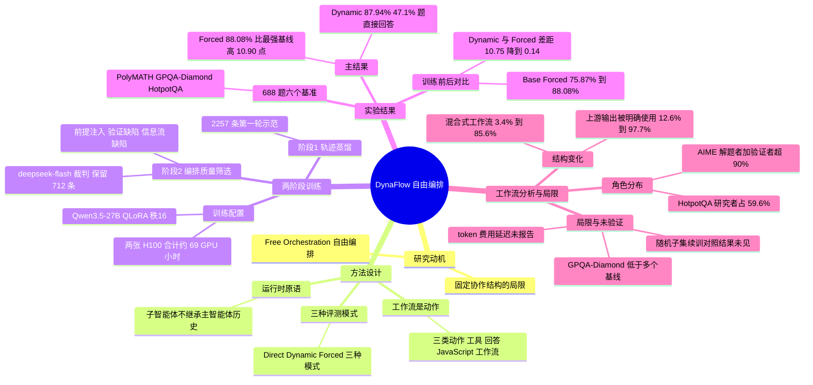

## 一、论文是干什么的？

想象你是一个项目经理，手下有一批能力固定的外包人员。有的活很简单，你自己 5 分钟就能做完，叫外包反而浪费时间；有的活可以拆成几块让大家同时做；还有的活必须「A 做完把结果交给 B，B 再检查」。一个好的项目经理，会先判断这件事要不要找人帮忙，再针对这件事临时写一份分工方案，等外包交回结果之后，再决定是收工还是追加一轮。这就是这篇论文想让大模型学会的能力。

现有的多智能体系统（multi-agent system，简称 MAS）大多像「固定流水线」：角色（程序员、测试员、评审员）和沟通方式事先设计好，不管题目难易都照走一遍。论文作者把这种能力叫做 **自由编排**（Free Orchestration）：**决定什么时候需要协作，并在解题过程中构造针对这道题的工作流**。他们提出 **DynaFlow**：把「写一段可执行的工作流程序」直接放进主智能体（Main Agent）的动作空间，和「直接回答」「调用普通工具」并列。工作流程序由主智能体用 JavaScript 写出，调度若干个固定不变的子智能体（sub-agent）串行或并行工作；程序跑完后，输出和执行记录会回到主智能体手里，由它决定是回答还是再写一轮工作流。以下数字均来自 [arXiv 全文](https://arxiv.org/html/2610.34467)（我读到的是 2026-10-29 的 v2 版本，arXiv v1 提交于 2026-10-25），属于「论文原文说的」；标注「我的解读」的部分是本综述的判断。

## 二、核心方法与创新

**1. 动作空间：工作流也是一种动作。** 给定问题 $q$ 和任务指令 $I$，主智能体的策略 $\pi_\theta$ 在三类动作中选择：普通工具调用、最终回答、以及「一个工作流动作」（由主智能体写出的 JavaScript 程序 $P$ 和对工作流工具 $W$ 的调用）。在第 $k$ 轮，它根据历史 $h_{k-1}$（此前所有动作和观察）生成动作 $a_k$。若 $a_k$ 是工作流，运行时执行程序并返回观察 $o_k=W(P)$，其中既有程序输出，也有每个子智能体调用的状态和输出记录；然后 $(a_k,o_k)$ 被追加进历史，进入下一轮。这像是项目经理收到外包交付物和工作日志，再决定下一步。

**2. 运行时与接口（附录 B）。** 工作流运行时只提供很少的原语：`agent` 用来调用一个子智能体，`parallel` 并发执行多个调用，`pipeline` 让多个条目各自走完依赖的阶段，`phase` 给阶段打标签。子智能体只收到程序明确传给它的指令和输入，**不会自动继承主智能体的对话历史**；调用还可以用 JSON schema 要求结构化输出。一旦启动工作流，主智能体被限制为只做协调和总结，实质解题必须交给子智能体。

**3. 两种评测模式。** Dynamic 模式下，第一步可在「直接回答」和「调用工作流」之间选；Forced 模式下，第一个实质动作必须调用工作流。作者用 Forced 来单独考察「工作流造得好不好」，用 Dynamic 来考察「该不该用工作流」。另有 Direct 模式：不用任何工具和工作流，直接回答。

**4. 两阶段监督微调（只训练主智能体）。** 两个阶段都最小化同一个损失：

$$\mathcal{L}_{\mathrm{SFT}}(\theta;\mathcal{D})=-\sum_{(I,q,s)\in\mathcal{D}}\log \pi_\theta(r,a_1\mid I,q)$$

其中监督目标 $s=(r,a_1)$ 是主智能体第一轮的输出：推理文字 $r$ 加第一个工作流动作 $a_1$。指令、问题和工具定义不计入损失。也就是说，**训练只教它「第一轮怎么分析题目、怎么写出第一份工作流」，后续轮次靠推理时的反馈自行决定**（论文在讨论部分把多轮监督列为未来工作）。

- **阶段 1：轨迹蒸馏。** 让教师模型 GLM-5.3 Max 用同样的工作流接口、工具和固定子智能体生成轨迹，只保留最终答案正确、且遵守「实质解题在工作流内完成」协议的轨迹，得到 2,257 条第一轮示范（来自 HotpotQA 和 BrowseComp）。
- **阶段 2：按编排质量筛选数据。** 光是答案正确不代表协作可靠。作者发现阶段 1 模型的失败常来自信息传递出错或主智能体判断错误，于是用一个 LLM 裁判检查工作流程序是否有三类缺陷：(i) 前提注入（主智能体把「决定答案的、题目之外的断言」当作既定事实交给子智能体）；(ii) 验证缺陷（评审指令把验证者引向预期答案，或限制它独立检查和修改）；(iii) 信息流缺陷（缺上下文、引用错误、有损传递、用写死的数值替代上游输出）。裁判必须引用程序里的原文片段作为证据，才算数。从 2,257 条里留下 712 条，从阶段 1 的检查点出发，用同一目标、更小的学习率续训。类比：不是只看学徒最后做对没有，而是把「靠运气蒙对」「偷看答案抄」的作业挑出来，不放进精修教材。

**5. 子智能体固定。** 评测时所有子智能体都是未做编排训练的 Qwen3.5-27B 基座。作者的说法是这样可以把「编排能力的学习」和「执行者能力的提升」分开。（我的解读：这也意味着论文的增益全部来自主智能体怎么指挥，而不是子智能体变强了。）

## 三、使用了哪些模型和计算资源？

**用到的 LLM（按角色分列）：**

- **训练对象（主智能体）：** Qwen3.5-27B，约 270 亿参数。用 ms-swift 4.6.0.dev0 做 4 位 NF4 QLoRA（双重量化、BF16 计算、梯度检查点），可训练参数 116,727,808 个（按原文数字推算，约占总参数的 0.43%）；视觉编码器和对齐模块冻结。
- **评测对象：** 主智能体用 Qwen3.5-27B（Base、阶段 1、阶段 2 三个检查点）；所有基线（CoT、CoT-SC、Self-Refine、AFlow）也都用 Qwen3.5-27B。
- **固定子智能体：** Qwen3.5-27B 基座，不训练，主智能体和子智能体都开启 thinking。
- **教师模型：** GLM-5.3 Max，只用于生成蒸馏轨迹。
- **裁判模型：** deepseek-flash（论文参考文献写作 DeepSeek-V4.1-Flash 模型卡）。它有两个用途：阶段 2 的数据筛选（thinking 开启、高推理强度、温度 0），以及对强制模式下工作流设计质量的打分（同样设置）。

**GPU 与训练规模：**

- 每个阶段都在 2 张 NVIDIA H100 80GB 上训练，单个训练进程把模型切分到两张卡上。
- 阶段 1 约 52 GPU 小时，阶段 2 约 17 GPU 小时，合计约 69 GPU 小时；按完整任务墙钟时间统计，**不含**教师轨迹生成、评测和 LLM 裁判。按原文数字推算，若两张卡全程占用，阶段 1 墙钟约 26 小时、阶段 2 约 8.5 小时。
- 训练配置（表 3）：学习率阶段 1 为 $5\times10^{-5}$、阶段 2 为 $1\times10^{-5}$；各 2 个 epoch；LoRA 秩 16、α 为 32、dropout 为 0；融合版 AdamW；余弦调度，预热比例 0.05；有效批大小 4；最大序列长度 67,584；随机种子 42；没有单独的验证集。

**推理与评测设置（附录 D 表 4）：** 主智能体上下文长度 131,072，最大输出 81,920 个 token，温度 1.0、top-p 0.95、top-k 20、presence penalty 1.5；子智能体单次响应最大输出 65,536 个 token。

**论文未报告的信息：**

- 评测推理用什么 GPU、多少张卡：论文未报告。
- 单道题的平均推理时间、单次完整评测（688 题）的耗时：论文未报告。
- 教师模型 GLM-5.3 Max 的 API 花费、调用的原始轨迹条数（只给了过滤后保留的 2,257 条）：论文未报告。
- 裁判模型的调用花费、单次评测的 token 总量与金额：论文未报告。
- 平均每题的子智能体数量有报告（Forced 约 4.16 个，Dynamic 为 2.44 个），但这只是调用数，论文没有给出对应的 token、费用或延迟数字。

## 四、实验结果

**设置（原文）：** 共 688 道题：AIME 2024、2025、2026 各 30 题，PolyMATH 200 题（随机种子 42 抽样），GPQA-Diamond 198 题，HotpotQA 200 题（随机种子 42 抽样，使用网络搜索检索）。指标是最终答案准确率，没有有效最终答案的运行算错；整体准确率是对 688 题的微平均（所有题合在一起算）。

**主结果（表 1，准确率 %）：**

| 方法 | AIME24 | AIME25 | AIME26 | PolyMATH | GPQA-D | HotpotQA | 整体 |
|---|---|---|---|---|---|---|---|
| CoT | 96.67 | 93.33 | 86.67 | 83.00 | 85.35 | 46.50 | 74.27 |
| CoT-SC | 90.00 | 93.33 | 96.67 | 84.50 | 85.86 | 50.50 | 76.16 |
| Self-Refine | 96.67 | 93.33 | 93.33 | 87.50 | 88.38 | 48.00 | 77.18 |
| AFlow | 93.33 | 96.67 | 100.00 | 86.00 | 87.37 | 47.00 | 76.45 |
| Base，Direct | 93.33 | 93.33 | 93.33 | 74.00 | 83.33 | 47.50 | 71.51 |
| Base，加网络搜索 | 83.33 | 73.33 | 73.33 | 66.00 | 79.80 | 77.50 | 74.71 |
| Base，Dynamic | 63.33 | 63.33 | 73.33 | 64.00 | 77.78 | 53.00 | 65.12 |
| Base，Forced | 76.67 | 70.00 | 70.00 | 70.00 | 77.78 | 81.50 | 75.87 |
| DynaFlow，Direct | 93.33 | 90.00 | 90.00 | 87.00 | 86.87 | 51.50 | 77.18 |
| DynaFlow，Dynamic | 93.33 | 100.00 | 96.67 | 91.50 | 83.84 | 84.50 | 87.94 |
| **DynaFlow，Forced** | 100.00 | 100.00 | 100.00 | 90.50 | 84.85 | 83.50 | 88.08 |

要点（原文）：Forced 模式整体 88.08%，比最强基线（Self-Refine，77.18%）高 10.90 个百分点；Dynamic 模式 87.94%。Forced 模式在三年 AIME 共 90 题全部答对。PolyMATH 上两种模式都比最强基线高 3 到 4 个百分点（90.50 与 91.50，对比 Self-Refine 的 87.50）。HotpotQA 上 Dynamic 与 Forced 比「Base 加网络搜索」高 6 到 7 个百分点。

**训练阶段与执行模式（表 2，整体准确率 %）：**

| 主智能体 | Direct | Dynamic | Forced |
|---|---|---|---|
| Base | 71.51 | 65.12 | 75.87 |
| 阶段 1 | 76.74 | 84.45 | 85.47 |
| DynaFlow（阶段 2） | 77.18 | 87.94 | 88.08 |

- 训练前，Forced 在除 HotpotQA 之外的所有基准上都比 Base，Direct 差（原文图 3）。也就是说，**没训练的模型拿到工作流工具，反而帮倒忙**；训练之后才转为收益。
- Dynamic 与 Forced 的差距：Base 为 10.75 个百分点，阶段 1 为 1.02，DynaFlow 为 0.14。
- Dynamic 模式下 DynaFlow 有 47.1% 的题直接回答；把这些题也算进平均，每题平均用 2.44 个子智能体，对比 Forced 约 4.16 个，约少 41%（41% 是原文说法，按 2.44/4.16 推算约 41.3%）。

**工作流结构分析（原文第 5.3 节）：**

- 混合式（既有并行又有串行）工作流占比：Base 为 3.4%，阶段 1 为 83.2%，阶段 2 为 85.6%。
- 「把上游输出传下去并明确要求下游使用」的程序占比：Base 为 12.6%，阶段 1 为 93.3%，阶段 2 为 97.7%。
- 严重信息流缺陷占比从阶段 1 的 1.9% 降到阶段 2 的 0.9%；指定了纠正或精修中间结果的工作流从 28.1% 升到 35.9%；平均子智能体数从 4.35 降到 4.16。
- 角色分布：在 AIME 和 PolyMATH 上，解题者与验证者合计超过 90% 的节点；HotpotQA 上研究者占 59.6%；验证类节点在各任务中占 33.2% 到 43.9%。

**一个具体案例（附录 H，AIME 2026 回文数计数）：** Base 只派一个解题者，因算术错误给出 59；DynaFlow 把枚举、动态规划、容斥三种方法分给并行解题者，再把结果交给验证者比对并独立重算，三个解题者和验证者都得到 62。

**我的解读与需要留意的地方：**

1. **并非每项都赢。** 按表 1，GPQA-Diamond 上 DynaFlow 的 Forced 为 84.85%，比 CoT（85.35）、CoT-SC（85.86）、AFlow（87.37）和 Self-Refine（88.38）都低；论文正文只点名了 Self-Refine 和 AFlow，按表中数字，CoT 和 CoT-SC 也更高。
2. **样本量小。** 三个 AIME 各只有 30 题，一题就差 3.33 个百分点；「AIME 全对」是在 90 题的有限集合上的结果。
3. **检索不对等。** 论文自己说明，免工具基线没有和工作流设置同等的检索能力，因此 HotpotQA 的对比要分开看；较公平的参照是「Base 加网络搜索」的 77.50%。
4. **训练数据与测试域不同。** 训练示范来自 HotpotQA 和 BrowseComp（阶段 2 为 449 条加 263 条），而评测还包括 AIME、PolyMATH、GPQA-Diamond。这在一定程度上说明学到的是通用的编排习惯，但论文没有专门分析这一点。
5. **对照缺失。** 论文在 3.2 节写到「需要一个等量随机子集续训的对照，用来区分筛选效果和多训练的效果」，但在我读到的正文和附录里没有找到这个对照的结果，也没有找到多随机种子或置信区间。因此阶段 2 的增益到底有多少来自「筛选」，在论文中没有被单独验证。
6. **不能把 41% 当成省钱比例。** 论文只给出子智能体数量的下降，没有给出 token、费用或延迟。

## 五、潜在应用与已落地应用

**论文明确提到的方向（原文）：** 讨论部分提出两条未来工作：训练子智能体，使其更擅长可靠的信息传递与独立验证；把第一轮监督扩展到包含分歧和错误结果的多轮轨迹，让主智能体更会独立判断冲突输出、识别错误，并选择错误恢复、工作流修订和最终答案选择。

**我的判断（非论文原文）：** 这种「由一个主智能体按需现写协作程序」的思路，可能适合需要检索加核对的研究助理、需要多方案交叉验证的数学或科学问答，以及希望对简单问题省掉协作开销的客服或代码助手。不过论文只在六个问答与推理基准上验证，没有在真实产品流程中评测。

**已落地情况：** 作者在 GitHub 开源了 [amiya-special/Dynaflow](https://github.com/amiya-special/Dynaflow)，采用 MIT 许可证，截至 2026-10-30 通过 GitHub API 查到约 174 颗星，最近一次推送为 2026-10-27。README 提供 direct、dynamic、forced 三种演示模式，要求 Python 3.11 以上；dynamic 和 forced 需要 Node.js 24 以上和 Docker，并需要兼容 OpenAI 流式 Chat Completions 的 API，以及网络搜索和页面检索的凭证。README 注明演示成功的含义是所有问题都返回了有效格式的答案，不对答案正确性打分。另有 [项目主页](https://amiya-special.github.io/DynaFlow-website)。HF 论文页显示未关联任何模型、数据集或 Space，因此截至 2026-10-30，没有看到公开发布的训练后主智能体权重；我也没有查到商业产品中的落地案例。

## 六、网络上的讨论与评价

- [Hugging Face 论文页](https://huggingface.co/papers/2610.34467)：票数 143（用 HF API 核对），由作者之一 Qi Li 于 2026-10-27 提交到每日论文。页面上除了 Librarian Bot 的自动推荐外，我只看到作者自己发的一条评论，内容是 GitHub、arXiv 和项目主页的链接，没有看到独立评价。
- [GitHub 仓库](https://github.com/amiya-special/Dynaflow)与[项目主页](https://amiya-special.github.io/DynaFlow-website)：均为作者发布，项目主页含案例图与中英文版本，属于官方介绍，不是独立评测。
- [hyper.ai 论文页](https://hyper.ai/en/papers/2610.34467)：收录摘要及站方生成的分节解读（One-sentence Summary、Key Contributions 等），复述论文数字，非独立评测。
- [alphaXiv 页面](https://www.alphaxiv.org/abs/2610.34467)：论文索引页，页面标注提交日期为 2026 年 10 月 29 日（与 v2 日期一致），我没有看到独立评论内容。
- [AI 郵報（aiposthub）的解读文章](https://www.aiposthub.com/dynaflow-learned-multi-agent-workflow-orchestration/)（2026-10-27，繁体中文）：二手解读，比较克制。它提醒「平均子智能体数下降不能直接换算成 token、费用或等待时间」，也提醒 HotpotQA 上无搜索基线与有搜索系统不可直接比较，并指出官方示范成功不等于已公开训练后权重。值得注意的是，该文写阶段 1 训练示范为 2,031 笔，而我读到的 v2 论文写 2,257 条；对照 arXiv v1 的 HTML 全文，v1 正文确实写 2,031 条（附录里写 2,254 条），v2 才改为 2,257 条，所以这是版本差异，不是该文写错。本综述以最新的 v2 为准。
- [QMReader 的中文重写页](https://rss.qiaomu.ai/articles/dynaflow-%E5%AD%A6%E4%B9%A0%E8%87%AA%E7%94%B1%E5%BD%A2%E5%BC%8F%E7%9A%84%E5%A4%9A%E6%99%BA%E8%83%BD%E4%BD%93%E7%BC%96%E6%8E%92--015423139d4a/rewrite)：通过中文关键词检索出现的标题页（标题为「乔木风格重写，DynaFlow：学习自由形式的多智能体编排」），我打开时页面框架可访问，但未读到可评述的实质内容，不作评价。
- 查过但没有相关结果：截至 2026-10-30，Hacker News 的 Algolia 搜索 DynaFlow 加 multi-agent orchestration 返回 0 条，搜索 arXiv ID 只返回一条不相关的论文；Reddit 的搜索接口对自动请求返回拦截页，我没有继续绕过，因此未能检索 Reddit；X/Twitter 与知乎没有通过通用网页搜索找到相关页面。检索中出现过一篇同名但无关的 DynaFlow（arXiv 2605.21603，讲设备内并行算子调度），请注意区分。
- 局限（论文自述）：论文没有单独的局限性章节；讨论部分指出，未来要训练子智能体做可靠的信息传递与独立验证，并扩展到多轮监督。另外，正文也写明免工具基线与工作流设置检索条件不同，因此 HotpotQA 的结果需要分开解读。

## 七、思维导图

