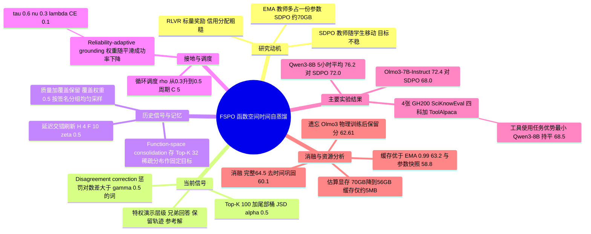

## 一、论文是干什么的？

先想象一个学生在备考：老师只在卷子最后打一个总分（对或错），并不告诉他哪一步想错了。这就是目前主流的**可验证奖励强化学习**（RLVR，Reinforcement Learning with Verifiable Rewards）的处境：一整段回答只换来一个标量结果，很难知道一长串词里哪些决定好、哪些决定坏。近来流行的**自蒸馏**（self-distillation）给了一个办法：让同一个模型扮演两个角色，一个是「裸考的学生」（只看题目），一个是「开卷的自我老师」（题目之外还能看到一份参考答案或同伴的成功解法），两者在每个位置对下一个词的预测差异，就是逐词的细粒度监督。代表方法是 SDPO（Self-Distillation Policy Optimization，论文引用的 Hubotter 等人 2026 年工作，arXiv 2601.20802）。

但论文指出一个问题：老师和学生是同一份参数，学生一更新，老师也跟着变，目标一直在「移动」。常见补救办法是维护一份 EMA（指数滑动平均）的参数副本当稳定的老师，可这要多占一份与模型等大的显存。本文提出 **FSPO**（Function-Space Policy Optimization），核心想法是：不保存「过去的老师参数」，而是把过去老师给出的**下一个词的概率分布**，只挑概率最高的几十个词存成一张小表，当作固定不动的目标。类比：与其雇一位一直陪读的家教（占一个座位），不如把家教过去批改过的重点笔记存在抽屉里，需要时拿出来对照，抽屉只占一点点空间。论文声称，这样在 5 小时训练预算下平均准确率比最强基线高约 4 个百分点，同时 Olmo3-7B-Instruct 的估算峰值显存从约 70 GB 降到 56 GB（论文把 56 GB 称为各方法共有的训练状态，FSPO 另有时间回放的少量激活开销，详见第三章）。以下数字均来自 [arXiv 全文](https://arxiv.org/html/2610.19687)，其中基线结果是作者直接取自 SDPO 论文的数字，并非重新训练得到。

## 二、核心方法与创新

FSPO 由四个部件组成，最后合成一个损失函数。（说明：论文全称 Function-Space Temporal Self-Distillation 的缩写 FTSD 在第 2 节开头和相关工作里也被用来指这个方法，摘要、实验和结论则用 FSPO，指的是同一件事。）

**1. 特权适配与分歧纠正（当前信号）。** 每道题让策略采样 $G$ 个回答 $y_{p,j}$，用验证器打分 $r_{p,j}\in[0,1]$。对每个回答构造一份「特权演示」$d_{p,j}$，按优先级依次是：同组里已验证成功（得分不低于 $\tau_{\mathrm{succ}}$）的兄弟回答，其次是记忆里保留的历史成功轨迹 $\tilde y_p$，最后才用数据集自带的参考解 $g_p$。学生看到 $p_{p,j,t}=\pi_\theta(\cdot\mid x,y_{<t})$，老师看到同一个前缀外加演示，得到 $q_{p,j,t}$（对老师停止梯度）。为了不比较整个词表，只取学生概率最高的 $K_{\mathrm{cur}}$ 个词，其余概率合并成一个「尾部桶」，然后用广义 Jensen–Shannon 散度（JSD，一种衡量两个概率分布差多远的指标，$\alpha=0.5$）拉近两者，得到 $\mathcal{L}_{\mathrm{distill}}$。类比：开卷老师在每个字上点评「这里你的把握其实太大了」。

在此之上再加一个更有针对性的惩罚：如果某个词满足 $\log p-\log q>\gamma$，即学生比开卷老师高估得太多，就把它放进集合 $\mathcal{N}$，用铰链形式的 $\mathcal{L}_{\mathrm{neg}}$ 压低它。于是当前目标是 $\mathcal{L}_{\mathrm{cur}}=\mathcal{L}_{\mathrm{distill}}+\lambda_{\mathrm{neg}}\mathcal{L}_{\mathrm{neg}}$。

**2. 函数空间时间巩固（历史信号，论文标题里的核心）。** 对每道题，记忆里存一条保留轨迹 $\tilde y_p$、它的验证得分、一个「结构签名」，以及当时的老师在每个位置给出的稀疏分布：Top-$K_{\mathrm{temp}}$ 个词的概率加一个尾部桶。这些分布存下来之后**不再改变**，所以和不断演化的当前策略之间有了「时间上的隔离」。训练时让当前策略在这些轨迹上的预测去逼近这些固定目标，得到 $\mathcal{L}_{\mathrm{temp}}$。为避免目标过期，采用延迟加交错刷新：一条目标存满 $H$ 步后才有资格刷新，每 $F$ 步刷新符合条件条目的一个比例 $\zeta$。作者强调这里的「函数空间」指的是保存模型的输出函数（下一词分布），而不是保存参数。

**3. 质量与覆盖感知的记忆。** 保留哪条轨迹不只看得分，而是把验证质量和「结构签名覆盖度」合成一个保留分数（覆盖权重 0.5）；回放时按签名分组均匀采样。论文里签名的定义：工具使用任务用调用的动作序列，选择题类任务用预测的选项。类比：整理错题本时，不只留分数最高的解法，也留不同类型的解法，避免一本笔记里全是同一种套路。记忆在训练开始前就用最初几个批次里题目的参考解做了预填充（标记得分为 0，只当兜底目标，不当作已验证演示），所以时间巩固从第一步起就能工作。

**4. 可靠性自适应参考接地。** 对每道题维护一个平滑的成功率估计 $\hat r_p^{(s)}=(1-\nu)\hat r_p^{(s-1)}+\nu\, r_p^{(s)}$，参考解的权重为 $w_p^{(s)}=\mathrm{clip}\big((\tau-\hat r_p^{(s)})/\tau,0,1\big)$：模型反复答不对的题，多用参考解做交叉熵监督；一旦能稳定做对，这项监督就逐渐消失，得到 $\mathcal{L}_{\mathrm{CE}}$。类比：差生多给标准答案，学会之后就撤掉拐杖。

**总目标与调度：**

$$\mathcal{L}(\theta_s)=(1-\rho_s)\,\mathcal{L}_{\mathrm{cur}}+\rho_s\,\mathcal{L}_{\mathrm{temp}}+\lambda_{\mathrm{CE}}\,\mathcal{L}_{\mathrm{CE}}$$

其中 $\rho_s$ 不是常数，而是按周期 $C$ 从 $\rho_{\min}$ 线性升到 $\rho_{\max}$（每个周期先偏重当前信号、再逐步偏重历史信号）。主要超参数（论文表 5）：每批 32 道题、每题 8 个 rollout、学习率 $1\times10^{-5}$、AdamW、bf16、$K_{\mathrm{cur}}=100$、$K_{\mathrm{temp}}=32$、$\tau_{\mathrm{succ}}=0.5$、$H=4$、$F=10$、$\zeta=0.5$、$\gamma=0.5$、$\lambda_{\mathrm{neg}}=0.1$、$\lambda_{\mathrm{CE}}=0.1$、$\tau=0.6$、$\nu=0.3$、$(\rho_{\min},\rho_{\max})=(0.3,0.5)$、$C=5$。全部数据集和模型共用同一套超参，没有按数据集调参。由于只用当前这一个策略做 rollout 和特权评估，论文说它既不需要 EMA 教师，也不需要 rollout 重要性采样修正。

## 三、使用了哪些模型和计算资源？

- **训练对象（初始检查点）：** Qwen3-8B（关闭 thinking 模式）和 Olmo3-7B-Instruct（论文写作 allenai/Olmo3-7B-Instruct）。两者都是 FSPO 与各基线共同的起点。
- **评测对象：** 同样是上述两个模型训练后的结果；在 5 个任务的留出测试集上用 avg@16 评估（每题 16 次采样取平均）。验证时用 vLLM，温度 0.6、top-p 0.95、16 个 rollout；训练 rollout 用 HF Transformers 的常驻策略，温度 1.0、top-p 1.0。
- **裁判或辅助模型：** 论文描述的打分来源是任务的验证器 $R$（论文未说明验证器的具体实现细节），没有提到额外的 LLM 裁判，也没有提到外部教师，但这是「未提及」，论文并未明确声明没有使用。教师就是策略自身，在「题目加演示」的上下文下运行。
- **商用 API：** 论文未报告是否使用商用 API，也未报告任何 API 花费。
- **GPU：** 每次运行使用 4 张 NVIDIA GH200。
- **训练时长：** 论文按**挂钟时间预算**比较，报告 1 小时与 5 小时内达到的最高 avg@16；因此训练挂钟预算最长 5 小时（4 张 GH200）；FSPO 论文称遵循 SDPO 的训练与评测设置，而 SDPO 论文注明其每次运行含初始化和验证约 6 小时（FSPO 论文未单独说明）。按原文数字推算，5 小时训练预算约为 20 张 GH200 小时，这是我的换算，论文没有直接写 GPU 小时。每个任务各自训练，总共 2 个模型乘 5 个任务乘各方法的运行次数，论文未报告随机种子数或重复次数。
- **单步耗时：** 论文只在图 4 里画了 Olmo3-7B-Instruct 每个训练步的平均时间随训练时间的变化，正文未给具体秒数；论文称 FSPO 的单步耗时会随训练快速下降（因为回答越来越短），而 GRPO 与 SDPO 的单步耗时随回答变长而上升。
- **单次评测成本：** 论文未报告。
- **显存：** 论文图 6 的估算：Olmo3-7B-Instruct 的公共训练状态（权重、梯度、AdamW 状态、激活与 KV cache）约 56 GB，GRPO 因额外的同步 rollout 副本、SDPO 因额外的 EMA 教师副本，都约 70 GB；FSPO 无额外模型副本，但多出时间回放的激活开销。缓存本身在主机内存里，峰值约 5 MB（5 个任务平均到 942 条记录时为 4.8 MB）。论文还按同一口径估算，在 6T 参数规模下，省掉一份 bf16 参数副本约相当于 12 TB 总显存。
- **其他配置：** 提示最长 2048、回复最长 8192、教师重新提示的上下文最长 10240 个 token；预热 10 步、权重衰减 0.01、梯度裁剪范数 1.0。

## 四、实验结果

**任务与设置（论文原文）：** 四个 SciKnowEval（Feng 等人 2024）三级推理子集——化学、物理、生物、材料——外加 ToolAlpaca 的工具使用任务，每个任务划分互不重叠的训练与测试集。指标是 avg@16。基线 GRPO（一种主流的 RLVR 算法：每道题采样一组回答，用组内相对得分决定好坏）、on-policy GRPO、SDPO 的数字取自 SDPO 论文（本综述已与 SDPO 论文表 3 核对，基线数字一致）；GRPO 每批做 4 次离策略小批更新，而 on-policy GRPO、SDPO、FSPO 每批只更新一次。

**主结果（论文表 1，单位为准确率百分数，每格为 1 小时 / 5 小时内的最高值）：**

Qwen3-8B（零样本基座：化学 41.2、物理 59.2、生物 30.8、材料 58.9、工具 57.5，平均 49.5）

| 方法 | 化学 | 物理 | 生物 | 材料 | 工具使用 | 5 小时平均 |
|---|---|---|---|---|---|---|
| GRPO | 65.9 / 74.5 | 63.8 / 72.7 | 35.1 / 59.9 | 74.3 / 77.1 | 64.9 / 67.7 | 70.4 |
| GRPO（on-policy） | 63.3 / 63.4 | 63.6 / 63.6 | 49.8 / 49.8 | 73.9 / 74.1 | 60.2 / 65.7 | 63.3 |
| SDPO（on-policy） | 73.2 / 80.9 | 66.6 / 75.6 | 50.6 / 56.8 | 72.1 / 78.4 | 68.0 / 68.5 | 72.0 |
| **FSPO** | 81.8 / 83.4 | 66.7 / 76.0 | 71.2 / 71.2 | 81.7 / 81.7 | 66.6 / 68.5 | **76.2** |

Olmo3-7B-Instruct（零样本基座：化学 22.8、物理 37.7、生物 16.2、材料 36.7、工具 39.3，平均 30.5）

| 方法 | 化学 | 物理 | 生物 | 材料 | 工具使用 | 5 小时平均 |
|---|---|---|---|---|---|---|
| GRPO | 39.7 / 56.7 | 55.3 / 63.3 | 35.6 / 55.8 | 70.9 / 75.0 | 56.4 / 65.0 | 63.2 |
| GRPO（on-policy） | 51.4 / 57.5 | 62.7 / 62.7 | 49.8 / 49.8 | 73.3 / 73.5 | 56.8 / 60.6 | 60.8 |
| SDPO（on-policy） | 68.0 / 80.0 | 59.9 / 66.1 | 48.0 / 52.8 | 73.7 / 79.1 | 60.8 / 62.1 | 68.0 |
| **FSPO** | 81.0 / 83.3 | 66.4 / 70.1 | 62.3 / 62.3 | 76.3 / 79.9 | 57.6 / 66.6 | **72.4** |

按原文数字推算：FSPO 的 5 小时平均比 SDPO 在 Qwen3-8B 上高 4.2 个点，在 Olmo3-7B-Instruct 上高 4.4 个点，与摘要里的「约 4 个百分点」一致。论文写道 FSPO 在四个科学推理任务上都取得最佳的 5 小时成绩；工具使用上优势最小，Qwen3-8B 上 FSPO 与 SDPO 同为 68.5，而在 1 小时预算下 SDPO 在两个模型上都更强（例如 Qwen3-8B 的 68.0 对 66.6）。表中还可以看到，FSPO 在不少任务上 1 小时的成绩就接近 5 小时（如 Qwen3-8B 的生物、材料两项 1 小时与 5 小时相同），论文则在图 3 的收敛曲线上说它比基线更快逼近峰值。

**遗忘实验（论文表 3、图 5）：** 在 Olmo3-7B-Instruct 上训练某个任务后，测 HumanEval、MMLU、HellaSwag、Winogrande、TruthfulQA 五个原有能力。基座这五项平均 61.26。FSPO 在每个训练任务下的平均保留分都是各方法最高：化学 60.95、物理 62.61、生物 60.94、材料 62.32、工具使用 59.45；对应 SDPO 为 59.97、59.95、59.64、60.19、58.73，GRPO 为 57.08、57.28、57.21、56.86、54.79。物理和材料训练后的平均分甚至高于基座，主要来自 HumanEval 从 47.56 升到 58.54（物理）和 56.10（材料）；而 HellaSwag、Winogrande、TruthfulQA 普遍仍低于基座。

**消融（论文表 2，Olmo3-7B-Instruct，生物 / 工具使用 / 平均）：**

| 变体 | 生物 | 工具使用 | 平均 |
|---|---|---|---|
| 完整 FSPO | 62.3 | 66.6 | 64.5 |
| 只用 $\mathcal{L}_{\mathrm{distill}}$ | 54.9 | 57.2 | 56.0 |
| 去掉 $\mathcal{L}_{\mathrm{neg}}$ | 61.9 | 65.8 | 63.8 |
| 去掉 $\mathcal{L}_{\mathrm{temp}}$ | 59.9 | 60.3 | 60.1 |
| 去掉 $\mathcal{L}_{\mathrm{CE}}$ | 59.1 | 64.3 | 61.7 |
| 同时去掉 $\mathcal{L}_{\mathrm{temp}}$ 与 $\mathcal{L}_{\mathrm{CE}}$ | 54.4 | 53.8 | 54.1 |
| 只用参考解当演示 | 41.8 | 39.1 | 40.5 |
| 参数快照（每 $H$ 步）代替函数空间缓存 | 59.4 | 58.1 | 58.8 |
| EMA 教师（衰减 0.99） | 62.3 | 64.2 | 63.2 |
| EMA 教师（衰减 0.999） | 61.3 | 61.3 | 61.3 |
| 冻结初始策略当教师 | 56.8 | 56.1 | 56.5 |
| 只按奖励保留 | 59.8 | 64.1 | 61.9 |
| 只按覆盖保留 | 56.3 | 57.8 | 57.0 |
| 常数参考权重 | 60.2 | 65.1 | 62.6 |
| 反向循环（先巩固后适配） | 57.6 | 61.7 | 59.7 |
| 零样本基座 | 16.2 | 39.3 | 27.8 |

论文的解读：时间巩固与参考接地贡献最大，分歧纠正的贡献较小但稳定；有意思的是，在去掉时间与参考两个锚点之后保留分歧纠正（54.1）反而比只用蒸馏（56.0）更差，说明激进的局部纠正需要先把自我老师稳住。函数空间缓存优于参数快照、EMA、冻结策略等替代做法，其中好几个甚至低于完全去掉时间巩固（60.1）。EMA 教师在生物上与缓存持平（62.3），差距主要出现在工具使用。附录表 4 还给出超参敏感性，例如 $H=1$（立即刷新）只有 57.0、不刷新（$H=\infty$）为 60.1，$H=4$ 最好；$\lambda_{\mathrm{CE}}=1.0$ 会掉到 55.3；JSD 优于前向与反向 KL（两种不对称的分布差异度量）。我的补充看法：消融只在一个模型的两个任务上做，且论文未报告多随机种子的方差，所以小差距（例如去掉 $\mathcal{L}_{\mathrm{neg}}$ 的 0.7 个点）不宜过度解读。

## 五、潜在应用与已落地应用

**论文明确提到的方向（原文）：** 面向 LLM 后训练中的科学推理和结构化工具使用；结论称这种做法让「持续后训练」可以更省显存、更稳定，并且随模型规模增大，省掉一份参数副本的收益也越大（文中估算 6T 参数下约 12 TB）。

**我的判断（非论文原文）：** 如果一个团队已经在用 SDPO 一类的自蒸馏做 RLVR，并且受限于显存，这个思路可以直接作为 EMA 教师的替代；对需要在新任务上继续训练又不想遗忘旧能力的场景（持续学习），把历史输出分布存成表再回放，是一种成本很低的正则。但论文只验证了两个 7B 到 8B 级别的模型、五个任务，且依赖「每题有参考解和验证器」，在没有可靠验证器的开放式任务上是否适用，论文没有验证。

**已落地应用：** 截至 2026-10-30，没有检索到有据可查的产品落地。HF API 显示该论文没有关联的模型、数据集或 Space，也没有 GitHub 仓库或项目主页字段；arXiv 全文里也没有代码链接。

## 六、网络上的讨论与评价

- [Hugging Face 论文页](https://huggingface.co/papers/2610.19687)：票数 140（已用 HF API 核对），由作者之一 Vinay Kumar Verma 提交到每日论文（2026-10-26）。页面有 2 条评论：一条是作者 Vinay Kumar Verma 于 2026-10-27 发的推介，称该工作相比近期的自蒸馏策略方法 SDPO 有显著提升并复述摘要；另一条是 Librarian Bot 的自动相似论文推荐。没有看到独立评测。
- [Papers With Code 镜像页](https://paperswithcode.co/paper/2610.19687)：收录摘要，标注任务为推理与强化学习，列出 GRPO、PPO、RLVR、on-policy distillation 等相关方法；页面没有代码链接，也没有用户评论。
- [twyran 的 Daily-Paper 第 40 期](https://github.com/twyran/Daily-Paper/issues/40)（2026-10-28 的每日论文摘要）：把这篇列为当期面向就业相关推荐的第一篇，理由是它覆盖 RLVR、推理与工具使用，并结合策略优化、自蒸馏与显存效率，与后训练算法岗位相关，还附了一道面试题；这是对摘要的转述和推荐，不是独立评测（该页把方法称为 Function-Space Policy Optimization）。
- 代码：HF 页面、arXiv 页面、Papers With Code 镜像都没有提供代码或项目主页，截至 2026-10-30 没有检索到作者发布的实现仓库。
- 查过但没有相关结果：Hacker News（Algolia 搜索接口搜论文标题得到 0 条命中）；X/Twitter、Reddit、知乎、微信公众号在用英文标题、中文关键词和 arXiv 编号的搜索中未检索到针对这篇论文的讨论（知乎等处检索到的是关于 SDPO 的介绍文章，不是本文）。另有 alphaXiv 页面可访问，但没有读到独立评论。另外有一个 [Pith 页面](https://pith.science/paper/7KVDXE2A)，我这边访问返回 403，没能读取内容。另一个审查工具反馈说该页面载有一份标注为 AI referee 的评议，我没能核实其内容；即使存在，它也是 AI 评议，不是独立人工评测，更不是复现实验。
- 局限（论文自述与我的观察）：论文自述的是实验涵盖科学推理和工具使用，两个骨干；我的观察是基线数字取自 SDPO 论文而非同条件复跑，论文未报告多随机种子的方差或显著性检验，Table 1 报告的是「预算内最高值」而非最终值，这对不同方法的比较有利于曲线波动大的方法；工具使用任务上 FSPO 相对 SDPO 的优势很小甚至为零（Qwen3-8B 上持平）。

## 七、思维导图

