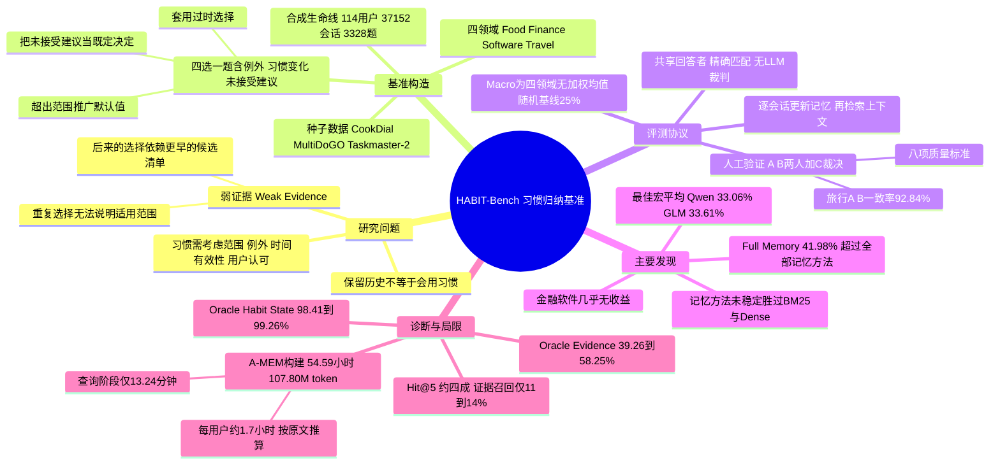

## 一、论文是干什么的？

想象你有一位私人管家。你从没说过「我喜欢午餐吃清淡的」，但他注意到：你连续几次点餐时都先看了清淡的候选，最后选了其中一个；有一次你因为请客户吃饭点了重口味的，他知道那只是例外；半年后你搬了家、换了公司，他也知道旧习惯可能已经失效；而他自己曾经推荐过某家店，你一次都没答应过，他也不会把那家店当成你的偏好。这种「从零散、不完整的迹象里，推断出一条有适用范围、有例外、会随时间变化的行为默认值」的能力，就是论文所说的**习惯归纳**（habit induction）。

现在的大模型智能体越来越多地配备「记忆系统」，用来在多次对话之间保留信息。但论文指出（论文原文观点）：只保留过去的对话，并不等于智能体能推断出习惯并恰当地使用它。为了量化这个差距，作者提出 **HABIT-Bench**：用合成的长期用户历史（每个用户的会话数因领域而异：食品 130 个，金融和软件各 540 个，旅行 124 到 147 个），在食品、金融、软件、旅行四个领域，给智能体出四选一的选择题，看它能否在新请求下选出「被历史证据支持、且当前仍然适用」的那个动作。论文最醒目的结论是：八种记忆方法里最好的一个（GLM-5.3-Flash 下的 A-MEM；换用 Qwen3-235B-A22B 时最好是 33.06%），四个领域的宏平均准确率只有 33.61%，而随机乱猜是 25%。需要注意，这个数字并不是「所有做法里的最好成绩」：第四章会讲到，GLM 下把压缩后的完整历史直接交给模型（Full Memory 对照组）能到 41.98%，比八种记忆方法都高。另外，即便把标注好的证据直接喂给模型，表现依然有限。

下文凡标注「论文原文」的内容均来自 [arXiv 全文](https://arxiv.org/html/2610.24520)（本综述读取的是 v2，v1 提交于 2026-10-17）；「我的解读」则是综述者的判断。

## 二、核心方法与创新

**1. 先定义「习惯记忆」。** 论文原文把习惯记忆定义为：从跨会话的不完整证据中推断行为默认值，并按其适用范围、例外、时间有效性和用户认可程度来使用它的能力。关键点有两个：一是相关的历史交互不一定能确立一条有效的默认值（重复的选择可能只在某个情境下成立）；二是助手自己提出、用户没有接受的建议，不能算作用户偏好。

**2. 形式化。** 对用户 $u$，$H_u^{\le t}=(s_1,\dots,s_t)$ 表示截至第 $t$ 个会话的历史。一道题（probe）$p$ 包含请求 $x_p$、四个候选动作 $A_p$、可见历史截止点 $t_p$，以及要还原的目标时间 $\tau_p$（可以是现在，也可以是某个历史时刻）。每个习惯状态 $z_{u,h}(\tau)$ 描述一条行为默认值及其适用条件、例外、时间有效性、用户认可情况。标准答案由 $a^\star_p=\mathrm{Resolve}(x_p,A_p,Z_u(\tau_p))$ 给出，其中 $\mathrm{Resolve}$ 把相关习惯组合起来并按请求约束选出唯一有效的动作。**弱证据**（weak evidence）指对某个默认值或其有效条件只提供不完整支持的观察，例如重复出现的选择没法说明适用范围，或者后来的选择必须结合更早的候选清单才能看懂。

**3. 数据怎么造。** 论文原文：以任务型对话数据集为「种子」，叠加受控的习惯图（habit graph），合成「真实提示作种子的合成生命线」。histories 里把含习惯证据的会话和同领域的普通任务会话穿插在一起，私有标注把每道题链接到适用的习惯状态和支持它的会话。总规模为 114 个用户、37,152 个会话、3,328 道题。

| 领域 | 用户数 | 会话数 | 题数 | 种子数据集 | 证据结构（论文原文概括） |
|---|---|---|---|---|---|
| Food 食品 | 30 | 3,900 | 630 | CookDial | 重复选择加情境对比，测试直接使用、边界、例外 |
| Finance 金融 | 36 | 19,440 | 1,368 | MultiDoGO | 复原用户确认的工作流，跟踪其替换，含两习惯与三习惯组合题 |
| Software 软件 | 18 | 9,720 | 680 | MultiDoGO | 与金融类似，但更换更频繁，含相似错误、未完成工单等干扰 |
| Travel 旅行 | 30 | 4,092 | 650 | Taskmaster-2 | 行为规则复原及对新请求的应用，含例外与随时间变化 |

各领域的构造细节（论文附录 A）：

- **食品**：20 个习惯模板（制备、收尾、摆盘类私人选择），每个用户有 7 个习惯；一个稳定习惯有 10 个信号会话（1 次候选清单、1 次远距离的序号确认、3 次认可后的复用、2 次边界观察、1 次单次例外、1 次不解决问题的演练、1 次被拒绝的助手建议）。每个用户 70 个信号会话加 60 个普通会话，共 130 个会话。210 个用户层面的习惯各产生直接使用、边界、例外三类题，共 630 题。
- **金融**：8 个候选习惯，每个用户激活 6 个、2 个缺席，其中 2 个激活的习惯会被替换。每个用户 540 个会话，时间跨度从 2021 年 1 月到 2025 年 6 月。一条常驻策略是靠「有序候选清单」加「很久以后用户引用序号的确认」拼出来的。1,368 题包含 944 道两习惯题和 424 道三习惯题。
- **软件**：7 个候选习惯，18 个用户各 540 会话，共有 71 条替换链。680 题包含 464 道两习惯题和 216 道三习惯题。
- **旅行**：47 个有依据的实例、18 个策略原型（13 个习惯族）、194 个习惯分配给 30 个用户；每个用户 124 到 147 个会话。650 题包含 456 道单习惯题和 194 道两习惯题。

**4. 评测协议与指标。** 论文原文：记忆方法按时间顺序把会话读入每个用户独立的记忆 $M_u^t=\mathrm{Update}(M_u^{t-1},s_t)$，在题目处检索出上下文 $R_p=\mathrm{Retrieve}(M_u^{t_p},x_p)$，再由同一个「回答者」LLM 预测 $\hat a_p=\mathrm{Answer}(x_p,A_p,R_p)$。评分用精确匹配：

$$\mathrm{Acc}_d=\frac{1}{|P_d|}\sum_{p\in P_d}\mathbb{I}[\hat a_p=a^\star_p],\qquad \mathrm{Macro}=\frac14\sum_{d=1}^{4}\mathrm{Acc}_d$$

也就是四个领域各自的准确率取简单平均，不加权。论文强调这样不需要 LLM 当裁判，避免裁判带来的波动。四选一的随机基线是 25%。

**5. 选项设计与人工验证。** 候选项都满足请求的硬性约束，区别只在于用不用对习惯：包括套用过时的选择、把默认值推广到适用范围之外、把用户没接受的建议当成既定决定。人工验证由 A、B 两位审核者在不看答案的情况下独立作答并按八项标准（可回答性、证据充分性、范围、边界与例外、选项平衡、自然度、来源依据、隐私）评估，分歧由第三位审核者 C 裁决。

**6. 对照与诊断设置。** No Memory（不给历史）、Full Memory（给一份压缩历史）、Oracle Evidence（直接给私有的标注证据）、Oracle Habit State（直接给私有的习惯状态和所需动作）。后两者用到了方法拿不到的信息，仅作诊断，不是可部署的系统。

## 三、使用了哪些模型和计算资源？

**被评测的对象（记忆方法）：**

- 记忆方法 6 个：A-MEM、Mem0、MemOS、MemRL、LightMem、SeCom；多存储记忆方法 2 个：Letta、MIRIX；合称「八种记忆方法」。
- 检索基线 5 个：Recency-5、Recency-10、BM25 RAG、Dense RAG、Temporal Hybrid RAG。
- 对照：No Memory、Full Memory（另有评测控制 Full History）；诊断用 Oracle Evidence、Oracle Habit State。
- 实现来源（论文附录 C）：A-MEM、Letta、LightMem、Mem0、MemOS、MemRL、MIRIX 是通过 MedMemoryBench 的适配器运行的官方代码适配版，只向统一回答者暴露检索结果，因此不是上游原生的端到端运行；SeCom 是按时间顺序摄入改造的官方源码适配基线。

**使用的 LLM（回答者和记忆构建共用同一模型）：**

- 主模型一：Qwen3-235B-A22B（检查点 Qwen/Qwen3-235B-A22B），BF16，8 路张量并行，上下文窗口 40,960 个 token，开启思考模式。
- 主模型二：glm-5.3-flash（通过 API 调用），采用低推理强度的思考模式，生成额度 16,384 个 token，遇到长度截断时最多提高到 32,768 个 token。
- 补充实验：Qwen3-4B、8B、14B、32B，关闭思考；检索实验用 BGE-M3 作为稠密检索编码器。GLM 实验里用 Qwen3-8B 的分词器只是为了度量 token 预算，不生成内容。
- 数据构造、会话改写、模型检查所用的 LLM 型号：论文未报告（附录只提到「基于模型的检查」，没有给出名称）。
- 裁判模型：无，评分是精确匹配；人工验证由 3 位人类审核者完成。

**GPU 与 API：**

- Qwen3-235B-A22B：论文只写了 BF16 与 8 路张量并行；GPU 的数量和型号论文均未报告。
- GLM-5.3-Flash：走 API，花费论文未报告。
- Qwen3-4B 到 32B 的 GPU 型号与数量：论文未报告。

**耗时与成本：**

- 总体配置规模：论文原文称评测共覆盖 308 个「方法、模型、领域」配置。整体 GPU 小时、API 总花费：论文未报告。
- 记忆构建成本（论文 4.5 节，基于 Qwen3-8B 与 32 个用户、954 道题的子集）：A-MEM 构建记忆累计 54.59 小时、107.80M 个 LLM token；它的查询阶段累计 13.24 分钟、3.39M 个 token。按原文数字推算，每个用户的 A-MEM 构建平均约 1.7 小时、约 3.4M token（54.59 除以 32，107.80M 除以 32）。论文注明这是累计的每用户延迟而非并行墙钟时间，token 含提示与生成、不含 embedding，也不能直接外推到整个数据集。
- 其他方法的构建与查询耗时只在图 3(b) 以图形给出，正文只写出了 A-MEM 的数值。
- 解码设置：温度 0，种子 42，输入上限 40,000 个 token；Full Memory 给持久摘要分配 8,192 个 token、每个压缩器输入 30,000 个 token；每个决策最多尝试 3 次。
- 单道题推理耗时、单次完整评测的价钱：论文未报告。

## 四、实验结果

**主结果（论文表 3，四选一精确匹配准确率，%，Macro 为四个领域的无加权平均）。** 下表只摘出有代表性的行：

| 方法 | Qwen3-235B-A22B Food | Finance | Software | Travel | Macro | GLM-5.3-Flash Macro |
|---|---|---|---|---|---|---|
| No Memory | 22.38 | 23.54 | 24.85 | 28.31 | 24.77 | 25.43 |
| Full Memory 压缩历史 | 48.25 | 20.54 | 21.76 | 33.38 | 30.99 | 41.98 |
| BM25 | 45.08 | 23.03 | 22.50 | 39.38 | 32.50 | 32.96 |
| Dense | 39.84 | 22.08 | 23.53 | 39.85 | 31.32 | 33.21 |
| A-MEM | 42.70 | 22.44 | 25.74 | 41.38 | 33.06 | 33.61 |
| Mem0 | 32.70 | 22.95 | 25.29 | 33.08 | 28.51 | 33.08 |
| MemRL | 42.70 | 23.32 | 23.24 | 38.15 | 31.85 | 31.44 |
| LightMem | 28.25 | 22.81 | 25.88 | 31.08 | 27.01 | 30.63 |
| Letta | 41.59 | 22.73 | 23.24 | 40.92 | 32.12 | 32.90 |
| MIRIX | 26.98 | 22.73 | 25.59 | 34.62 | 27.48 | 30.42 |

论文原文的三个发现：

1. **习惯归纳和动作选择都很难。** 八种记忆方法的宏平均准确率在 Qwen3-235B-A22B 下是 27.01% 到 33.06%，在 GLM-5.3-Flash 下是 30.42% 到 33.61%，最好的也只有约三分之一。
2. **记忆的收益因领域而异。** 在 Qwen3-235B-A22B 下，最佳记忆方法相对 No Memory，食品提升 20.32 个百分点，旅行提升 13.07 个百分点；金融里八种方法全部低于 No Memory 的 23.54%；软件里最大提升只有 1.03 个百分点。用 GLM 时，金融和软件的最佳记忆方法分别只有 28.29% 和 25.44%，旅行则可以到 54.62%（Letta）。
3. **记忆方法没有稳定地胜过简单检索。** Qwen 下最好记忆方法 33.06% 对 BM25 的 32.50%；GLM 下 33.61% 对稠密检索的 33.21%。GLM 的 Full Memory 压缩历史控制组达到 41.98%，超过全部八种记忆方法。论文同时提醒，各方法的上下文构建方式与有效预算不同，所以这比较的是整条流水线，而不是单纯的记忆架构。

**诊断对照（论文表 4，Qwen3-235B-A22B，%）：**

| 条件 | Food | Finance | Software | Travel |
|---|---|---|---|---|
| No Memory | 22.38 | 23.54 | 24.85 | 28.31 |
| Oracle Evidence | 58.25 | 42.91 | 39.26 | 55.54 |
| Oracle Habit State | 98.41 | 98.54 | 99.26 | 99.23 |

直接把标注证据给模型后，准确率在 39.26% 到 58.25% 之间，仍远没解决；而直接给出习惯状态和所需动作后几乎满分，说明回答者能把这类特权信息映射到正确选项。我的解读：「证据在手却依然选错」说明难点不仅是找到相关会话，还包括把分散的证据拼成该时刻、该情境下的有效规则；不过论文也指出，这个对比同时混合了「重建要求」和「提供信息量」的差异，不能当成干净的误差分解。

**证据获取与答对不是一回事（论文表 13，Qwen3-32B，六个能提供来源会话归属的方法）：** Hit@5（前五个归属会话里至少有一个是标注的正证据）为 37.77% 到 41.44%，但标注证据召回率只有 11.17% 到 13.89%；答对且至少命中一次证据的联合指标为 12.92% 到 16.20%；还要求前五个会话里没有被标为「无约束力」的 Clean Grounded@5 只有 5.49% 到 8.20%（只在有资格的子集上计算，不含食品）。论文提醒，这些指标分母不同，不能解释成因果意义上的误差分解。

**模型规模（论文图 2、表 12，宏平均准确率 %）：** 

| 方法 | 4B | 8B | 14B | 32B | 235B-A22B |
|---|---|---|---|---|---|
| A-MEM | 29.41 | 30.34 | 30.63 | 31.46 | 33.06 |
| LightMem | 26.33 | 27.16 | 28.14 | 25.04 | 27.01 |
| Full Memory | 26.29 | 28.08 | 29.40 | 29.88 | 30.99 |

增益小且不单调。需要注意（论文原文）：这里记忆阶段和回答阶段的模型一起变，小 Qwen 用的是更早的读者协议，235B 用了修订后的读者协议，所以这不是只改参数量的受控实验。

**检索量与摄入粒度（论文 4.5 节，Qwen3-8B、32 个用户、954 题）：** 改变检索条数 $k$（2、5、10、20）和摄入块大小（128、512、2048、4096 个 token），准确率在 24.83% 到 31.71% 之间。$k$ 从 2 加到 20，A-MEM 从 29.23% 升到 31.21%，Letta 从 28.53% 升到 31.71%；更大的块不一定更好。

**人工验证（论文 3.4 节、附录 B）：** 独立审核覆盖食品 200 题、金融 340 题、软件 311 题、旅行 618 题。A、B 两位审核者在共同有效作答上的一致率分别为 99.50%、100.00%、99.68%、92.84%（Cohen 的 κ 分别为 0.9933、1.0000、0.9957、0.9044）。金融有 4 题最初被标为需要修改，因为所有选项都漏了一条额外的输出位置要求，已在最终评测前修正；软件的 311 题全部通过；旅行内容修订的 79 题全部通过定向验证。论文强调这检验的是「给定证据时答案是否可恢复」，不是人类从整段历史里检索的能力。

**论文自述的边界：** 合成历史不是真实用户的纵向记录；旅行是受控诊断集，不是单独封存的泛化测试；确定性的动作标签不构成概率意义上的习惯校准任务；所有适配器都是官方代码适配而非上游原生端到端运行。

## 五、潜在应用与已落地应用

**论文原文提到的价值：** 作者认为结果指向一类需要新设计的记忆表示，即能保留「默认值、支持它的观察、它的有效条件」之间关系的表示；HABIT-Bench 则提供一个受控环境来研究这类表示如何支撑符合情境的决策。

**我的判断（非论文原文）：**

- 对做智能体记忆系统的团队，这是一个可以把「能否检索到」和「能否用对」拆开诊断的测试集，适合在加入新的记忆模块后回归测试。
- 对个性化助手产品，这类测试对应的是「该不该替用户套用默认值」的风险：把一次例外当成规矩，或者把助手自己的建议当成用户偏好，都会造成过度个性化。
- 论文只在合成的四选一任务上评测，并没有在真实产品里验证，因此不能直接推出任何产品结论。

**已落地应用：** 作为评测资源，已经公开发布。[GitHub 仓库](https://github.com/LUMIA-Group/habit-bench)（LUMIA-Group/habit-bench）提供共享评测器、记忆方法的实现与适配器、主实验配置，代码为 Apache-2.0 许可证，截至 2026-10-30 约 4 颗星（据 GitHub API）；[Hugging Face 数据集](https://huggingface.co/datasets/hollyming/HABIT-Bench)（hollyming/HABIT-Bench）含历史、题目和标准答案，HF API 显示数据集许可证标记为 other，评测运行环境要求 Python 3.11、Linux 与 CUDA。另有[项目主页](https://hollyming.github.io/habit-bench-site/)。截至 2026-10-30，我在上面列出的来源（论文、GitHub 仓库、HF 数据集、项目主页）以及网页搜索中，没有找到把它用于具体商业产品的案例，这只代表我的检索范围，不代表不存在。

## 六、网络上的讨论与评价

- [Hugging Face 论文页](https://huggingface.co/papers/2610.24520)：票数 90（已用 HF API 核对），由第一作者 Junming Zhang 提交到每日论文（2026-10-28）。页面共 7 条评论（含作者两次回复）：作者本人的介绍帖（强调「记住过去的选择不够，需要区分习惯与一次性例外、识别习惯变化、避免把智能体自己的建议当作用户偏好」，并给出 33.61% 对 25% 随机基线）；alphaBell Research 的两条追问与建议，认为表 4 中 Oracle Habit State 同时暴露了所需动作，建议把「预测的当前习惯状态」与最终四选一动作分开计分，并询问已发布的题目能否支持这个中间计分；作者回复称已发布的题目与金标注释可用来单独评估中间的习惯状态，并列出了各领域的相关字段；alphaBell 的第二条评论据此建议分三阶段报告（会话编号的证据召回、探测时刻的活动习惯状态、最终选择），作者回应认同这种拆分；Librarian Bot 的自动相似论文推荐；以及 Sal Parvez（ML Systems）的一条评论，认为包含用户未接受的建议是聪明的测试，并表示会希望学到的习惯在使用前先展示给用户。这些都是个人意见，不是独立复现。
- [AI Weekly 的报道](https://aiweekly.co/alerts/habit-bench-best-memory-method-hits-3361-on-user-habits)（2026-10-28）：主要复述论文摘要中的数字与引文，编者按认为 33.61% 与「持久记忆」的营销话术之间的差距，是向考虑把个性化功能写进 2026 路线图的人展示的数据点。这是二手摘要，不是独立评测。
- [memory-bench-registry 的 2026-W44 候选清单](https://github.com/Fengzdadi/memory-bench-registry/issues/3)：该论文被列入「Likely」候选的记忆类基准，仅是自动打分的收录条目，没有评价内容。
- [arXiv 摘要页](https://arxiv.org/abs/2610.24520)与 [Hugging Face 数据集页](https://huggingface.co/datasets/hollyming/HABIT-Bench)：均为作者一方的资源页。
- 查过但没有相关结果：Hacker News 的 Algolia 搜索（HABIT-Bench 与 2610.24520 均返回 0 条）；英文标题、arXiv 编号、中文关键词的通用网页搜索里，截至 2026-10-30 未检索到 Reddit、X/Twitter、知乎、微信公众号上的相关讨论页面（这只说明通用搜索没有找到，不代表这些平台上不存在）。

## 七、思维导图

