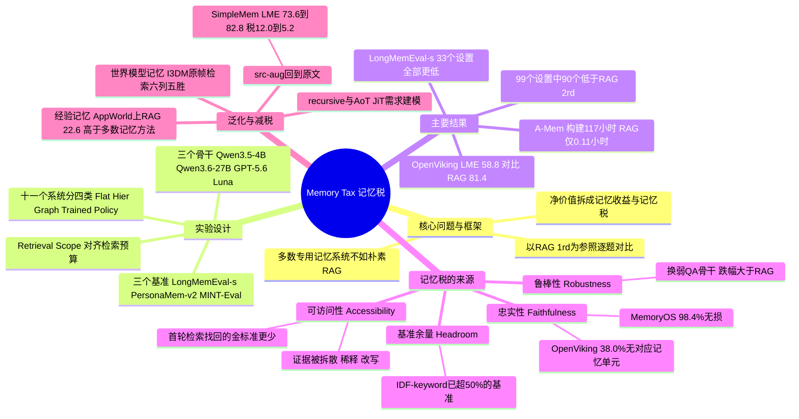

## 一、论文是干什么的？

想象你要长期记住和朋友的所有聊天。一种做法是把每次聊天都录音存好，需要时直接翻录音找原话；另一种做法是每次聊完都写一份「会议纪要」：提炼要点、合并重复、给人物画像，之后只翻纪要。直觉上，纪要更整齐，查起来应该更快更准。但纪要写得再好，也可能漏掉当时没觉得重要的细节，比如某个具体数字，一旦漏了，再怎么翻都找不回来。

这篇论文研究的就是这个问题：给大模型智能体（agent）配上「长期记忆系统」（把历史对话加工成摘要、事实、图结构等再检索），相比「朴素 RAG」（直接把原始历史切块、检索，几乎不加工）到底值不值？作者在三个基准、三种大模型骨干上评测了 11 个有代表性的开源记忆系统，发现很多情况下记忆系统不如朴素 RAG，而且成本高得多。于是他们提出一套看法：以朴素 RAG 为参照，把记忆的净价值拆成两部分，一部分是记忆答对而 RAG 答错的题，叫**记忆收益**（memory benefit）；另一部分是 RAG 答对而记忆答错的题，叫**记忆税**（memory tax）。收益大于税，记忆才算「净赚」。论文随后重点分析「税」从哪里来，并把这个视角推广到经验记忆和世界模型记忆。

以下数字均来自 [arXiv 全文](https://arxiv.org/html/2610.34073v1) 及其 PDF；「我的解读」会明确标出。论文的 [项目主页](https://hexuan21.github.io/MemoryTax/) 和 [GitHub 仓库](https://github.com/hexuan21/MemoryTax) 也已存在（详见第六章）。

## 二、核心方法与创新

这篇论文本身不提出新的记忆系统，它的贡献是一套评测方法和一个概念框架。

**1. 形式化设定（论文第 2 节）。** 交互历史记作 $\mathcal{H}=\{h_1,\dots,h_T\}$；记忆系统通过摄入过程 $I$ 把它加工成持久记忆 $\mathcal{M}=I(\mathcal{H})$；收到查询 $q$ 时检索相关记忆单元 $\mathcal{C}=R(q,\mathcal{M})$，再生成答案 $\hat{y}=G(q,\mathcal{C})$。不同系统把 $\mathcal{M}$ 实现成摘要、抽取出的事实、结构化记录或情景条目。朴素的分块 RAG 则几乎不加工原始历史，直接检索原文块，论文把它当作全文统一的参照物。

**2. 朴素 RAG 基线的具体做法（附录 A.2）。** 按对话轮次切块，不跨会话；短轮次贪心合并成约 1024 字符的块，最后一轮作为重叠；每块前加会话时间头。查询时 BM25 与稠密检索（Qwen3-Embedding-0.6B）各取 top-$k$，去重后用 Qwen3-Reranker-0.6B 重排，最终取 $k$ 块（大约是候选池的一半）喂给骨干模型。RAG（1rd）是一轮检索；RAG（2rd）会让骨干模型判断块是否够用，不够就发出追问再检索一轮。

**3. 公平对比：Retrieval Scope（检索范围）。** 不同系统的记忆单元粒度差别很大，同样 top-$k$=10 可能是几百个词元，也可能是几万个词元。所以论文定义检索范围 RS：LLM 从检索到回答整个过程中看到的记忆单元词元数，除以该系统可检索存储的总词元数。作者调整每个系统的 top-$k$，让它的 RS 大致不低于 RAG（1rd），同时系统之间大致可比；少数记忆单元很少的系统（如 OpenViking）保持固定 top-$k$。论文的附录 B.3 称，多数情况下上调 top-$k$ 会让记忆系统表现更好，少数需要下调的情况性能下降很小，作者据此认为这一调整没有故意压低记忆基线。

**4. 把净价值拆成「收益」和「税」（第 4.1 节）。** 以 RAG（1rd）为参照做逐题对比：记忆独对的题体现收益，RAG 独对的题体现税。论文强调这些量都是相对参照而言的。

我的解读（用公式写出来，论文正文没有给出这样的显式公式）：设题目总数为 $N$，$W$ 为记忆答对而 RAG 答错的题集合，$L$ 为 RAG 答对而记忆答错的题集合，则

$$
B=\frac{|W|}{N},\qquad T=\frac{|L|}{N},\qquad \mathrm{Acc}_{\mathrm{mem}}-\mathrm{Acc}_{\mathrm{RAG}}=B-T
$$

举例（按原文数字推算）：在 LongMemEval-s 上，用 Qwen3.6-27B 时 RAG（1rd）准确率 77.6，SimpleMem 为 73.6，论文表 4 给出 SimpleMem 的税为 12.0，所以推算其收益约为 8.0（$77.6-12.0+8.0=73.6$）。

**5. 为什么会有税：「双刃剑式偏离」。** 论文的核心观点是：论文认为，有实质内容的记忆操作（抽取、压缩、重组）可能改变信息被组织、保存和访问的方式，使存储的内容偏离原始历史。这些偏离本来是为了帮任务，例如把分散的事实整理在一起、提炼用户偏好，但也可能丢掉或遮蔽证据。同一种操作在一道题上是收益，在另一道题上就是税。论文附录 D 给出了配对案例，例如「把对话拆成逐条短事实」帮助某个系统数清了看过的 4 套房子，却把「500 积分可抵 5 美元」压成「因 500 积分优惠而更常去这家店」，丢掉了 5 美元这个关键数字。

**6. 四条分析线索（第 4.2 到 4.5 节）。**

- **忠实性（Faithfulness）**：信息在加工中保存得有多好。宏观上，只给模型金标准原始轮次，和只给对应的金标准记忆单元，对比分数；微观上，从三个基准的原始语料里随机抽 500 条原始轮次，由人标注对应记忆单元中信息保留程度（无损、部分丢失、大量丢失、没有对应记忆单元）。
- **可访问性（Accessibility）**：信息保存了，是否还容易被找到。论文反复多轮检索，每轮把已取出的单元从剩余库中排除，记录要几轮才能找回全部金标准记忆单元；还比较「查询与金标准原始轮次」和「查询与金标准记忆单元」的嵌入相似度，观察加工后是否更远。
- **鲁棒性（Robustness）**：用三种骨干分别构建记忆，再用各骨干回答，看换模型后分数掉得比 RAG 更多还是更少。
- **基准余量（Headroom）**：用 No Memory、IDF-keyword（取查询中 IDF 最高的两个词，优先含两词的块，再含其一的块，同层内随机采样）、RAG-Emb、RAG-Hybrid 四个简单基线，在 15 个记忆基准上看简单检索能做到多好。如果简单检索已经很强，记忆就没什么可以补充的空间，任何小损失都更显眼。

**7. 减税的三条设计启示（第 6 节，限定为可加在现有系统上的小改动）。**

- 构建阶段：让偏离「可恢复」，保留一条回到原始历史的轻量通道。概念验证叫 src-aug：检索记忆的同时也检索原文，一起重排后再回答。
- 访问阶段：递归或自指式记忆（recursive），把过去的查询、证据和检索路径也存进记忆，供相似需求下次直接命中，即让记忆「记住自己是怎么记的」。
- 未来方向：先于查询构建记忆（ahead-of-time，AoT）不知道将来要问什么；即时记忆（just-in-time，JiT）在查询到来后再加工，更有针对性但增加在线延迟；论文提出折中，用过去兴趣和访问模式建模未来需求，把记忆看成隐式的推荐系统。

## 三、使用了哪些模型和计算资源？

**LLM 与相关模型（均来自论文原文）：**

- **被评测的骨干（用于回答与记忆构建）**：Qwen3.5-4B、Qwen3.6-27B，以及通过 OpenAI API 访问的 GPT-5.6 Luna（推理强度 low，默认采样配置）。三个骨干都跑了全部 11 个系统（第 3.1 节）。本地模型用温度 0.0、top-p 1.0、关闭推理。
- **裁判模型**：LLM-as-Judge 由 Qwen3.6-27B 担任，不用 F1、BLEU 之类词面重叠指标。选择题（PersonaMem-v2）直接匹配选项字母，解析不了的才交给裁判。附录表 6 给出裁判与人工标注的一致率：LongMemEval-s 为 95.1%，PersonaMem-v2 为 100.0%（因为是选择题），MINT-Eval 为 97.3%。论文未报告抽查样本量。
- **辅助模型**：嵌入模型统一用 Qwen3-Embedding-0.6B，重排模型用 Qwen3-Reranker-0.6B。为核对基线，RAG 消融（附录表 7）还试了 all-MiniLM-L6-v2（0.02B）、BGE-Large-en-v1.5（0.3B）、pplx-embed-v1（4B）、NV-Embed-v2（8B）以及 BGE-Reranker-Large、Jina-Reranker-v3、Qwen3-Reranker-4B。
- **系统自带的策略模型**：Mem-T 使用 Qwen3-4B，Memory-R2 使用 Qwen2.5-7B-Instruct，二者按发布版本使用，只把最后的 QA 模型替换成上面的骨干。
- **金标准映射辅助**：把金标准原始轮次映射到记忆单元时，由 GPT-5.6 Terra 与 Claude Sonnet 5 各自独立挑选，少数分歧由人工裁决。
- **多模态基准的字幕**：附录 C.5 中图像先由 Qwen3.6-27B（作为 VLM）转成约 200 词元的字幕。
- **经验记忆实验**：骨干为 Qwen3.5-4B。**世界模型记忆实验**：评测的是 I3DM、WorldKV、ReWorld、MagicWorld、FramePack、HyDRA 六个视频世界模型方法。

**算力：**

- 本地模型：Qwen3.6-27B 与 Qwen3.5-4B 在 NVIDIA H20 GPU 上本地部署；GPU 数量论文未报告。
- GPT-5.6 Luna：走 OpenAI API；论文未报告美元花费，只给出词元数（见下）。
- 世界模型实验：所有方法在 NVIDIA H100 GPU 上运行，50 步推理；GPU 数量论文未报告。
- 论文未报告总 GPU 小时或整篇论文的总花费，作者在局限性中只说评测受计算与 API 调用成本限制，因此对 PersonaMem-v2 取 20%（200 个语料中的 40 个），对 MINT-Eval 取 10%（595 个中的 60 个），LongMemEval-s 在 GPT-5.6 Luna 上取 100 个语料（20%）。

**每个计算单位的耗时与成本（论文附录 E 的表 19 到 21，数字为整个基准的汇总；按原文数字推算的会标明）：**

- GPT-5.6 Luna、LongMemEval-s（100 个语料）：RAG（1rd）推理词元 0.27M，离线建库 0.11 小时，在线问答 3.4 分钟，LLM 调用 0.10K 次，存储 122.5K 词元。A-Mem 构建词元 29.3M、维护词元 145.0M、推理 0.44M，离线构建 117.0 小时，在线问答 3.2 分钟，LLM 调用 98.4K 次，存储 188.5K 词元。Mem-T 构建 51.7M、维护 180.4M、推理 4.90M，离线 76.0 小时，调用 114.2K 次，存储 489.1K 词元。LightMem 构建 5.22M，离线 15.2 小时，调用 2.67K 次。
- Qwen3.6-27B、PersonaMem-v2（40 个语料，934 道题）：RAG（1rd）推理词元 2.77M，离线 0.07 小时，在线 58.3 分钟，调用 0.93K 次。Mem-T 构建 35.4M、维护 161.9M、推理 61.0M，离线 59.0 小时，在线 6807.9 分钟（按原文数字推算约 113.5 小时），调用 106.1K 次，存储 707.3K 词元。A-Mem 离线 227.4 小时。
- 论文说明墙钟时间是「折算为单并发的等效时间」，不同系统并发数不同，同一骨干下大致可比，但端点吞吐仍有波动。
- 每个系统在 11 个系统乘 3 个基准乘 3 个骨干共 99 个设置下都要跑一次，论文没有汇总每个设置的单次成本或总耗时。

## 四、实验结果

**数据与题量（论文附录表 5）。**

| 基准 | 语料数 | 题数 | 每语料词元数（中位） | 题型 |
|---|---|---|---|---|
| LongMemEval-s | 500 | 500 | 约 115k | 简答 |
| PersonaMem-v2 子集 | 40 | 934 | 约 123k | 四选一 |
| MINT-Eval 子集 | 60 | 1,557 | 约 139k | 简答 |

**主结果（论文表 1，Qwen3.6-27B 一列，单位为裁判准确率 %）。**

| 方法 | LongMemEval-s | PersonaMem-v2 | MINT-Eval |
|---|---|---|---|
| No Context | 9.0 | 25.6 | 3.8 |
| Full Context | 68.4 | 45.4 | 28.7 |
| Gold Context | 84.6 | 72.9 | 未评测 |
| **RAG（1rd）** | 77.6 | 46.8 | 28.6 |
| **RAG（2rd）** | 81.4 | 48.7 | 33.1 |
| A-Mem | 79.4 | 48.4 | 24.4 |
| MemOS | 76.6 | 50.2 | 19.7 |
| SimpleMem | 73.6 | 46.7 | 19.9 |
| MemoryOS | 73.4 | 48.2 | 26.3 |
| LightMem | 78.8 | 47.0 | 23.0 |
| OpenViking | 58.8 | 38.7 | 18.6 |
| HippoRAG2 | 78.2 | 46.5 | 23.5 |
| MAGMA | 68.2 | 40.5 | 27.0 |
| PlugMem | 75.8 | 45.2 | 33.3 |
| Mem-T | 75.0 | 42.1 | 30.4 |
| Memory-R2 | 73.0 | 48.4 | 21.5 |

大白话解读（我的解读，数字来自上表）：在 LongMemEval-s 上，没有一个记忆系统超过 RAG（2rd）的 81.4；Gold Context 说明只要把证据原文直接递给模型，就能做到 84.6，所以瓶颈主要在「证据能不能被找出来」。记忆系统并不是处处都输：PersonaMem-v2 上 MemOS（50.2）超过 RAG（2rd）的 48.7，MINT-Eval 上 PlugMem（33.3）略高于 RAG（2rd）的 33.1。

**逐格统计（按原文数字推算）。** 论文表 1 的括号数字是相对 RAG（2rd）的差。我数了 11 个系统、3 个基准、3 个骨干共 99 个格子：90 个低于 RAG（2rd），只有 9 个高于；其中 LongMemEval-s 的 33 个格子全部更低，PersonaMem-v2 有 28 个更低，MINT-Eval 有 29 个更低。同一数据独立复算的结果见第六章中 Qiita 文章的说法，两者一致。注意这些结论依赖作者选择的参照是较强的 RAG（2rd）；论文表 1 同时给出了 RAG（1rd）与 RAG（2rd）两行，相对 RAG（1rd）的差值会不同，本文未逐格统计。

**成本。** 同样在 GPT-5.6 Luna、LongMemEval-s 上，RAG（2rd）准确率 90.0，离线建库 0.11 小时；A-Mem 准确率 84.0，却需要 117.0 小时离线构建和 98.4K 次 LLM 调用（表 19，见第三章）。论文图 1 用帕累托图画出准确率对词元成本，并说明气泡大小表示记忆存储规模。

**忠实性：信息到底丢了多少（论文表 2，500 条抽样原始轮次，单位 %）。**

| 方法 | 无损 | 部分丢失 | 大量丢失 | 无对应记忆单元 |
|---|---|---|---|---|
| MemoryOS | 98.4 | 0.0 | 0.0 | 1.6 |
| MAGMA | 93.6 | 6.2 | 0.2 | 0.0 |
| MemOS | 85.8 | 9.0 | 2.4 | 2.8 |
| PlugMem | 79.6 | 10.8 | 5.2 | 4.4 |
| LightMem | 76.2 | 13.6 | 0.6 | 9.6 |
| Memory-R2 | 72.6 | 14.8 | 6.0 | 6.6 |
| SimpleMem | 65.6 | 27.6 | 2.2 | 4.6 |
| OpenViking | 39.4 | 9.6 | 13.0 | 38.0 |

论文还发现，即使用金标准记忆单元消除了检索失败，MAGMA、LightMem 等系统的分数也接近金标准原始轮次，但远高于它们的原始分数，说明证据其实还在，只是更难被找到，这是下一个维度（可访问性）的证据。

**可访问性与鲁棒性。** 第一轮检索中，记忆系统找回的金标准单元一般比 RAG 少；案例分析归纳出三种模式：证据被拆散到多个记忆单元、被无关信息稀释、被改写。论文还报告：固定 QA 骨干时，换用不同模型来构建记忆，分数有明显波动；固定记忆时，把 QA 骨干换成较弱的模型，许多系统的跌幅比 RAG 更大（论文图 6 与附录 C.4，具体幅度见图）。

**基准余量（附录表 16，Qwen3.6-27B）。** 例如在 EverMemBench-MCQ 上，IDF-keyword 得 68.2，RAG-Hybrid 得 82.7；LongMemEval-s 上 RAG-Hybrid 为 77.6；AMA-Bench 上 IDF-keyword 为 29.0、RAG-Hybrid 为 48.4。论文据此认为许多现有基准偏「检索友好」，记忆能额外获益的空间有限，因此「税」更显眼；同时也承认，许多真实查询本来就是精确回忆型，这类能力本身有价值。

**减税的概念验证（论文表 4，Qwen3.6-27B，准确率 / 税，单位 %）。**

| 方法 | LongMemEval-s | PersonaMem-v2 |
|---|---|---|
| SimpleMem | 73.6 / 12.0 | 46.7 / 11.2 |
| 加 src-aug | 82.8 / 5.2 | 49.6 / 7.2 |
| 加 recursive | 不适用 | 46.8 / 12.1 |
| MemoryOS | 73.4 / 11.4 | 48.2 / 17.1 |
| 加 src-aug | 76.4 / 7.8 | 53.0 / 8.5 |
| 加 recursive | 不适用 | 49.1 / 16.4 |
| Mem-T | 75.0 / 10.8 | 42.1 / 15.2 |
| 加 src-aug | 80.0 / 5.2 | 49.0 / 8.7 |
| 加 recursive | 不适用 | 45.7 / 13.6 |

LongMemEval-s 每个语料只有一道题，所以跨查询的 recursive 机制不适用。解读：src-aug 对三个系统都同时提高准确率并降低税；recursive 在 PersonaMem-v2 上的收益较小，对 SimpleMem 的税甚至从 11.2 升到 12.1。

**经验记忆（论文 5.1 节与附录表 17，Qwen3.5-4B）。** 在 ALFWorld、WebShop、Mind2Web、BigCodeBench、AppWorld、τ2-Bench 上比较 Memp、ReasoningBank、G-Memory、SkillPro 与 ReAct（无记忆）及朴素 RAG（取最相似的 2 个过去任务，把原始轨迹放进上下文）。结果因任务而异：WebShop 的得分，Memp 为 44.5，高于 RAG 的 38.4；Mind2Web 的步成功率，ReasoningBank 为 49.9，高于 RAG 的 45.3。但在 AppWorld 的任务目标完成率上，RAG 为 22.6，ReasoningBank 与 Memp 均为 14.3，SkillPro 为 10.7，G-Memory 与 RAG 持平（22.6）。成本上，SkillPro 在 ALFWorld 每个任务平均 1226.3K 词元，RAG 为 234.8K。论文的结论是税也会出现在经验记忆里，但大小取决于任务。

**世界模型记忆（论文 5.2 节、表 3、附录表 18）。** 在 Context-as-Memory 测试集（60 个样本）与 MemoBench（取 25%，90 个样本）上，直接取回过去帧的 I3DM，C-as-M-eval 的 SSIM 为 .560，高于 WorldKV 的 .372、ReWorld 的 .378、MagicWorld 的 .388、HyDRA 的 .320 与 FramePack 的 .217。我数了附录表 18 里两个基准共 6 个指标列（PSNR、SSIM、1-LPIPS 各两个基准）里，I3DM 在 5 列最高（只有 MemoBench 的 SSIM 被 MagicWorld 的 .433 略微超过 I3DM 的 .430）。论文的结论是潜变量或缓存式记忆没有稳定超过这种直接取回原始观察的简单办法。

**论文自述的局限（原文 Limitations）：** 基线选择具有代表性而非穷尽；尽量遵循官方配置，进一步针对系统调参可能有提升；基准以静态、离线、英文为主，长期部署中的交错查询与多语言场景探索不足；没有评测比 GPT-5.6 Luna（low）更强的前沿模型；多模态、潜变量、参数化记忆留待未来。

## 五、潜在应用与已落地应用

**论文明确提到的方向（原文）：**

- 评测方面：建议今后在报告记忆系统分数时同时报告朴素 RAG 的分数，用来标定难度、留出真实的改进余地，并让记忆的贡献更清楚。
- 系统方面：保留回到原始历史的通道；让记忆「记住如何记忆」；用过去兴趣和访问模式预测未来需求，在 AoT 与 JiT 之间折中。
- 把「收益与税」视角扩展到全模态、潜变量、参数化记忆等形式（论文明确说留待未来）。

**我的判断（非论文原文）：** 对做个人助手或客服智能体的团队，最直接的做法是：新增记忆层之前，先在自己的数据上跑一遍同口径的朴素 RAG 基线，并做逐题对比，看记忆独对的题和 RAG 独对的题各有多少，而不是只看平均分。对已经上线摘要式记忆的系统，可以考虑像 src-aug 那样在记忆旁边保留原文检索，同时注意论文的实验只在对话式记忆基准上做了验证，不等于在你的场景一定成立。

**已落地应用：** 截至 2026-10-30，我没有查到把该论文方法部署到产品中的有据可查案例。论文本身是评测与分析工作，不是一个可部署的新系统。有第三方在文章里讨论如何把它用于自己的工作流（见第六章），但这属于使用想法，不是落地部署。

## 六、网络上的讨论与评价

- [Hugging Face 论文页](https://huggingface.co/papers/2610.34073)：HF API 票数 156（已核对），由作者 Xuan He 提交到每日论文（2026-10-28）。页面有 5 条评论：作者 Xuan He 于 2026-10-28 发的推介帖，说明许多记忆系统连朴素 RAG 都打不过且成本更高；两条读者提问或解读，一条称赞对 RAG 基线描述详细，并追问 src-aug 带来多少额外词元与延迟，另一条根据表 18 估算 LightMem 在约每个历史 29 个查询处词元成本才与 RAG 持平，同时指出准确率仍低于 RAG，希望看到其他系统的摊销曲线；Librarian Bot 于 10-29 发的相似论文推荐；另有一条评论认为被遮蔽的证据是最值得担心的税，倾向于默认保留原始历史。评论里没有作者的正式回复，也没有第三方复现。
- 代码与数据：[GitHub 仓库 hexuan21/MemoryTax](https://github.com/hexuan21/MemoryTax) 采用 MIT 许可证，截至 2026-10-30 约 11 颗星（GitHub API 返回 11）。README 的 TODO 清单显示：主实验结果已发布到 HF，消融与分析结果和其他中间产物已发布，「发布每个基线的复现代码」一项仍未勾选；但仓库目前已有 reproduction 目录，里面有 13 个基线的子目录（如 amem、memos、lightmem、plugmem、memt 等），README 里的 harness 命令部分仍标为 TODO。所以更准确的说法是：基线复现代码已部分公开，完整的运行说明还没写完。HF 上有一个索引仓库 [MemoryTax-Res](https://huggingface.co/datasets/hexuan21/MemoryTax-Res) 和 6 个按骨干、设置分开的结果数据集（合计 7 个仓库），没有模型和 Space。[项目主页](https://hexuan21.github.io/MemoryTax/)可正常访问。
- [Qiita 文章（日文）](https://qiita.com/Takuya__/items/375b9d0d35371048122a)（2026-10-29）：作者说明读了论文、项目主页、GitHub 和 HF 结果数据，并用公开的逐题正误数据复算了论文的主要数字，没有新跑 LLM 实验。他统计出 11 个系统、3 个基准、3 个骨干共 99 个设置中有 90 个低于 RAG（2rd），LongMemEval-s 的 33 个全部更低，这与我对论文表 1 的逐格统计一致。他还称在能复算的 92 个设置中，以 RAG（1rd）为参照有 68 个设置里税大于收益（这是相对 RAG（1rd）的口径，与上面相对 RAG（2rd）的 90/99 不是同一个统计）。这是第三方读后整理，不是独立评测；复算的 92 个设置之外的 7 个因判定数据未公开，用的是论文表 1 的值。
- [CCTest 文章](https://cctest.ai/en/articles/agent-memory-may-not-pay-off-introducing-the-memory-tax)（2026-10-28）：页面自注为 AI 生成摘要，复述论文主要观点，没有独立实验。
- [DAIR.AI Academy 论文页](https://academy.dair.ai/papers/memory-tax-dissecting-the-net-value-of-agent-memory-2610.34073)（2026-10-27）：收录了作者列表、要点概述和聊天问答入口，要点与论文摘要一致，非独立评测。
- [alphaXiv 页面](https://www.alphaxiv.org/abs/2610.34073)：收录摘要和作者机构（UIUC、Tsinghua、RUC、Verdent.ai、Waterloo），我读到的页面没有独立评论内容。
- [AkihikoWatanabe 的论文笔记](https://github.com/AkihikoWatanabe/paper_notes/issues/7031)（2026-10-28 创建）：我读到的页面内容是摘要、作者列表及日文机翻，属于收录类笔记，未见独立评价。
- [laurigates 的 Research radar 周报](https://github.com/laurigates/claude-plugins/issues/3273)（2026-W44，自动化工作流生成）：把本论文列为值得参考的研究，建议在自己的插件规则文档的持久化智能体记忆一节里，加入「提炼出的记忆应当和直接检索原始转录做对比，并保留指向原始材料的指针」之类的指导。这是工具自动生成的使用建议，不是评测。
- [Matsushima-A-830 的 ai-100days 第 31 天 PR](https://github.com/Matsushima-A-830/ai-100days/pull/107)（2026-10-29）：作者用自编的 2 个多会话对话日志、共 16 道题做了一个缩小版的概念验证，没有使用论文的基准，也没有复现论文：RAG 角色（字符 bigram TF-IDF 检索）答对 13 题，摘要加变更历史的记忆答对 15 题，其中税 1 件、收益 3 件，因此在这个玩具实验里记忆反而胜出；作者明确记录了论文的主要结论（记忆常输给朴素 RAG）在这个缩小实验中没有重现，并指出这是 16 题的小样本。属于个人学习记录，不能当成对论文的反驳。
- 搜索到但未能读取内容：[FourWeekMBA 的文章](https://fourweekmba.com/ai-plain-rag-topped-all-11-agent-memory-systems-in-one-test/)（标题为 Plain RAG Topped All 11 Agent Memory Systems in One Test），我访问时被网站的浏览器检查页面拦截，没有读到正文，因此不对其内容作任何描述。作者 README 链接的[ X 推文](https://x.com/XuanHe21/status/2114917854877307162)页面可打开，但内容由脚本动态渲染，我没有读到推文正文。
- 检索说明：Hacker News 的 Algolia 搜索 arXiv ID 2610.34073 返回 0 条；按标题关键词搜索，会出现另一篇名为 MemoryTax: The Bitter Lesson of Agent Memory 的帖子，但它链接的是 arXiv 2610.29823，是另一篇论文，不要混淆。Reddit 搜索接口返回的是拦截页面，我没有对 Reddit 做进一步尝试。中文关键词检索没有找到知乎或微信公众号上的专门文章（返回结果是英文与日文页面）。截至 2026-10-30，没有检索到独立团队用论文代码做的完整复现或正式反驳。

## 七、思维导图

