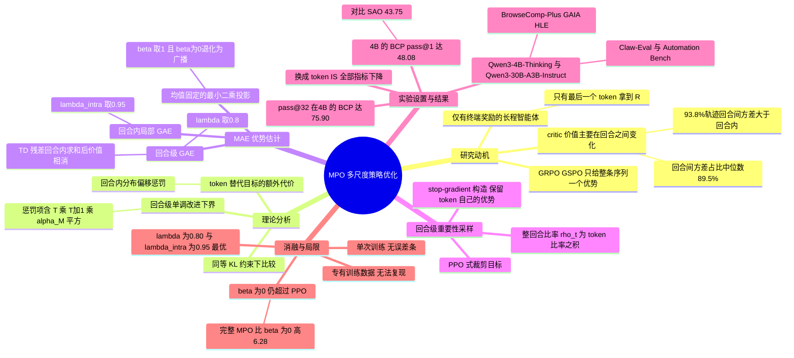

## 一、论文是干什么的？

想象一支足球队打完一场比赛，只在终场哨响时得到一个比分：赢了或输了。教练要从这个比分里回头判断，到底是哪几次进攻（回合）打得好，又是每次进攻里哪几脚传球（token）做对了。LLM 智能体训练面临的就是这种「只有最终奖励」的难题：它一轮一轮地与环境交互（搜索、调用工具、给出最终回答），每一轮的输出又是一个 token 一个 token 生成的。论文把「一整轮助手输出」叫作一个回合（turn），把回合内的每个字叫作 token，并指出：信用分配和策略更新应该同时考虑这两个尺度。

论文先做了一个观察。作者取了一次搜索智能体训练中 2,048 条轨迹、16,323 个回合，发现评论家（critic，即价值函数）给出的价值在回合之内比较平稳、在回合之间变化很大：回合均值之间的差异，平均占轨迹内价值方差的中位数 89.5%，在 93.8% 的轨迹里回合间方差大于回合内方差。据此他们提出 **MPO**（Multiscale Policy Optimization，多尺度策略优化）：以回合为锚点传播长程信用，再在回合内部做细分；更新策略时也按整个回合的概率比率来修正。下文所有数字均取自 [arXiv 全文](https://arxiv.org/html/2610.35013)，「我的解读」会单独标明。

## 二、核心方法与创新

**1. 问题设定。** 一条轨迹是 $\tau=(o_0,a_0,o_1,a_1,\ldots,o_T,a_T)$，其中 $a_t$ 是第 $t$ 个助手回合的输出，$o_{t+1}$ 是环境反馈。只有轨迹最后一个 token 拿到奖励 $R(\tau)$，其余 token 的奖励都是 0，折扣 $\gamma=1$。论文把整个回合 $a_t$ 当成一个「宏观动作」，它的概率是各 token 概率的乘积 $\pi_\theta(a_t\mid h_t)=\prod_i \pi_\theta(a_{t,i}\mid h_{t,i})$。

**2. 理论分析（论文第 4 节）。** 作者证明了两件事：一是回合尺度上的单调改进下界（定理 1，下界里有 $2A_{\max}T(T+1)\alpha_M^2$ 这一项惩罚）；二是在同样的 KL 约束下，用 token 级替代目标会多出一项「回合内分布偏移」的惩罚（定理 2，上界含 $L_{\max}(L_{\max}-1)\alpha_T^2$）。我的解读：这像是接力赛，如果每个队员只对自己那一棒单独打分，就忽略了前一棒已经改变了他的起跑位置；整段回合作为一个整体来衡量更一致。

**3. 多尺度优势估计 MAE（Multiscale Advantage Estimation）。** 分两步。

第一步，回合级信用传播。把回合内所有 token 的 TD 残差相加，中间的价值预测会相互抵消，只剩回合边界的价值：$\delta_t^{\mathrm{turn}}=\mathbf{1}\{t=T\}R(\tau)+V_{t+1,1}-V_{t,1}$。然后在回合的时间轴上做 GAE：$A_t^{\mathrm{turn}}=\delta_t^{\mathrm{turn}}+\lambda A_{t+1}^{\mathrm{turn}}$。衰减每个回合只算一次，而不是每个 token 一次，所以与回合长短无关。

第二步，回合内细分。在当前回合内部再算一条局部 GAE：$A_{t,i}^{\mathrm{intra}}=\sum_{j=i}^{L_t}\lambda_{\mathrm{intra}}^{j-i}\delta_{t,j}$。然后用「均值固定」的最小二乘投影合并两者，得到闭式解

$$A_{t,i}^{\mathrm{MAE}}=A_t^{\mathrm{turn}}+\beta\left(A_{t,i}^{\mathrm{intra}}-\overline{A}_t^{\mathrm{intra}}\right)$$

意思是：每个回合的平均信用就等于回合级的 $A_t^{\mathrm{turn}}$，局部信号只负责在这个均值附近做上下调整（总和不变，因为减去了局部均值）。当 $\beta=0$ 时退化为「整回合内每个 token 拿同一个优势」。类比：先决定这次进攻整体该得多少分，再把这个分数在传球的各个队员之间重新分配，但总分不变。

**4. 回合级重要性采样（turn-level IS）。** 回合比率 $\rho_t(\theta)=\prod_{i}\rho_{t,i}(\theta)$。如果直接把所有 token 的优势都乘同一个可微的 $\rho_t$，居中的局部修正在未裁剪的求和里会被抵消。所以论文用停止梯度构造 $\widetilde{\rho}_{t,i}=\rho_{t,i}\,\mathrm{sg}\left[\prod_{j\neq i}\rho_{t,j}\right]$：前向传播时每个 token 的权重都是整个回合比率 $\rho_t$，反向传播时每个 token 只对自己的概率求导，保留各自的 MAE 优势。最后是 PPO 式裁剪目标 $\mathcal{L}_{\mathrm{MPO}}=\widehat{\mathbb{E}}_{t,i}[\min(\widetilde{\rho}_{t,i}\widehat{A}_{t,i}^{\mathrm{MAE}},\mathrm{clip}(\widetilde{\rho}_{t,i},1-\epsilon,1+\epsilon)\widehat{A}_{t,i}^{\mathrm{MAE}})]$，其中优势在整个 rollout 批次的有效 token 上归一化一次。

**5. 评论家训练。** 沿用 VAPO 的解耦 GAE，设 $\lambda_{\mathrm{critic}}=1$，评论家直接回归最终回报 $R(\tau)$（蒙特卡洛目标）。参考配置为 $\lambda=0.8$，$\lambda_{\mathrm{intra}}=0.95$，$\beta=1$，$\gamma=1$，不使用逐 token 的 KL 奖励。论文强调所有计算相对轨迹长度是线性时间。

## 三、使用了哪些模型和计算资源？

**LLM（按论文第 6.1 节）：**

- 训练对象：Qwen3-4B-Thinking（4B）和 Qwen3-30B-A3B-Instruct（30B-A3B）。论文表格中把后者简写为 30A3B。
- 评测对象：同样是上述两个模型训练后的检查点；还评测了未经 RL 的初始检查点（Base）。
- 对比算法：GRPO、GSPO、PPO、VAPO、SAO，以及消融版本 MPO w/ token IS，它们都是训练方法，不是额外的模型。
- 裁判或辅助模型：论文正文与附录未说明奖励判定所用的裁判模型。官方 [GitHub 仓库](https://github.com/IQuestLab/Multiscale-Policy-Optimization) 的 README 写明，搜索任务的奖励由一个兼容 OpenAI 接口的判定服务对最终答案和参考答案做比对，裁判模型由使用者自行配置；检索端使用 Qwen3-Embedding-8B 建立稠密索引。这两点来自 README，不是论文原文。
- 是否使用商用 API：论文未报告。

**训练设置（论文附录 B 表 4）：**

| 项目 | BrowseComp-Plus（BCP） | Claw-Eval | Automation Bench |
|---|---|---|---|
| 训练步数（第 6.1 节） | 300 | 300 | 200 |
| max_prompt_length | 4096 | 8000 | 8000 |
| max_response_length | 32768 | 64000 | 64000 |
| train_batch_size | 32 | 64 | 64 |
| Actor 学习率 | $10^{-6}$ | $1.6\times10^{-6}$ | $1.6\times10^{-6}$ |
| Critic 学习率 | $10^{-5}$ | $10^{-5}$ | $10^{-5}$ |
| 每题采样数 rollout.n | 8 | 8 | 8 |
| 最大回合数 | 20 | 20 | 50 |

BCP 的设置在 4B 与 30B-A3B 两个规模上共用。BCP 训练数据沿用 SUPO 的设置；Claw-Eval 与 Automation 的训练数据是公司内部专有数据，论文说细节无法公开。

**GPU 型号与数量：**

- 论文未报告 GPU 型号与数量。
- 官方 README 称原始实验使用 80 GB 显存的 GPU，默认启动脚本申请一个 8 卡节点；这是仓库说明，不是论文原文。

**耗时与成本：**

- 一次完整训练的 GPU 小时或墙钟时间：论文未报告。
- 单个任务推理耗时：论文未报告。
- 单次评测成本、API 花费：论文未报告。
- 评测协议：训练好的模型取每次训练中表现最好的检查点，离线评测 5 次并报告平均；搜索任务的 pass@1 与 pass@3 由每题 32 条独立 rollout 估计；Base 每题 3 条 rollout。
- 每种方法每个模型规模只有一次训练（论文第 6.3 节原文：Each method has one run per model size）。

## 四、实验结果

**主结果（论文表 1）：** 三个搜索基准（BrowseComp-Plus、GAIA、HLE）报告 pass@1 与 pass@3，Claw-Eval 报告 pass@3 与 pass^3（三次全成功），Automation Bench 报告 pass@1。论文称 MPO 在两个规模的全部九项指标上都是最高分。下面摘录部分数字（单位为百分比）：

| 模型 | 方法 | BCP pass@1 | GAIA pass@1 | HLE pass@1 | Claw-Eval pass^3 | Automation pass@1 |
|---|---|---|---|---|---|---|
| 4B | Base | 8.84 | 24.92 | 5.53 | 8.09 | 0.00 |
| 4B | GRPO | 39.34 | 33.92 | 8.51 | 48.79 | 4.33 |
| 4B | PPO | 40.85 | 31.71 | 7.22 | 50.78 | 11.67 |
| 4B | SAO | 43.75 | 35.62 | 8.19 | 49.11 | 12.06 |
| 4B | MPO w/ token IS | 45.72 | 36.35 | 8.89 | 50.22 | 12.45 |
| 4B | **MPO** | 48.08 | 39.47 | 9.92 | 51.73 | 13.33 |
| 30B-A3B | Base | 21.69 | 25.24 | 7.47 | 12.64 | 0.17 |
| 30B-A3B | PPO | 45.20 | 35.70 | 8.31 | 55.33 | 14.17 |
| 30B-A3B | VAPO | 46.73 | 38.33 | 9.25 | 56.72 | 13.77 |
| 30B-A3B | SAO | 45.36 | 39.62 | 9.91 | 57.23 | 14.20 |
| 30B-A3B | MPO w/ token IS | 48.27 | 41.23 | 9.45 | 57.61 | 13.17 |
| 30B-A3B | **MPO** | 50.32 | 43.42 | 10.03 | 58.35 | 15.00 |

相对每一列里最强的非 MPO 基线，MPO 在 4B 上的 BCP、GAIA、HLE pass@1 分别提升 4.33、3.85、0.66 个百分点，在 30B-A3B 上分别提升 3.59、3.80、0.12 个百分点。我的解读：HLE 上的提升幅度很小，30B-A3B 上只有 0.12 个百分点，而且每种配置只训练了一次，没有给出误差条，所以这类小差距不宜过度解读。

**回合级 IS 的作用：** 把回合级比率换成 token 级比率（MPO w/ token IS）后，所有报告的分数都下降。4B 上 BCP、GAIA、HLE 的 pass@1 分别下降 2.36、3.12、1.03 个百分点。同时，论文指出即使使用 token IS，MAE 在两个规模的六项搜索指标上也都优于 PPO，说明多尺度信用分配本身就有贡献。

**测试时扩展（图 6）：** 在 4B 上，MPO 在评测的每个 $k$（1、2、4、8、16、32）、三个基准上都领先 GRPO 与 PPO；pass@32 在 BCP、GAIA、HLE 上分别为 75.90、69.90、34.00，比 GRPO 与 PPO 中较强者高 3.61、5.82、5.80 个百分点。30B-A3B 上论文说收益取决于基准和采样预算。

**训练动态：** 论文发现 PPO 与 MPO 的评论家都用 $\lambda_{\mathrm{critic}}=1$ 训练，但 MPO 在训练后期的解释方差平均更高；论文给出的推测是，回合对齐的更新改变了访问到的历史，使回报结构更容易被评论家学到，并明确说这不能证明评论家精度因此提高。

**消融（4B 搜索，表 2、表 3，每个设置一次训练）：**

| 设置 | BCP pass@1 | GAIA pass@1 | HLE pass@1 |
|---|---|---|---|
| 参考 $(\lambda,\lambda_{\mathrm{intra}},\beta)=(0.80,0.95,1.00)$ | 48.08 | 39.47 | 9.92 |
| $\lambda=0.60$ | 47.51 | 38.92 | 9.11 |
| $\lambda=0.85$ | 46.36 | 37.26 | 8.87 |
| $\lambda_{\mathrm{intra}}=0.90$ | 46.25 | 37.92 | 8.15 |
| $\lambda_{\mathrm{intra}}=1.00$ | 47.67 | 38.23 | 8.43 |
| $\beta=0$（只有回合级 GAE） | 41.80 | 34.20 | 7.88 |
| $\beta=0.5$ | 44.13 | 37.24 | 8.26 |
| $\beta=1.5$ | 46.23 | 38.26 | 8.93 |
| $\beta=2.0$ | 45.14 | 37.05 | 8.11 |

结论：适中的 $\lambda=0.80$、$\lambda_{\mathrm{intra}}=0.95$、$\beta=1$ 表现最好。$\beta=0$ 时仍然在六项搜索指标上全部超过 PPO（pass@1 提升 0.95、2.49、0.66 个百分点），说明只靠回合级传播已有收益；但去掉局部细分会比完整 MPO 低 6.28、5.27、2.04 个百分点。论文还解释了 $\lambda<\lambda_{\mathrm{intra}}$ 的原因：名义轨迹长度 $1/(1-\lambda)$ 在 $\lambda=0.80$ 时是 5 个回合，在 $\lambda_{\mathrm{intra}}=0.95$ 时是 20 个 token。

**评论家价值结构（附录 C）：** 除上文的 89.5% 与 93.8% 外，论文也提醒局部变化不可忽略：平均边界跳变超过回合内价值跨度的轨迹只占 22.4%，回合边界只占相邻价值变化平方和的 9.2%。这也是保留 token 级细分的理由。

## 五、潜在应用与已落地应用

**论文明确提到的方向（原文）：** 在搜索、工具使用、自动化三类长程智能体任务上验证；结论称这些发现支持在优化长程 LLM 智能体时同时使用交互与生成两个尺度。

**我的判断（非论文原文）：** 方法只依赖「回合边界清晰」这一结构，因此对任何多轮工具调用型智能体都可能适用，例如深度研究、办公自动化、代码智能体。但论文只在 4B 与 30B-A3B 两个 Qwen3 模型、三类任务上验证，且 Claw-Eval 与 Automation 的训练数据是专有的，外部无法复现。

**已落地应用：** 截至 2026-10-30，我没有检索到有据可查的产品落地。开源方面，[官方仓库](https://github.com/IQuestLab/Multiscale-Policy-Optimization) 基于 verl，采用 Apache-2.0 许可证，创建于 2026-10-27，截至 2026-10-30 GitHub 星数为 1。仓库当前只覆盖搜索智能体（BrowseComp-Plus），README 说明把题目划分为 747 道训练题与 83 道留出验证题（合计 830 道，是我相加得出的，README 没有直接写总数），没有提供 Claw-Eval 与 Automation 的训练流程。HF 页面没有关联的模型或数据集。

## 六、网络上的讨论与评价

- [Hugging Face 论文页](https://huggingface.co/papers/2610.35013)：票数 382（已用 HF API 核对），由 Tingyang Chen 提交到每日论文。页面上有作者发的介绍帖（复述摘要），以及至少两条读者评论，另有 Librarian Bot 的自动推荐。2026-10-28 的评论由 Aamer Mihaysi 发出：一是认为实际中很多失败轨迹只因某一回合出错（如工具参数格式错误），token 级信用会把责任涂抹到整个回合；二是希望检验回合长度差异悬殊（如 40 个 token 的函数调用和 6000 个 token 的文件读取）时回合级比率是否稳定，若每个任务都要重调裁剪范围就是部署成本；三是提出可否把回合内几乎不变的评论家价值当作推理时的异常分数，并追问评论家在策略漂移后是否仍然校准。另一条评论（2026-10-28 晚）指出表 3 中 $\beta=0$ 的结果可能才是实用的重点，并请作者给出 $\beta=0$ 与完整 MPO 的多随机种子方差，因为每个设置只训练了一次且选取了最佳检查点。截至检索时我没有看到作者对这些评论的公开回复。
- [Mindverse 的德语新闻稿](https://www.mind-verse.de/news/mpo-optimierung-llm-agenten-dialogzuege-d99b953ec8ce)（2026-10-28）：基于摘要的解读，页面自述为 AI 生成后经编辑审阅；文中指出摘要没有给出具体数字、基线、不确定性与算力成本，并提醒训练信号的改进不能替代工具质量与安全防护。这是二手介绍，不是独立评测，也没有读到全文。
- 查过但未检索到相关内容：截至 2026-10-30，Hacker News 的 Algolia 搜索（arXiv 编号与标题）未返回相关帖子；用英文标题、arXiv 编号和中文关键词的网页搜索，没有找到 Reddit、知乎、微信公众号或 X/Twitter 上针对这篇论文的帖子，也没有找到独立的复现报告。
- 局限（论文自述与可见事实）：每个方法每个模型规模只有一次训练、没有误差条；两个任务的训练数据为专有数据；训练动态分析中对评论家的解释只是推测；论文没有报告算力与耗时。

## 七、思维导图

