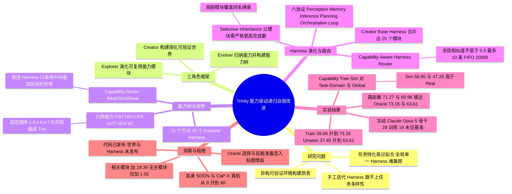

## 一、论文是干什么的？

想象你在训练一支综合运动队的教练团。传统做法是：游泳有游泳教练，篮球有篮球教练，每个项目各练各的，换一个新项目就得重新找人。但你仔细观察会发现，很多项目其实共用同样的底层能力，比如「看清场上局势并持续记住它」「动手之前先检查一步是否合规」。如果按「底层能力」而不是「项目名称」来分组训练，练好一项能力就能同时帮到好几个项目，新项目来了也能直接套用。这就是这篇论文的核心想法。

论文面向的是**多模态智能体**：让一个冻结的大模型（不改权重）去玩游戏、解谜、操作机器人这类需要多步观察与决策的任务。作者指出两个瓶颈：一是要造出大量异构、可验证的训练环境，成本很高；二是智能体的表现越来越取决于外面那层「**Harness**」（可以理解为包在模型外面的一套控制流程与工具模块，管感知、记忆、推理、规划等），而手工迭代 Harness 赶不上任务的多样性。作者提出 **The Trinity**（三位一体）框架：由 **Creator**（造世界）、**Explorer**（去探索并演化模块）、**Evolver**（整理任务、归纳能力）三个角色组成闭环，让 Harness 在「按能力组织的任务树」上递归地自我改进。以下数字均取自 [arXiv 全文](https://arxiv.org/html/2610.36077)，凡是我的理解和评论会明确标注。

## 二、核心方法与创新

**1. 先搞清 Harness 是什么。** 论文把 Harness 形式化为六个控制流协议，分别是 Perception（感知）、Memory（记忆）、Inference（推理，维护相容的候选假设）、Planning（规划）、Orchestration（编排，决定调用哪些资源）和 Loop（循环，决定执行与否并提交）。记作 $\mathcal{H}_{\phi}=(\Pi_{er},\mathbf{M},\mathbf{I},\mathbf{P},\mathbf{F},\mathbf{L})$，大模型本身 $f_\theta$ 保持冻结，进化的只是这些协议下的模块配置。类比：模型是同一位厨师，Harness 是他的厨房流程和工具柜，论文改进的是流程和工具柜，而不是厨师。

**2. 三阶段建树。**

- 阶段一，任务树：Evolver 把公开的多模态基准整理成统一规格（目标、观察、动作、反馈、完成标准、预算），分入五个需求领域（规则发现、约束求解与设计、感知与控制、多智能体互动、长程环境）。训练集与未见集的划分在能力归纳之前就固定。Explorer 用基础 Harness $\mathcal{H}_0$ 在训练实例上跑出轨迹。
- 阶段二，能力树：几个独立 agent 先各自提议能力类别，由一个裁判合并，再由评审检查定义、证据、归属与覆盖度，最终得到六种能力和 30 种缺陷类型。六种能力分别是 PST（感知与状态追踪）、HCI（假设与对手推断）、CFR（约束检查与反馈修复）、GVT（目标承诺与价值权衡）、VEA（视频证据获取）、VC（视频理解）。每个训练任务拿到一个能力需求集合 $K_\tau$，按预先固定的顺序（c、d、a、b、e、f）排序成一条路径 $p_\tau=\mathrm{sort}_{\prec}(K_\tau)$，所有路径合并公共前缀得到一棵前缀树 $\mathcal{T}=\mathrm{Trie}(\{p_\tau\})$。结果是 11 个节点，例如节点 $c$ 放只需要约束检查的任务，其子节点 $c \to d$ 放还需要目标承诺的任务。论文强调，来自不同领域、内容迥异的任务（如自适应规划、迷宫导航、台球、文字冒险）只要能力组合相同，就会落在同一个节点。
- 阶段三，Harness 树：Explorer 的 Harness 树与能力树同构，每个节点是「从父节点继承来的模块」加「本节点自己的局部模块」。

**3. Capability-Driven Real2Sim2Real（能力驱动的真实到仿真再到真实）。** 对同一节点上的异构任务，Evolver 根据节点需求和代表任务的公开规格，设计简化的训练关卡（不允许包含目标任务的布局、私有证明或解答轨迹），Creator 用一个代码型 Harness 把关卡实现成带 3D 场景、公开规则、固定动作预算和评分器的仿真世界。关卡要通过宿主执行的验证器检查，再用一个冻结的「筛选 Harness」试玩，只有表现落在预设的中间区间（既不太易也不太难）才被录用，否则调整难度。训练只在这些简化世界里做，真实原任务只用来衡量迁移效果。类比：不让篮球运动员直接去打比赛来练「传球前先看清防守」，而是设计一套专门练这项判断的小游戏，练完再回比赛里验收。

**4. 选择性继承与持续精炼。** 子节点的 Harness 为 $\mathcal{H}_{E,v}^{(i)}=P_v^{(i)}\oplus L_v^{(i)}$，其中 $P$ 是继承的父模块注册表，$L$ 是局部模块，$\oplus$ 为右偏并集（局部覆盖同名继承）。父节点更新后，只有在相同验证任务、相同试验次数和预算下，宿主验证的任务完成数严格更高，才采纳父节点的新模块，否则保留旧的。Evolver 比较成功与失败轨迹来创建或修订局部模块，宿主在每次更新前检查证据、归属、接口和版本谱系。每个模块每步最多被调用两次，且不强制调用。

**5. Creator 的 Base Harness 合并。** Creator 只有在验证器检测到失败时才演化，每一轮结束时把各节点的合格提议与现有模块库合并：有效修订取代前任，不同的能力保留，部分重叠的合并，近似重复的保留较早学到的那个。合并结果成为下一轮的 Base Harness。论文最终的 Creator 模块库有 25 个模块（11 个是 RSI 之前就有的审计类模块，14 个是从被拒世界中学到的规则模块）。

**6. 能力感知的 Harness 路由器。** 演化出的 Harness 各有专长，所以需要按任务挑选。路由器让一个 agent 读取任务的公开信息（目标、初始观察、元数据、图片）、候选 Harness 的描述、检索到的历史经验和性能与成本摘要，然后在执行前提交选择及理由，$h_n=\pi(x_n,\mathcal{C},R(x_n,\mathcal{M}_n),S(\mathcal{M}_n))$。检索用余弦相似度不低于 0.5、最多 10 条记录、容量 20,000 条的先进先出记忆，记忆初始只来自训练侧的分类轨迹，未见任务的能力标签不会进入路由上下文。

## 三、使用了哪些模型和计算资源？

- **被演化、被评测的对象：** 论文**不训练任何模型权重**，所有变体共用同一个冻结骨干 Claude Opus 5（论文引用其系统卡，设置为 adaptive thinking，low effort）和同一个基础 Harness $\mathcal{H}_0$（论文称为 Prime Agent）。进化的是 Harness 的模块配置与评测时技能。
- **各角色所用模型：** 原文写明评测的所有运行共用这个冻结骨干，路由的变体也共用同一冻结骨干；Creator、Explorer、Evolver、独立提议能力的 agent、裁判与评审各自具体用什么模型，论文未逐一说明，属论文未报告，我不作推测。
- **对比用的参照系统：** Codex Harness 与 DeepSeek Harness（都是 Harness 而非模型），在 16 个非机器人未见基准上用同一骨干与设置通过各自原生工具接口运行。
- **GPU：** 论文未报告 GPU 型号与数量。冻结骨干应是通过模型服务调用，但原文未明说，这属于我的推测。
- **API 花费（金额）：** 论文未报告金额；它用 token 总量衡量成本，单位为百万 token（M）。
- **一次完整训练或评测的成本（原文 Table 3、Table 4、Table 5 中的 token 数）：**
  - 第 1 轮 RSI 的训练（演化阶段）token：模拟能力树 405.70M，真实任务能力树 211.56M，任务领域 15 个 Harness 278.25M，能力领域 6 组 136.94M，全局共享 582.54M。
  - 基础 Harness 在 28 个训练基准与全部未见基准上的推理 token：582.54M 与 613.07M；模拟能力树的第 1 轮推理 token 为 514.42M 与 549.07M。
  - 路由比较中的 token 估计含技能准备、路由和正式推理：完整路由器在训练集与未见集分别 497.89M 与 541.28M。
  - 论文称 Creator 构建环境主导了首轮训练成本，后续轮可复用世界来摊薄（Figure 4，具体数值图中给出，我只引用了文字结论）。
- **评测规模：** 28 个训练基准与 18 个未见基准（其中 26 个训练、16 个未见加两个具身基准的仿真与真机版）。评测前每个「基准与 Harness」组合先跑 5 次准备试验并总结成技能，技能冻结后再正式评测。每个具身设置正式评测 10 个回合。
- **单任务推理耗时、墙钟时间、迭代总时长：** 论文未报告。

## 四、实验结果

**设置（论文原文）：** 全部使用冻结的 Claude Opus 5，基础 Harness 为 $\mathcal{H}_0$，分数统一到 0 到 100 分，各基准等权平均。需要特别留意（论文原文）：表格里 $\mathcal{H}^{(i)}$ 的成绩是每个实例使用 Oracle 设定下最优的兼容节点 Harness（事后选最好的）再加评测时技能，而可部署的路由器结果另见路由小节。

**1. 先看模块与技能的贡献（Table 2，第 1 轮）：**

| 设置 | 模块 | 技能 | Train（28 个） | Unseen（18 个） |
|---|---|---|---|---|
| 基础 $\mathcal{H}_0$ | 无 | 无 | 39.06 | 37.45 |
| 只用模块 | 有 | 无 | 56.95 | 47.26 |
| 只用技能 | 无 | 有 | 58.86 | 48.67 |
| 两者都用 | 有 | 有 | 63.80 | 53.53 |

我的解读：评测时技能（准备 5 次试验后总结）单独就能把基础分提升约 19.8 分（按原文数字推算：58.86 减 39.06），所以摘要里的 34 分和 26 分是「模块演化加技能准备加 Oracle 选择」的合成结果，不应当全部归因于能力树。

**2. 按能力组织是否优于按任务组织（Table 3，只用模块、不用技能，第 1 轮）：**

| 方法 | 课程 | Harness 数 | 环境数 | Train | Unseen | 训练 token |
|---|---|---|---|---|---|---|
| Global（一个共享 Harness） | 真实 | 1 | 28 | 53.04 | 42.92 | 582.54M |
| Task-Domain | 真实 | 15 | 15 | 51.17 | 40.82 | 278.25M |
| Capability-Domain（六个平铺组） | 真实 | 6 | 6 | 49.25 | 39.43 | 136.94M |
| Capability Tree（Real） | 真实 | 10 | 11 | 53.44 | 42.31 | 211.56M |
| Capability Tree（Sim） | 仿真 | 10 | 11 | 56.95 | 47.26 | 405.70M |

论文原文的结论：平铺的能力分组比 Global 便宜但成绩更低；加上层级继承后（Real）比平铺高出 4.19 与 2.88 分；换成仿真世界（Sim）再高 3.51 与 4.95 分，同时推理 token 最低（514.42M 与 549.07M）。注意仿真课程的训练 token 反而比真实课程高，因为首轮要造世界。

**3. 连续迭代（Figure 5、Figure 6，Table 8）：** 训练集 28 个基准的均值依次为 39.06、63.80、67.75、70.85、73.16（Base 到第 4 轮），未见集 18 个基准依次为 37.45、53.53、55.17、59.56、63.61，即摘要所说的约 34 分与约 26 分（按原文数字推算：73.16 减 39.06 为 34.10，63.61 减 37.45 为 26.16）。在 16 个非机器人未见基准上，均值从 42.13 升到 64.06，超过 Codex 参照的 47.49 与 DeepSeek 参照的 46.18（正文取整为 47.5 与 46.2）。第 1 轮提升最大，第 2 到 4 轮还能再加 9.4 个训练点与 6.4 个未见点（原文口径：训练点按 28 个基准，未见点按 16 个非机器人基准；18 个未见基准按原文数字推算为 63.61 减 53.53，约 10.1 点）。个别基准：ARC-AGI-3 第 1 到第 4 轮从 41.0 升到 53.6，SciGym 从 45.2 到 57.1，BuildArena 从 93.3 到 97.8；Mastermind 停在 88.9，Eleusis 从 82.2 略降到 81.1；Crafter 与 DiG-bench 仍低于两个参照。

**4. 路由（Table 4，在第 4 轮 Harness 树上）：**

| 方法 | 能力定义 | 经验记忆 | Train | Unseen |
|---|---|---|---|---|
| Random | 无 | 无 | 52.74 | 46.23 |
| Agent 自路由 | 无 | 无 | 65.79 | 52.36 |
| Agent 自路由 | 有 | 无 | 70.34 | 58.27 |
| 完整路由器 | 有 | 有 | 71.27 | 60.96 |
| Oracle（事后最优） | 无 | 无 | 73.16 | 63.61 |

按原文数字推算：完整路由器比基础 $\mathcal{H}_0$ 高约 32.2 与 23.5 分，与 Oracle 的差距约 1.9 与 2.7 分。这比摘要里的 34 与 26 更接近一个真正可部署系统的数字，但仍含技能准备。

**5. 能力与模块的关系（Figure 7、Table 5）：** 在 29 个模块上，最强的正相关出现在 HCI 与 Inference（0.744）、GVT 与 Loop（0.444）、VEA 与 Perception（0.347）、PST 与 Memory（0.306）、CFR 与 Planning（0.274）。受控干预：给基础 Harness 随机加一个相关模块，分数从 39.06 升到 58.45（加 19.39）；加一个无关模块只升到 40.08（加 1.02）。从完整第 4 轮 Harness 里去掉一个相关模块，73.16 降到 70.42（减 2.74）。我的解读：这些是描述性关联加小规模干预，不足以证明因果结构。

**6. 具身迁移（Table 6，成功率，每个设置 10 个回合）：** 作者把两个具身任务映射到能力树的 $d \to a$ 节点，使用该节点演化的 Harness，并在重建的仿真器里做 5 次试错来学技能。

| Harness | SOON 仿真 | CaP-X 仿真 | SOON 真机 | CaP-X 真机 |
|---|---|---|---|---|
| $\mathcal{H}_0$ | 0 | 10 | 0 | 0 |
| $\mathcal{H}^{(1)}$ | 20 | 20 | 20 | 20 |
| $\mathcal{H}^{(2)}$ | 20 | 30 | 20 | 20 |
| $\mathcal{H}^{(3)}$ | 80 | 40 | 60 | 40 |
| $\mathcal{H}^{(4)}$ | 80 | 60 | 60 | 60 |

SOON 用 Unitree G1 走向并触碰风扇旁的桌子，CaP-X 用 AlohaMini2 掀开三个倒扣杯子并报告方块是否存在、颜色和位置。论文自己说明，这些对比评估的是「完整的 Harness 加技能配置」，并不能把模块演化与技能准备的作用分开。我的提示：每个设置只有 10 个回合，成功率以 10 个百分点为单位，统计不确定性较大。

## 五、潜在应用与已落地应用

**论文明确提到的方向（原文）：** 作者希望动态扩展能力树以容纳新出现的能力需求，并把这种范式延伸到模型参数训练，形成「能力感知路由加 RSI」的闭环。局限里论文只写了两点：用网络搜索做基准发现，检索覆盖与质量会随查询变化；当前研究主要集中在 Harness 层面的自我改进。

**我的判断（非论文原文）：** 如果思路成立，潜在场景包括给多任务的通用智能体按能力配置不同的「工具与流程包」、为机器人任务先在简化仿真里学技能再上真机、以及为新基准低成本地自动生成训练关卡。但这些都未被论文在更大范围验证，且结果建立在单一冻结骨干与 5 次试验的技能准备之上。

**已落地情况：** 论文的落地证据只有两个具身任务（SOON 与 CaP-X）的真机测试，各 10 个回合。截至 2026-10-30，我没有检索到产品级部署。代码的开源情况见第六章。

## 六、网络上的讨论与评价

- [Hugging Face 论文页](https://huggingface.co/papers/2610.36077)：HF API 显示票数 389，由 Pengfei Zhou（同时是论文通讯作者之一）于 2026-10-28 提交到每日论文，页面关联了项目主页与 GitHub 仓库，没有关联模型或数据集（仅有第三方点赞统计 Space）。页面当前显示为「#2 Paper of the day」。截至 2026-10-30 页面共有 3 条评论：作者提交者 IntJudge（Pengfei Zhou）2026-10-28 发的一句摘要；alphabell-research 2026-10-28 的评论，指出第 4.1 节对每个基准与 Harness 组合先做 5 次准备试验并把轨迹转成技能，所以报告的约 26 分增益包含了对目标基准的适应，建议为 18 个未见基准补一列无准备的对照（同样的 Harness 和路由器），并给出这 5 次试验的 token 或算力成本；以及 Librarian Bot 的自动推荐。我没有看到作者对第二条评论的回复。这条评论的关切与下面 CCTest 的提醒一致。
- [GitHub 仓库 InfRec-Cardinal/The-Trinity](https://github.com/InfRec-Cardinal/The-Trinity)：截至 2026-10-30，使用 MIT 许可证，约 30 颗星，README 写明 2026-10-30 已发布代码（按提交历史，这个仓库 10 月 27 日创建时只是写着 Coming Soon 的技术报告仓库，代码在 10 月 30 日的 UTC 清晨才提交，README 的发布公告紧随其后，所以更早的页面快照会显示尚未发布），并称论文在 HF Daily Papers 上排第 1（HF 页面当前显示的是第 2 名，两者不一致，这里只转述两个来源各自的说法）。开源计划里已勾选的只有代码；仿真环境、Harness、Router 与演示站仍是未完成项。README 还说明基准数据集、可运行的基准驱动、适配器配置、实验快照与路由方案并未随包提供，运行完整流程需要自行实现环境适配器，完整训练需要带 Bubblewrap 的 Linux。因此以目前公开内容很难直接复现论文结果（这是我的判断）。有个别搜索结果仍显示该仓库为 coming soon，应是页面快照过期。
- [GitHub 议题 1](https://github.com/InfRec-Cardinal/The-Trinity/issues/1)：Hugging Face 的 Niels Rogge 于 2026-10-28 提议把演化出的 Harness、模块或数据集发布到 HF Hub，截至检索时 0 条回复。
- [项目主页](https://trinity-rsi.github.io/)：作者自己的页面，搜索摘要显示其给出训练集提升 34.1 点、未见集提升 26.2 点，与论文摘要和 Table 8 的数字一致，属作者自述；但主页是在介绍 Router 的同一句话里给出这两个数字，而这两个数字对应的是 Oracle 选择，可部署路由器在 Table 4 中为约 32.2 与 23.5 分（按原文数字推算）。
- [AI Weekly 的报道](https://aiweekly.co/alerts/trinity-framework-lifts-multimodal-agents-34-points-on-28-tests)（2026-10-28）：基于摘要复述，编者按建议等看全文再决定是否投入，并指出摘要没有给出单个基准和基座模型。这是二手摘要，不是独立评测。
- [CCTest 的文章](https://cctest.ai/en/articles/the-trinity-recursive-self-improvement-built-around-capabilities)（2026-10-28）：同样是概述，提醒评测前有 5 次准备试验，所以收益混合了跨任务迁移与对目标基准的适应，并称材料中没有未做准备的对照。我对照原文发现：CCTest 的结论只基于它所提供的材料（来源标注为 Hugging Face Daily Papers），而论文其实给了含技能准备的 token 估计（Table 4），也给了 18 个未见基准上的无技能对照：基础 $\mathcal{H}_0$ 为 37.45 分，第 1 轮只用模块为 47.26 分（Table 2）。不过我没有在原文中找到第 2 到 4 轮的无技能结果，34 与 26 分仍含技能准备，所以它「混合了迁移与适配」的提醒大体成立。
- 其他索引页：[hyper.ai 论文页](https://hyper.ai/en/papers/2610.36077)、[paperswithcode.co 页面](https://paperswithcode.co/paper/2610.36077)、一个意大利语的论文简介发布页 [AI Paper in Pillole 77](https://github.com/sovietalysrls-ui/ai-paper-in-pillole/releases/tag/2026-10-29_077_the-trinity)（我只确认其存在及标题，没有细读内容），均不是独立评测。
- Hacker News：有人在 2026-10-29 提交了论文链接，截至检索时 1 分、1 条评论（我没有读评论内容，所以不对它作描述）。
- 截至 2026-10-30 未检索到 Reddit、X、知乎或微信公众号上的相关页面，也未检索到独立复现。
- 我的整体评价（非论文原文）：设计思路完整、实验面铺得很广（44 个基准加两个真机任务），但目前公开的评价基本都是对摘要的转述，真正的第三方验证尚缺。

## 七、思维导图

