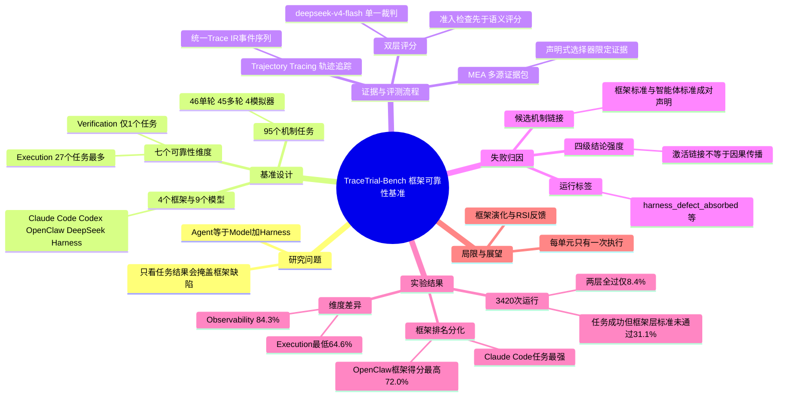

## 一、论文是干什么的？

想象你请了一位装修工人（大模型）去你家干活，同时配了一套工具箱和一位工头（运行框架，英文叫 harness）：工头负责把你的要求传给工人、决定给他哪些工具、记录他每一步做了什么、在危险操作前要不要先请示。最后房子装好了，你满意地验收通过。但如果工头中途把一条「水管漏水」的报告弄丢了，只是工人碰巧自己发现并修好了，那这套系统其实有隐患，只是被结果掩盖了。

这篇论文关心的正是这个问题。现在的大多数智能体评测只看「任务做成没有」，把模型和框架的贡献混在一起。论文把智能体写成 $\mathrm{Agent}=\mathrm{Model}+\mathrm{Harness}$，主张框架本身也要被单独评测。作者提出 **TraceTrial-Bench**：95 个专门针对框架机制设计的任务、七个可靠性维度，对 Claude Code、Codex、OpenClaw、DeepSeek Harness 四个框架配九个模型共跑了 3420 次，并同时给出「任务得分」和「框架得分」两张成绩单。以下数字均来自 [arXiv 全文](https://arxiv.org/abs/2610.32285)。

## 二、核心方法与创新

**1. 七个可靠性维度。** 论文沿用已有的框架分类法，把框架应尽的义务分成七类：Context（上下文，信息跨边界时是否保留或泄露）、Execution（执行，进程语义、状态与结果传递是否忠实）、Governance（治理，审批、护栏、密钥脱敏、信任边界）、Lifecycle（生命周期，状态转移、恢复、幂等重试）、Observability（可观测性，模型可见的诊断信息、可回放日志）、Tools（工具，接口有效性、传输是否忠实、工具发现）、Verification（验证，完成声明是否与真实结果一致）。各维度的任务数为 15、27、9、19、7、17、1，共 95 个，覆盖 40 个机制级属性。类比：这像是给汽车做体检，分为刹车、电路、发动机等几大系统，每个系统用专门的测试项目。

**2. 任务设计。** 每个任务都从某个机制出发，设定一个「触发条件」（例如输出过长需要恢复、命令返回非零退出码却生成了看似成功的文件、跨会话传递事实、只能通过交互通道获得的私密值），再把它包装成普通的领域工作。任务带有确定性验证器和独立的「真值锚点」。论文原文给出：46 个单轮任务、45 个固定多轮任务、4 个由模拟器驱动的任务；评分表共有 783 条框架标准和 556 条智能体标准，其中 909 条是程序化规则，430 条是语义评分细则（附录 A）。

**3. 保留框架原生行为。** 每个框架通过各自的适配器运行，任务目标和评分标准保持一致，但提示构造、工具传输、上下文策略、权限和会话行为都不改。论文允许「表示形式的归一化」，禁止「引入新能力、增强模型可见证据或改变通过条件」。

**4. 轨迹追踪（TT）与证据获取（MEA）。** TT 把各框架的原生记录转成统一的 Trace IR（统一的事件序列，每个事件有 schema_version、seq、timestamp、run_id、event_type 等公共字段），并保留原始记录以便审计。因为完整轨迹太长，MEA 为每条评分标准按声明式选择器生成一个「证据包」：模拟器账本、工作区变更、原生轨迹、请求边界的工具声明、执行与安全探针、智能体自述，各自只对特定类型的结论有权威。类比：像法庭上的证据规则，监控录像能证明「发生了什么」，当事人证词只能证明「他说了什么」。

**5. 双层评测。** 先过「准入检查」（容器生命周期、归档完整性、轨迹可评分等），不合格的运行不进入语义评分，并且准入不是第三个分数。然后先评智能体层，再评框架层，智能体结果只作为下游上下文，不能当作框架失败的证据。裁判对框架标准给出四种状态：0 不支持、1 支持、2 未触发（按智能体结果决定通过与否）、3 框架故障（一律记为失败）。单次运行得分为

$$S = 50\,\frac{p_H}{n_H} + 50\,\frac{p_A}{n_A}$$

其中 $p_H, n_H$ 是框架层通过与总标准数，$p_A, n_A$ 是智能体层的对应数。只有 $S=100$ 才算「两层全过」。

**6. 失败归因（FA）。** 任务可事先声明「某条框架标准失败可能经由某种中间机制影响某条智能体标准」，记为 $\ell=(h_\ell,a_\ell,\mu_\ell)$。当两个端点都失败且激活条件成立时，这条候选链接被自动激活。论文强调四个层级的结论强度不同：标准判定、确认的框架缺陷、被激活的候选链接、经人工复核验证的传播。自动激活的链接并不证明因果。运行标签（如 harness_caused、agent_caused、harness_defect_absorbed、clean）只是操作性证据状态，不是因果结论。

## 三、使用了哪些模型和计算资源？

- **被评测的运行框架（版本见附录表 19）：** OpenClaw 2026.6.9、Codex 0.145.0、Claude Code 2.1.220、DeepSeek Harness 0.1.0-rc.6。Codex 与 Claude Code 通过本机回环的 LiteLLM 网关访问模型。
- **被评测的九个模型（报告分组名）：** DeepSeek-V4-Pro、Gemini 3.7 Flash、GLM-5.3、GPT-5.6-Sol、Grok-4.6、HY3、Kimi K3、Opus 5、Qwen3.8-Max。推理设置沿用各次运行的归档配置，具体参数规模论文未报告。
- **裁判模型：** 全部 3420 次最终评测都使用 deepseek-v4-flash。每条标准的输出上限为 4096 token（1966 次评测）、8192 token（1452 次）、32000 token（2 次）。
- **训练对象：** 论文没有训练任何模型，是纯评测工作。
- **GPU 型号与数量：** 论文未报告。评测运行环境使用 Docker 容器；模型通过 API 或网关调用。
- **运行规模：** $4\times 9\times 95 = 3420$ 个单元，每个框架 855 次，每个模型 380 次，每个单元只保留一次被选中的执行（含早期恢复后的替代执行），没有重复实验。
- **单次运行的预算上限：** 有效墙钟时间限制为 120 到 5400 秒，任务定义的用户输入轮数为 1 到 120 轮，工具调用上限为 5 到 300 次。这些是上限，不是实际耗时。实际平均耗时论文未报告（作者明确说不把时长差异解释为受控吞吐实验）。
- **单次运行的 token 与费用（表 7，按论文各厂商官方定价估算，不含裁判调用、被丢弃的执行等）：** 全体平均每次运行约 562.1k token，估算费用约 0.528 美元；按框架：Claude Code 约 578.8k token、0.436 美元，Codex 约 617.2k token、0.595 美元，DeepSeek Harness 约 372.7k token、0.446 美元，OpenClaw 约 680.0k token、0.633 美元。注意这些都是「有有效用量记录的运行」的平均值，论文没有说这些记录覆盖了全部 3420 次运行，也没有给出总费用，所以不能直接用单次均值乘以运行次数来当作整个实验的总花费，本综述也不给出这样的总额。
- **裁判的单次评测成本与总耗时：** 论文未报告。

## 四、实验结果

**总体（论文 5.1 节）：** 20016 条智能体标准中 14979 条通过（74.8%），28188 条框架标准中 19242 条通过（68.3%）。1351 次运行（39.5%）满足全部智能体标准，只有 286 次（8.4%）同时满足两层的全部标准。平均两层综合分为 70.4。

**四个框架的比较（表 6，855 个对应单元，单位为百分比）：**

| 框架 | 智能体全过 | 智能体平均分 | 框架 Micro | 框架 Macro | 两层全过 | 综合分 |
|---|---|---|---|---|---|---|
| Claude Code | 44.0 | 75.9 | 71.5 | 71.2 | 9.1 | 73.5 |
| Codex | 35.8 | 70.7 | 60.2 | 59.8 | 2.8 | 65.2 |
| DeepSeek Harness | 40.0 | 73.3 | 69.5 | 68.8 | 9.8 | 71.0 |
| OpenClaw | 38.2 | 71.7 | 71.9 | 72.0 | 11.7 | 71.8 |

大白话：任务做得最好的是 Claude Code，框架标准满足得最好的是 OpenClaw，两者不是同一个。框架 Macro 的跨度是 12.2 个百分点（Codex 59.8% 到 OpenClaw 72.0%），而智能体全过的跨度只有 8.2 个百分点。

**模型与框架的交互（5.3 节）：** 每个模型分组里 Codex 的框架 Macro 都是最低；OpenClaw 在六个模型上最高，Claude Code 在 GLM-5.3、GPT-5.6-Sol、Grok-4.6 上领先。同一模型在不同框架下的框架 Macro 跨度为 10.0 到 16.2 个百分点（Qwen3.8-Max 最小，GPT-5.6-Sol 最大）。Grok-4.6 的智能体全过率从 OpenClaw 的 33.7% 到 Claude Code 的 55.8%；Opus 5 从 Codex 的 30.5% 到 Claude Code 的 53.7%。

**按维度（表 8 与表 9，框架 Micro）：** Execution 最低（64.6%），Lifecycle 为 65.5%，Context 为 65.6%，Observability 为 84.3%，Verification 为 90.1%（只有 1 个任务）。Execution 上 Codex 为 51.5%，OpenClaw 为 77.1%；Context 上 Claude Code 为 74.5%，OpenClaw 为 61.6%；Lifecycle 上 Codex 为 53.0%，DeepSeek Harness 为 71.7%。40 个属性中没有一个在所有模型与框架上达到 100%；网络限制最低，为 38.9%。子智能体结果聚合的框架满足率只有 46.2%，智能体成功率却是 72.2%（144 次运行）；跨轮次事实保留是 48.4% 对 95.8%。

**失败状态与归因（5.5 节）：** 3420 次运行中，两层全干净 286 次，只有框架失败 1065 次，只有智能体失败 369 次，两层都失败 1700 次。因此 1065 次（31.1%）是任务成功但至少有一条框架标准失败。在 1700 次两层都失败的运行中，842 次（49.5%）至少有一条被激活的候选链接，共 1633 个激活的端点对；在 2069 次有智能体失败的运行中，1773 次（85.7%）至少还有一条智能体失败不被任何链接覆盖。

**论文自述的局限：** 任务集有针对性且各机制覆盖不均，每个任务、模型、框架组合只有一次被选中的执行，对部署负载的泛化与重复运行的稳定性证据有限；任务版本、运行设置与评分预算的差异也限制了对具体框架设计做因果结论。

## 五、潜在应用与已落地应用

**论文明确提到的方向：** 作者设想把该基准用于「框架演化」的闭环（找出机制失败、修改框架行为、在留出任务上检验），以及为递归自我改进（RSI）提供按标准粒度的反馈，并通过交叉评测智能体版本与框架版本来区分各自贡献。

**我的判断（非论文原文）：** 对工程团队来说，它可能适合在升级或更换 Claude Code、Codex 等框架时做回归检查，或选择更适合自己场景（比如强调上下文隔离或审批治理）的框架。不过论文只在 95 个任务和一次性运行上验证，不宜把单个分数当作选型的唯一依据。

**已落地情况：** 代码与任务已在 [GitHub 仓库](https://github.com/TraceLite-AI/TraceTrial-Bench) 开源，截至 2026-10-30，GitHub API 显示许可证为 MIT，约 23 颗星、8 个 fork，最近一次推送为 2026-10-28。HF 页面关联了数据集 [TraceLite-AI/TraceTrial-Bench](https://huggingface.co/datasets/TraceLite-AI/TraceTrial-Bench)（页面显示 3515 行）；README 另列出了排行榜与 Hugging Face Space。第三方企业落地案例截至 2026-10-30 未检索到。

## 六、网络上的讨论与评价

- [Hugging Face 论文页](https://huggingface.co/papers/2610.32285)：HF API 显示 299 票，每日论文榜第 2 名（页面数据与 README 标注一致）。页面有 3 条评论：作者 HengjieZhu 于 2026-10-27 发的推介帖（复述摘要）；用户 MLSystemsRI 于 10-27 的评论，称 31.1% 的数字是评估只看结果的智能体时值得展示的数字，并用「房子通过验收但墙后有问题」作类比；Librarian Bot 于 10-28 的自动相似论文推荐（其中包括 [When Agents Fail: Model or Harness--Who's to Blame?](https://huggingface.co/papers/2610.32483)）。
- [mer.vin 博客](https://mer.vin/news/tracetrial-bench-agent-harness-reliability/)（Mervin Praison，2026-10-28）：对论文的二手总结，并提醒所有数字都是作者自报、未经独立复现，裁判只用了单一模型，每个框架使用默认设置因此模型与框架的影响相互混杂。这是一篇博客解读，不是独立实验。
- [hyper.ai 论文页](https://hyper.ai/en/papers/2610.32285)：收录摘要的聚合页，非独立评测。
- 其他渠道：HN 的 Algolia 搜索（2610.32285、TraceTrial-Bench）均返回 0 条；Reddit 搜索接口被拦截，未能检索，所以我不能说那里有或没有相关讨论。X/Twitter 与知乎、微信公众号通过通用网页搜索（英文标题、中文关键词、arXiv ID 各一次）截至 2026-10-30 未检索到相关页面。
- 值得说明：论文评价的是各框架当时的版本，且作者自己也强调自动激活的链接不等于因果。

## 七、思维导图

