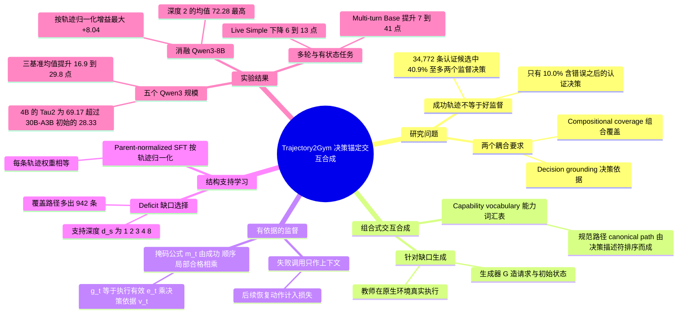

## 一、论文是干什么的？

想象你要教一个新来的客服实习生处理订单。最省事的办法是找来一批「最后办成了」的录音让他模仿。但这有两个隐患：第一，这批录音可能大多是「查一下订单、回答一句话」这类简单通话，很少出现「查不到账号，换个办法再查，再确认订单状态，然后才取消」这种需要把好几步串起来的复杂情形；第二，录音里的客服有时会「凭空知道」某个订单号，因为录音者手里有实习生看不到的内部资料，实习生照抄只会学到瞎猜。论文研究的就是这个问题：**成功完成任务的工具调用轨迹，不一定是好的监督数据**。

论文把好数据拆成两个相互配合的要求（以下均为论文原文观点）。一是**组合覆盖**（compositional coverage）：数据里要有足够多的「前面的观察决定后面的动作」的多步依赖结构。二是**决策依据**（decision grounding）：每一个被拿来模仿的动作，都要能从学习者在决策时「看得见的」对话和工具返回里推出来。作者提出的 Trajectory2Gym 就是围绕这两点造数据：专门针对数据里稀缺的结构去合成可执行的交互，只对「有可见依据」的决策计入训练损失，再按结构缺口分配数据，并用「按整条轨迹归一化」的监督微调训练。在 Qwen3 的五个规模（1.7B 到 30B-A3B）上，只用普通监督微调（没有强化学习），Tau1、Tau2 和 BFCL 三个基准在每个规模上都提升，三基准等权均值提升 16.9 到 29.8 个百分点。以下数字除特别说明外均来自 [arXiv 全文](https://arxiv.org/html/2610.33568)。

## 二、核心方法与创新

整个流程分三步（论文图 2），可以类比为「备课、批改、排课」。

**1. 组合式交互合成：针对缺口备课。** 论文先定义一个共享的「能力词汇表」$\mathcal{K}$，涵盖语义动作与参数、观察结果、错误恢复、分支、转人工、终止、轮次长度等，用来把不同工具、不同环境里的操作抽象成同一类角色。一条有序的「路径」$p=(\kappa_1,\dots,\kappa_\ell)$ 就是若干能力按顺序组成的一次交互结构，比如「查账号、报错、澄清、重试、读订单、确认、取消、更新」。生成器 $G$ 针对目标路径构造用户请求和兼容的初始状态，教师策略 $\pi_T$ 在原生环境里真实执行。每条轨迹只分配一条规范路径 $p(\tau)$ 用来记账，路径 $p$ 在已选集合 $\mathcal{S}$ 中的支持度是 $n_{\mathcal{S}}(p)=\sum_{\tau\in\mathcal{S}}\mathbf{1}[p(\tau)=p]$。**只有在真实执行日志里出现了对应依赖，这条路径才算被认证**，生成器的意图不算数；生成器或教师出错，结果只会表现为一个未被认证的结构，不会变成训练目标。类比：不是看老师「打算」讲什么，而是看学生课堂上「实际」练到了什么。

**2. 有依据的监督：只批改看得见依据的动作。** 学生上下文 $c_t$ 只包含原生接口暴露的事件，教师提示和私有事件不会进入。对每个决策，论文区分原生执行有效 $e_t$（调用没报错或通过了原生动作校验）和决策时依据 $v_t$（工具对智能体可用，标识符类参数能在之前的可见信息中找到来源），局部合格性为 $g_t=e_t v_t$。最终监督掩码为 $m_t=R_\tau\,\mathbf{1}[q_\tau\preceq A_\tau]\,g_t$，其中 $R_\tau$ 是原生检查器判定的整条轨迹成功，$q_\tau$ 是任务要求的有序操作，$A_\tau$ 是规范化后的相关用户操作与合格助手动作序列，$\preceq$ 表示有序子序列包含。失败的调用及其真实报错保留为上下文但不计损失，而随后的恢复动作会被监督。类比：学生做错的那一步不要求他再抄一遍，但错误信息要留在草稿纸上，因为「看到报错后怎么改」才是要学的。论文图 1 给了一个例子：用户先说想换大瓶子和暗一点的台灯，最后只确认台灯；只看 API 能否执行会把两个换货请求都保留，而 Trajectory2Gym 用目录证据和最新确认保留台灯、拒绝多出来的瓶子（论文说明这是改写对话加构造的第二个候选动作的示意）。

**3. 结构支持学习：按缺口排课，按整条轨迹称重。** 对学习者规模 $s$，设 $d_s$ 为每条可行规范路径希望有的不同轨迹数（支持深度），某集合的剩余缺口为 $\delta_s(p,\mathcal{S})=[d_s-n_{\mathcal{S}}(p)]_+$。选择流程是：从固定的认证核心开始，每个训练任务补一条能完成任务的示范，补齐未覆盖的能力原子与路径，再添加能减少缺口的轨迹。论文证明在纯数量预算下，这一步恰好最大化带上限的支持度 $\sum_p\min(n_{\mathcal{S}}(p),d_s)$（命题 2）；上限的作用是体现「广度优先」，没有上限目标就不在乎覆盖了哪些路径。随规模增大，$d_s$ 依次取 1、2、3、4、8（对应 1.7B、4B、8B、14B、30B-A3B），更大的学习者每个路径看到更多不同实现。

训练时一条轨迹可能被渲染成多条训练样本。按样本平均的话，一条轨迹的权重正比于它被拆出的样本数（命题 4），长的多轮交互会主导损失。所以论文在轨迹层面定义损失：

$$\ell_\theta(\tau)=-\frac{1}{N_\tau}\sum_{u=1}^{N_\tau}\log\pi_\theta(y_u\mid h_u),\qquad \mathcal{L}_{\mathrm{SFT}}(\theta)=\frac{1}{|\mathcal{D}_s|}\sum_{\tau\in\mathcal{D}_s}\ell_\theta(\tau)$$

其中 $N_\tau$ 是该轨迹跨所有渲染样本的认证下一词对数。论文的算例：两条轨迹分别被渲染成 3 条和 1 条样本，按行平均权重是 3/4 与 1/4，按轨迹归一化则各为 1/2。类比：期末总评里，一门课不该因为被拆成了更多次小测就占更大比重。

**与已有做法的区别（论文原文）：** 主流做法按任务完成或单次调用能否执行来过滤轨迹；论文认为成功只证明「这一集结局好」，不证明每个被模仿的动作都有依据。三个阶段相互耦合：只合成不做依据检查，会教出收集者的捷径；只检查依据不合成，认证后的池子里恢复与探索仍然稀少；只选择不做前两者，只是对原池子重新加权。

**训练设置（附录 A.4）：** 全参数、仅助手词元的因果交叉熵，训练 1 个 epoch；全局批大小 8 个渲染样本，bfloat16，AdamW，权重衰减 0.01，余弦学习率调度，10 步预热，最大梯度范数 1.0；非思考模式，没有偏好学习、过程奖励或强化学习目标。

## 三、使用了哪些模型和计算资源？

**1. 被训练的模型（学生）。** 全部从公开的 Qwen3 检查点出发：Qwen3-1.7B、4B、8B、14B 和 30B-A3B（混合专家模型）。各规模的训练视图与学习率如下（来自附录 A.4、B.1、D.1）。

| 规模 | 支持深度 $d_s$ | 训练轨迹数 | 监督目标词元数（约） | 学习率 |
|---|---|---|---|---|
| 1.7B | 1 | 11,583 | 13.0M | $1.1\times10^{-5}$ |
| 4B | 2 | 13,986 | 18.0M | $7\times10^{-6}$ |
| 8B | 3 | 14,819 | 19.4M | $7\times10^{-6}$ |
| 14B | 4 | 15,805 | 20.6M | $3.7\times10^{-6}$ |
| 30B-A3B | 8 | 19,937 | 23.9M | $3.7\times10^{-6}$ |

1.7B 到 14B 共用一个包含 34,772 条认证交互、覆盖 2,515 个训练侧任务的语料；30B-A3B 使用扩充后的语料（35,819 条交互、3,602 个任务）。

**2. 评测对象。** 上述五个模型及各自的初始版本（配对比较）；另外在同一套完整测试集上重新评测了公开的智能体训练检查点：Simia（Qwen3-8B 及 Qwen2.5 版本）、MUA-RL（8B、14B、32B）、LoopTool-8B、EnvFactory-8B（thinking）、MidTool-RL-8B，附录表 5 共列出 16 个公开检查点，另有 OfficeBench-SFT、AgentBench-SFT 等变体。闭源模型 GPT-5.2（high）、Claude-4.5-Opus（high）、GPT-5.5、Gemini-3.0-Pro 以及 ToolACE-2-8B 的数字只是引用的参考值，BFCL 部分沿用 Gecko 论文表 3 的未加测试时精炼分数，并非本文自己重跑。

**3. 教师、生成器与用户模拟器。** 论文公式中有生成器 $G$ 与教师策略 $\pi_T$，评测的 Tau 基准带用户模拟器，但论文正文与附录**未报告**它们具体是哪个模型。论文只说教师提示不进入学生上下文，且教师身份不作为选择特征。

**4. 裁判。** 评测使用各基准的原生评分器（Tau 为原生任务成功，BFCL 为其自带评分）；是否借助某个 LLM 裁判，论文**未报告**。

**5. GPU 与耗时。**

| 项目 | 论文原文信息 |
|---|---|
| GPU 型号与数量 | 论文未报告 |
| 训练时长 / GPU 小时（每个规模） | 论文未报告 |
| 单次评测耗时与成本 | 论文未报告 |
| 数据合成所需的 API 调用与花费 | 论文未报告（论文未说明教师是否为商用 API） |
| 评测次数 | 每个任务只跑 1 次（Pass@1） |

按原文数字可以推算训练步数的量级：全局批大小为 8 个渲染样本，训练 1 个 epoch，但论文没有给出每个规模的渲染样本总数（一条轨迹可能被拆成多条），所以无法可靠推算总步数。

## 四、实验结果

**评测基准（附录 A.1）：** Tau1 含 115 个 Retail 与 50 个 Airline 任务；Tau2 含 40 个 Retail、20 个 Airline、40 个 Telecom 任务；BFCL 共 1,718 个样本，涵盖 4 个 Non-live 类别、3 个 Live 类别和 Multi-turn Base。Tau1 Airline 的训练侧使用同样的 50 个公开任务，论文自己称之为「见过任务」的转导式设置，并非任务不相交的泛化。

**Tau1 与 Tau2（论文表 1，Pass@1，百分数）：**

| 模型 | Tau1 平均 | Tau2 平均 | Tau 均值 | 增量 |
|---|---|---|---|---|
| Qwen3-1.7B 初始 | 8.52 | 23.33 | 15.93 | |
| 加 Trajectory2Gym | 34.43 | 37.50 | 35.97 | +20.04 |
| Qwen3-4B 初始 | 24.22 | 19.17 | 21.70 | |
| 加 Trajectory2Gym | 44.22 | 69.17 | 56.70 | +35.00 |
| Qwen3-8B 初始 | 27.87 | 25.00 | 26.44 | |
| 加 Trajectory2Gym | 51.13 | 74.17 | 62.65 | +36.21 |
| Qwen3-14B 初始 | 32.04 | 25.00 | 28.52 | |
| 加 Trajectory2Gym | 58.04 | 80.83 | 69.44 | +40.92 |
| Qwen3-30B-A3B 初始 | 44.39 | 28.33 | 36.36 | |
| 加 Trajectory2Gym | 66.78 | 84.17 | 75.47 | +39.11 |

论文强调：训练后的 4B 在 Tau2 上达到 69.17，高于公开的 30B-A3B 初始版本的 28.33；30B-A3B 训练后在 Tau2 上为 84.17，与引用的闭源参考值 84.76（GPT-5.2 high）和 85.31（Claude-4.5-Opus high）相差在 1.2 个点以内。五个规模、五个领域共 25 组配对比较中有 24 组提升，唯一的例外是 1.7B 的 Tau2 Airline，保持 20.00 不变；Tau2 Telecom 在 30B-A3B 上从 12.50 升到 95.00。

**与公开智能体检查点对比（论文原文，非等预算比较）：** 训练后的 8B 在 Tau2 上为 74.17，比每个重新评测的公开检查点至少高 28 个点（包含更大的 14B、32B 版本）；论文也明确说，这些检查点的训练数据、模型家族和上下文预算都不同，因此不能据此拆分各方法的组件贡献。三基准等权均值上，8B 训练后为 67.97，而公开检查点最高为 57.17（MUA-RL-32B）。

**BFCL（论文表 2）：**

| 规模 | 初始 Overall | 训练后 Overall | 增量 | Multi-turn Base（初始到训练后） |
|---|---|---|---|---|
| 1.7B | 55.88 | 66.48 | +10.60 | 12.00 到 48.00 |
| 4B | 62.92 | 74.85 | +11.93 | 21.00 到 62.00 |
| 8B | 67.30 | 78.62 | +11.32 | 36.00 到 68.00 |
| 14B | 72.01 | 79.68 | +7.67 | 46.00 到 67.00 |
| 30B-A3B | 77.58 | 80.93 | +3.35 | 65.00 到 72.00 |

论文指出收益集中在多轮工具使用：Multi-turn Base 提升 7 到 41 个点，4B 及以上的训练后模型都超过引用的 GPT-5.5 在该项的 60.00；30B-A3B 的 80.93 在数值上高于引用的 Gemini-3.0-Pro 的 79.97（论文强调两者协议来源不同）。单轮类别大多保持，一个一致的例外是 Live Simple，在五个规模中的四个下降 6 到 13 个点，论文只是「假设」这是因为模型在只需一次调用的问题上转向了先收集信息，文中没有给出针对这一解释的验证实验。

**配对增益的三基准均值：** 论文摘要给出范围 16.9 到 29.8 个百分点。按原文表 1、表 2 的数字推算：1.7B 约 16.9，4B 约 27.3，8B 约 27.9，14B 约 29.8，30B-A3B 约 27.2（按原文数字推算，用 Tau1 平均、Tau2 平均与 BFCL Overall 的等权平均算出，与摘要范围的两端一致）。

**消融（论文表 3，Qwen3-8B，每个设置只跑一次）：**

| 对比（基线 对 提出的做法） | 三基准均值 | 增益 |
|---|---|---|
| 现有候选池 对 加定向扩充 | 69.08 对 72.63 | +3.55 |
| 宽松的成功导出目标 对 决策依据过滤 | 65.22 对 67.97 | +2.75 |
| 随机选择 对 结构化选择 | 68.23 对 70.55 | +2.32 |
| 按渲染行平均 对 按轨迹归一化 | 59.94 对 67.97 | +8.04 |

四组对比都支持作者的设计，其中按轨迹归一化的增益最大，其中 Tau2 从 52.50 升到 74.17。论文同时提醒：每个设置只有一次运行，一个 Tau2 Airline 任务会让三基准均值移动 0.56 个点，所以几个点的差距只能算「方向性」证据；定向扩充改变了候选供给而未固定词元预算，所以并未隔离出「定向」本身的效果；四个对比各自作用在不同阶段，增益不能相加。结构化选择在同样的 14,819 条轨迹和相同目标词元预算下，覆盖了 6,360 条规范路径，而随机选择为 5,418 条，多出 942 条，提升主要在 Tau 两个基准，BFCL 基本不变（79.40 对 78.81）。

**支持深度敏感性（论文表 4，Qwen3-8B）：** 深度 2、3、4 的轨迹数分别为 13,986、14,819、15,805，三基准均值为 72.28、70.55、69.44，最浅的深度最高，下降主要来自 Tau2（82.50 降到 75.00）。论文据此说「支持深度是分配问题，不是越多越好」，并说明深度同时改变了数据量，因此该实验也未隔离路径支持与词元数的各自影响；预先设定的规模表在这些实验之前就固定了，所以不是挑选检查点。这些对照运行用的训练视图与主表的 8B 检查点不同。

**定性案例（论文 5.6 节）：** 同一个 Retail 任务需要先更新收货地址、再修改商品（修改商品后订单状态会变，地址就改不了）。Simia 看到了地址却反复查用户资料并转人工；MUA-RL 先改商品，导致地址更新被拒；Trajectory2Gym 先确认、在订单待处理时改地址，再改商品，原生奖励分别为 0、0、1。论文说明这是单个案例，不代表出错频率。

**局限（论文自述与综述者观察）：** 论文自述，增益反映的是整套配方（训练视图也随规模变化）；每组消融只有一次运行；对比公开检查点并非等预算；Tau1 Airline 是转导设置；未来工作是扩展到在线策略数据，以及网页、软件、终端类智能体。综述者观察：论文只做了监督微调，没有与加了强化学习的同一数据版本比较，评测的随机性（每任务只跑一次）论文自己也承认。

## 五、潜在应用与已落地应用

**论文明确提到的方向（原文）：** 结论部分认为，未来的工具调用训练流水线除了数据量，还应同时记录结构覆盖和决策合格性，并让一条交互的训练权重与其渲染格式无关；下一步是把决策级认证扩展到在线策略（on-policy）的轨迹，以及网页、软件和终端智能体。

**我的判断（非论文原文）：** 对企业客服、订票、运维工单等「后面的动作依赖前面查到的信息」的场景，这套思路可以直接借鉴到数据流水线里：生成数据时就记录每个动作的信息来源，训练前检查「这个参数是不是模型当时看得到的」。不过这些场景论文没有直接验证，Tau 系列也是模拟的零售、航空、电信场景。

**已落地应用：** 截至 2026-10-30，没有检索到有据可查的产品级落地。可确认的是开源发布：

- 代码：[GitHub 仓库](https://github.com/yihaohu0118/Trajectory2Gym)，Apache-2.0 许可证，截至 2026-10-30 约 26 个星标；README 说明这是监督方法的代码发布，含交互表示、决策依据目标构建、结构支持选择、按轨迹归一化的 SFT 实现和测试，并明确说明不含原始交互日志、任务实例、权重和宿主机启动脚本，仅靠这份代码不能重现全部数字。
- 数据：[mis2/Trajectory2gym](https://huggingface.co/datasets/mis2/Trajectory2gym)，34,772 条语义交互（README 称约 125 MB），是公共候选池，不是各规模的渲染训练样本，也不是 30B-A3B 的扩充语料。
- 模型：README 列出五个检查点，如 [Trajectory2Gym-8B](https://huggingface.co/mis2/Trajectory2Gym-8B)，还有 1.7B、4B、14B、30B-A3B 版本（均在 mis2 名下）。
- [项目主页](https://yihaohu0118.github.io/Trajectory2Gym-page/)。

## 六、网络上的讨论与评价

- [Hugging Face 论文页](https://huggingface.co/papers/2610.33568)：API 票数 368（以 HF API 为准）。页面有 3 条评论：作者 HU22333（Yihao Hu）2026-10-27 发的介绍帖，复述摘要；用户 orinmemory 同日发的评论，称赞同时开源了五个检查点和候选池，并指出最让他意外的是表 3 中按轨迹归一化带来 8.04 个点、表 4 中深度 2 优于深度 3 和 4，随后提问每个轨迹被渲染成的样本数有多偏斜、按行平均造成的 Tau2 下降是否主要来自少数很长的交互主导损失（截至 2026-10-30，这条评论下我没有看到作者回复）；Librarian Bot 10 月 28 日的自动相似论文推荐。该页面显示有 1 个 Space 引用本文（第三方的 paper-pulse）。
- [Daily LLM Paper Digest 2026-10-29（twyran/Daily-Paper Issue 41）](https://github.com/twyran/Daily-Paper/issues/41)：个人整理的日报，把本文标为「精读」并附上中文推荐理由和可能的面试追问，是推荐而非评测。
- [AtsunoriFujita 的论文阅读笔记 Issue 223](https://github.com/AtsunoriFujita/paper-reading-notes/issues/223)：日文笔记，复述了问题意识、两个挑战和数字（如 34,772 个认证候选中 40.9% 的交互监督决策不超过两个、只有 10.0% 含错误之后的认证决策），是个人阅读笔记。
- [QMReader 的中文重写页](https://rss.qiaomu.ai/articles/trajectory2gym-%E9%9D%A2%E5%90%91%E5%B7%A5%E5%85%B7%E4%BD%BF%E7%94%A8-agent-%E7%9A%84%E5%86%B3%E7%AD%96%E9%94%9A%E5%AE%9A%E7%BB%84%E5%90%88%E4%BA%A4%E4%BA%92%E5%90%88%E6%88%90--68c96a008f05/rewrite)：页面标注为由模型生成的「乔木风格重写」，把论点概括为「跑通的轨迹不等于能学的样本」，属二手改写。
- [hyper.ai 论文页](https://hyper.ai/en/papers/2610.33568) 与 [paperswithcode.co 页面](https://paperswithcode.co/paper/2610.33568)：收录摘要和站方自动整理的分节概述及基准标签，不是独立评测。
- [DEV Community 上的文章](https://dev.to/amrithesh_dev/why-trajectory2gym-is-the-ai-supervision-game-changer-you-cant-ignore-4873)：风格明显是营销式自动生成系列文章，里面的「案例研究」是一个虚构的调试助手场景，数字无法在论文中找到，不应作为证据。
- 查过但没有相关结果：Hacker News（Algolia 搜索 Trajectory2Gym 与 2610.33568，均 0 条）。截至 2026-10-30，通用网页搜索（英文标题、arXiv ID、中文关键词各一次）没有检索到 Reddit、X/Twitter、知乎或微信公众号上的独立讨论，也没有检索到独立的复现或第三方评测；这只说明我在检索范围内没找到。
- 机构信息：论文首页写明 Westlake University（西湖大学）与 Ant International（蚂蚁国际），其中 Yihao Hu 同时标注两家，Siyuan Lu 与 Tao Lin 仅标注 Westlake University，其余作者仅标注 Ant International。

## 七、思维导图

