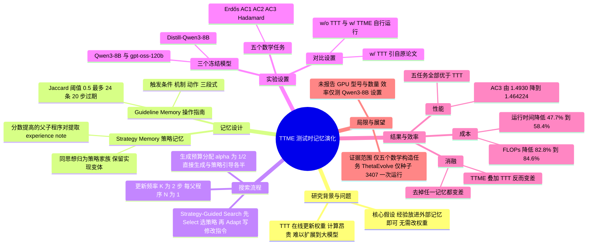

## 一、论文是干什么的？

想象你在备考一门很难的竞赛。有两种复习办法：第一种是每做完一批题，就把自己的大脑「重新训练」一遍，把经验刻进神经元里；第二种是准备一本笔记本，每做完几道题就把「踩过的坑」和「有效的招数」整理进去，下次做题先翻笔记。前者效果可能很好，但每次都要花大量时间和算力；后者轻便得多。这篇论文问的就是：在让大模型做「科学发现」（比如寻找更好的数学构造）时，第二种办法能不能打败第一种？

论文所说的第一种办法叫**测试时训练**（test-time training，TTT）。已有的 TTT-Discover 和 ThetaEvolve 等框架，会让大模型反复生成候选程序，评测打分，再把这些带分数的尝试当作强化学习（RL）的训练数据，在搜索过程中持续更新模型权重。论文原文承认这很强，但「通常计算昂贵且耗时」。作者因此提出 **TTME**（Test-Time Memory Evolution，测试时记忆演化）：**不改模型权重**，而是不断把搜索经验提炼进外部记忆，再把相关内容放进提示词里指导后续搜索。为了公平，他们让 TTME 和 TTT 使用**同一个发现框架**，只替换「测试时适应」这一个部件。论文的核心结论是：在评测过的五个数学任务上，TTME 的最佳分数都优于论文引用的 TTT 结果，同时在 TTT-Discover 加 Qwen3-8B 的设置下，FLOPs 减少 82.8% 到 84.6%，运行时间（不含评测）减少 47.7% 到 58.4%。

代码已在 [GitHub](https://github.com/yepengliu/TTME) 开源。以下带「论文原文」字样的内容来自 [arXiv 全文](https://arxiv.org/html/2610.32046)，带「我的解读」字样的是本综述的判断。

## 二、核心方法与创新

**1. 问题设定。** 论文关注「有可执行程序、有验证器」的任务：候选程序 $x$ 运行后产生一个构造，验证器给出是否有效 $v(x)\in\{0,1\}$ 和分数 $s(x)$（统一成越大越好）。目标是在搜索预算内找到最高分的有效候选：

$$
s^{\star}=\max_{x\in\mathcal{X}_{\mathrm{eval}},\,v(x)=1}s(x)
$$

两种适应方式的对比（论文式 2）：权重适应是 $\theta_{t+1}\leftarrow U_{\mathrm{RL}}(\theta_t,\mathcal{D}_t)$，即用 RL 更新模型参数；记忆适应是 $\mathcal{M}_{t+1}\leftarrow U_{\mathrm{mem}}(\mathcal{M}_t,\mathcal{D}_t)$，同时 $\theta_t=\theta_0$，模型权重不变。这里 $\mathcal{D}_t$ 是已评测的搜索记录，$t$ 是搜索步数。

**2. 两本笔记：Guideline Memory 与 Strategy Memory。** 记忆 $\mathcal{M}_t=(\mathcal{L}_t,\mathcal{S}_t)$ 由两部分组成，类比为「避坑手册」和「招数手册」。

- **Guideline Memory（操作指南记忆）**：像一本避坑手册，记录实现候选程序时的实用教训。每隔 $K$ 步，系统把近期结果（有效结果、分数、失败信息）汇总成摘要，再让**同一个冻结的基础模型**提出「触发条件 -> 机制 -> 具体动作」形式的指南。随后做合并：新指南与旧指南用词集合的 Jaccard 相似度比较，相似度至少 0.5 算匹配，匹配则累计出现次数并刷新最近确认步；不匹配则新增。超过 20 步没被再次确认的指南会过期，最多保留 24 条，按出现次数排序、次数相同看新近程度。每次更新最多提出 3 条，其中至多 1 条是「避免失败」类。提示词里每条指南最多显示 240 个字符。
- **Strategy Memory（策略记忆）**：像一本招数手册。系统挑出「子程序有效且分数比父程序更高」的案例，让模型对比父子程序的代码差异和评测结果，写出「这次改动背后的算法思想」备忘（experience note）。再把共享同一思想的备忘归入同一个「策略家族」，为每个家族维护一个持续更新的条目，条目里写明思想、适用条件和各种实现变体。

**3. 策略引导的搜索（Strategy-Guided Search）。** 论文算法 1 的流程是：沿用底层框架的父节点选择与存档更新规则，对每个父程序，由选择器（基础模型）从策略记忆中选至多 $N$ 个最可能改进该父程序的策略，并优先选尚未分配给前面父程序的策略；再由适配器（基础模型）读取策略条目和父程序完整代码，写出针对这个父程序的修改指令；没选中策略时，则用父程序和策略记忆提出一个新想法。生成阶段分两路：**直接生成**占预算比例 $\alpha$（实验取 $\alpha=1/2$），只带父程序上下文和指南；**策略引导生成**占 $1-\alpha$，额外带修改指令。两路都会看到 Guideline Memory。每 $K$ 步（论文取 $K=2$）更新两本记忆，实验里 $N=1$。

**4. 公平比较的设计。** 论文原文写明：保留各框架的父节点选择规则、存档更新规则和验证器。三种设置为：w/o TTT（权重固定、无记忆）、w/ TTT（权重经 RL 更新）、w/ TTME（权重固定、有记忆）。**注意**：w/ TTT 的分数来自两个原论文的报告，而不是作者重新运行得到的；w/o TTT 与 w/ TTME 才是作者自己跑的。这一点对理解结果很重要。

**5. 五个任务。** 全部是数学构造题（论文附录 A）：

- Erdős 最小重叠问题（越小越好）：找密度函数 $h$ 使最大重叠尽量小，用 801 个等宽区间的阶梯函数表示最优结果。
- AC1 第一自相关不等式（越小越好）：最小化 $\|f\ast f\|_\infty/\|f\|_1^2$，其中 $f$ 是非负阶梯函数。
- AC2 第二自相关不等式（越大越好）：最大化 $\|f\ast f\|_2^2/(\|f\ast f\|_1\|f\ast f\|_\infty)$。
- AC3 第三自相关不等式（越小越好）：允许函数取正负值，最小化 $\|f\ast f\|_\infty$ 与 $\left(\int f\right)^2$ 的比值。
- Hadamard 最大行列式（越大越好）：在元素为 $\{-1,+1\}$ 的 $29\times29$ 矩阵中最大化归一化的行列式绝对值。

## 三、使用了哪些模型和计算资源？

**用了哪些 LLM（论文原文第 4.1 节、附录 B）：**

- **搜索与候选生成的模型（同时也是记忆操作模型）**：论文原文说「同一个基础模型既负责候选生成，也负责所有与记忆相关的操作」，共三个：
  - Qwen3-8B（TTT-Discover 框架）；
  - gpt-oss-120b（TTT-Discover 框架）；
  - DeepSeek-R1-0528-Qwen3-8B，简称 Distill-Qwen3-8B（ThetaEvolve 框架）。
- **训练对象**：TTME 本身**不训练任何模型**，权重全程固定。对比对象 TTT 版本由原论文训练，论文附录 B 的表 8 写明原版 TTT-Discover 的 LoRA 秩为 32，且通过 Tinker 服务模型；本文的 w/o TTT 与 w/ TTME 用 vLLM 服务。
- **裁判或评测模型**：没有 LLM 裁判。打分靠程序化验证器（例如 Hadamard 的行列式用精确整数运算计算）。
- **辅助模型**：没有单独的辅助模型。记忆的提炼、整合、策略选择与适配都由上面同一个基础模型完成。附录 D 还提到，示例输出是用 gpt-oss-120b 对历史 AC1 与 AC2 输入重新生成的，仅用于展示提示词。
- **是否用商用 API**：论文没有写使用商用 LLM API 做实验。TTT-Discover 原版的服务方式是 Tinker，属于原论文的设置。

**搜索与评测设置（论文表 7、表 8、表 10）：**

| 项目 | TTT-Discover（Qwen3-8B 与 gpt-oss-120b） | ThetaEvolve（Distill-Qwen3-8B） |
|---|---|---|
| 搜索步数 | 50 | 65 |
| 每步父程序数乘每父候选数 | 8 乘 64 等于 512 | 32 乘 16 等于 512 |
| 每次运行的基础候选数 | 25,600 | 33,280 |
| TTME 两路候选分配 | 直接生成 32，策略引导 32 | 直接生成 8，策略引导 8 |
| 记忆更新间隔 $K$ | 2 步 | 2 步 |
| 程序运行与评测超时 | 1,000 秒与 1,100 秒 | AC2 与 Hadamard 为 300 秒与 350 秒；AC3 为 60 秒与 70 秒 |
| 随机种子 | 论文未在表 8 单独列出 | 原版 ThetaEvolve（论文表 7 所列的 65 步纯推理配置）为 42、1234、3407，本文 w/o TTT 与 w/ TTME 只用 3407 |

此外，TTT-Discover 设置使用 32,768 token 上下文，温度 1.0，top-p 1.0；gpt-oss-120b 的提示词与思考部分上限 26,000 token。记忆维护、策略选择与适配所需的额外调用，是在上面的基础候选数之外另算的。

**GPU 型号与数量：** 论文未报告。

**耗时与成本（论文表 3，仅 TTT-Discover 加 Qwen3-8B，运行时间不含评测，包含候选生成、记忆相关 LLM 调用以及适用时的 RL 训练）：**

| 任务 | TTT 运行时间 | TTME 运行时间 | 减少 | TTT 算力（EFLOPs） | TTME 算力（EFLOPs） | 减少 |
|---|---|---|---|---|---|---|
| AC1 | 11.76 小时 | 5.36 小时 | 54.5% | 29.47 | 4.53 | 84.6% |
| AC2 | 12.73 小时 | 6.66 小时 | 47.7% | 33.09 | 5.69 | 82.8% |
| Erdős | 11.67 小时 | 4.85 小时 | 58.4% | 26.21 | 4.15 | 84.2% |

按原文数字推算：算力上 TTT 约为 TTME 的 5.8 到 6.5 倍（例如 AC1 为 29.47 除以 4.53，约 6.5 倍），运行时间上约为 1.9 到 2.4 倍（AC1 为 11.76 除以 5.36，约 2.2 倍；AC2 约 1.9 倍；Erdős 约 2.4 倍）。表中「运行时间」没有说明用了几块 GPU，所以这里的小时数是墙钟时间还是 GPU 小时，论文未说明。

**论文未报告的内容：** GPU 型号与数量；gpt-oss-120b 和 Distill-Qwen3-8B 设置下的运行时间与 FLOPs；单次完整运行的 GPU 小时数；API 花费（未使用商用 API 的说明也没有）；FLOPs 的具体计量方法；ThetaEvolve 框架下的效率对比。

## 四、实验结果

**主结果一：TTT-Discover 框架（论文表 1，50 步）。** 箭头表示方向，Erdős 与 AC1 越小越好，AC2 越大越好。

| 方法 | 模型 | Erdős（越小越好） | AC1（越小越好） | AC2（越大越好） |
|---|---|---|---|---|
| w/ TTT（引自原论文） | Qwen3-8B | 0.380932 | 1.50525 | 0.9472 |
| w/o TTT | Qwen3-8B | 0.380957 | 1.505242 | 0.944771 |
| **w/ TTME** | Qwen3-8B | 0.380927 | 1.504329 | 0.949248 |
| w/ TTT（引自原论文） | gpt-oss-120b | 0.380876 | 1.50287 | 0.9591 |
| w/o TTT | gpt-oss-120b | 0.380945 | 1.505966 | 0.953682 |
| **w/ TTME** | gpt-oss-120b | 0.380862 | 1.502745 | 0.960784 |

**主结果二：ThetaEvolve 框架（论文表 2，65 步，Distill-Qwen3-8B）。**

| 方法 | AC2（越大越好） | AC3（越小越好） | Hadamard（越大越好） |
|---|---|---|---|
| w/ TTT（引自原论文） | 0.9469 | 1.4930 | 0.5764 |
| w/o TTT | 0.947375 | 1.519277 | 0.571085 |
| **w/ TTME** | 0.948148 | 1.464224 | 0.579938 |

用大白话说：在每一个格子里，TTME 都比对应的 TTT 数字更好。比如 AC3 从 1.4930 降到 1.464224，Hadamard 从 0.5764 升到 0.579938。**我的解读**：多数差距在小数点后第三到第六位，例如 Erdős 在 Qwen3-8B 上是 0.380932 对 0.380927，所以「更好」是真实的数值排序，但提升幅度在 Erdős 和 AC1 上很小，到底多有意义取决于这些数学常数问题里小数位的价值，论文没有给出多种子方差或置信区间。

**搜索过程（图 3）：** 论文原文说，在 TTT-Discover 框架下，TTME 在 25 步内就超过了 TTT 的最终分数（三个任务、两个模型）；在 ThetaEvolve 框架下，TTME 在三个任务上超过了 TTT 的分数。

**消融一：TTME 与 TTT 能否叠加（表 4，TTT-Discover，Qwen3-8B）。**

| TTT | TTME | AC2（越大越好） | Erdős（越小越好） |
|---|---|---|---|
| 无 | 无 | 0.944771 | 0.380957 |
| 有 | 无 | 0.9472 | 0.380932 |
| 无 | 有 | 0.949248 | 0.380927 |
| 有 | 有 | 0.944141 | 0.380944 |

论文原文的结论：单用 TTME 最好，叠加 TTT 反而变差，这支持把 TTME 当作 TTT 的替代方案，而不是需要二者都用。

**消融二：两本记忆各自的贡献（表 5，gpt-oss-120b）。**

| 配置 | AC1（越小越好） | AC2（越大越好） | Erdős（越小越好） |
|---|---|---|---|
| 完整 TTME | 1.502745 | 0.960784 | 0.380862 |
| 去掉 Guideline Memory | 1.505644 | 0.958506 | 0.380865 |
| 去掉 Strategy Memory | 1.505981 | 0.956493 | 0.380864 |
| 去掉全部记忆（w/o TTME） | 1.505966 | 0.953682 | 0.380946 |

去掉任一本记忆都会变差，两本合用最好。

**搜索行为分析（第 4.4 节）：** 论文原文说，TTT 和 TTME 都比不用二者的搜索提高了程序有效率（能编译并获得评测分数的比例），且在 AC1 与 Erdős 上两者有效率相近，但 TTME 的最佳分数更好，作者据此推测 TTME 产生了更有效的想法。在「想法组合」上，论文把「保留父程序的一个想法，再加上来自其祖先之外的、父程序中没有的想法」的候选记为组合，并统计它们被选为后续父节点的占比：AC1 上 TTME 为 10.2%，TTT 为 8.2%；AC2 上 TTME 为 24.7%，TTT 为 18.6%。如果只算比父程序提高超过 $10^{-5}$ 的组合，AC1 为 5.4% 对 4.8%，AC2 为 17.1% 对 13.3%。

**发现的构造（附录 E）：** 例如 gpt-oss-120b 产生了 65,536 个区间的 AC2 构造（目标值 0.960784），Distill-Qwen3-8B 产生了 100 个区间的 AC3 构造（1.464224300），gpt-oss-120b 产生了 801 个区间的 Erdős 构造（最大重叠 0.380861541），Distill-Qwen3-8B 加记忆产生了 $29\times29$ 的符号矩阵（0.579938205）。

**我的解读（局限与需要谨慎的地方）：**

- TTT 的数字是从原论文引用的，不是在同一台机器、同一随机种子下重新跑的。论文附录表 8 显示，原版 TTT-Discover 用 Tinker 服务，w/o TTT 与 w/ TTME 用 vLLM，因此 TTT 与 TTME 并非逐项严格同条件对照。论文自己的「干净比较」指的是同一框架、同一搜索预算和验证器。
- ThetaEvolve 下，w/o TTT 与 w/ TTME 只跑了种子 3407，一个种子；表 7 中原版纯推理配置列出三个种子。论文没有给出多次运行的方差。
- 效率对比只覆盖 TTT-Discover 加 Qwen3-8B 一种设置，没有 gpt-oss-120b 和 ThetaEvolve 的数据。
- 评测只有五个数学构造任务，结论是否推广到真实科学发现（实验、生物、物理）论文没有验证；论文自己的措辞也限定在「所评测的发现场景」。

## 五、潜在应用与已落地应用

**论文明确提到的方向（原文）：** 论文把 TTME 定位为一个「即插即用」的方法，可以接到现有的 TTT 类发现框架上。论文结论只声称它在所研究的数学发现任务上有效且高效。引言还提到，TTT 难以扩展到更大模型，因此省算力对更大模型、更复杂任务有潜在价值，但这属于论文的动机，并未用更大模型实测。

**我的判断（非论文原文）：** 任何「有自动验证器、可以反复试错」的任务，都可能受益于这种思路，比如算法设计、GPU kernel 优化、组合构造、代码优化。由于它不需要训练，调用闭源或不方便微调的模型时也能用，门槛比 RL 低。但这些场景论文都没有实验。

**已落地应用：** 截至 2026-10-30，我没有查到产品化的落地。能确认的是：作者在 [GitHub](https://github.com/yepengliu/TTME) 发布了代码，采用 MIT 许可证（仓库另含 Apache-2.0 条款的第三方部分，来自 ThetaEvolve 等的评测材料），截至 2026-10-30 约有 4 个星标。仓库 README 称提供了 AC1、AC2 与 Erdős 上的 TTT-Discover 搜索实现，以及论文报告的九个构造结果（附验证脚本与哈希清单），但 ThetaEvolve 的搜索运行脚本没有包含在这次发布中，只提供存好的构造与评分代码；搜索与评测的 worker 需要 Linux。HF 论文页没有关联的模型、数据集或 Space，也没有单独的项目主页。

## 六、网络上的讨论与评价

- [Hugging Face 论文页](https://huggingface.co/papers/2610.32046)：HF API 显示票数为 131，由第一作者 Yepeng Liu 于 2026-10-28 提交到每日论文。页面共 3 条评论：作者的一条已被隐藏的评论，作者于 10-28 发布的摘要原文，以及 Librarian Bot 于 10-29 发的自动相似论文推荐。没有找到独立评测或质疑。
- [GitHub 仓库的 Issue](https://github.com/yepengliu/TTME/issues/1)：目前有 1 个 Issue，标题为邀请 TTME 加入 AI Auto-Research 综述合集的审阅邀请（2026-10-26 创建，状态为开放），不是对方法的评测。
- [alphaXiv 页面](https://www.alphaxiv.org/abs/2610.32046)与 [Papers with Code 镜像页](https://paperswithcode.co/paper/2610.32046)：收录了摘要和作者信息，后者有一句 TL;DR，复述论文的主要结论，均不是独立评测。
- 相关背景：论文所比较的 TTT 方法之一见 [TTT-Discover 的 arXiv 页面](https://arxiv.org/abs/2601.16175)（Learning to Discover at Test Time），另一个是 ThetaEvolve。
- 查过但没有找到的：截至 2026-10-30，我用英文标题、中文关键词和 arXiv ID 做了网页搜索，并用 Algolia 检索了 Hacker News（搜索 2610.32046 与 Test-Time Memory Evolution 均为 0 条命中），没有检索到 Reddit、X/Twitter、知乎、微信公众号或博客上的独立讨论或评测。这不代表这些平台上一定没有，只是我在检索范围内没有发现。

## 七、思维导图

