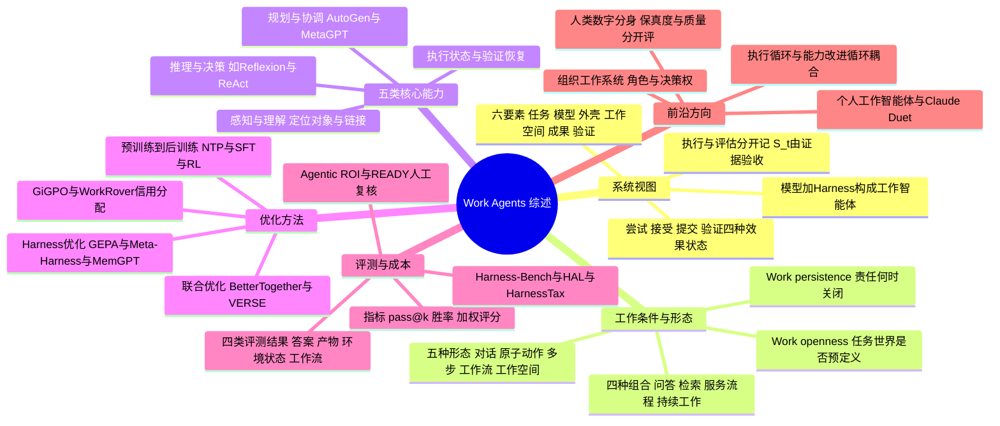

## 一、论文是干什么的？

想象你把一件事交给一位新来的助理：「把上季度的销售报告更新一下，数据在那几个表格里，更新完发给经理批准。」一个好助理不会只回你一段漂亮的话，而是要找到表格、改对数字、同步图表和幻灯片、检查有没有错，最后交出一份别人能验收的成果。这篇论文关心的就是：当 AI 从「生成回答」走向「替人完成数字工作」时，我们应该怎样理解、训练和评价这样的智能体。

这是一篇**综述加框架**论文（作者自称提出「以工作为中心、系统层面的视角」），不是提出一个新模型或新算法的实验论文。它的核心主张是：**工作智能体**（work agent）不是单独的一个模型，而是「基础模型（做决策的大脑）加运行外壳 harness（管上下文、工具、记忆、技能、执行控制和错误恢复的那一层）」组成的系统，在一个有状态的数字工作空间（文件、应用、记录、消息、其他参与者）里干活，并且成果要能用可观察的证据来验证。可以类比成：模型是一位聪明的员工，外壳是他的办公桌、工具箱、笔记本和上班流程，工作空间是整间办公室。以下内容均依据 [arXiv 全文](https://arxiv.org/abs/2610.35845)，其中「我的解读」会明确标注。

## 二、核心方法与创新

因为是综述，这里的「方法」指的是论文提出的一整套分析框架，大致分为五块。

**1. 六要素系统视图。** 论文用六个要素描述一次委托工作：任务 $T$、模型 $M$、外壳 $H$、工作空间 $E$、工作成果 $O$ 和验证 $V$。其中模型加外壳构成工作智能体本身，任务、工作空间、成果和验证界定了它要对什么负责。论文还写出两个式子：执行过程 $(T, E_0) \xrightarrow{M,H} (\tau_{0:t}, E_t, O_t)$，以及在评估时刻 $t$ 的评估 $S_t = V(T, E_0, \tau_{0:t}, E_t, O_t)$。其中 $E_0$ 是初始工作空间，$\tau_{0:t}$ 是到 $t$ 时刻为止的动作与反馈序列，$E_t$ 是此刻的工作空间状态，$O_t$ 是到此刻为止的成果。大白话：执行是「干活」，评估是「拿证据对照要求验收」，两件事分开记。论文举的最小例子是：只要问答被委托出去并且答案要被检查，连问答系统也算一个最简单的工作智能体。

**2. 两个工作条件维度。** 论文提出两个相互独立的维度：
- **工作持久性**（work persistence）：责任在什么时候算完成。一端是「交付即结束」（比如返回答案、提交补丁），另一端是「责任跨阶段、跨事件一直开着」（比如要等用户确认、要应对后来到达的数据修订，或者对一段约定时间负责）。
- **工作开放性**（work openness）：任务相关的对象、接口、规则和参与者，是在请求里就说清楚了，还是要在执行中自己发现。

类比：持久性问的是「这活什么时候才算交差」，开放性问的是「我得先自己找出多少东西才能开工」。两个维度组合出四种情形：问答（预定义世界、交付即结束）、信息检索（执行中发现、交付即结束）、服务工作流（预定义世界、责任仍开着，如 τ-bench）、变化条件下的持续工作（执行中发现且责任开着，如 OSWorld 2.0、VibeLifeBench）。论文特别强调，持久性不等于任务难度，也不等于执行时间长短。

**3. 五种工作形态（按任务范围和组织方式划分）。** 论文第三章依次是：对话层（产出信息成果）、原子动作层（对一个局部对象做修改并检查）、多步层（有依赖的一串动作完成一个目标）、工作流层（经过若干阶段、与其他参与者交接）、工作空间层（请求只给目标，智能体要自己找出相关文件和依赖并保持一致）。论文的概括是：工作的复杂度随着智能体必须管理的依赖网络而增长。

**4. 五类核心能力。** 感知与理解、推理与决策、规划与协调、执行与状态管理、验证恢复与重规划。论文把它们画成一个循环而不是流水线，围绕一个共享的工作上下文读写信息。一个值得初学者记住的细节是：执行与状态管理里区分了四种状态——「尝试过的动作」（已发出）、「被接受的调用」（接口确认收到）、「已提交的效果」（目标状态里确实改了）、「已验证的效果」（还对照要求检查过）。比如发邮件，调用成功不等于任务成功，重试还可能造成重复发送。论文还用一张表说明，持久性和开放性怎样分别抬高这五项能力的要求（持久性要求重新感知、跨会话保存状态、重新验证；开放性要求在执行中发现对象、权限和证据来源）。

**5. 优化与评测。** 优化分三条线：
- 模型优化：预训练（如下一词预测）、中期训练（领域知识、交互模式、长上下文）、后训练（示范学习 SFT、执行奖励的强化学习与信用分配、教师指导的在线蒸馏、反馈条件与回顾式学习）。
- 外壳优化：观察与动作接口、工作流与执行控制、长上下文与记忆与技能。
- 联合优化：模型与外壳耦合（如 BetterTogether、Co-Harness、SkillRL 这类让权重与外部程序或技能交替更新的做法），以及自我改进和递归自我改进。论文还主动提出了比较方案：在一致任务条件下比较 $(M_0, H_0)$、$(M_1, H_0)$、$(M_0, H_1)$、$(M_1, H_1)$ 四种配置。

评测则从「检查什么结果、按哪些维度、用什么方法、报告什么指标」拆解，并梳理了开源外壳与执行环境，以及性能、成本与经济价值（性能与成本的帕累托前沿、专业工作的价值、智能体投资回报 agentic ROI）。第六章讨论未来应用与前沿方向：个人工作智能体、人类数字分身、组织工作系统，以及「工作执行」与「能力改进」两个相互作用的循环。

## 三、使用了哪些模型和计算资源？

本文为综述，无自己的训练或计算资源，论文没有训练模型、没有跑自己的评测实验，也没有报告撰写综述本身所用的 GPU 或 API 开销。下面改为说明它综述了哪些模型和外壳（以下名称与数字都是论文转述的他人工作，不是本文作者的实验）。

- **本文训练对象：** 无（论文未报告任何训练）。
- **本文评测对象：** 无（论文未报告自己的评测实验）。
- **本文使用的裁判或辅助模型：** 论文未报告。论文在评测部分讨论了他人工作里由程序、人类或模型担任裁判的做法，例如 SWE-bench 用测试、PresentBench 用模型裁判按清单打分。
- **GPU 型号与数量：** 论文未报告（全文只有一处出现 GPU 字样，与硬件配置无关）。
- **API 花费、单次耗时：** 论文未报告。
- **论文综述并转述数字的模型（原文说法，均为他人工作）：**
  - 预训练与中期训练：DeepSeek-V4（网页加数学、编程、长技术文档）、Kimi K2（改写知识型段落）、Kimi K2.5（文本加视觉联合训练，上下文从 32K 扩到 256K）、GLM-5、Step 3.5 Flash（先 32K 再扩到 128K）、Nemotron（500B token 混合数据、256K 上下文）、论文原文写作 Qwen3.8-Flash-Next 的模型（256K 上下文的稀疏注意力）。
  - 后训练：Mercor 与 SkyRL 的知识工作配方训练出一个论文称为 397B 的模型。
  - 论文提到的前沿智能体外壳与系统：Codex、Claude Code、OpenHands、SWE-agent、Magentic-One、AutoGen、MetaGPT 等。论文还写到 Claude Duet 是 2026 年 10 月作为实验性版本发布的个人服务示例。
- **配套资源：** 作者的 [awesome-working-agent](https://github.com/EnjunDu/awesome-working-agent) 阅读清单。截至 2026-10-30，它的 README 分四类列出：智能体、方法与系统 279 条，基准与评测 190 条，综述与基础 92 条，资源 59 条（资源类不计入论文数量）。该仓库约 69 个星，未见许可证文件。

## 四、实验结果

论文本身没有做新的实验，所以没有「它自己的」主结果表。它做的是把别人的结果放进自己的框架里解读。下面挑论文中明确给出的数字，请注意它们都来自被综述的工作，且多数设置并不相同，不能互相横向比较。

| 方向 | 论文转述的结果（出处为被综述工作） | 我的解读 |
|---|---|---|
| 中期训练加入智能体数据 | Nemotron 在 SFT 固定时，SWE-bench Verified Pass@1 从 60.7% 升到 64.5% | 先熟悉交互再做后训练有帮助 |
| 训练目标设计 | Nemotron 的 100B token 消融中，对工具回复屏蔽损失但保留为上下文，Pass@1 从 27.5% 升到 37.8% | 工具回复是证据，不必让模型去生成 |
| 数据改写 | Kimi K2 早期检查点：十种改写各用一次得 28.94% SimpleQA，十次重复原文为 23.76% | 同一知识的多种说法比重复更好 |
| 长上下文任务 | TrajLong 在固定 40B token 预算下，在七个消融基准上都优于原始轨迹训练 | 把轨迹改造成检索与状态重建任务更有效 |
| 强化学习 | Mercor 与 SkyRL 配方用 1,928 个专家任务，397B 模型在留出的 APEX-Agents 上 Pass@1 从 16.11% 升到 27.29% | 环境修复与精确记录对奖励可靠性很关键 |
| 环境修复 | WorkRover：跨任务退化 0.7% 对 7.0%，归一化模型 token 成本 1.00 对 0.59（对比全部应用修复的做法） | 选择性修复的退化更少（更稳），但归一化模型 token 成本更高（1.00 对 0.59），不是更省 |
| 递归自我改进 | VERSE 受控研究测试准确率：基线 39.20，仅验证 39.81，仅自我进化 31.79，两者都用 41.05，每种条件只跑了一次 | 没有可执行检查的自我进化可能变差，但样本很少 |

在评测与经济价值部分，论文给出的是结论性判断而非新数字：同一模型换不同外壳，调用成本可能差别很大而成功率接近（HarnessTax 的发现）；能力相当的智能体可能需要不同量的人工复核（READY 的发现）；人工研究也有喜忧参半的证据，例如经验丰富的开发者使用所测试的 AI 工具后完成时间变长，而一项产品创新实验里有 AI 辅助的个人与无 AI 的人类团队表现相当。论文还强调基准分数必须连同任务、外壳、工具配置和资源预算一起解读，不同基准的成功率、pass@k 等指标单位和严格程度不同，不能直接比较。

## 五、潜在应用与已落地应用

**论文明确提到的方向（原文）：** 个人工作智能体（在两次请求之间继续推进用户的目标，必要时判断是执行、询问还是等待）；人类数字分身（代表某位专业人士的判断，论文要求把「决策一致度」与「成果质量」分开评估）；组织工作系统（协调角色、决策权和相互依赖的贡献，完成共同交付）。论文也列出了研究议程表，覆盖环境、持久性、验证、两个循环的耦合等问题。

**论文提到的已有系统（原文）：** Codex 与 Claude Code 被作为支持多日、跨会话工作的前沿智能体例子；论文写到 Claude Duet 于 2026 年 10 月作为实验版发布，可检查已连接的应用、准备简报、在用户不在时继续被委托的任务，并在完成或需要决策时通知用户。论文引用的 SWE-bench、OSWorld、τ-bench、GDPval 等是评测基准，不是落地产品。

**我的解读（非论文原文）：** 这套框架对工程团队最实用的用处，是当作「诊断清单」：智能体出错时，先看是证据没找到（感知）、决策错了、依赖断了、执行没生效，还是验收标准没写清，再决定改模型、改外壳还是改环境。论文的表 8 就是这个思路。不过它本身没有证明这套框架能提升某个具体系统的效果。

**已落地应用：** 作为综述，论文本身不是一个产品。作者提供了 [项目主页](https://enjundu.com/blog/working_agents) 和 awesome-working-agent 阅读清单，用来跟踪相关研究，没有发布模型或数据集（HF API 显示关联模型、数据集、Space 均为 0）。

## 六、网络上的讨论与评价

- [Hugging Face 论文页](https://huggingface.co/papers/2610.35845)：票数 119（用 HF API 核对），由 Junhao Shen 提交到每日论文（论文作者之一）。页面有 2 条评论：提交者 2026-10-27 发的帖子，内容是摘要原文；Librarian Bot 于 10-28 发的自动相似论文推荐。没有看到独立的实质评论。
- [alphaXiv 页面](https://www.alphaxiv.org/abs/2610.35845)：页面有一个标明为 AI Overview 的机器生成概述，Discussion 区没有评论，不是人类评议。这个概述自己写道：论文没有报告能说明其维度比只看长时程的分类法更能解释结果的比较，它是综述和框架，不是在受控实验里测试过的新智能体。这些是 AI 概述的说法，我没有逐条对照论文核实。
- [hyper.ai 论文页](https://hyper.ai/en/papers/2610.35845)、[papers.cool 页面](https://papers.cool/arxiv/2610.35845)、[paperswithcode.co 页面](https://paperswithcode.co/paper/2610.35845)：均为收录或镜像页，主要是摘要，未看到独立评论（hyper.ai 页面的正文我没有抓到有效文字）。
- [Hamidun News 报道](https://news.hamidun.com/en/news/14696/work-agents-16-researchers-build-a-unified-coordinate-system)（2026-10-27）：自称由 AI 处理 HF 每日论文并经编辑整理，复述了论文的两个维度、五种形态和五类能力，写的 HF 票数是 15（当时的数字，与现在 API 的 119 不同）。这是二手摘要，不是独立评测。
- [CCTest 的文章](https://cctest.ai/en/articles/from-answering-to-delivering-a-systems-view-of-work-agents)（2026-10-27）：页面标注为 AI 摘要，同样是对论文要点的转述，其中对持久性的描述偏向「长时间执行」，与论文原文强调的「责任何时关闭、并非时长」不完全一致，读者应以原文为准。
- [作者阅读清单仓库](https://github.com/EnjunDu/awesome-working-agent)：作者自己的配套资源，不是外部评价。
- 查过但没有相关结果：截至 2026-10-30，Hacker News 的 Algolia 搜索（按 arXiv 编号和标题）未检索到相关帖子；Reddit 搜索接口返回 Blocked 页面，我没有再用 Playwright 重试，所以 Reddit、X/Twitter、知乎、微信公众号上是否有讨论，我没有核实，本节不下结论。
- 局限（我的解读，非论文自述）：论文是概念框架加文献综述，框架的分类（如五种形态、五类能力）有一定作者主观划分成分；不少被引用的数字来自单次实验，论文自己也指出 VERSE 每种条件只跑了一次；论文承认基准分数在不同外壳与协议下难以比较，但没有给出统一的复现对照。

## 七、思维导图

