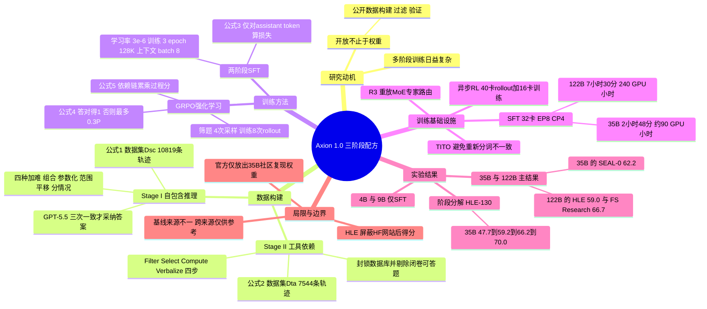

## 一、论文是干什么的？

想象你要培养一位能自己查资料、写代码算数、再给出答案的研究助理。很多团队的做法是：先让他读大量专业书（中期训练），再上好几种辅导班（多种监督数据、偏好优化、蒸馏），最后才上岗实习（强化学习）。流程越堆越长，外人很难知道到底哪一步真有用，更难复现。这篇论文问了一个朴素的问题：**要得到一个能力不错的智能体基础模型，这些复杂步骤到底有多少是必需的？**

作者（Duke University、ByteDance 等）给出的答案是 Axion 1.0：只用三步，即两轮轻量的监督微调（SFT）再加一轮强化学习（RL），不做专门的中期训练、DPO（直接偏好优化）和 OPD（在线策略蒸馏）。他们把力气花在**造好题**上：第一阶段造「靠自己推理就能做」的难题，第二阶段造「必须上网搜索、读网页、写代码才能做」的可自动验证的题。论文还公开了数据构建、过滤、验证、提示词和训练代码。以下内容依据 [arXiv 论文](https://arxiv.org/abs/2611.03233)，其中「我的解读」会明确标注。

## 二、核心方法与创新

整体流程可以类比成培养学生：先练「独立解难题」，再练「会查资料并核对」，最后放到真实环境里「边做边改」。

**1. 第一阶段数据：模型感知的难题强化（自包含推理）。** 作者从公开课程材料、竞赛和推理数据集收集数学、物理、化学、生物、计算机的题目，只把它们当作「种子」。先让一个生成用的大模型做「组合」：取出种子解答中得到的某个中间量，写成一道必须用到它的新题。然后让基础模型去做这道题（允许 Python，禁止搜索）：

- 基础模型做错的题，直接进入候选题库。
- 基础模型做对的题，把它成功的解法交给生成模型，再随机施加四种加难操作之一：A 组合（再加一个依赖当前答案的推理步骤）、B 参数化（把固定数值换成符号参数，要求给出通式）、C 范围平移（扩大或移动参数范围，使枚举或原来的捷径失效）、D 分情况（引入条件，使答案在不同情形下不同）。

类比：老师发现学生用某个套路做对了题，就专门改题让这个套路失灵，逼他学更深的东西。每次改题后，答案都要重新核验：GPT-5.5 独立解三遍，三次一致且推导通过检查才采纳参考答案，否则丢弃。最后由另一个大模型做题（可用 Python、不能检索），只保留答案正确、格式完整的轨迹，得到数据集 $\mathcal{D}_{\mathrm{sc}}=\{(x_i,\tau_i,\varnothing,y_i)\}$（论文公式 1），其中 $x_i$ 是题目，$\tau_i$ 是解题轨迹，$y_i$ 是参考答案。

**2. 第二阶段数据：确定性程序造题（工具依赖推理）。** 作者用 NASA Exoplanet Archive、OurAirports、OpenAlex、UniProt、Ensembl 等结构化公开数据源（论文提到生物、化学、数学、地理、航空等领域；具体数据库名见 [官方仓库 README](https://github.com/bytedance/axion1_0)），用程序而不是大模型来出题并算出标准答案，分四步：筛选（Filter）、选出唯一实体（Select）、计算衍生量（Compute）、改写成自然语言问题（Verbalize，这一步才用大模型）。论文举的例子：筛出有环的行星，选质量最小的（天王星），再算平均密度 $\rho=M/(4\pi R^{3}/3)$，约 $1.27\,\mathrm{g/cm^{3}}$。

为了让这些题真的「需要工具」，作者做了三道把关：做题时封锁构造题目用的数据库表；允许通用搜索、网页访问和 Python；先让模型不带检索工具做一遍，能闭卷答对的题直接剔除。得到数据集 $\mathcal{D}_{\mathrm{ta}}=\{(x_i,\tau_i,z_i,y_i)\}$（公式 2），多出来的 $z_i$ 是构造程序记录下的中间验证目标（做题时不透露）。

**3. 两阶段 SFT。** 先在 $\mathcal{D}_{\mathrm{sc}}$ 上训练，再从该检查点接着在 $\mathcal{D}_{\mathrm{ta}}$ 上训练。损失只算助手生成的 token（推理、工具调用和最终答案），用户消息和工具返回内容只作上下文，不计入损失（公式 3）。

**4. 强化学习：GRPO 加过程奖励。** 从第二阶段检查点出发，用 GRPO（组相对策略优化）配合 verl 框架，模型在搜索、网页访问、学术检索和 Python 工具环境中自己生成轨迹。奖励设计（公式 4）是：

$$
R(\tau;y,z)=\begin{cases}1, & F=1,\\ \max\!\left(0,\,0.3P-0.1(1-A)\right), & F=0.\end{cases}
$$

其中 $F\in\{0,1\}$ 表示最终答案是否正确，$A\in\{0,1\}$ 表示是否提交了有效最终答案，$P\in[0,1]$ 表示已验证的中间进展。答对拿满分；答错时，做对了一部分中间步骤可以拿最多 0.3 的部分分，不提交答案要扣 0.1。公式 5 定义 $P=\frac{1}{m}\sum_{j=1}^{m}\prod_{\ell=1}^{j}b_\ell$，即依赖链上后面的步骤只有在前面所有步骤都验证通过时才算分。比如三步里第一步和第三步对、第二步错，$P=1/3$。类比：做应用题，前面步骤错了，后面碰巧对的步骤不给分。

RL 选题时，每题先采样 4 条轨迹，只保留「至少一条答对、且四个奖励不全相同」的题，这样既说明有解法可学，又有组内差异可供学习。正式训练时每题 8 条 rollout。

**5. 训练基础设施上的两个小技巧。** 其一是 TITO（Token-In-Token-Out）：智能体循环直接传递 token ID，避免「解码再重新编码」造成分词边界变化，使训练与采样看到的序列一致。其二是 R3（Rollout Routing Replay）：混合专家（MoE）模型里推理引擎与训练引擎可能给同一个 token 选不同专家，R3 把采样时选的专家记录下来，训练时照着重放。

## 三、使用了哪些模型和计算资源？

**基础模型（初始化来源）**

- Axion 1.0-35B：由 Qwen3.6-35B-A3B 初始化（总参数约 35B、激活约 3B）。
- Axion 1.0-122B：由 Qwen3.5-122B-A10B 初始化（总参数约 122B、激活约 10B）。
- 4B 与 9B 变体只做两阶段 SFT、不做 RL，论文没有在所读正文里写明它们具体基于哪个基础模型，此处按论文未披露处理。
- 数据管线中用到的其他模型：GPT-5.5 负责三次独立求解来验证参考答案；做题收集轨迹的「另一个大模型」论文只称 a separate LLM，**具体型号论文未披露**；生成和改写题目的生成模型型号也未披露。RL 的辅助服务节点部署 2 个 Qwen3.8-27B（用作开放题与引用奖励的评审）和 6 个 Qwen3.5-9B（网页摘要与上下文压缩）。

**SFT 计算资源（论文第 5.1 节）**

- 所有 SFT 都用 128K 上下文、32 块 GPU，全参数训练，BF16，学习率 $3\times10^{-6}$ 恒定，每阶段 3 个 epoch，全局 batch 为 8，每步使用样本打包（sample packing）。
- 并行方案：Megatron-FSDP 接入 ms-swift 的 Megatron 后端；张量并行 1、专家并行 8、上下文并行 4，微批大小 2。
- 122B：第一阶段处理 841M token 用 3 小时 32 分，第二阶段 3 小时 58 分，合计 7 小时 30 分，约 240 GPU 小时，单卡峰值显存 113 GiB。
- 35B：第一阶段处理 657M token 用 1 小时 2 分，第二阶段 1 小时 46 分，合计 2 小时 48 分，约 90 GPU 小时，单卡峰值显存 101 GiB。
- **GPU 具体型号：论文未披露。**（单卡显存峰值 113 GiB 说明不是 80 GB 卡，但这只是我的推断，不是论文声明。）

**RL 计算资源（第 5.2 节）**

- 122B：10 个张量并行 4 的 vLLM rollout 引擎共 40 块 GPU，加 16 块 GPU 的训练器（张量并行 2、专家并行 8、优化器状态卸载到 CPU），另有一个服务节点（GPU 数量与型号论文未披露）。
- 异步训练：攒够 24 个奖励非退化的题就更新一次；每 2 步通过 NCCL 同步一次权重，122B 模型同步耗时 45 到 60 秒；落后超过 11 个参数版本的轨迹被丢弃；R3 的专家记录每个样本约 20 MB。
- RL 总训练步数、总时长、总 GPU 小时、35B 的 RL 资源配置：**论文未披露**。RL 超参数见附录表 5：学习率 $2\times10^{-6}$、剪裁范围 0.2 与 0.28、KL 系数 0.001、每个 session 最长响应 49,152 token。
- 评测：在 ReAct 环境中使用网页搜索、网页访问、学术检索和 Python；自己的 harness 里每个基准跑三次（BMB 五次）。每条样本推理耗时与成本：**论文未披露**。

**数据规模（来自官方 README 而非论文正文）：** 第一阶段 10,819 条轨迹；第二阶段 7,544 条轨迹，约 312M token；HF 上的模型卡称 SFT 样本共约 18K 条。

## 四、实验结果

评测覆盖六个设置：Humanity's Last Exam（HLE）、BioMysteryBench（BMB，取人类难题子集）、SEAL-0、HiPhO、FrontierScience 的 Olympiad 与 Research 两个子集。分数均为百分比，越高越好。下表节选论文表 1（数字已与原文核对）：

| 模型 | HLE | BMB | SEAL-0 | HiPhO | FS Olympiad | FS Research |
|---|---|---|---|---|---|---|
| Agents-A1 | 47.6 | 未报告 | 56.4 | 46.4 | 79.0 | 40.0 |
| GPT-5.6 Sol（作者自测） | 未报告 | 47.1 | 53.2 | 42.9 | 79.0 | 63.3 |
| Gemini 3.1 Pro（HLE 为官方数，其余作者自测） | 51.4 | 35.3 | 53.2 | 38.5 | 85.0 | 26.7 |
| Claude Fable 5 | 63.8 | 46.1 | 未报告 | 未报告 | 未报告 | 未报告 |
| Axion 1.0-35B | 52.2 | 35.3 | 62.2 | 45.7 | 86.0 | 56.7 |
| Axion 1.0-122B | 59.0 | 41.7 | 58.6 | 46.2 | 87.0 | 66.7 |

要点（均为论文自报结果）：

- Axion 的 HLE 成绩是在屏蔽 Hugging Face 等网站访问的限制下取得的；不加限制时 35B 为 59.1%、122B 为 64.8%。
- 与规模相近的 Agents-A1 比，35B 在 HLE 高 4.6 个百分点、SEAL-0 高 5.8、FS Olympiad 高 7.0。
- 在 HLE 与 BMB 上，122B 仍低于 Claude Opus 5 与 Claude Fable 5（HLE 63.6 与 63.8；BMB 49.4 与 46.1），BMB 上也低于 GPT-5.6 Sol 的 47.1。所以论文说的是对部分商业模型「有竞争力」，不是全面超越。
- 从 35B 到 122B，六项里五项提升，SEAL-0 反而从 62.2 降到 58.6；论文也说明这不是受控的规模实验。
- 基线来源不一（官方报告、他人评测、作者自测），论文承认跨来源比较「仅供参考」。作者对自测模型每个基准跑三次（BMB 五次）并汇报**单次最好成绩**而不是平均，这对结果有利，读者应留意。

**各训练阶段的贡献（论文表 2，用的是 130 题纯文本 HLE 子集 HLE-130，不能与主表 HLE 直接比）：**

| 35B 的训练阶段 | HLE-130 | BMB | SEAL-0 | FS Research |
|---|---|---|---|---|
| Qwen3.6-35B-A3B 基础模型 | 47.7 | 23.5 | 44.1 | 26.7 |
| + SFT 第一阶段 | 59.2 | 17.6 | 50.5 | 48.3 |
| + SFT 第二阶段 | 66.2 | 35.3 | 53.2 | 58.3 |
| + RL（最终 Axion 1.0-35B） | 70.0 | 35.3 | 62.2 | 56.7 |

大白话解读：第一阶段主要提升纯推理（HLE-130、FS Olympiad 等），但 BMB 反而下降（23.5 降到 17.6）；第二阶段让需要查资料和分析数据的任务（BMB、SEAL-0）明显上升；RL 在 HLE-130 与 SEAL-0 上继续提升，但在 HiPhO 和 FS Research 上 35B 略降。论文自己的结论是：大部分增益来自两个 SFT 阶段，RL 在部分基准上补充提升。这些是依次检查点的比较，不是逐个去掉组件的消融实验。

**其他分析（均为论文自报）：**

- 4B 与 9B 只做 SFT：9B 在六项上都高于 4B（如 HLE-130 从 53.1 到 63.1，BMB 从 11.8 到 23.5）。
- 把基础模型换成 Qwen3.5-35B-A3B，同样两阶段 SFT 后与 Qwen3.6 的差距显著缩小（HLE-130 差距从 9.2 降到 0.8 个百分点），说明配方不完全依赖更强的起点。
- R3：在 122B 上平均梯度范数从 1.998 降到 1.922，平均 PPO KL 从 0.0413 降到 0.0396，HLE-130 为 74.6 对 72.3；但 SEAL-0 从 63.1 降到 58.6，最大梯度尖峰也从 21.1 升到 26.8。论文自己也说，异步陈旧性与上下文压缩的离策略效应使它无法把差异完全归因于 R3。

## 五、潜在应用与已落地应用

**已核实的开放情况（我在 2026-11-06 查看了 GitHub 与 Hugging Face）：**

- 代码：[bytedance/axion1_0](https://github.com/bytedance/axion1_0) 创建于 2026-11-02，Apache-2.0 许可，当时约 60 个星；提交历史显示 11 月 2 日起陆续加入数据生成、两阶段 SFT 与异步 RL 代码，并在 11 月 4 日合并了指向 35B 复现权重的 PR，最近一次提交是 11 月 6 日更新 README。仓库包含 datagen、训练（SFT 基于 Swift 加 Megatron-FSDP，RL 基于 verl）、评测准备与评分脚本。
- 训练数据：[Axion1-0/axion-training-data](https://huggingface.co/datasets/Axion1-0/axion-training-data)（Apache-2.0，规模标签为 10K 到 100K 条）。
- 模型权重：官方 README 明确写道，目前提供的是 [Axion 1.0-35B 社区复现检查点](https://huggingface.co/Axion1-0/Axion-1.0-35B)，**这是社区发布，不是官方 Axion 检查点**。模型卡给出复现版成绩：HLE 52.8、BMB 35.3、SEAL-0 60.4、HiPhO 45.9、FS Olympiad 85.0、FS Research 55.0，与论文数字接近但不相同。我没有找到论文中 122B 模型或官方 35B 权重的公开发布，仓库 [issue #1](https://github.com/bytedance/axion1_0/issues/1) 里有人询问权重发布时间，该用户随后自己留言称发布了一份重新实现的权重（放在 Google Drive、需邮件索取解压密码）并给出与论文的对比表；这与上面 HF 上的社区复现检查点数字一致。社区已有 GGUF 量化版本（例如 [prithivMLmods/Axion-1.0-35B-GGUF](https://huggingface.co/prithivMLmods/Axion-1.0-35B-GGUF)）。
- 复现说明：早期提交信息曾写明最终 RL 运行配置当时不可得，之后的提交称实现了「与论文对齐的异步 RL 配方」。我没有自己复跑，所以不能确认 RL 部分与论文逐项一致。
- 项目页：[axion1-0.github.io](https://axion1-0.github.io/)。

**潜在应用（我的解读，论文没有给出具体落地案例）：** 一是让研究机构低成本复现并改造智能体训练流程，因为数据构建与训练代码都公开；二是把「确定性程序造题加自动验证」的思路迁移到其他有结构化数据的领域；三是做科学问答、文献与数据库查询类的研究助手。论文本身没有报告任何商业或生产环境的落地案例。

## 六、网络上的讨论与评价

这篇论文发布才几天，我能核实到的公开讨论很少：

- [HF 论文页](https://huggingface.co/papers/2611.03233)：截至核查时共 3 条评论。第一条是作者账号 ChrisBullet 发的介绍，列出论文、项目页、代码、训练数据与 35B 复现模型链接。第二条来自用户 orinmemory，称赞完整配方与权重一起开放，并认为链式部分奖励「看起来是不易被钻空子的合理设计」，同时提问：RL 选题过滤（四次采样至少一次答对且奖励方差非零）在 35B-A3B 规模下大约有多大比例的题目能留下，以及 4B、9B 的 SFT 模型是否也能从同样的 GRPO 中获益相当。我没有看到作者对这个问题的回复。第三条是 Librarian Bot 的自动相似论文推荐。
- [Hacker News 帖子](https://news.ycombinator.com/item?id=50365662)：有人于 2026-11-04 提交了项目页链接，我查询时是 2 分、0 条评论。
- [GitHub issue #1](https://github.com/bytedance/axion1_0/issues/1)：有人询问模型权重发布时间；[issue #3](https://github.com/bytedance/axion1_0/issues/3) 由用户 NielsRogge 提出，标题为 Verify evals on Papers with Code（正文是 HF 开源团队成员的通知：已在 Papers with Code 上收录该论文与 3 项评测，并请作者核对分数与元数据，尚无回复）。
- 查过但没有找到有实质内容的：Google 类搜索（只找到名字相近的无关模型，如 AionLabs 的 Aion-1.0）、HN 搜索、知乎与微信公众号、X/Twitter、博客。Reddit 与 [Pith](https://pith.science/arxiv/2611.03233) 返回 403/被拦截，无法读取其内容；按规则我没有尝试绕过拦截。[alphaXiv](https://www.alphaxiv.org/abs/2611.03233) 页面可打开但为前端动态加载，我没有读到可描述的评论内容。Paperium 未能连通。

## 七、思维导图

