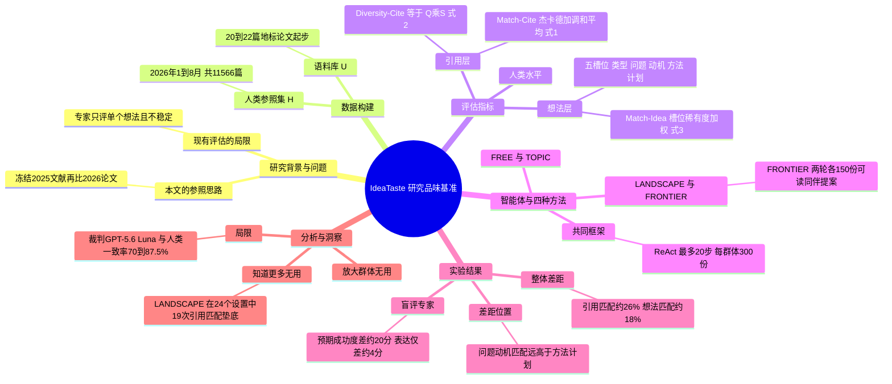

## 一、论文是干什么的？

想象一个美食评论圈：大家都读过同一批食谱书（2025 年以前的文献），一年之后，这个圈子里的厨师们实际做出了哪些新菜（2026 年发表的论文）是有据可查的。现在让一群 AI「厨师」只读同样的食谱书，各自写一份「下一道新菜」的方案，然后看看这些方案和人类厨师后来真正做出的菜有多像。越像，说明 AI 的「品味」越接近人类社区的选择。

这就是 **IdeaTaste**（可以直译为「想法品味」）这个基准的思路。论文把「研究品味」（research taste）定义为：该读什么文献、该追哪些问题、该试哪些方法的判断力。它不去给单个想法打分，而是把一整个「AI 提案群体」和一整个「人类研究社区」做对比。论文的核心结论是：AI 在「看哪些文献」「做哪个大方向」上已经和人类有不少重合，但一到「具体用什么办法做」「具体研究计划怎么排」就几乎对不上，这才是 AI 研究品味的主要瓶颈。以下数字均为论文自报的结果，来自 [arXiv 原文](https://arxiv.org/abs/2611.03424)。

## 二、核心方法与创新

**1. 时间切分：用「未来」当标准答案。** 作者选了四个领域：机器学习系统、代码生成（这两个是成熟领域）、世界模型、自动化科研（这两个是新兴小领域）。每个领域先手选 20 到 22 篇「地标论文」，把 2025 年底以前引用地标论文的文章，再加上至少被两篇这类文章共同引用的背景论文，作为 **语料库 $U$**（AI 只能在这里检索）。2026 年 1 月到 8 月发表的相关论文（引用地标论文，或由主题检索得到，并按书面领域定义筛选、去掉综述）作为 **人类参照集 $H$**。类比：考试前把课本冻结，考完后看学生写的「创新方案」和业界之后真正发表的东西有多接近。

| 领域 | 语料库 $U$（至 2025） | 人类参照 $H$（2026 年 1 到 8 月） |
|---|---|---|
| 机器学习系统 | 88,184 | 5,188 |
| 代码生成 | 94,674 | 3,375 |
| 世界模型 | 50,271 | 1,867 |
| 自动化科研 | 30,264 | 1,136 |

**2. 四个指标：两个层次，各看「像不像」和「多不多样」。** 论文从两个层面比较提案与人类论文：读了什么（引用）、想了什么（想法）。

- **引用匹配 Match-Cite**：用杰卡德相似度 $J(d_h,d_a)=|C(d_h)\cap C(d_a)|/|C(d_h)\cup C(d_a)|$ 衡量两篇文档引用集合的重合度，然后双向取最近邻平均，得到 $J_{A\to H}$（每个提案像不像某篇人类论文）和 $J_{H\to A}$（每篇人类论文的来源有没有被提案覆盖），再取调和平均 $M_{cite}=2J_{A\to H}J_{H\to A}/(J_{A\to H}+J_{H\to A})$（原文公式 1）。
- **引用多样性 Diversity-Cite**：$D_{cite}=QS$，其中 $Q$ 衡量每个提案引用得够不够多（以人类论文的平均引用数 $\tau$ 封顶），$S$ 衡量不同提案是不是引用了不同的文献（原文公式 2）。
- **想法匹配 Match-Idea**：先让一个大模型把每篇文档的摘要抽成固定的五个槽位：贡献类型、问题、动机、方法、研究计划。再用 GPT-5.6 Luna 逐槽位判断两篇文档「是否实质相同」。因为「问题」容易撞车而「研究计划」很少撞，每个槽位按稀有度加权 $w_i=-\log_2 p_i$。Match-Idea 就是「被至少一个提案匹配上的人类论文槽位」的加权比例（原文公式 3）。
- **想法多样性 Diversity-Idea**：同样的匹配办法用在提案内部，$D_{idea}=1-$（被同伴提案共享的槽位加权比例）。

所有指标取值 0 到 1，并且把「人类论文彼此之间」按同样公式算出的数字叫做 **人类水平**，作为参照线。类比：不是看 AI 和标准答案像不像，而是看 AI 比起「人类同行互相之间的相似度」差多少。

**3. 四种让 AI 写提案的方式。** 同一个 ReAct 风格的智能体框架，一次运行写一份提案，最多 20 步；每步只能做一个动作：规划（plan）、检索语料库（search）、把文献钉到 50 张卡片的工作集（read papers）、改草稿（draft）、压缩历史（summary）、提交（proposal）。四种方法只差「它知道多少」：

- **FREE**：只告诉它「你是这个领域的研究者」。
- **TOPIC**：分配一个研究主题（按语料库频率抽样，近年加权）。
- **LANDSCAPE**：不分主题，但给出领域内最常见的任务标签、方法标签、任务-方法组合及其占比，相当于给了一张「热门程度地图」。
- **FRONTIER**：像 TOPIC，但分两轮（每轮 150 份），第二轮可以查看同伴上一轮的提案和研究轨迹（不可引用，且标记为未经科学验证）。

**4. 盲评专家评审。** 因为「人类没做过的想法」也可能是好想法，作者找了 11 位有审稿经验的评审，对 192 份文档（一半 AI 提案、一半 2026 年论文）盲评，每份两位评审，维度包括稳健性、表达、贡献、可行性、预期成功度、总评，还要猜是不是 AI 写的。

## 三、使用了哪些模型和计算资源？

**被评测的六个 LLM 智能体**（论文表 2 与附录表 17）：

| 模型 | 发布日期（论文标注） | 备注 |
|---|---|---|
| Llama 4 Scout | 2025-04-05 | 预训练截止 2024 年 8 月，通过 AWS Bedrock 调用，输出上限 8,192 tokens |
| Claude Haiku 4.5 | 2025-10-15 | 公开网络数据截至 2025 年 2 月 |
| Gemini 3.5 Flash-Lite | 2026-07-21 | 模型卡称数据截止 2026 年 3 月 |
| DeepSeek-V4-Flash | 2026-07-31 | 百万 token 上下文 |
| Qwen3.8-27B | 2026-08-14 | 论文仓库说明它期望本地 vLLM 服务 |
| K2 Horizon 375B A23B | 2026-09-03 | Institute of Foundation Models 出品 |

前两个在 2026 年之前训练，因此不可能见过任何 2026 年参照论文，是「无泄漏」对照组。

**评测流程用到的其他模型：**

- 摘要到五槽位的抽取：DeepSeek-V4-Pro（官方接口）。
- 标签抽取与领域筛选：DeepSeek-V4-Flash（JSON 模式）。
- 逐槽位想法匹配裁判：GPT-5.6 Luna（JSON 模式，输出上限 1,200 tokens），并保证不让任何模型家族评判自己。
- 候选对检索：BM25（$k_1=1.5$，$b=0.75$）加 all-MiniLM-L6-v2 稠密向量，各取前 200 做倒数排名融合 $1/(60+r)$，取前 5 作为近邻。
- 裁判可靠性：作者用 40 个分层抽样的文档对，三位标注者（硕士生、博士生、计算机博士）做多数票，裁判与人类多数的一致率为问题 87.5%、动机 70.0%、方法 87.5%、研究计划 72.5%；五次重复运行彼此一致率 77% 到 90%。

**计算资源与耗时：**

- GPU 型号与数量：论文未披露。作者多数模型通过 API 调用，Qwen3.8-27B 按其 [GitHub 仓库 README](https://github.com/cxcscmu/IdeaTaste) 说明需要本地 vLLM 服务器，但具体 GPU 没有写。
- 调用量：论文设定每个智能体最多 20 次模型调用，每个群体 300 份提案，因此一个群体最多 6,000 次智能体调用；README 称评测一个 300 份提案群体约需 300 次抽取调用，外加每篇 2026 论文 5 次裁判调用，以及最多 1,500 次多样性配对裁判调用。这是仓库自己的估计上限，不是实测。
- 规模：论文称总共超过 90,000 份提案。按「6 个模型 × 4 种方法 × 4 个领域 × 300 份」，主表是 28,800 份；其余应来自扩大群体等分析实验，但论文正文没有逐项拆账，这一点是我的推算，不确定。
- 每份提案的耗时、金钱成本、总 GPU 时数：论文未披露。采样参数（温度、top-p、种子）均不发送，使用各接口默认值。

## 四、实验结果

**主结果（表 2，单位 %）。** 下面摘取人类水平与若干代表性设置，数字均来自原文表 2（已用 PDF 文本核对）。

| 设置 | 机器学习系统 引用匹配 / 想法匹配 | 自动化科研 引用匹配 / 想法匹配 |
|---|---|---|
| 人类水平 | 20.84 / 13.56 | 18.51 / 10.53 |
| Llama 4 Scout，FRONTIER | 2.76 / 5.95 | 4.71 / 3.32 |
| Claude Haiku 4.5，TOPIC | 4.24 / 1.99 | 6.14 / 2.55 |
| DeepSeek-V4-Flash，FRONTIER | 4.78 / 0.94 | 7.02 / 1.83 |
| K2 Horizon 375B A23B，FRONTIER | 4.59 / 1.27 | 6.82 / 2.36 |

方向说明：匹配和多样性指标都是越高越好；人类水平是「2026 年论文互相比较」得到的参照线。

**论文自报的主要发现：**

1. **整体差距大。** 平均而言，LLM 智能体只达到人类水平的约 26%（引用匹配）和约 18%（想法匹配），任何模型、任何领域都没有一个群体达到人类水平的一半。差距在最新最小的「自动化科研」领域最窄，在机器学习系统与代码生成最宽。
2. **差在「提什么」而不在「读什么」。** 六个模型里有五个，想法匹配比引用匹配更落后于人类。给定方向后，六个模型里有四个的引用多样性可以达到社区的最多 3 倍（例如 DeepSeek-V4-Flash 的 FRONTIER 在机器学习系统上是 42.15 对人类 13.50），但没有任何群体达到人类水平的想法多样性（人类 84.97，最高的 K2 Horizon FRONTIER 为 84.58）。
3. **知道得更多没用。** 2026 年之前训练的两个模型想法匹配更高（平均约占人类水平的 26%，对比 2026 年发布的约 14%；附录给出的平均匹配分是 3.10 对 1.68）。Llama 4 Scout 想法匹配最高，但盲评分最低。更丰富的上下文也没帮上忙：LANDSCAPE 在 24 个设置里有 19 个的引用匹配垫底。
4. **盲评：执行层面差距最大。** 表 3 中，平均而言 AI 提案在各质量维度都低于 2026 论文（个别模型有例外，见下文）；预期成功度差约 20 分，表达只差约 4 分。86% 的 AI 提案被评审识别为 AI 生成，人类论文是 39%。

| 盲评维度（0 到 100） | 人类论文 | LLM 智能体平均 |
|---|---|---|
| 稳健性 Soundness | 49.83 | 38.54 |
| 表达 Presentation | 62.50 | 58.16 |
| 贡献 Contribution | 53.99 | 45.31 |
| 可行性 Feasibility | 75.39 | 63.80 |
| 预期成功度 Success | 70.70 | 50.39 |
| 总评 Rating | 49.48 | 38.54 |
| 被判为 AI 生成的比例 | 39.06 | 86.46 |

此外，在没有人类对应物的提案上，可行性差距从 8 分扩大到 15 分、预期成功度差距从 15 分扩大到 26 分，作者据此认为这些提案更像「较弱的方向」而不是「被忽视的机会」。DeepSeek-V4-Flash 在稳健性、表达、贡献上超过人类论文，但可行性和预期成功度仍落后。

**分析实验（论文自报）：**

- **方向覆盖（以自动化科研、DeepSeek-V4-Flash 为例）。** 人类用到 200 种任务标签、268 种方法标签、2,871 种任务-方法组合；FRONTIER 用到 192 / 220 / 3,441，FREE 只有 36 / 103 / 710。单看任务或单看方法，FRONTIER 已接近人类，但在组合上大约只到人类的一半。
- **逐槽位匹配（表 4）。** 以机器学习系统为例，人类论文之间的槽位匹配率是：问题 28.32%、动机 42.58%、方法 3.99%、研究计划 7.21%；Llama 4 Scout 的 FRONTIER 为 12.10 / 23.46 / 1.29 / 1.52，DeepSeek-V4-Flash 的 FRONTIER 为 1.04 / 2.04 / 0.06 / 0.02。也就是说 AI 能对上「研究什么、为什么」，几乎对不上「怎么做、做哪几步」。
- **案例（图 4）。** 同一个问题（MoE 专家加载慢），人类论文 ReMoE 是微调路由器让它多复用专家；不匹配的提案则是「不改模型，外面加预取和缓存」。作者的观察是：不匹配的提案倾向于不动网络本身，只在外围加机制。
- **加大群体（图 5）。** 把 FREE、TOPIC 群体从 300 份扩大到人类参照集的规模（3.8 到 17 倍），匹配分只缓慢上升并趋平，仍远低于人类水平。
- **稳定性（附录 E.2）。** 重跑一次 300 份提案，匹配指标变化至多 0.44 个百分点，多样性指标至多 2.20 个百分点。

需要谨慎的地方：这些结论都是在作者选定的四个领域、六个模型、用作者设计的提案智能体与 GPT-5.6 Luna 裁判得到的；论文自己在附录中也承认，AI 只能检索到 2025 年的文献，而人类作者在 2026 年可能看到了更新的工作，因此人类水平是「参照线」而非严格公平的对手。

## 五、潜在应用与已落地应用

**有依据的潜在方向（论文自述）：** 作为 AI 科学家系统「想法生成」环节的体检工具；每当新模型发布，可以用「模型训练数据截止之后」的新一年论文重新评测，论文称该构造可对任意年份 $Y$ 重复（冻结到 $Y-1$ 年末，以 $Y$ 年论文为参照）。论文的结论还指出，改进 AI 研究品味应该着眼于「把一个已识别的问题变成具体方法」，而不是扩大提案数量。

**已落地情况（我去核实过）：**

- [GitHub 仓库 cxcscmu/IdeaTaste](https://github.com/cxcscmu/IdeaTaste)：MIT 许可证；提交历史显示 2026-11-01 初始提交，11-02 发布代码、配置和测试，11-03 补充论文链接并更名；我查看时有约 21 个 Star。提供 `ideataste generate` 与 `ideataste evaluate` 命令，可以换新模型和新方法。
- [Hugging Face 数据集 cx-cmu/IdeaTaste](https://huggingface.co/datasets/cx-cmu/IdeaTaste)：包含四个领域的语料库、人类参照集、领域标签地图和槽位权重等文件，README 称约 530 MB；HF 页面显示约 27.5 万行。
- [项目主页与实时排行榜](https://cxcscmu.github.io/IdeaTaste/)：存在，页面包含概览视频和「Live leaderboard」入口；我没有逐项核对排行榜上的具体名次。
- HF 论文页没有关联模型（linkedModels 为空）。
- 除上述基准本身外，我没有找到任何第三方把它用于实际 AI 科学家产品的公开案例。

## 六、网络上的讨论与评价

- [Hugging Face 论文页](https://huggingface.co/papers/2611.03424)：票数 47（用 HF API 核对），作者 Shanshan Zhong 本人提交到每日论文并贴了一段演示视频。页面上有一条读者 Hi-Angel 的评论，大意是「从摘要看不出为什么 AI 的做法和人类不同就一定更差」，作者 Shanshan Zhong 随后回复：光靠匹配并不能证明「不同就更差」，所以他们另做了专家盲评。已匹配和未匹配的提案在总体评分上同样落后于人类论文，但未匹配的提案在可行性和预期成功度上落后得更多，也就是说，人类社区从未收敛到的那些想法，恰恰是专家认为最不可能成功的。这个问题恰好对应论文的盲评部分：作者用 192 份盲评来论证「无人类对应物的提案更弱」，但这依赖评审的判断。
- [alphaXiv 概览页](https://www.alphaxiv.org/overview/2611.03424)：我读到的只是标题、作者和摘要，没有看到独立评论。
- [项目主页](https://cxcscmu.github.io/IdeaTaste/)与 [GitHub 仓库](https://github.com/cxcscmu/IdeaTaste)：作者自己的介绍材料。
- [awesomepapers.io 的收录页](https://awesomepapers.io/federated-learning/papers/hf2611.03424)：返回 429，无法读取，只列链接，不描述内容。
- [X 搜索页](https://x.com/search?q=IdeaTaste)：需要登录，无法读取，只列链接。
- 查过但没有相关结果：Hacker News Algolia 搜索（用 IdeaTaste、arXiv ID 搜索，命中均与本文无关）；Reddit 搜索接口返回 403，无法读取；Paperium 搜索页无法连接。另用英文标题检索，也没有检索到知乎、微信公众号或独立博客上的讨论。网络检索中出现的 [Measuring the Gap Between Human and LLM Research Ideas（arXiv 2607.01233）](https://arxiv.org/abs/2607.01233) 是论文参考文献里的相关工作，不是对本文的评论。
- 本文发布仅数天，讨论很少属于正常现象，不能据此判断学界评价。

## 七、思维导图

