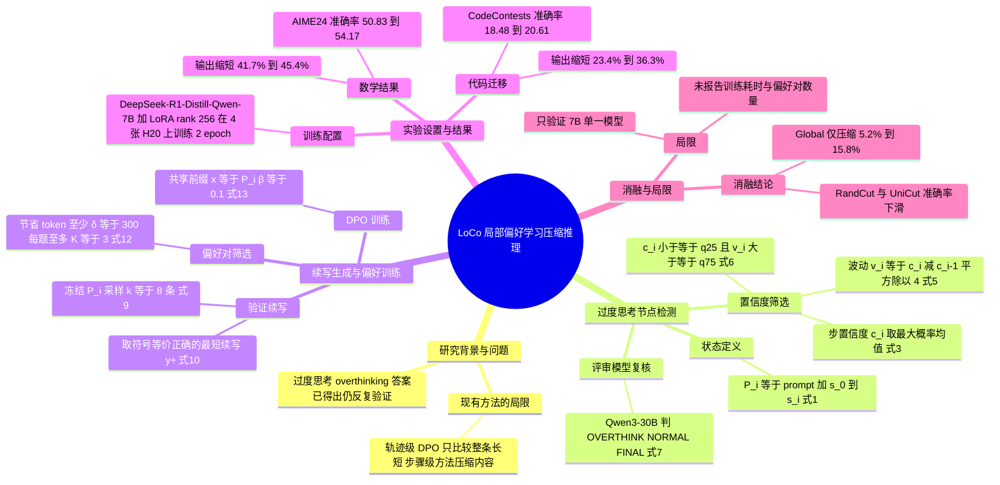

## 一、论文是干什么的？

现在的「推理大模型」（比如 DeepSeek-R1 系列）做题时会先写一大段思考过程（思维链，CoT），然后才给答案。问题是它们常常**想明白了还不肯停**：答案早就算出来了，还要「再验证一遍」「换个方法再算一遍」「等等，让我再想想」。这就叫**过度思考**（overthinking）。这些多余的话要花真金白银的推理时间和显存。

打个比方：你问同事「7 月 3 日是周三，7 月 14 日是周几？」他已经用数手指、列日历、取余数三种办法都得到「周日」，却还在翻「2030 年是不是闰年」「有没有别的公式」。我们希望他在第一次确认之后就说一句「那就是周日」。这篇论文要教的正是这个能力：**在哪个时刻该继续想，在哪个时刻该收笔**。

以往的压缩方法大多是「整条轨迹层面」的：比较一条长答案和一条短答案，告诉模型「短的更好」。这像是只对学生说「作文要写短点」，却没告诉他「写到哪一句就可以收尾了」。本文提出 LoCo（Local Compression，局部压缩），把监督信号精确放在「某一个推理状态」上：同一段已经写好的前文，后面接「原来的啰嗦续写」还是「更短的正确续写」，让模型学会选后者。

## 二、核心方法与创新

LoCo 的整体流程分三步（论文图 1），全部使用模型**自己生成**的数学推理轨迹，不需要人工标注。

**0. 先把思维链切成「步」。** 论文按段落（空行）把 CoT 切成若干步 $s_0, s_1, \dots, s_n$，并把「已经写完第 $i$ 步」的状态定义为

$$
P_i = \mathrm{prompt}(q) \,\|\, s_0 \,\|\, \cdots \,\|\, s_i \qquad (1)
$$

每个 $P_i$ 就是一个决策点：模型此刻既可以继续写，也可以收尾。

**1. 找出「过度思考」的节点（第 4.2 节，两道筛子）。**

- 第一道筛子是**置信度筛选**。把完整的思维链再喂回模型，记录每个位置上模型对下一个词的最大概率 $p^{\max}_\tau$（式 2），一步内取平均得到步置信度 $c_i$（式 3）；再用相邻两步置信度的差异来衡量「波动」，窗口取最小的 2 步，得到 $v_i = (c_i - c_{i-1})^2 / 4$（式 5）。然后用模型自己轨迹的分位数做阈值：只有「置信度落在最低 25% 且波动落在最高 25%」的状态才算候选，即 $\mathcal{O} = \{ i : c_i \le q_{25} \wedge v_i \ge q^{v}_{75} \}$（式 6）。类比：学生一边写一边「底气不足、情绪还起伏很大」，往往就是在反复纠结。这两个信号都只用到第 $i$ 步为止的信息，不会偷看被删掉的后文。
- 第二道筛子是**评审模型复核**。候选状态再交给一个更强的评审模型（论文用 Qwen3-30B）判断「下一步」是 OVERTHINK（在重复已经确立的信息）、NORMAL（有实质推进）还是 FINAL（给出最终答案）（式 7、8）。只有被判定为 OVERTHINK 的才保留。这样可以避免误删真正有用的推理，或把最后「写出答案」的那一步删掉。

**2. 生成「验证过的更短续写」（第 4.3 节）。** 对每个保留下来的状态 $P_i$，冻结前缀，让模型自己再采样 $k=8$ 条续写（式 9）。只保留「推理格式完整且答案与标准答案符号等价」的续写，并从中选**最短**的一条作为 $y_i^+$（式 10）。原来的续写 $y_i^-$ 就是被拒绝的那条；只有当新续写严格更短才保留这个点（式 11）。

**3. 局部偏好学习（第 4.4 节）。** 得到三元组 $(P_i, y_i^+, y_i^-)$ 后，只保留省下的词数不少于阈值 $\delta=300$ 的，每道题最多留 $K=3$ 对（省得最多的优先），再用标准 DPO 损失训练（式 13）：

$$
\mathcal{L}_{\mathrm{DPO}} = -\mathbb{E}\left[\log \sigma\left(\beta\left(\log\frac{\pi_\theta(y^+|x)}{\pi_{\mathrm{ref}}(y^+|x)} - \log\frac{\pi_\theta(y^-|x)}{\pi_{\mathrm{ref}}(y^-|x)}\right)\right)\right]
$$

其中 $x=P_i$ 是共享的前缀，$\pi_{\mathrm{ref}}$ 是冻结的参考模型（即原始基座），$\beta=0.1$。因为两条续写共享同一个前缀，模型学到的不是「短的比长的好」这种笼统偏好，而是「**处在这个状态时，应该选择收尾**」。

**创新点小结（论文自述）：** 把压缩目标从「缩短轨迹」换成「学习某个状态下该不该继续」；监督完全来自模型自己的轨迹与续写，数据分布与被训练模型一致。作者的消融实验支持了这一点（见第四节）。

## 三、使用了哪些模型和计算资源？

- **被训练的基座模型：** DeepSeek-R1-Distill-Qwen-7B（论文与 [HF 模型卡](https://huggingface.co/MuyaoYuan/LoCo-7B)均写明）。训练方式是 LoRA 适配器，不是全参数微调：秩 256、缩放系数 $\alpha=512$、dropout 0.05，作用于注意力的 q/k/v/o 投影，基座冻结。两个训练轮次（2 epochs），有效批量 64，学习率 $1\times10^{-5}$，余弦调度、预热比例 0.1，AdamW、权重衰减 0.01、梯度裁剪 1.0，DPO 的 $\beta=0.1$，最大序列长度 14,336 token。
- **评审模型：** 论文写作 Qwen3-30B；[GitHub 仓库](https://github.com/MuyaoYuan/LoCo)的 README 给出的具体权重是 Qwen3-30B-A3B-Instruct-2507。
- **训练数据来源：** 用 DeepSeek-R1-Distill-Qwen-7B 在 math14k 题库（共 14,027 道数学题，沿用 TokenSqueeze 论文的纯数学训练集）上，每题采样 3 条轨迹（温度 0.6、top-p 0.95），取最短的正确轨迹；每条轨迹最多保留 10 个候选节点（均匀抽样）；提示长度上限 6k、续写长度上限 12k token。最终有多少对偏好数据：论文未披露。
- **消融用到的外部模型：** GPT-5.4（只用于「外部续写」那组消融，用来在同一冻结前缀上续写）。
- **GPU：** 训练在 4 张 NVIDIA H20 上进行（论文），仓库脚本注明 4 GPU、DeepSpeed ZeRO-2。仓库 README 另给出推荐环境：CUDA 12.8、Python 3.12。评测用 vLLM，评测所用 GPU 数量论文未披露。
- **耗时与成本：** 训练总时长、数据构造总时长、每条样本的生成耗时、API 花费，论文均未披露（暂无相关信息）。论文给出的是推理端的「长度」收益：详见第四节，但没有折算成秒或金额。
- **评测设置：** 每道题采样 8 次，温度 0.6、top-p 0.95，最多生成 32,768 个新 token，上下文长度 36,864，生成到结束符才停，不在 `</think>` 处截断。

## 四、实验结果

**评测基准。** 数学 5 个：MATH-500（500 题）、AMC23（40 题）、Olympiad（675 题）、AIME24（30 题）、AIME25（30 题）；代码 3 个：MBPP sanitized（257 题）、LiveCodeBench v5（167 题）、CodeContests（165 题）。指标有三个：准确率 Acc（越高越好）、平均输出 token 数 Token（越低越好）、AUC（准确率随最大输出长度预算变化的曲线下面积，越高越好，沿用 TokenSqueeze 论文的定义）。对比方法是 DAST 与 TokenSqueeze，均直接用其公开发布的完整权重评测。

**数学结果（表 1，均值，括号内为 LoCo 相对基座的变化）：**

| 基准 | 基座 Acc / Token / AUC | DAST | TokenSqueeze | LoCo |
|---|---|---|---|---|
| MATH-500 | 91.88 / 4015 / 82.64 | 91.38 / 3720 / 83.95 | 91.18 / 2442 / 85.92 | 91.80 / 2243 / 86.56 |
| AMC23 | 90.31 / 6285 / 76.95 | 88.12 / 5981 / 76.89 | 88.44 / 4350 / 79.42 | 91.56 / 3663 / 83.44 |
| Olympiad | 61.33 / 8972 / 51.28 | 59.91 / 9155 / 51.86 | 60.98 / 6149 / 54.29 | 62.78 / 4968 / 56.61 |
| AIME24 | 50.83 / 13493 / 40.33 | 50.83 / 14423 / 41.40 | 48.75 / 10457 / 40.14 | 54.17 / 7364 / 46.82 |
| AIME25 | 37.92 / 15134 / 30.29 | 37.92 / 15652 / 31.66 | 35.83 / 11055 / 31.20 | 40.42 / 8291 / 34.55 |

LoCo 的输出长度相对基座下降：MATH-500 约 44.1%、AMC23 约 41.7%、Olympiad 约 44.6%、AIME24 约 45.4%、AIME25 约 45.2%，即摘要所说的 41.7% 到 45.4%。准确率在 MATH-500 上基本持平（-0.08），其余四个基准都略高于基座。DAST 压缩很有限，在 Olympiad、AIME24、AIME25 上输出反而变长；TokenSqueeze 压缩也很猛（MATH-500 约 39.2%），但在 AMC23、AIME24、AIME25 的准确率低于基座。

**代码结果（表 2，数学训练、代码测试）：**

| 基准 | 基座 Acc / Token / AUC | DAST | TokenSqueeze | LoCo |
|---|---|---|---|---|
| MBPP | 84.05 / 3403 / 78.42 | 81.13 / 4097 / 76.32 | 81.37 / 2196 / 77.40 | 84.05 / 2167 / 79.95 |
| LiveCodeBench | 41.77 / 12319 / 32.86 | 39.82 / 14158 / 31.88 | 41.69 / 9670 / 35.03 | 42.51 / 9278 / 35.64 |
| CodeContests | 18.48 / 14900 / 13.87 | 16.06 / 17757 / 12.61 | 19.09 / 11677 / 15.54 | 20.61 / 11413 / 16.78 |

LoCo 输出长度相对基座下降：MBPP 约 36.3%、LiveCodeBench 约 24.7%、CodeContests 约 23.4%。三个代码基准上 LoCo 的 AUC 最高。

**消融实验（表 3，选三个数学基准）：**

| 变体 | AMC23 Acc / Token | AIME24 Acc / Token | AIME25 Acc / Token | 说明 |
|---|---|---|---|---|
| Global | 90.94 / 5957 | 54.17 / 12002 | 40.42 / 12740 | 去掉状态，只用最短与最长正确整条轨迹配对，压缩幅度只有 5.2%、11.1%、15.8% |
| GPT-5.4 Cont. | 90.62 / 4083 | 52.92 / 9204 | 39.58 / 9690 | 同样的切点，但「更短续写」改由 GPT-5.4 生成 |
| RandCut | 88.44 / 3679 | 48.33 / 7880 | 38.75 / 9151 | 切点随机选 |
| UniCut | 89.38 / 3573 | 48.75 / 7895 | 36.67 / 8627 | 切点均匀间隔选 |
| LoCo | 91.56 / 3663 | 54.17 / 7364 | 40.42 / 8291 | 完整方法 |

读法：压缩幅度上，Global 远不如 LoCo，说明「在哪里下刀」很重要；随机或均匀切点能压得差不多，但准确率下滑更明显（附录 A.3 还说明探测器的切点平均相对位置约 0.57，更靠后，而 RandCut 与 UniCut 约 0.47 与 0.50，更靠前、模型还没想完）；外部强模型生成的续写没有自家生成的好，作者猜测原因是与模型自身思维风格的分布一致性。这个解释是作者的推测，论文并没有专门验证。

**需要谨慎看待的地方（我的解读）：** 以上全部是作者自报结果，只在一个 7B 蒸馏模型上；AMC23、AIME24、AIME25 题量只有 30 到 40 题，表中报告的 ± 值（如 AIME24 上 LoCo 为 ±4.27；论文没有说明这个数的含义，推测反映多次采样的波动）不小，几个点的准确率差异不一定显著；论文只报告了基座、DAST、TokenSqueeze 三个对比对象，没有与其它压缩方法（如 O1-Pruner、Step-DPO 系压缩方法）做表格对比；论文也没有给出模型是否会在「需要验证」的场景里过早收笔的专门测试。

## 五、潜在应用与已落地应用

**潜在应用（我的推断，论文自身只做了数学与代码评测）：**

- 对按输出 token 计费或延迟敏感的推理服务，这种方法可以作为对已有推理模型的一次后训练，直接减少输出长度；论文只验证了 7B 模型。
- 思路可以迁移到其它「何时停止」的场景，比如多轮 Agent 的是否继续检索，但论文没有验证，仅是设想。

**开源与发布情况（已实际核对）：**

- 代码：[GitHub 仓库 MuyaoYuan/LoCo](https://github.com/MuyaoYuan/LoCo)，MIT 许可证，创建于 2026-11-03；截至 2026-11-06 有两次提交（2026-11-03 的 init 和 2026-11-04 的 update readme），约 9 个星。仓库包含 construction（六步数据构造）、train、eval、data、script、utils 等目录，README 给出完整的数据构造、训练与评测命令。
- 模型：[MuyaoYuan/LoCo-7B](https://huggingface.co/MuyaoYuan/LoCo-7B)，MIT 许可证，基座为 DeepSeek-R1-Distill-Qwen-7B，BF16 权重，约 7.6B 参数，由作者在 2026-11-04 发布（HF 评论区作者自己说明）。
- 数据集：训练用的 math14k 题库放在仓库的 `data/math14k/` 目录下；偏好数据 `dpo.jsonl` 需要按 README 的流程自行生成，HF 页面没有单独关联的数据集。
- 在线 demo：未见（HF 页面关联的两个 Space 是无关的显存计算器）。
- 已落地应用：未见任何产品或业务部署的公开证据。

## 六、网络上的讨论与评价

论文刚发布三天，讨论很少，以下是我实际查到的内容。

- [HF 论文页评论区](https://huggingface.co/papers/2611.04814)（API 显示 59 个赞）：作者之一 Liyan Xu 发了一条说模型已发布；用户 guicybercode 提问，担心在「额外一步是验证」的任务里（比如答题前先检查测试）模型会不会过早停止，并说在普通硬件上砍掉约 40% 的 token 对响应时间影响很大，想知道方法在哪里会失效。作者回复说，提前停止主要是减少冗余验证，并不是砍掉所有验证：偏好对的构造保证只有推理到达有把握的状态之后，模型才会考虑收尾，目标是学到这种自适应行为，并认为大部分 token 的节省来自减少多余验证；提问者表示明白了，但仍希望看到在验证步骤决定答案的任务上的专门测量；Liyan Xu 另有一条评论介绍该工作的动机来自他们之前关于「LLM 推理是局部转移过程」的 ICML 2026 论文；另有 Librarian Bot 自动推荐了若干相似论文。
- [GitHub Issue 1](https://github.com/MuyaoYuan/LoCo/issues/1)：Hugging Face 的 Niels Rogge 发来的标准通知，说已把论文和 4 个评测结果收录到 Papers with Code 并请作者核对，并无技术讨论。
- [Papers with Code 页面](https://paperswithcode.co/paper/2611.04814)：收录了论文摘要和 AIME 2025、MATH 500、AIME 2024、AMC 2023 等基准条目，没有评论内容。
- [AI Weekly 的快讯](https://aiweekly.co/alerts/loco-cuts-math-reasoning-traces-417-454-with-no-accuracy-loss)：复述摘要的数字，编辑评语认为若自蒸馏配方能在这八个基准之外成立，对按输出 token 付费的团队是个便宜的改造手段，同时指出代码上的收益较小，应当视为方法论文而非即插即用的开发包；该文称摘要没有写基座模型，这点只是摘要本身没写，正文与模型卡里有。
- [hyper.ai 论文页](https://hyper.ai/en/papers/2611.04814)：论文摘要的镜像，没有额外评论。
- [Daily-Paper 日报 Issue 50](https://github.com/twyran/Daily-Paper/issues/50)：把该论文列入当日 LLM 论文摘要（页面显示 HF 56 赞）；[paperlens 的 2026-W45 雷达 Issue 7](https://github.com/XavierGeerinck/paperlens.io/issues/7) 把它列为 230 篇论文里的第 2 名（总分 15），这是打分表，没有对内容的评论。
- [Yelzkizi 博文](https://yelzkizi.org/tencent-loco-45-percent-token-reduction-2026/)：该站对抓取返回 403，无法读取；搜索引擎只显示标题和一篇同站的另一篇文章，我没有读取到正文，不对其内容作描述。
- Reddit、X/Twitter、Hacker News、知乎、微信公众号：Reddit 搜索接口返回 403 被拒绝，未绕过；Hacker News 的 Algolia 搜索只返回与本文无关的旧评论，没有找到相关帖子；网页搜索也未在 X/Twitter、知乎、公众号上找到相关内容。因此这些渠道目前没有可引用的讨论。Pith、Paperium 等聚合站我没有检索到对应条目。
- 综上：目前的外部评价基本是复述作者结论，**尚未见到独立复现或批评性评测**。

## 七、思维导图

