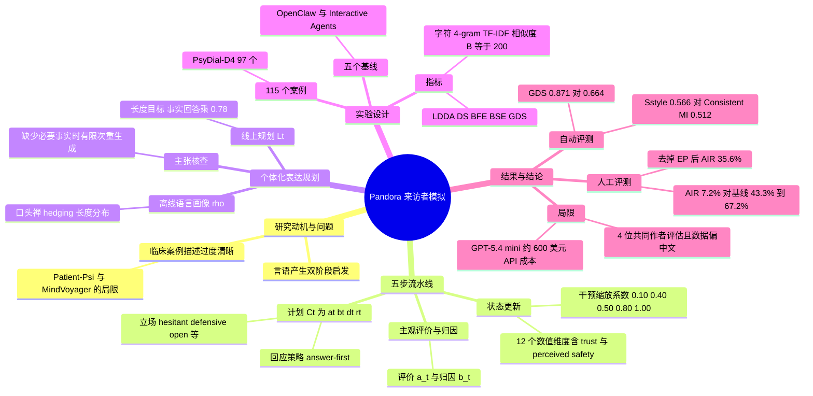

## 一、论文是干什么的？

心理咨询师培训、咨询对话评测，常常需要一个"模拟来访者"来陪练。现在的做法通常是把一份"临床案例描述"（比如这个人有什么核心信念、什么应对模式）喂给大模型，让它扮演来访者。问题是：这份案例描述是**临床医生的视角**写出来的、条理清晰的解释，而真实的来访者往往**自己都说不清自己为什么难受**（论文称之为 self-opaque，自我不透明）。结果模拟出来的"来访者"一开口就头头是道地分析自己的童年和心结，像一个读过心理学教材的人，而不是一个支支吾吾的真人。

打个比方：真人来访者像一个刚从雾里走出来的人，只能说"每次有人夸我，我就觉得不太舒服，好像不是我做的"；而现有模拟器像一个拿着诊断报告念稿子的人。Pandora 想做的是：让模拟来访者既"心里有这些事"，又只说到"此时此刻他能说清的那一步"，并且用**这个人自己的说话习惯**（口头禅、爱不爱含糊其辞、一句话多长）说出来。

需要说明：这是一篇偏人机交互（cs.HC）方向的研究，评测都是"和原始对话像不像""是否被人觉得像 AI"，**并不证明**它对咨询师培训真的有效，论文自己在伦理声明里也强调这一点。

## 二、核心方法与创新

Pandora 借鉴了语言学里"先在脑子里准备要说什么（概念准备），再把它变成具体词句（语言形成）"的两阶段说话模型，把"说什么"和"怎么说"拆开来规划。每一轮（第 $t$ 轮）输入包括：咨询师当前这句话 $x_t$、之前的对话 $H_{t-1}$、上一轮心理状态 $s_{t-1}$、此刻可用的案例记忆 $M_t$、以及这个来访者的个人语言画像 $\rho$。处理流程分五步：

1. **咨询师干预评估与状态更新**。一个基于规则（不是再调一个大模型）的评估器，看咨询师这句话有没有做到澄清、提问、情感反映，以及有没有错过该做的情感反映。然后更新一个包含 12 个数值维度的心理状态：痛苦、情绪唤起、防御、回避倾向、信任、感知安全、披露意愿、自我觉察、领悟、心智化、核心信念激活、问题清晰度。比喻：像一个"心情仪表盘"，咨询师说了贴心的话，信任和安全感指针上升；说了否定的话，防御指针上升。不同类型的话影响力度不同，实际事务、事实提问、反映式陈述、质疑、否定的缩放系数分别为 0.10、0.40、0.50、0.80、1.00；信任和安全感还要做平滑，新值只占 0.25、旧值占 0.75，所以不会一句话就"翻脸"。
2. **主观评价与归因**。从状态和案例材料中生成"来访者怎么看待这件事"（主观评价 $a_t$，含情绪意义、威胁感、对自我与关系的含义、对自己判断的把握）和"来访者现在怎么解释这件事"（归因 $b_t$，从就事论事，到试探性的人际猜测，再到联系深层信念）。同一份案例材料，在不同的互动阶段可以得到不同深度的说法。
3. **内容目标、立场与回应策略**。把上面的结果整理成一个计划：

$$C_t=(a_t,b_t,d_t,r_t)\qquad(1)$$

其中 $d_t$ 是内容计划（要提到哪些记忆，以及犹豫、防御、困惑、情绪淹没、开放等立场），$r_t$ 是回应行为计划（例如事实性提问就先直接回答，少做自我剖析；实际请求要简短；被质疑时允许抵触）。

4. **个体化表达规划（本文最大的创新）**。离线先从来访者的原话中"蒸馏"出一份语言画像 $\rho$：常用话语标记、含糊（hedging）习惯、情绪直白程度、话语长度分布、句子数。线上再把它与当前状态结合：

$$L_t=F_{\mathrm{realize}}(s_t,C_t,H_{t-1},\rho)\qquad(2)$$

输出说话风格、人称焦点、确定程度、情绪直白度、含糊程度、长度与句数目标。比喻：前面三步是"编剧"，决定剧情和人物心态；这一步是"配音指导"，告诉演员这个角色一句话大概多长、爱说"也许"、情绪露多少。长度目标以来访者的话语长度中位数为基准，事实性回答乘 0.78，实际性回复乘 0.55。

5. **回应生成与执行**。由客户端大模型把所有中间计划写成一句自然语言，并有"主张核查"：生成后检查这句话支持了哪些案例事实，缺少必要事实时可触发有限次重新生成。

论文给出的例子：咨询师问"他没回你消息，你怎么想"，Pandora 的来访者说 Maybe he's upset with me, or I said something wrong——简短、带 maybe、保留不确定，而不是长篇分析。

另外，论文构建了评测体系：用**记忆卡片**（L1 到 L3 三个深度）衡量披露的时机和先后顺序（LDDA、DS、BFE、BSE、GDS 五个指标），用字符 4-gram TF-IDF 余弦相似度衡量说话风格像不像原对话（原始版 $S_{\mathrm{raw}}$ 和内容遮蔽版 $S_{\mathrm{style}}$），再加人工"是否像 AI"的二分类判断。

## 三、使用了哪些模型和计算资源？

| 项目 | 论文披露的信息 |
|---|---|
| 基础模型 | 论文附录 A.6 称所有基于大模型的客户端模拟、案例筛选和模型辅助评测都使用 GPT-5.4 mini（OpenAI，API 标识 gpt-5.4-mini） |
| 计算资源 | 全部推理通过 API 在服务商基础设施上完成，没有披露 GPU；论文未训练任何模型 |
| 总成本 | 估计 API 总花费约 600 美元（覆盖模拟、案例筛选、评测） |
| 每条样本或每轮的耗时、调用量 | 论文未披露 |
| 状态更新 | 规则驱动，不需要额外调用大模型 |
| 人工评测 | 4 位评估者（2 位心理咨询师，2 位合成数据研究者，均为论文共同作者），45 个披露条目，每条 8 个候选，共 1440 条判断 |

注意：五个基线方法（OpenClaw、Interactive Agents、Patient Phi、MindVoyager、Consistent MI）是论文作者改编实现的版本，论文说所有被评方法都使用同一个中性事实目录并由共享的覆盖控制器管理披露进度；每个基线具体用的模型，论文正文只说客户端模拟都使用 GPT-5.4 mini，没有单独逐项列出。

## 四、实验结果

数据：从 PsyDial-D4、AnnoMI、ConsistentMI、Eeyore 四个数据来源的 5754 条记录中，经过结构筛选（至少 24 轮咨访交换等）和语义评分，选出 115 个案例（97 个中文、18 个英文：PsyDial-D4 97 个、AnnoMI 11 个、Eeyore Full 5 个、ConsistentMI 2 个）。注意其中包含重构或模型生成的对话，并不都是真实来访者的原话。

自动评测（案例平均值，表 2，已与 PDF 核对）。LDDA、DS、GDS、$S_{\mathrm{style}}$、$S_{\mathrm{raw}}$ 越高越好；BFE、BSE 越低越好。

| 方法 | LDDA | DS | BFE（低好） | BSE（低好） | GDS | $S_{\mathrm{style}}$ | $S_{\mathrm{raw}}$ |
|---|---|---|---|---|---|---|---|
| OpenClaw | 0.658 | 0.362 | 0.115 | 0.270 | 0.609 | 0.397 | 0.280 |
| Patient Phi | 0.667 | 0.373 | 0.108 | 0.200 | 0.629 | 0.438 | 0.310 |
| MindVoyager | 0.672 | 0.378 | 0.105 | 0.190 | 0.634 | 0.408 | 0.290 |
| Consistent MI | 0.690 | 0.417 | 0.100 | 0.128 | 0.664 | 0.512 | 0.352 |
| Interactive Agents | 0.681 | 0.364 | 0.099 | 0.133 | 0.643 | 0.501 | 0.342 |
| Pandora w/o EP（去掉表达规划） | 0.811 | 0.795 | 0.107 | 0.140 | 0.828 | 0.458 | 0.311 |
| Pandora | 0.852 | 0.875 | 0.102 | 0.127 | 0.871 | 0.566 | 0.385 |

大白话解读：

- 风格相似度：Pandora 最高，比最强基线 Consistent MI 高 0.053（内容遮蔽版）和 0.032（原始版）。只看 97 个中文案例，次序相同：Pandora 为 0.489 和 0.422，Consistent MI 为 0.427 和 0.385，去掉表达规划为 0.362 和 0.337。
- 去掉表达规划后，披露组织能力仍强（GDS 0.828，高于最强基线 0.664），但风格相似度降到 0.458，低于 Consistent MI。这说明前面的心理状态与内容规划主要管**什么时候说什么**，表达规划才管**像不像这个人说话**。
- 披露指标并非全面第一：BFE 最低的是 Interactive Agents（0.099），Consistent MI 为 0.100，Pandora 为 0.102；BSE 上 Pandora 的 0.127 仅比 Consistent MI 的 0.128 略低。作者也承认捆绑（一次说出多条）误差各有取舍。
- 值得留意：Pandora 的 DS（0.875 对 0.417）与 GDS 大幅领先。论文附录 A.5 说明所有被评方法都有共享覆盖控制器，而 Pandora 的私有上下文还额外提供最多三条记忆线索，这是 Pandora 方法设置的一部分，读者在解读领先幅度时应考虑这一点。

人工评测（表 3，越低越好，每个来源 180 条判断中被判为像 AI 的次数）：

| 来源 | 被判像 AI 票数 | AIR |
|---|---|---|
| Patient Phi | 121 | 67.2% |
| OpenClaw | 111 | 61.7% |
| MindVoyager | 98 | 54.4% |
| Consistent MI | 85 | 47.2% |
| Interactive Agents | 78 | 43.3% |
| Pandora w/o EP | 64 | 35.6% |
| Pandora | 13 | 7.2% |
| 原始对话（Reference） | 8 | 4.4% |

Pandora 的 7.2% 接近原始对话的 4.4%，但论文强调原始对话中包含重构或生成内容，所以这并不意味着它等同于真人。评估者一致性不算高：平均成对一致率 62.9%，对像 AI 的正向一致率 53.7%。评估者仅 4 人且全是共同作者，只评了孤立的单句话，也未记录是否使用过揭示来源功能，因此完全盲评无法确认。以上都是论文自报结果，只对其评测设置成立。

## 五、潜在应用与已落地应用

潜在方向（来自论文自己的表述，均属展望）：咨询师培训用的更真实陪练对象、咨询师能力评测的测试对象、研究来访者表达与咨询过程的实验平台。论文同时明确说，这些在培训或评测中是否真有帮助仍是未来要研究的问题，且模拟器不应代替专业临床评估或治疗。

开源情况（已实际核实）：

- 代码：[whunextgen/Pandora](https://github.com/whunextgen/Pandora)。查看提交历史，2026 年 10 月 11 日首次提交并发布心理状态与表达建模，10 月 13 日加入对话预处理和基于来源的蒸馏，10 月 26 日加入双语项目网站，11 月 4 日仍有更新。GitHub 页面未声明开源许可证（license 字段为空），复用前需自行确认授权。仓库说明明确：只发布预处理与确定性建模核心（状态更新、主观评价、归因、内容规划、表达规划），**不含**实验运行脚本、模型提供方集成、数据集与被试记录，也不会生成大模型回复，演示例子使用虚构语句、无需 API key。因此论文的实验并不能直接用这个仓库复现。另外，仓库自述称当前版本里没有按信任或意愿来限制记忆可用性的门控，当前可用的记忆全部开放，这与论文正文里披露意愿影响立场的叙述侧重点不同，读者可自行对照。
- 项目主页：[PANDORA 项目网站](https://clain.org/Pandora/)，是一个交互式解读页面。
- 数据：论文称会通过 GitHub 提供受许可允许的数据；需审批的来源由申请者先从原提供方取得授权，再凭证明联系获取。当前仓库不含原始案例内容。
- HF 上关联的模型、数据集、Space：HF 论文页显示均为 0。
- 已落地应用：未找到相关信息。

## 六、网络上的讨论与评价

我实际查过的来源与所见：

- [HF 论文页](https://huggingface.co/papers/2611.00617)：写作时 76 个点赞，只有 2 条评论，一条是作者自己贴的概览图片，另一条是自动的 Librarian Bot 相关论文推荐，没有实质性讨论。
- [alphaXiv 页面](https://www.alphaxiv.org/abs/2611.00617)：页面可打开，但我没有读到任何评论内容。
- [HyperAI 论文页](https://hyper.ai/en/papers/2611.00617)：论文条目页，页面可打开，仅为论文收录，没有看到评论。
- [Pith](https://pith.science/arxiv/2611.00617)：返回 403，无法读取。
- Reddit：搜索接口返回 403（Blocked），无法读取，未用 Playwright 绕过。
- Hacker News：通过 Algolia 接口按 arXiv ID 和论文关键词搜索，没有相关帖子（按 ID 搜索只命中一条无关的评论文本）。
- 网页搜索：只找到 arXiv、HyperAI、Papers with Code 作者页等收录页，没有博客、知乎、微信公众号或 X/Twitter 的讨论。X/Twitter、知乎、微信公众号没有直接抓取，因此不能断言那里一定没有。

结论：截至 2026 年 11 月 6 日（论文发布仅数天），没有找到有实质内容的独立第三方讨论或评价。

## 七、思维导图

