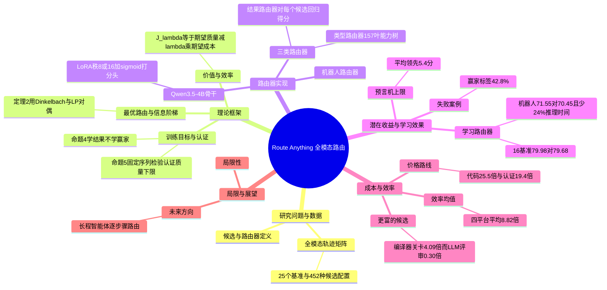

## 一、论文是干什么的？

想象你开了一家「万能外包公司」：手下有写文章的、画画的、拍视频的、配音的、写代码的，还有会操作机械臂的。每来一单活儿，你得决定派谁去做。派最贵最强的人当然稳，但成本高；派便宜的人省钱，可能搞砸。这个「前台分派员」，就是本文研究的**路由器**（router）。论文把每一个可被派去干活的对象（大语言模型、图像/视频/语音生成模型、机器人策略）统称为「候选」（candidate）。

这篇论文的特别之处在于：过去的路由研究基本只盯着语言模型，而本文把范围扩大到「全模态」，在同一套数据上同时研究文本问答、图文问答、图像生成、视频生成、语音生成、代码与办公智能体、机器人操作。作者提出三个问题：路由最多能赚多少？学出来的路由器到底好不好用？什么时候「便宜一点的路线」就足够好？论文给出的主要结论是：理论上「每题挑最好的」比「固定用最强的」平均高 5.4 分；但真实学出来的路由器只比固定最强候选高 0.3 分；路由真正稳定的价值是**省钱**，在与参考模型质量几乎持平时，效率平均提高 8.82 倍（这是论文自报数字，并且是四个测试平台的算术平均）。

## 二、核心方法与创新

**1. 路由器的价值公式。** 设输入为 $x$，候选 $u$ 跑出的质量为 $V_u\in[0,1]$（即该基准的分数），消耗资源 $D_u$（美元或秒）。路由器 $g$ 的得分是

$$J_\lambda(g)=\mathbb{E}[V_g]-\lambda\,\mathbb{E}[D_g]$$

也就是「质量减去按价格折算的成本」。生活类比：点外卖时，你不是只看好不好吃，而是看「好吃程度减去价格带来的心疼」。当价格 $\lambda=0$ 时，只比质量。

**2. 参考模型与效率。** 如果没有给定价格，就拿一个「参考策略」（比如永远调用最强模型）当标尺。定义质量变化 $Q=\mathbb{E}[V_g-Y_B]$、节省 $S=\mathbb{E}[C_B-D_g]$、效率 $\eta=\mathbb{E}[V_g]/\mathbb{E}[D_g]$（每单位成本换到的质量），并要求质量不能掉太多：$Q\ge-\epsilon$（式 1）。引理 1 说明效率提升的充要条件是 $Q+\eta_B S>0$，注意「效率更高」和「质量不掉」是两个独立条件：一个只在 15% 的任务上做对、但价格只有十分之一的模型，效率是参考的 1.5 倍，质量却掉了 0.85。

**3. 最优路由定理（定理 2）。** 在每个「状态」（路由器观察到的信息）下，最优做法就是挑出使 $v(s,u)-\lambda c(s,u)$ 最大的候选。最高效率 $\eta^\star$ 是 Dinkelbach 函数 $\Phi(\lambda)$ 的唯一根，证明用到 Dinkelbach 分式规划与线性规划对偶。第二部分说明：在质量下限约束下求最高效率，不会产生新类型的路由器，它只是「在某个特定价格 $\lambda_\epsilon$ 下的普通路由」，价格由参考模型和容忍度决定。

**4. 信息阶梯（命题 3）。** 路由器看到的信息越细，能达到的上限越高：

$$V^\star(\sigma_1)\le V^\star(\sigma_2)\le V^\star(x)\le\mathbb{E}[\max_u W_u]$$

最左是「每个基准固定用最好的候选」，最右是「每个输入都事后挑最好的」（oracle，预言机）。类比：只知道「这是数学题」时，你只能派数学最强的人；如果能看到「这道具体的题」，才能因题施派。

**5. 学结果，不要学赢家（命题 4）。** 训练路由器有两种目标：回归每个候选的得分（outcome，结果），或分类「谁赢了」（winner label，赢家标签）。作者证明按赢家标签分类可能会损失近一半的价值范围，并给出反例：若候选 A 稳定给出 $a<1$，候选 B 以概率 $b\in(\tfrac12,a)$ 给出 1，则 B 更常赢，但 A 的期望更高。在有「并列时选更快的」规则时更糟。

**6. 质量下限的统计认证（命题 5）。** 在拟合数据上满足质量下限，不代表在测试集上也满足。作者把候选路由器沿价格路径排序，依次做 $p$ 值检验，在第一个通不过处停止（固定序列检验，不需要多重比较校正），都不通过就退回参考模型，从而以置信水平 $1-\alpha$ 保证 $\mathbb{P}(Q<-\epsilon)\le\alpha$。

**7. 全模态轨迹矩阵（数据贡献）。** 25 个基准、374,401 次打分运行、452 种候选配置，所有候选在同一批输入上都跑一遍，所以可以事后知道「如果当时派另一个，结果会怎样」。

**路由器本身很朴素**：以 Qwen3.5-4B 为底座，加上 LoRA 微调和一个 sigmoid 打分头，对每对（输入，候选画像）打分后选分最高者；机器人路由器还会读 3 帧 240×320 摄像头画面和机器人状态，并为 7 个策略各配一个 sigmoid 输出头。

## 三、使用了哪些模型和计算资源？

**候选模型（论文原文名称，我无法独立核实这些模型的存在与版本）：**

| 类别 | 候选 |
|---|---|
| 语言模型 | Claude Opus 5.5、GPT-6.1 Sol、DeepSeek V4.1 Flash，长上下文、知识与智能体任务上另加 GPT-6 Astra |
| 图像生成 | FLUX 3、Seedream 5.0 Pro、MAI-Image 2.6、GPT Image 2.5、Qwen-Image 3 Pro、Grok Imagine 2.0（少数 GenEval2 提示上另有两个生成器） |
| 视频生成 | MiniMax H3、Seedance 2.5、Wan 3.0 |
| 语音生成 | Seed Audio 1.0、Fish S2.1 Pro、Gemini 3.8 Flash TTS |
| 机器人策略 | $\pi_{0.5}$、GigaBrain、Spatial Forcing、X-VLA、X-WAM、PatchWAM、ME-Dex（均在 50 个 RoboTwin 任务上联合训练） |

另外，价格路由实验使用 CodeRouterBench（8 个模型，参考模型为 claude-opus-4-6）和 RouterBench（11 个模型，参考模型为 gpt-4-1106-preview）。用于给能力树叶节点打标签的是 GPT-6.1 Sol。

**路由器骨干与训练设置（来自附录 B.3）：**
- 基础模型：Qwen3.5-4B。能力树路由器分类器用 LoRA（秩 8），训练 3 个 epoch，批大小 16，学习率适配器 $10^{-4}$、打分头 $10^{-3}$。
- 11 基准的结果路由器与类型路由器：LoRA（秩 16，$\alpha=32$，作用于语言模型所有线性层），AdamW，学习率 $2\times10^{-5}$（适配器）与 $3\times10^{-4}$（头），每次更新 32 个任务，6 个 epoch，种子 42、13、2026、7。
- 机器人路由器：LoRA 秩 8、3 个 epoch、批大小 16，在全部 49,000 条训练结果上训练。
- 赢家标签生成式路由器：对 Qwen3.5-4B 做全参数微调，共 12 种配方。

**计算资源：**
- GPU：论文仅在一处披露，4B 路由器在**一张 H20 GPU** 上每次决策耗时 0.13 秒（相比之下生成一张图要 27 到 158 秒，生成一段视频要 211 到 314 秒）。训练用了多少张 GPU、总共多少 GPU 小时，论文**未披露**。
- 每个完整计算单位的耗时：机器人场景每个场景的策略推理时间，路由后为 11.05 秒，最佳单一策略为 14.51 秒（节省 24%）；代码任务中 Opus 每题 3.93 秒、Qwen3-Max 每题 6.23 秒；TF-IDF 路由器每题 1.9 毫秒；作为验证器的 LLM 评审（grok-4.6）每题 39.0 秒、按标价 0.0159 美元；DeepSeek-v4-pro 预测每题 1.89 秒、0.000944 美元；隐藏测试沙箱每题 0.15 秒。
- 成本：CodeRouterBench 上始终调用 Opus 的成本是每题 11.655 毫美元（原文写作 m 加美元符号）；GPT Image 2.5 每张图 0.21 美元。收集 374,401 次运行的总花费（API 费用、机器人仿真算力）论文**未披露**。

## 四、实验结果

**1. 路由的理论上限（表 1，测试集 19,814 个输入、24 个基准）**

| 类别 | 固定最佳候选 | 预言机 | 差距 |
|---|---|---|---|
| 文本问答 | 83.27 | 87.56 | 4.28 |
| 图文问答 | 85.32 | 88.02 | 2.70 |
| 图像生成 | 82.93 | 87.92 | 4.99 |
| 视频生成 | 62.43 | 81.36 | 18.93 |
| 语音生成 | 98.62 | 99.30 | 0.68 |
| 代码与办公智能体 | 69.17 | 77.29 | 8.11 |
| 机器人操作 | 70.45 | 88.85 | 18.40 |
| 全部 | 82.60 | 87.98 | 5.38 |

大白话：视频和机器人领域「没有谁一直最强」，所以挑对人的潜在收益最大；语音生成里大家都接近满分，几乎没有空间。而且大部分收益在「同一类任务内部」：事后选出的每类最佳候选只能弥补约 8% 的差距。

**2. 学出来的路由器（表 3，单个训练种子，16 个基准、3,444 个输入）**

| 类别 | 固定 | 路由器 | 预言机 | 路由器减固定 |
|---|---|---|---|---|
| 文本问答（3 个基准） | 65.14 | 64.97 | 71.43 | -0.17 |
| 代码与办公智能体 | 69.24 | 70.01 | 74.78 | +0.77 |
| 图像生成 | 82.96 | 83.21 | 87.92 | +0.25 |
| 视频生成 | 62.17 | 64.28 | 80.22 | +2.12 |
| 语音生成 | 98.63 | 98.63 | 99.30 | 0.00 |
| 全部 16 个基准 | 79.68 | 79.98 | 84.80 | +0.30 |
| 机器人（结果路由器） | 70.45 | 71.55 | 88.85 | +1.10 |

机器人上 +1.10 的 95% 置信区间是 [-0.40, +2.55]，包含 0，也就是说统计上并不显著。在图像生成上，对 31 种路由器设计、124 种配置的测试里，没有一个显著优于固定生成器，44 个显著更差；一个没经训练、直接让 Qwen3.5-4B 自己选候选的路由器比固定候选低 1.15 分。

**3. 机器人场景读图路由（RoboTwin，2,000 个测试场景）：** 干净场景下 PatchWAM 最好，加入域随机化后 ME-Dex 最好，路由器会随场景条件切换。

| 场景 | ME-Dex | PatchWAM | 路由器 |
|---|---|---|---|
| 干净场景 | 78.4 | 81.7 | 81.6 |
| 随机化场景 | 62.5 | 45.6 | 61.5 |

总体成功率 71.55% 对 70.45%，策略推理时间 11.05 秒对 14.51 秒，约少 24%，每策略秒数对应的成功率是最佳单一策略的 1.33 倍。

**4. 学结果还是学赢家：** 同样的输入和骨干，机器人上按结果回归得到 71.6%，按赢家标签分类只有 42.8%；因为 94% 的赢家标签是由「并列时选更快的」规则决定的，分类器学会了挑又快但常失败的策略（每场景 1.9 秒）。

**5. 价格路由（表 5；质量变化越接近 0 越好，效率比越高越好）**

| 测试平台 | 路线 | 质量变化 | 效率比 |
|---|---|---|---|
| 代码（CodeRouterBench，对比始终用 Opus 4.6） | 拟合，$\epsilon=0$ | -0.44 [-1.75, +0.97] | 25.5 倍 |
| 代码 | 认证，$\epsilon=0$ | 200 次随机划分中全部不低于 0 | 19.4 倍（中位数） |
| 文本问答（RouterBench，对比始终用 GPT-4） | 拟合，$\epsilon=0$ | -0.40 [-0.84, +0.08] | 7.1 倍 |
| 文本问答 | 认证 | 200 次中全部不低于 0 | 6.7 倍 |
| 图像生成 | 拟合，$\epsilon=0.5$ | -0.47 [-0.87, -0.06] | 1.35 倍 |
| 图像生成 | 拟合，$\epsilon=2$ | -1.56 [-2.39, -0.73] | 2.03 倍 |
| 机器人（按秒） | 结果路由器 | +1.10 [-0.40, +2.55] | 1.33 倍 |

「8.82 倍」是 25.5、7.1、1.35、1.33 四个数的平均（图像取 $\epsilon=0.5$）。需要注意，这个平均由代码和文本两个大倍数拉高；而且参考模型是「始终调用最贵模型」，所以倍数很大并不意外。代码任务上，零损失路由器根本不调用 Opus 4.6，直接把任务派给更便宜的模型；而拟合出的零损失下限在把拟合数据对半划分后，只有 12.5% 的划分在测试集上成立，经命题 5 认证后则 200 次全部成立。

**6. 其他发现：**
- 公平比较：只要求「每个训练输入都有分数」的固定基线，会因 Opus 5.5 在 1,122 个 HLE 训练输入中缺 11 个分数而把它剔除，导致该基线汇总分从 68.30 掉到 65.52，并把路由器的 -0.40 变成 +2.38。用匹配的固定候选才没有这个假象。
- 重试与验证：在 42 个有序模型对里，第一个模型失败后第二个模型成功率都更低（中位比值 0.49）；免费的编译器关卡能带来 4.09 倍美元效率（质量降 2.4 点），而按标价的 LLM 评审只有 0.30 倍。

## 五、潜在应用与已落地应用

**潜在应用（依据论文结论的推断）：**
- AI 网关或智能体平台按任务类型和预算分派模型，在质量几乎不变时降低费用，代码和文本问答的省钱空间最明显。
- 机器人系统按场景条件（如是否有干扰）在多个策略间切换，同时节省推理时间。
- 作者在局限性里指出：长程智能体任务的**逐步骤路由**更复杂，仍有待探索。

**已落地情况：** 论文没有描述商业部署，这里不写任何未经证实的落地案例。开源情况经核实如下：
- 代码：[GitHub 仓库 InfRec-Cardinal/route-anything](https://github.com/InfRec-Cardinal/route-anything) 已公开，MIT 许可证，我查看了提交历史，最近一次提交是 2026-11-04（为 arXiv 版本刷新 README 和文档），更早的 2026-10-22、2026-10-24 有实验代码与发布对齐的提交，GitHub API 显示 16 星。
- 数据：README 明确写明**全模态轨迹矩阵是专有数据，未发布**；仓库不含该矩阵的记录、划分文件、嵌入、媒体或训练好的检查点，所以全模态实验的分数无法独立复现。仅较早的代码与文本回放数据已在 [Hugging Face 数据集 Lance1573/route-anything-data](https://huggingface.co/datasets/Lance1573/route-anything-data) 发布（我只引用 README 的说法，未下载该数据集核对内容），CodeRouterBench 是公开的，RouterBench 需从上游获取。
- 项目主页：[Route Anything 项目页](https://mikeeeeeeeeeeeeee.github.io/RouteAnything)（页面可打开，我只读到了标题和作者）。
- HF 论文页（API 数据）显示没有关联的模型、数据集或 Space。

## 六、网络上的讨论与评价

截至 2026-11-06（论文发布仅数天），我没有找到有实质内容的独立讨论。查过的来源如下：
- [HF 论文页](https://huggingface.co/papers/2611.05275)：实时点赞数 85；每日论文接口显示有 2 条评论，但我没能读取到评论正文，因此不描述其内容。提交者账号与论文第一作者同名。
- Hacker News：用 Algolia 搜索 arXiv 编号和论文标题关键词，没有与本文相关的帖子。
- Reddit：搜索接口返回「被网络策略拦截」，[Reddit 搜索](https://www.reddit.com/search/?q=2611.05275)无法读取，不描述其内容（我没有再用 Playwright 重试）。
- X/Twitter：[X 搜索页](https://x.com/search?q=2611.05275)只返回前端壳页面，未取得任何推文内容，无法读取。
- Pith：[Pith 页面](https://pith.science/arxiv/2611.05275)返回 403，无法读取。
- Paperium：站内搜索论文标题和编号没有命中。
- 通用网页搜索（论文标题加编号）：没有搜到本文，结果只是其他路由工作的页面，因此没有知乎、微信公众号或博客的讨论可列。

另外，论文参考文献中有同一团队的相关工作，如 [Agent-as-a-Router（arXiv 2606.22902）](https://arxiv.org/abs/2606.22902)，本文的代码与文本价格测试平台 CodeRouterBench 就来自它；这属于作者自引，不是外部评价。

## 七、思维导图

