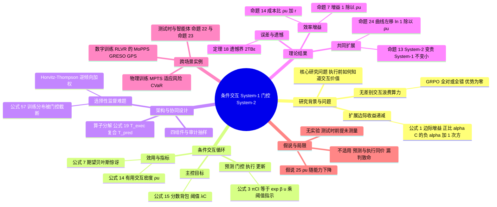

## 一、论文是干什么的？

想象你是一家餐厅的老板，厨房（大厨）每做一道菜都很贵。如果顾客点的每一道菜都让大厨从头做一遍，再看好不好吃，成本会很高。聪明的做法是在前台安排一位经验丰富的店员：他看一眼订单就能判断「这道菜大概率没问题、不值得大厨亲自试做」还是「这道菜很特别，必须认真做」。大厨只做值得做的，成本就下降了；而大厨做出来的结果，又反过来帮店员积累经验。这篇论文讲的就是这个故事。

近几年 AI 的进步主要靠「把昂贵的执行者做得更大」：更大的模型、更多的数据和算力、更长的推理链、更多的智能体。论文把这个昂贵的执行者叫作 **System-2**（慢而深思的系统）。作者问：下一阶段的进步，会不会来自给它配一个轻量的搭档 **System-1**（快而廉价的预测器），让它在执行之前先估计每个候选「交互」值不值得花钱？作者的回答是「有条件的肯定」。需要先说清楚：这是一篇**观点加理论**（Perspective）论文，全文没有训练任何模型，也没有跑任何新的对比实验，所有「节省多少算力」的结论都是在明确假设下推出来的数学结果或者假说，不是实测数字。

这里的「交互」是论文的基本单位：大模型生成一段思维链、强化学习智能体跑一条轨迹、工具型智能体调用一次工具，都算一次交互。它们的共同点是：先付钱，后看结果。

## 二、核心方法与创新

### 1. 条件交互：预测、门控、执行、更新

论文提出的核心机制叫**条件交互**（conditional interaction），是一个四步循环：

1. **预测**：System-1 用很低的成本（记作 $c_{\mathrm{pred}}$，远小于执行成本 $c_{\mathrm{exec}}$）给每个候选交互打分，估计它的效用。
2. **门控**：只有分数超过阈值 $\kappa_t$ 的候选才会被放行。
3. **执行**：System-2 只执行被放行的候选。
4. **更新**：执行的结果反过来训练 System-1，让它越来越准。

类比：System-1 像机场的安检初筛，快速挑出「需要开箱检查」的行李；System-2 是慢而细的人工开箱。论文强调，这不是普通的「小模型筛一遍再交给大模型」（静态级联，训练一次后冻结），关键区别在于**反馈和联合优化**：什么对当前 System-2 有用会随着 System-2 的每次更新而改变，所以 System-1 必须持续从 System-2 的结果里学习。

选择规则（公式 3）写成 $\pi_{\mathrm{CI}}(i_t)=\frac{1}{Z_t}\exp(\beta\hat u(i_t))\cdot[\hat u(i_t)\ge\kappa_t]$：阈值 $\kappa_t$ 决定谁有资格被执行，温度参数 $\beta$ 决定在有资格的候选里多偏向最高分者；当 $\beta\to\infty$ 就退化成贪心的取最大值（命题 2）。如果所有候选都低于阈值，系统就选择「弃权」，什么也不执行。

### 2. 效用怎么定义

论文默认的效用是**期望贝叶斯惊讶**（公式 7），也就是「执行这次交互后，我的信念预计会改变多少」，等于互信息 $I(\theta;o\mid i,\mathcal{H})$。结果完全可预测的交互，效用接近零。但作者反复强调这只是一种选择，不同场景可以换成别的效用：实验设计用信息增益，课程学习用期望提升，决策用信息价值，鲁棒域随机化用适应风险。论文里所有的「效率结论」都是相对于「已声明的某个效用」来说的。

### 3. 核心指标 $\rho_u$

论文最重要的新概念是 $\rho_u$，即**有用交互的密度**（公式 14）：$\rho_u(\theta_t)=\Pr_{i\sim\mathcal{D}}[u(i;\theta_t)\ge u_{\min}]$，意思是候选池里真实效用超过某个下限的比例。比如强化学习里用 GRPO 训练推理模型时，一道题让模型答 $G$ 次，如果全对或全错，所有回答的优势值都是 0，这道题就白白消耗了 $G$ 次生成。论文用 $u_{\mathrm{adv}}=1-p^G-(1-p)^G$（$p$ 为当前通过率）表示这道题「有信号」的概率，此时 $\rho_u$ 就是「能产生非零优势的题目所占比例」。

作者的假说是：除了参数量 $N$、数据量 $D$、算力 $C$ 之外，$\rho_u$ 是一个**效率坐标**，描述这三者转化为能力的效率，即 $\mathcal{P}=f(N,D,C,\rho_u)$。并且预测 $\rho_u$ 会随着模型变强而下降（假说 25：已经掌握的东西不再有用），这也许能部分解释为什么扩展定律有边际递减。注意：作者明确说这只是假说，需要独立测量，不能反过来拿损失曲线去拟合 $\rho_u$（那样是循环论证，见 Remark 9）。

### 4. 主要理论结果（都在明确假设下成立）

| 结果 | 内容 | 通俗解释 |
|---|---|---|
| 命题 7（IIE 增益） | 完美且免费的预测器下，单位成本的效用提升为 $1/\rho_u$（成本相等时）；有误报率 $f_p$、漏报率 $f_n$、预测成本时按公式 13 打折 | 有用的题只占 20% 时，理想情况最多省到五分之一的执行量 |
| 命题 14（筛选增益） | 完美筛选下成本比为 $\mathcal{C}_{\mathrm{CI}}/\mathcal{C}_{\mathrm{react}}=\rho_u+r$，$r=c_{\mathrm{screen}}/c_{\mathrm{exec}}$ | 只要筛选够便宜，节省就逼近 $1/\rho_u$ |
| 命题 15（内存） | 预测式评分的峰值内存是 $\Theta(BGLd_{\mathrm{model}}+bd_e+B)$，与候选总数 $n$ 无关 | 候选池可以很大而不占 rollout 内存 |
| 定理 18（遗憾界） | $\mathcal{R}_T\le 2TB\varepsilon_\phi\cdot[2\varepsilon_\phi\ge \mathrm{gap}_{\min}]$ | 预测误差小于效用间隔的一半时，选得和神谕完全一样 |
| 命题 13（共同扩展） | System-2 成本放大 $k$ 倍时，最优 System-1 尺寸不减小 | System-2 越贵，越值得把 System-1 做大一点 |
| 命题 22、23 | 测试时与智能体场景的成本上界，分别逼近 $1/\rho_u^{tt}$ 和 $\rho_u^{\mathcal{C}}+r+m\varepsilon_\phi R_c$ | 同一思路用在推理阶段的停止决策和工具调用上 |
| 命题 24（水平缩放） | $\mathcal{L}_{\mathrm{CI}}(\mathcal{C})=\mathcal{L}_{\mathrm{base}}(\mathcal{C}/\rho_u)$ | 对数算力轴上曲线整体左移 $\ln(1/\rho_u)$ |

### 5. 架构与几个设计细节

- **算子分解**（公式 17 到 19）：$(\theta_{t+1},\phi_{t+1})=(\mathcal{T}_{\mathrm{exec}}\circ\mathcal{T}_{\mathrm{pred}})(\theta_t,\phi_t;\mathcal{H}_{0:t})$，System-1 先快速更新，System-2 再沿着经过门控的梯度慢速更新。两个时间尺度不同，作者认为这是循环稳定的原因，但**通用情形的收敛保证仍是开放问题**。
- **四个组件**：表示（用冻结的语言模型编码器等把候选变成向量）、预测（输出均值和不确定度）、门控、学习。阈值用公式 22 自适应：$\kappa_{t+1}=\kappa_t+\alpha_\kappa(n^{\mathrm{adm}}_t/n-\rho^*)$，让放行比例稳定在目标值 $\rho^*$ 附近。
- **审计抽样**：被拒绝的候选里随机抽一小部分仍然执行，用来发现 System-1 的漏判。
- **三个接口**：知识接口（把 System-2 的解直接蒸馏给 System-1）、表示接口（System-1 是否共享 System-2 的特征，共享会准一点但盲点相同）、反馈接口（哪些结果用来监督 System-1）。
- **最大的结构性难题：选择性监督**（第 7.2 节，公式 57）。因为只有被放行的交互才有结果，System-1 的训练数据是它自己挑出来的，被误判为低价值的候选永远得不到纠正。解决思路是探索混合、独立审计，再用逆倾向加权（Horvitz-Thompson）修正，作者承认这仍是最需要理论的地方。
- **何时不该用门控**（第 2.4 节）：候选价值差不多、预测和执行一样贵、执行本来就便宜、漏判代价灾难性（安全关键场景）、效用定义错误时。

## 三、使用了哪些模型和计算资源？

- **LLM 或基础模型**：论文没有训练或评测任何具体的 LLM，**论文未披露任何模型名称与版本**。文中提到的 GRPO、DAPO 是训练算法，OpenAI o1 仅出现在参考文献里，都是引用背景，不是本文的实验对象。
- **GPU 与计算资源**：本文没有实验，**暂无相关信息**（没有 GPU 型号、数量，也没有 API 调用量）。
- **每个计算单位的耗时与成本**：没有训练 run、没有推理样本，**论文未披露**。文中给出的只是成本的渐近表达式，例如公式 25、26 里的 $\Theta(nGLd_{\mathrm{model}}^2)$ 对比 $\Theta(n\,c_{\mathrm{embed}})+\Theta(nd_\phi^2)+\Theta(BGLd_{\mathrm{model}}^2)$，这是阶数估计，不是实测耗时。
- 文中提到的「数个倍数的 rollout 节省」是引用前人预测式提示采样工作（如 MoPPS）的结果，作者自己说明这些是「说明而非验证」该框架，也并非本文实测。

## 四、实验结果

**本文没有新的实验结果表**。论文自己区分了三类说法（第 7 节开头）：

| 类别 | 内容 |
|---|---|
| 在明确假设下已证明 | IIE 核算（命题 7）、筛选与内存结果（命题 14、15）、遗憾界（定理 18、推论 19）、测试时与智能体成本界（命题 22、23）、固定误差曲线下的共同扩展（命题 13）、水平缩放（命题 24） |
| 有特定应用的证据支持 | 预测式提示与任务采样的节省（第 5.1 节引用的文献，作者称这些结果与「只是水平缩放」的零假设一致） |
| 仅为假说 | 共同设计能在成本、服务质量和成功率上同时占优的前沿（图 3）、$\rho_u$ 的衰减（假说 25）、扩展指数发生变化 |

几点需要特别留意的诚实提示（均来自论文自述）：

- 测试时（推理阶段）的节省结论，论文称其前提（有用比例小、停止预测器准确）**都还没有被测量过**，是「效率主张里连间接证据都没有的地方」。
- 理想的 $1/\rho_u$ 是上限，不是实际加速比：审计抽样、预测器重训、筛选误差都会降低它。
- $\rho_u$ 的衰减曲线**尚未被测量**，作者认为测量它是检验整个框架最干净的单个实验。

举一个纯算术的例子帮助理解（这是本综述的示意计算，不是论文数据）：若某批题目里只有 20% 有用，即 $\rho_u=0.2$，理想情况下执行量最多降到约五分之一，即最多约 5 倍节省。

## 五、潜在应用与已落地应用

**潜在方向（论文的论述）**

- 强化学习后训练里的在线提示选择，避免在全对或全错的题上浪费 rollout。
- 具身智能和机器人里的任务或域随机化配置选择，因为真实世界的 rollout 不能随便并行。
- 测试时推理的自适应停止、模型路由，以及智能体的工具与电脑使用门控（把延迟、花费、token、风险放进同一个成本账本）。
- 科学发现里的自适应实验设计、数据和上下文的存储管理（缓存、回放池）。
- 论文还提到 System-1 位于所有动作之前，天然适合作为安全与成本约束的把关位置。

**已落地情况（只写有依据的）**

- 论文综述的相关工作（如 MoPPS、GRESO、DPS、BOTS、PCL、GPS、MPTS 等）是前人或同一团队的预测式采样方法，作者明确说这些结果「说明而非验证」了本框架，所以不能视为本文的落地。
- **本文自己的代码、模型、数据集、demo**：我核查了 HF 论文页（API 显示关联的模型、数据集、Space 均为 0）、作者的[项目页](https://cheemswang.github.io/blogs/sys1-sys2-codesign.html)（页面末尾有一个名为「Try it」的小型交互模拟（120 个候选任务，演示先预测再执行能省多少），但页面内没有 GitHub 链接），并用 GitHub 搜索接口按 arXiv 编号检索，均未发现本文专属的代码仓库。结论：截至 2026-11-06，未找到本文专属的开源代码或模型。
- 第三方聚合站 [hyper.ai](https://hyper.ai/en/papers/2610.39497) 的「View Code」按钮指向 [thu-rllab/MoPPS](https://github.com/thu-rllab/MoPPS)。这是同一团队更早的论文（KDD 2026，摘要为在线预测提示难度加速推理模型的 RL 微调）的仓库，我通过 GitHub API 看到它创建于 2025-07-04，最近一次推送为 2026-03-04（79 个星），**不是本文的代码**，也没有证据表明它实现了本文的框架。

## 六、网络上的讨论与评价

我查过的来源：HF 论文页、arXiv 摘要页、作者项目页、hyper.ai、AI News Weekly，并用搜索引擎检索了 Reddit、X/Twitter、Hacker News、知乎、微信公众号、博客的相关结果。实际能找到的很少，如实记录如下。

- [HF 论文页](https://huggingface.co/papers/2610.39497)：HF 上显示 69 个点赞。页面上有三条评论：作者 Yun Qu 贴了论文摘要；用户 MLSystemsRI 留言说，先便宜检查、再让昂贵的执行者出动，就像工程报价先在纸面上筛活儿，并好奇「闸门究竟多常拒绝掉本来有回报的事」；另一条是 Librarian Bot 的自动相关论文推荐。
- [AI News Weekly 的报道](https://aiweekly.co/alerts/paper-proposes-informative-compute-as-agi-scaling-yardstick)（2026-11-02，作者署名 Alexis Dufresne）：复述了论文要点，称这是一个「提出以信息量算力作为 AGI 扩展衡量标尺」的假说，并强调作者把结果表述为「由分析支持的假说」而不是已在训练系统中证明的结果；编者按认为，如果该思路成立，前沿智能体的基础设施预算可能从「买更多 token」转向「建设更好的分流模型」，并评价作者「没有夸大」。这是该站的转述与评论，不是独立实验验证。
- [hyper.ai 论文页](https://hyper.ai/en/papers/2610.39497)：只是论文摘要的聚合页，标注 Tsinghua 与 THU-IDM、标签为 Reasoning、LLM、Agent，未显示社区评论。
- [作者项目页](https://cheemswang.github.io/blogs/sys1-sys2-codesign.html)：作者自己的科普式长文，不属于第三方讨论。
- [Pith 评审页](https://pith.science/paper/2610.39497)：由 AI 评审员（页面注明为 deepseek-v4-flash，2026-10-30 读论文）生成的评审，不是人类专家意见。总评大意是：这是一篇谨慎、坦诚的观点型论文，把预测式筛选形式化得很好，但头条的扩展性结论依赖一个未被测量、作者自己也点明的假设（每次交互带来的进展大致恒定）；页面列出 2 条主要质疑和 6 条次要质疑。
- Reddit、X/Twitter、Hacker News、知乎、微信公众号、Paperium：用搜索引擎没有检索到有关本文的帖子或文章（我没有逐站点直接抓取这些站点）。**未找到相关讨论**不代表不存在。

## 七、思维导图

