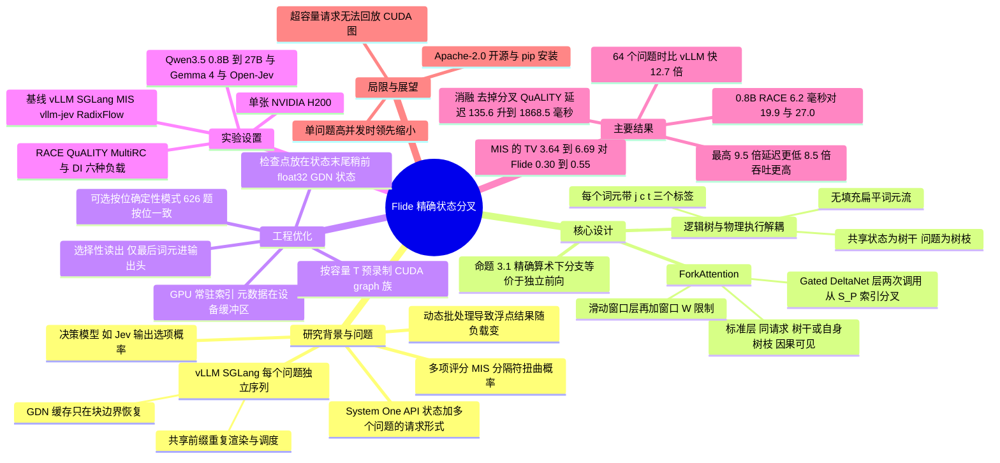

## 一、论文是干什么的？

先打个比方。你去医院做体检，医生要问你一堆是非题：有没有发烧？有没有咳嗽？有没有过敏史？这些问题都基于同一份病历。如果每问一个问题，医生都要把整份病历从头到尾重读一遍，那就太浪费了。更聪明的做法是：病历只读一遍，然后带着读完的印象依次回答每个问题。

现在的大模型推理引擎（例如 vLLM、SGLang）本质上是为「写文章」设计的：一个请求对应一条文字序列，一直往后生成。但在 LLM 智能体（agent）系统里，有一类越来越常见的任务并不需要写文章，只需要做选择题，例如「这封邮件是不是垃圾邮件」「下一步该调用哪个工具」。论文把专门做这类任务的模型叫作**决策模型**（decision model），摘要里提到的 Jev 被当作这类模型的代表；论文摘要把这类模型提供的轻量、可靠的分类式判断称为「rapid System One execution」（快速的 System One 执行）；正文里 System One 是一个接口名，即 vLLM 和 SGLang 已经提供的「System One API」（引自 TypeSafe AI, 2026），请求形式是一个状态加若干个问题。论文没有对 System One 和 Jev 另做定义，Jev 只是被当作一类决策模型的代表引用（同样引自 TypeSafe AI, 2026），具体含义本文不做展开。决策模型不生成一大段文字，而是直接给出每个选项的概率，再用阈值（例如概率大于 0.5 就执行）去触发动作。

问题在于：同一份上下文（论文里叫「状态」，state）常常要问很多个问题。现有引擎要么把每个问题当成独立请求，反复处理同一段前缀；要么用「多项评分」（multi-item scoring，简称 MIS）的办法把多个问题拼在一起，但这样会让问题之间互相干扰，概率就被扭曲了。**Flide** 就是为这个场景专门设计的推理引擎：共享的上下文只算一次，每个问题像树枝一样从同一个树干上分叉出去，并且在精确算术下，每个分支的结果与单独跑一遍完全等价。

论文发布于 2026-10-30（arXiv v1），作者来自新加坡国立大学和牛津大学。

## 二、核心方法与创新

### 1. 现有引擎的三个痛点

论文指出 vLLM、SGLang 等面向生成的引擎处理决策请求时有这些问题：

- **重复计算前缀**：每个问题被当成独立提示词，共享上下文要被渲染、分词、调度很多遍。最新的 vLLM 能把共享上下文只算一次，但每个问题仍然是一条独立序列。
- **混合架构缓存的缺口**：像 Qwen3.5 这类混合架构里既有标准注意力层，也有循环式的 Gated DeltaNet（GDN）层。前缀缓存只能在「块边界」处恢复循环状态，边界之后的词元要重新算。
- **概率被扭曲**：MIS 会在每个问题前插入分隔符，改变了隐藏状态，输出概率与「单独问这个问题」时不同。
- **不确定性**：动态批处理时，浮点数求和顺序会随批次组成而变，同一个请求在不同负载下可能得到不同决策。

### 2. 逻辑树与物理执行解耦

Flide 的核心想法是把「请求在逻辑上长什么样」和「在 GPU 上怎么执行」分开。逻辑上，一个请求是一棵树：共享状态是**树干**（trunk），每个问题是一根**树枝**（branch）。物理上，Flide 把一整轮的所有请求压成**一条没有填充（padding）的扁平词元流**，大致是「各请求的状态在前，各个问题在后」。每个词元身上带着三个标签：属于哪个请求 $j$、属于哪根树枝 $c$（$c=0$ 表示树干）、位置 $t$。树的依赖关系不靠复杂的调度器表达，而是存在 GPU 上的元数据里。

类比：像把一整班同学的试卷拆成「共用的阅读材料」和「各自的小题」，所有材料和小题按顺序排成一长条流水线，每个小题身上贴着标签说明它该看哪份材料。

问题的位置编号从状态长度 $P$ 之后接着走，这样旋转位置编码与单独跑完整提示词 $s \oplus q_i$ 时一致。

### 3. ForkAttention

ForkAttention 是让「一条扁平流」表现得像「很多独立请求」的关键。

- **标准注意力层**：一个查询词元 $x$ 只能看到满足以下条件的键 $y$：同一请求（$j_y=j_x$）、属于树干或自己的树枝（$c_y \in \{0, c_x\}$）、位置不在自己之后（$t_y \le t_x$）。滑动窗口层再加一条距离小于窗口 $W$ 的限制。简单说就是「只能看自己的材料和自己的题，别人的题看不见」。
- **Gated DeltaNet 层**（循环层）：每层分两次调用。第一次处理各请求的状态段，得到每个请求的循环状态 $S_P$ 和卷积窗口；第二次把所有问题段放在一起处理，每个问题通过索引从自己请求的 $S_P$ 出发，**不需要复制状态**。

### 4. 精确性保证

论文的命题 3.1 说：对一个因果模型，在精确算术下，每个问题词元的隐藏状态与单独跑 $s \oplus q_i$ 完全相同，而且与同一轮里其他请求无关（证明在附录 A，用逐层归纳）。在真实的浮点数下，差异只在舍入误差级别，论文通过测试验证。

### 5. 工程上的加速手段

- **GPU 常驻索引与扁平图执行**：一轮的组成（各段长度、位置、键范围、状态索引）全部放在设备缓冲区里。启动时，Flide 预先录制一族 CUDA 图（按词元流容量 $T$ 分档），每轮选能装下的最小的一张回放；超过最大容量的轮会按请求边界拆分，单个请求就超容量则不用图回放。
- **选择性读出**：只有每个问题的最后一个词元要送进输出头，所以最后一层的 MLP 只在这些行上算。
- **增量状态分叉（检查点恢复）**：在状态内部某个位置 $m$ 存检查点，保存每个 GDN 层的 float32 循环状态和卷积窗口，以及 $m$ 之前的标准注意力 KV。检查点放在稍微靠前的位置，这样下一步最可能变化的词元落在检查点之后，只需重算那一小段。
- **按位确定性模式（可选）**：归约顺序不依赖于一轮的组成，因此在任何负载下答案的每一位都相同。论文称在 Qwen3.5 上，DI、RACE、MultiRC、QuALITY 共 626 个问题的分叉答案与单独运行的结果按位一致。

## 三、使用了哪些模型和计算资源？

**GPU**：论文称所有测量都在一张 NVIDIA H200 上完成（1 块）。引擎逐个启动，每个负载级别之前清空前缀缓存。

**评测的模型**（以 bfloat16 提供服务，开启 CUDA 图，MIS 除外；float32 参考关闭 TF32）：

| 类别 | 模型 |
|---|---|
| 混合架构（含 GDN 层） | Qwen3.5 的 0.8B、4B、9B、27B |
| 另一模型族 | Gemma 4 的 E2B、E4B、12B、31B |
| 专用决策模型 | Open-Jev-2B、Open-Jev-9B |

附录 H 还列出了一长串用 Flide 服务的决策模型（如 Intern-Decision 4B、Senova 4B、StartLux 4B、OneJev 0.8B、AJev 12B、Sieve 31B 等），每个与其发布时使用的引擎比较，中位延迟加速比大约从 1.1 倍到 28 倍（该附录的详细逐项数字本文不一一转述）。

**对比基线**：vLLM（决策接口）、SGLang（决策接口）、SGLang 多项评分（MIS）、vllm-jev、vllm-jev 加 RadixFlow。论文提到 vLLM 版本为 10 月 14 日的构建。

**数据与负载**：RACE、QuALITY、MultiRC（阅读理解选择题）以及 Decision Index（DI）公开集，共六种负载：RACE、QuALITY 每个状态只问一个问题；RACE、QuALITY、MultiRC 把一个状态的所有问题放进一个请求（平均每请求问题数：RACE 4.0，QuALITY 18.1，MultiRC 47.6）。另有图像（GQA）和智能体历史的扩展实验。

**每个计算单位的耗时**：论文报告的是**每个请求的中位延迟**（单个客户端，毫秒），以及 8、32、64 个并发客户端（C8、C32、C64）下的每秒请求数（表 3 只列 C8 和 C64，C32 出现在其他表里）；**没有按「每轮（round）」或「每批」报告延迟**，这部分为「暂无相关信息」。训练方面：Flide 是推理引擎，不涉及训练，「暂无相关信息」。单卡显存峰值见第四节。

单问题、单客户端的中位延迟（毫秒，来自论文表 3，Qwen3.5）：

| 模型 | 引擎 | RACE | QuALITY |
|---|---|---|---|
| 0.8B | vLLM | 19.9 | 35.1 |
| 0.8B | SGLang | 27.0 | 35.3 |
| 0.8B | Flide | 6.2 | 17.9 |
| 4B | vLLM | 24.6 | 68.6 |
| 4B | SGLang | 31.6 | 75.3 |
| 4B | Flide | 10.9 | 62.3 |
| 9B | vLLM | 24.7 | 106 |
| 9B | SGLang | 32.6 | 117 |
| 9B | Flide | 13.7 | 102 |
| 27B | vLLM | 48.2 | 337 |
| 27B | SGLang | 55.9 | 363 |
| 27B | Flide | 41.2 | 340 |

可以看到模型越大、上下文越长，计算本身越占主导，Flide 的单问题优势越小，在 27B 的 QuALITY 上甚至略慢于 vLLM（340 对 337 毫秒）。

## 四、实验结果

**速度**

- 摘要和正文数字：最高比最佳基线延迟低 9.5 倍、吞吐高 8.5 倍；摘要写的是「最高比 vLLM 和 SGLang 快 9.5 倍」。这个最大值可以在论文表 3 里对上：Qwen3.5-0.8B、QuALITY 把一篇文章的所有问题放进一个请求（平均约 18 个问题）时，最好的基线（SGLang）单请求延迟 359 毫秒，Flide 37.7 毫秒，约 9.5 倍；吞吐 39.1 对 4.6 请求每秒（8 个客户端），约 8.5 倍。（这是本文根据表格数字的核算；论文正文没有逐字写出对应哪一格。）
- 单问题场景（Qwen3.5-0.8B，RACE）：Flide 6.2 毫秒，vLLM 19.9 毫秒，SGLang 27.0 毫秒，最小模型上最多约 3.2 倍。
- 多问题场景：Flide 在每个模型规模和并发级别都领先，收益最大的是 QuALITY 和 MultiRC。Qwen3.5 平均下 MultiRC 延迟：Flide 105 毫秒，vLLM 350 毫秒，SGLang 491 毫秒。
- 同一状态问 64 个问题时，Flide 比 vLLM 快 12.7 倍（论文图 5a）。
- Gemma 4：多问题延迟比 vLLM 低 1.1 倍到 2.9 倍。
- 专用决策模型（Open-Jev 2B 与 9B 平均）：RACE 延迟 Flide 13.0 毫秒，对 vllm-jev 49.8 毫秒、对 RadixFlow 40.9 毫秒；QuALITY 为 72.8 毫秒，对 101.8 与 113.3 毫秒；长提示上优势最高约 1.7 倍。
- 智能体历史越来越长时，Flide 每多一千词元历史的边际成本约 0.6 到 1.0 毫秒；32 个智能体、0.8B 模型下每秒 208.2 步，对 MIS 的 28.9 步，约 7.2 倍。
- 图像（GQA）：每张图比 vLLM 和 SGLang 中较好者快 5.0 倍到 7.5 倍。
- 显存峰值（表 14）：默认设置下 vLLM 与 SGLang 分别为 135.3 和 131.7 GiB，Flide 为 18.8 GiB（这主要反映 vLLM 和 SGLang 默认会预留大部分显存给键值缓存，峰值取决于设置，并不是它们真实需要那么多；论文把各引擎限制到卡的十分之一后，vLLM 为 17.2、SGLang 为 18.7 GiB，与 Flide 的 18.8 GiB 相当，论文称此时 Flide 在同等显存下仍保持吞吐领先。所以不要把 135.3 对 18.8 理解成 Flide 省了约 7 倍显存）。
- 启动：0.8B 服务器用预编译内核包约 36.3 秒就绪，不用则约 181 秒。

**输出保真度（Qwen3.5 平均，表 4）**

- 与 float32 参考的 top-1 答案一致率（RACE 单问题）：Flide 99.8%，vLLM 99.5%，SGLang 99.2%。
- 不同负载下答案变化的比例：Flide 最多 0.2%，SGLang 最多 1.7%，vLLM 最多 3.2%。
- 分隔符代价（平均总变差距离 TV，单位为百分点）：MIS 在 DI、RACE、QuALITY、MultiRC 上分别为 4.84、3.64、6.69、3.77；Flide 为 0.44、0.36、0.55、0.30。MIS 在阈值 0.5 下的决策翻转率最高 29%，Flide 最多 2.3%。
- 准确率：Flide 与 vLLM 相差在每个格子里都不超过 1.2 个百分点。

**消融（Qwen3.5-4B，表 5）**

| 去掉的组件 | 影响 |
|---|---|
| 分叉（forks） | QuALITY 全问题延迟从 135.6 毫秒升到 1868.5 毫秒；DI 吞吐从 48.9 降到 20.7 请求每秒 |
| CUDA 图 | DI 延迟从 8.8 毫秒升到 76.1 毫秒 |
| 扁平图 | RACE 全问题吞吐从 210.3 降到 134.9 请求每秒，约降 36% |
| 选择性读出 | 各负载吞吐小幅下降 |

**局限（论文行文中提到的，没有专门的局限章节）**

- 单问题、高并发时，Flide 的领先会缩小，例如论文说在许多客户端下 QuALITY 上只领先约 4%。
- 超出最大 CUDA 图容量的请求不能用图回放。
- 按位不变模式是可选的，开启它在 64 个客户端下最多损失 10% 吞吐。
- 一些比较依赖特定引擎版本和各引擎不同的提示格式。

## 五、潜在应用与已落地应用

**潜在应用**：智能体的路由与工具选择、邮件或工单分类打标签、内容审核、一份文档同时问多个是非题、语音助手（一次输入、多个判断）、带图像的多问题判断等。

**已落地与开源情况**

- **开源**：代码在 [GitHub 的 OmniJev/Flide](https://github.com/OmniJev/Flide)，页面显示许可证为 Apache-2.0（其中 GDN 内核含有来自 MIT 许可的 flash-linear-attention 的代码）。项目主页 [flide.org](https://flide.org)，可用 `pip install flide` 安装、`flide serve --model Qwen/Qwen3.5-0.8B` 启动。
- **模型支持**：项目页列出 Qwen3.5 与 Gemma 4 系列，并提到 OneJev、Open-Jev 等决策模型；预编译内核列出 A40、A10、RTX 30、H100、H200。README 称提供 Jev 的 `/v1/systemone` 接口。
- **集成情况**：论文附录 H 说明多个决策模型已用 Flide 提供服务，OneJev 此前使用的引擎被 Flide 取代并比较了速度。除此之外是否有第三方生产环境部署，暂无相关信息。
- **README 演示**：README 称一张 H200 上 28 秒处理 1 万封邮件、每封 8 个问题（这是项目自述，本文未独立验证）。

## 六、网络上的讨论与评价

- **Hacker News**：作者团队成员 unikcc 发了 [Show HN 帖子](https://news.ycombinator.com/item?id=50421155)，标题为「Show HN: Flide: Make Jev-like decision models up to 9.5x faster」，抓取时约 124 分、约 30 条评论。要点如下，均为人类用户的发言：
  - 有人问 9.5 倍出现在什么条件下。作者回答：这是 Qwen3.5-0.8B 在 QuALITY 上每篇文章（约 5.8k 词元）约 18 个问题的情况（与上面表 3 的核算一致）；问题越多收益越大，单问题从接近持平到超过 3 倍；没有准确率损失，只有浮点舍入差异。
  - 有评论者（p-e-w）认为「同一个问题、很多输入」的反向场景在实践中更有用；作者承认当前设置在那里帮助不大，计划支持动态把问题放在前面。
  - 有评论者（Tostino）说自己改了 vLLM 做共享上下文的决策实验，也拿到相近的收益，不需要新引擎；作者回应对标准注意力成立，但 vLLM 在 Qwen3.5 上只在块边界缓存 GDN 状态，所以 Flide 自己做了缓存并保证任意负载下按位一致。
  - 硬件方面：作者说仅在 Linux 上测试，6GB 的 NVIDIA 显卡可跑 0.8B 模型；纯 CPU 或更小显卡建议用 llama.cpp 或 LM Studio；有用户询问的 GLiDE 9B 尚未支持，因为它是双向注意力，加速空间有限。
- **论文评论区**：HF 论文页（抓取时）没有评论内容，暂无相关信息。
- **GitHub**：仓库抓取时约 483 星、31 个分叉，当时没有未关闭的 issue（有 2 个未合并的 PR）（GitHub 数据，随时间会变）。
- **博客文章**：[Singularity Moments 的一篇文章](https://singularitymoments.com/content/forking-the-mind-inside-flides-95x-acceleration-for-decision-models/)无署名，配图标注为 AI 生成，文风疑似 AI 撰写（属于推断），**不能当作人类专家意见**。它整体褒扬，同时指出输出很长时效率下降、分布式栈还不成熟；文中不少数字（如微秒级延迟、对手延迟范围）没有来源，与论文表格不一致，不要采信。
- 另有 hyper.ai、papers.cool、deeplearn.org、zeli.app 等聚合或镜像页，只是转载摘要，不含独立评价。
- 知乎、Reddit、X/Twitter 上的讨论：暂无相关信息（本次未检索到）。

## 七、思维导图

