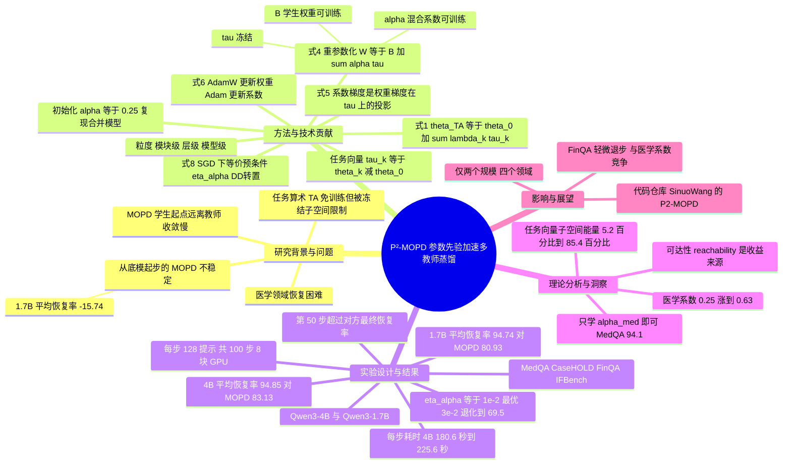

## 一、论文是干什么的？

想象一所学校要培养一个「全科学生」，手边有四位单科名师：医学老师、法律老师、金融老师、指令遵循老师。传统做法（多教师在线策略蒸馏，MOPD）是：让学生自己先做题、写答案，再由四位老师逐字给反馈，学生照着反馈改。问题是学生起点是「通用底模」，一开始离每位老师都很远，学得很慢，而且容易偏科——某一科被别的科「挤掉」。

另一条路是「任务算术」（task arithmetic，一种模型合并方法）：直接把各位老师相对底模的「进步量」按比例加到底模上，不用训练，几秒钟就能得到一个混合模型。但这样合并出来的模型往往只能拿到老师水平的一部分。

这篇论文 P²-MOPD 把两条路合起来：先用合并结果当起点，然后把「各位老师的进步量乘以可学习的系数」直接做进学生的权重里，让系数和学生权重一起被蒸馏目标训练。老师的参数此时变成了「参数先验」，既给出一个好起点，又给出一组好用的前进方向。据论文报告，它用一半的训练步数就超过了 MOPD 的最终平均恢复率；1.7B 学生平均恢复率为 94.7%，而 MOPD（以合并结果为起点）为 80.9%。

论文发布于 2026-11-02（arXiv v1），v2 修订于 2026-11-05。

## 二、核心方法与创新

### 2.1 先弄懂几个基础概念

- **在线策略蒸馏（on-policy distillation）**：学生自己生成答案，老师对学生写出的每个词给出打分。类比：学生先写一遍作文，老师在学生自己写的句子上逐词批注，而不是让学生背老师的范文。好处是学生练的正是自己真实会犯的错误。
- **任务向量（task vector）**：老师模型的参数减去底模参数，即 $\tau_k=\theta_k-\theta_0$。类比：老师相对于「普通学生」多学到的那一份「进步笔记」。
- **任务算术 / 模型合并**（式 1）：$\theta_{\mathrm{TA}}(\lambda)=\theta_0+\sum_k \lambda_k\tau_k$。论文里 $K=4$，均匀取 $\lambda_k=0.25$，也就是把四份笔记各取四分之一加到底模上。
- **恢复率（recovery）**：单个领域的恢复率为 $(s-s_{\mathrm{base}})/(s_{\mathrm{teacher}}-s_{\mathrm{base}})$，即学生从底模水平追到老师水平的比例，0 表示没进步，100 表示追平老师；论文的主指标是四个领域的平均值。

### 2.2 MOPD 的奖励与损失

对学生在某一位置的候选词 $v$，奖励为（式 2）：

$$r_i(v)=-w_i(v)\,[\log p(v)-\log q(v)]$$

其中 $p$ 是学生概率，$q$ 是对应领域老师的概率，$w_i(v)$ 是学生概率在候选词集合上重新归一化后的权重。意思是：学生比老师更自信的词，会被扣分。损失（式 3）是带裁剪的策略梯度形式，奖励当作常数处理，按未被遮蔽的回答词数归一化。

### 2.3 P²-MOPD 的关键：重参数化

对每个权重模块 $m$，P²-MOPD 把权重写成（式 4）：

$$W_m(B,\alpha)=B_m+\sum_k \alpha_{k,m}\,\tau_{k,m}$$

- $B$ 是学生自己的完整权重，可训练。
- $\alpha_{k,m}$ 是第 $k$ 位老师在模块 $m$ 上的混合系数，可训练。
- 任务向量 $\tau$ 冻结不动。
- 初始化：$B_m$ 取任务算术合并后的权重，$\alpha_{k,m}=\lambda_k=0.25$，所以训练起点与合并模型完全一致。

类比：学生手里既有「自己的笔记本」（$B$，可以随便改），又有四本「老师笔记」，并且有四个「音量旋钮」（$\alpha$）决定每本老师笔记读多大声。旋钮和笔记本一起学。

### 2.4 梯度与更新

- 式 5：$\partial L/\partial B_m=G_m$，$\partial L/\partial \alpha_{k,m}=\langle G_m,\tau_{k,m}\rangle$。也就是说，系数的梯度就是权重梯度在老师任务向量方向上的投影，几乎不需要额外反向传播。
- 式 6：权重用 AdamW 更新，系数用单独的 Adam 更新，两条通道使用同一份更新前的梯度；系数增量再乘以任务向量加回权重里，保证两边一致。
- 式 7：总位移分成两部分，一部分是学生权重自由移动，另一部分落在任务向量张成的子空间内。
- 式 8：若用最简单的 SGD，等价于给梯度加了预条件，$w^+=w-(\eta_W I+\eta_\alpha DD^\top)g$。直观理解：沿着老师给出的方向，有效学习率被放大了，所以走得更快。

### 2.5 粒度

系数可以设在三种粒度：模块级（每位老师每个权重模块一个系数，主设置）、层级（每位老师每层一个）、模型级（每位老师一个）。

### 2.6 论文给出的「为什么有效」

论文把收益归因于「可达性」（reachability）：把老师方向加进来之后，学生能更快到达需要的参数区域。证据包括：

- 沿医学任务向量 $\tau_{\mathrm{med}}$ 的位移，MOPD（合并起点）仅为 +0.03，P²-MOPD 为 +0.40（4B）和 +0.42（1.7B）。
- 位移能量落在任务向量子空间内的比例，MOPD（合并起点）为 5.2%（4B）和 10.7%（1.7B），P²-MOPD 为 85.4% 和 90.0%。
- 医学系数从 0.25 涨到 0.63（4B）和 0.65（1.7B）。
- 受控实验（1.7B）：只学医学系数 $\alpha_{\mathrm{med}}$ 就能把 MedQA 拉到 94.1，而冻结该系数则只有 24.2，随机方向也几乎没有帮助（MedQA 1.4）。

### 2.7 与已有工作的关系

论文提到的相关工作包括任务算术、TIES-Merging、DARE、AdaMerging 等合并方法，以及 MOPD、IM-MOPD、Open-MOPD、MOPD-Router 等多教师蒸馏方法。本文的新意是把「学习合并系数」和「继续训练学生权重」放在同一个蒸馏目标里联合优化。

## 三、使用了哪些模型和计算资源？

**学生/底模（据论文）：**

| 规模 | 模型 | 层数 |
|---|---|---|
| 4B | Qwen3-4B | 36 层 |
| 1.7B | Qwen3-1.7B | 28 层 |

**教师（据论文）：**

- 4B：直接使用 IM-MOPD 已发布的四个领域教师（医学、法律、金融、指令遵循）。教师的具体模型名和来源仓库，论文页面未给出，暂无相关信息。
- 1.7B：作者自己训练。医学和法律教师用 SFT，训练数据是 Qwen3.6-35B-A3B 的筛选后回答；金融和指令遵循教师用 GRPO 训练 200 步。

**数据与训练设置：**

- 领域和评测：MedQA、CaseHOLD、FinQA、IFBench。τ²-bench 因其用户模拟器需要付费 API 而被省略。
- 训练提示共 65,075 条：医学 13,761、法律 31,396、金融 8,446、指令遵循 11,472。测试集大小依次为 1,273、5,314、1,147、300。
- 每步 128 个提示（每个领域 32 个），每个提示 1 条回答，共 100 步。
- 采样温度 1.0，top-p 1.0；最大提示长度 15,872 词元，最大回答长度 16,384 词元。
- 奖励支持集：学生概率前 16 的词元，核采样阈值 0.99。
- 权重用 AdamW，学习率 1e-5（5% 预热后保持常数），梯度裁剪 1.0；系数用 Adam，学习率 1e-2（主设置）。
- 评测采用 avg@3（种子 42、43、44），在第 25、50、75、100 步保存检查点。

**计算资源：**

- GPU 数量：每次运行使用 8 块 GPU（来自附录超参数表）。
- GPU 型号：暂无相关信息（论文可见文本未给出）。
- 训练框架、推理引擎：暂无相关信息（论文可见文本未给出）。
- 每步耗时（论文 Table 4）：4B 上 MOPD（合并起点）每步 180.6 秒，P²-MOPD 225.6 秒（约 1.24 倍）；1.7B 上分别为 153.9 秒和 167.4 秒（约 1.09 倍）。
- 其中演员（actor）更新耗时：4B 从 14.7 秒涨到 73.8 秒，1.7B 从 11.1 秒涨到 37.1 秒。
- 100 步总墙钟时间（论文所述）：4B 从 5.26 小时到 6.51 小时，1.7B 从 4.48 小时到 4.90 小时。注意：这些墙钟时间与「每步耗时乘以 100 步」对不上，例如 4B 的 MOPD（合并起点）按 180.6 秒乘 100 步约为 5.02 小时，而论文报告 5.26 小时（其余三组同样略高约 0.2 到 0.25 小时）。论文可见文本没有解释差异来源（可能含步骤之外的开销，但这只是猜测），本综述两组数字都照录，不做调和。
- Table 4 另有一列「预算内恢复率」，其含义是 P²-MOPD 第 75 步检查点相对 MOPD 100 步墙钟预算的数值，与上面 Table 1 的最终（第 100 步）恢复率口径不同，二者不可直接比较，故本综述不引用该列。
- GPU 小时：论文未直接给出，暂无相关信息。若按「8 块 GPU 乘以墙钟时间」自行粗算，4B 的 P²-MOPD 约 52 GPU 小时，但这是本综述的推算，不是论文数字，且未考虑评测耗时。
- 到达目标所需时间：P²-MOPD 在 4B 上不超过 MOPD（合并起点）的 0.31 倍，1.7B 上不超过 0.55 倍。

## 四、实验结果

**主要结果（三个种子平均；取自论文 Table 1，节选）：**

| 模型 / 方法 | MedQA | CaseHOLD | FinQA | IFBench | 平均恢复率 | 最差领域恢复率 |
|---|---|---|---|---|---|---|
| 4B 底模 | 68.84 | 62.03 | 58.76 | 25.89 | 0 | - |
| 4B 老师 | 79.86 | 73.57 | 75.41 | 59.22 | 100 | - |
| 4B 任务算术合并 | 73.95 | 66.00 | 70.01 | 33.78 | 42.98 | 23.67 |
| 4B MOPD（合并起点） | 76.07 | 72.62 | 75.35 | 51.08 | 83.13 | 47.22 |
| 4B IM-MOPD | 78.22 | 71.76 | 73.25 | 57.78 | 88.02 | 84.12 |
| 4B P²-MOPD | 78.74 | 72.58 | 75.01 | 59.41 | 94.85 | 89.42 |
| 1.7B 底模 | 44.10 | 44.65 | 43.62 | 19.89 | 0 | - |
| 1.7B 老师 | 58.99 | 70.52 | 62.66 | 46.44 | 100 | - |
| 1.7B 任务算术合并 | 50.67 | 57.20 | 47.40 | 24.44 | 32.41 | 17.15 |
| 1.7B MOPD（合并起点） | 48.87 | 69.15 | 62.96 | 45.22 | 80.93 | 32.03 |
| 1.7B IM-MOPD | 55.22 | 62.49 | 54.71 | 38.30 | 67.81 | 48.73 |
| 1.7B P²-MOPD | 57.20 | 69.49 | 61.53 | 46.66 | 94.74 | 88.01 |

另外，论文中从底模直接开始的普通 MOPD 在 1.7B 上出现负恢复率（-15.74），MedQA 掉到 5.21，说明从底模起步很不稳定。

**大白话解读：**

- 最大的收益来自 MedQA：相对 MOPD（合并起点）的 MedQA 恢复率平均提升 +29.0 个百分点（4B）和 +48.2 个百分点（1.7B），这里是恢复率而不是原始准确率。普通 MOPD 往往在这一科上「学不动」，P²-MOPD 把医学系数调大后补上了。
- 速度：第 25 步时领先 MOPD（合并起点）+6.2（4B）和 +21.5（1.7B）；第 50 步就超过了对方最终的平均恢复率（83.1 和 80.9）；在 24 组配对种子比较中全部领先。
- 代价：每步更慢（4B 约 1.24 倍，1.7B 约 1.09 倍），但因为收敛快，到达目标所需时间更短。
- 并非全胜：FinQA 上（恢复率口径，论文 Table 2）4B 低 1.9 个百分点（-1.9），1.7B 高 0.8 个百分点；论文正文称多数配对种子里 P²-MOPD 在 FinQA 上略低。论文把它归因于医学系数上涨后与金融的竞争。

**消融实验：**

| 训练权重 W | 训练系数 α | 4B 平均 / 最差 | 1.7B 平均 / 最差 |
|---|---|---|---|
| 否 | 否（合并起点） | 42.98 / 23.67 | 32.41 / 17.15 |
| 否 | 是 | 52.98 / 35.62 | 49.31 / 27.17 |
| 是 | 否（MOPD 合并起点） | 83.13 / 47.22 | 80.93 / 32.03 |
| 是 | 是（P²-MOPD） | 94.85 / 89.42 | 94.74 / 88.01 |

- 粒度：4B 模块级 94.9、层级 73.4、模型级 96.5；1.7B 模块级 94.7、层级 94.4、模型级 97.2。模型级数值甚至更高，但波动更大（1.7B 标准差 9.3），论文选模块级作为主设置，理由是更均衡。
- 系数学习率（1.7B）：0 时 80.9，3e-3 时 91.3，1e-2 时 94.7（最佳），3e-2 时 69.5。
- 从底模起步（初始系数为 0）：P²-MOPD 第 100 步平均恢复率 61.2，而 MOPD 为 -15.7。
- 学到的系数（4B）：医学 0.63，法律 0.37，金融 0.39，指令遵循 0.35 到 0.36（论文给出范围）；1.7B：医学 0.65 到 0.66，法律 0.46，金融 0.36，指令遵循 0.33。

**局限（来自论文设置与表述，非独立评价）：**

- 只测试了 Qwen3 的 1.7B 和 4B 两个规模、四个领域，且只训练了 100 步。
- 1.7B 的教师由作者自己训练，与 4B 的教师来源不同。
- 每个测试样本只采样 3 次（avg@3）。
- 粒度结果有波动，4B 层级设置明显掉分。
- 论文可见文本中没有单独的局限性章节。

## 五、潜在应用与已落地应用

**潜在应用（基于论文方法的推断，非论文声明）：**

- 把多个独立训练的领域专家模型合并蒸馏成一个小型通用模型，减少多模型部署成本。
- 当已经有一批现成的微调模型（任务向量）时，用它们作为先验加速新的后训练。
- 对「合并后性能不够、从头蒸馏又太慢」的场景提供折中方案。

**已落地应用：**

- 暂无相关信息。论文没有报告生产部署。
- 官方代码仓库：[SinuoWang/P2-MOPD](https://github.com/SinuoWang/P2-MOPD)，README 称为官方实现，页面显示 18 个星标和 1 个 issue，未给出所用框架和硬件。注意：arXiv 摘要页的「代码」栏没有该链接，而 HF 论文页和论文 HTML 摘要中写明了该链接。

## 六、网络上的讨论与评价

- Hugging Face 论文页：暂无用户评论。
- GitHub：仓库只有上述 README 信息，1 个 issue，内容本次未读取，暂无相关信息。
- X/Twitter、Reddit、知乎、Hacker News：本次搜索没有找到专门讨论，暂无相关信息。
- 新闻站 [AI News Weekly（aiweekly.co）](https://aiweekly.co/alerts/p-mopd-hits-947-distillation-recovery-in-half-the-steps) 于 2026-11-10 发布了一篇简讯，复述摘要数字，并有编辑评论称若结果能推广到 4B 以上，减半教师整合的计算量会改变企业内部蒸馏的经济账。该页面是否由 AI 生成无法判断，且它只基于摘要，不是同行评议或独立复现，请不要当作专家意见。
- 相关背景：基础的 MOPD 框架另有论文（arXiv 2606.30406），这属于背景信息，不是对 P²-MOPD 本身的评价。

## 七、思维导图

