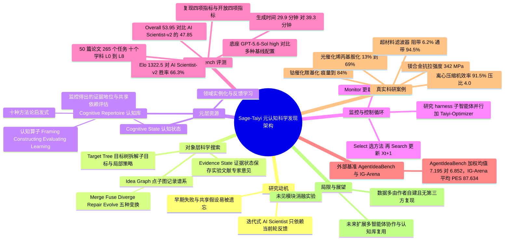

## 一、论文是干什么的？

想象你在解一道很难的科研题。普通的做法是：想一个点子、试一试、根据结果再想下一个点子，一轮一轮往下走。但这样走有个毛病：只盯着「上一轮」的结果，很容易忘记早前失败过什么、哪些假设其实一直没被验证，结果在同一个坑里反复摔跤。

这篇论文提出的 **Sage-Taiyi**（中文项目名「书生·太一」，来自上海人工智能实验室）想解决的就是这个问题。它借用了心理学里的「元认知」概念，也就是「想一想自己是怎么想的」。好比一位好导师：学生在做实验的同时，导师在旁边不断问「你这个结论有证据吗？你那几个想法是不是其实依赖同一个没验证的前提？要不要换个思路？」Sage-Taiyi 就是让 AI 同时扮演「学生」和「导师」两个角色：一边搜索科研点子，一边反思、调整搜索的方向和方法。

论文发布于 2026 年 11 月 9 日（arXiv 提交日期），在 HuggingFace 2026 年第 46 周周榜上拿到 57 票。作者团队在摘要里强调的成果有三类：在自建的科学构思基准 Taiyi-Bench 上总分超过此前最强的 AI Scientist-v2；在另外两个外部基准上表现也不错；并且通过五个有人类专家参与的合作案例，把它提出的方案推进到了真实的实验或仿真验证。

## 二、核心方法与创新

### 2.1 两层结构：「做事的」和「管做事的」

论文借用了心理学家 Nelson 和 Narens 的框架，把系统分成两层：

- **对象层**（Object level）：真正在解科研问题的那一层，好比正在做题的学生。
- **元层**（Meta level）：盯着对象层进展、决定怎么调整的那一层，好比旁边的导师。

两层之间靠两个动作连接：**监控**（把对象层发生的事汇报上来，更新「我现在懂了什么」）和**控制**（根据这份理解决定下一步查什么、用什么方法）。

### 2.2 对象层的三样东西

对象层的状态记作 $X_t=(T_t,G_t,E_t)$，可以理解成学生桌上的三份材料：

1. **Target Tree（目标树）** $T_t$：把大问题拆成小目标、再拆成子目标，每个子目标配上局部策略，策略产出「子点子」。好比把「做一顿满汉全席」拆成「炒菜、煲汤、点心」。
2. **Idea Graph（点子图）** $G_t$：把每个完整点子当作节点，点子之间的演变当作边，记录谁是谁的「父母」。论文定义了五种变换：Merge（合并相近点子）、Fuse（融合互补机制，需先检查前提是否兼容）、Diverge（保留原点子，另开一条实质不同的新分支）、Repair（修补有缺陷的依赖或缺失的接口）、Evolve（保持核心机制不变地改进）。
3. **Evidence State（证据状态）** $E_t$：存放实验结果、文献知识和专家意见，并且每条都记录来源和适用条件。

### 2.3 元层的两样东西：认知状态和认知库

- **Cognitive State（认知状态）** $C_t$：这是 AI 的「读书笔记加警示牌」。一部分是对当前问题的有选择的理解：关键发现、相互竞争的解释、必要的假设、适用条件、尚未解决的问题。另一部分是监控得出的评估：哪些判断证据充分、哪里有矛盾和不确定、哪些点子共享同一个依赖。论文举的例子很形象：好几个点子提出了不同的机制，却都依赖同一个没验证过的前提，那么它们「意见一致」并不构成独立的支持，因为这个前提一错就全错。
- **Cognitive Repertoire（认知库）** $\mathcal{R}$：可复用的「方法工具箱」，分两类。
  - **方法论启发式**（methodological heuristics）：共十种，决定整条研究路径怎么走，包括证据驱动发现、模型驱动发现、类比迁移、表征驱动重构、组合式综合、逆向设计、约束搜索与规则归纳、主动假设检验、瓶颈驱动重设计、能力驱动的前沿拓展。
  - **认知算子**（Cognitive Operators）：更小的局部推理动作，按功能分成四类：Framing（界定目标）、Constructing（构造点子）、Evaluating（评估证据）、Learning（从结果中学习并修订认知库）。

认知库不是死的：论文说它通过「领域实例化」（分析各学科经典论文，把通用方法落到具体领域，比如化学里的同位素标记实验）和「反馈学习」（用成功、失败和验证结果改进条目）不断完善。

### 2.4 监控与控制：核心循环

用公式表达这个循环（论文公式 2、3）：

$$C_{t+1}=\mathrm{Monitor}(q,X_t,C_t,\mathcal{R})$$

$$\mathcal{R}_t=\mathrm{Select}(q,X_t,C_{t+1},\mathcal{R}),\quad X_{t+1}=\mathrm{Search}(q,X_t,C_{t+1},\mathcal{R}_t)$$

大白话：先根据研究问题 $q$ 和当前搜索情况，更新「我现在懂了什么」（监控）；再据此从工具箱里挑出合适的方法（选择），用这些方法继续搜索（搜索）。控制还要决定：这条分支是继续、修改、转向还是干脆停掉？这里的下标 $t$ 表示逻辑上的状态变化，并不是固定时长的一轮。

举个论文里的例子：监控发现好几个点子共享一个未验证的前提，控制就选择「假设与边界审查」和「判别性预测」这两种方法，要求新增一个子目标去检验这个前提，验证结果再回到证据状态，进入下一轮监控。

### 2.5 研究 harness：从点子走向真实验证

所谓 harness（可以理解为「调度台」），负责把控制的决定翻译成具体任务：需要新解释或新设计时调用构思；否则进入执行或验证。构思阶段由多个子智能体并行探索不同的推理路径。真实案例里，专家参与选点子和验证，一个叫 **Taiyi-Optimizer** 的工具在给定的条件或设计空间里做搜索（案例中提到化学部分用到了贝叶斯优化），实验或仿真结果再回流到证据状态。

## 三、使用了哪些模型和计算资源？

**底层 LLM（均以论文原文为准）：**

- Sage-Taiyi 在 Taiyi-Bench 评测中使用 **GPT-5.6-Sol**，推理强度设为 high。这样做是为了与使用相同底座模型的基线框架公平对比。
- 对比基线中用到的其他模型：Claude-Opus-5（high）、Gemini-3.7-Flash（high）；通用框架 Codex（GPT-5.6-Sol 的 high 与 ultra 两档）、Claude Code（搭配 GPT-5.6-Sol 或 Claude-Opus-5）；科学发现框架 EvoScientist、AI Scientist-v2、Robin（均搭配 GPT-5.6-Sol）。
- AgentIdeaBench 表 4 中所有系统均使用 GPT-5.6-Sol。但 IG-Arena 的图 11 说明里写的是「All systems use GPT-5.5」，与前面的写法不一致，原文没有解释，这里如实标注，读者引用时需留意。
- 论文还提到其多智能体并行探索与验证的思路与 Sage-A1.5 的 Agentic Orchestration 和 Agentic Verification 能力一致，但没有说明 Sage-Taiyi 是否实际调用了 Sage-A1.5 模型。

**计算资源：**

- GPU 型号、数量：暂无相关信息（论文没有训练模型，也没有报告 GPU 配置；从描述看是通过 API 调用上述商用模型）。
- API 费用、token 消耗：暂无相关信息。

**每个完整计算单位的耗时：**

- Taiyi-Bench 上，Sage-Taiyi 平均每个任务的生成时间为 **29.9 分钟**（记录的墙钟时间，每个任务要求产出 K=10 个点子）。对比：AI Scientist-v2 为 39.3 分钟，Codex（ultra）为 44.8 分钟。论文称直接生成和部分其他框架更快，但得分更低。并行探索独立的研究分支有助于压缩墙钟时间。
- 真实案例的优化迭代量（论文给出）：钴催化羰基化共 35 次评估、10 轮；光催化烯丙基胺化共 61 次评估、5 轮；超材料 10 轮；镁合金 3 轮；压缩机 3 轮。每次实验或仿真的耗时、整个合作项目的总时长：暂无相关信息。
- 每次运行的 token 数与美元成本：暂无相关信息。

## 四、实验结果

### 4.1 Taiyi-Bench：自建的科学构思基准

**基准是什么：** 265 个任务，来自 50 篇论文、覆盖十个学科（地球科学、神经科学、经济学、管理学、物理、生物、化学、环境科学、材料科学、通信工程）。论文选的是 2026 年 3 月 1 日及以后首次公开的研究，目的是晚于所用模型的知识截止日期（论文脚注写 GPT-5.6-Sol 的报告截止为 2026 年 2 月 16 日），降低训练数据污染风险。每篇论文被还原成决策的有向无环图，任务通过逐级披露已有决策来构造（L0 到 L8），每个任务要求系统给出 K 个自包含的点子、理由和判别性检验。

**八项指标（0到100分）：** 复现类四项（Finding、Exact、Coverage、Lookahead）加开放类四项（Novelty、Effectiveness、Feasibility、Diversity）；两组分别取平均，Overall 为两组平均的均值。评分由「文献接地的验证器」完成，论文称其与人类专家判断一致性良好（具体一致性数值我没有在正文中找到）。

**主要结果（表 3，部分）：**

| 系统 | 复现类均分 | 开放类均分 | Overall |
|---|---|---|---|
| Sage-Taiyi（GPT-5.6-Sol） | 44.62 | 63.28 | 53.95 |
| AI Scientist-v2（GPT-5.6-Sol） | 38.32 | 57.39 | 47.85 |
| Claude Code（GPT-5.6-Sol） | 40.29 | 47.98 | 44.14 |
| Codex（GPT-5.6-Sol，ultra） | 35.93 | 48.43 | 42.18 |
| 直接生成 GPT-5.6-Sol | 32.58 | 46.54 | 39.56 |

摘要中的 54.0 与 47.9 就是 53.95 与 47.85 的四舍五入。论文称 Sage-Taiyi 在全部八项指标上排名第一（相比 AI Scientist-v2 领先 6.1 分）。其他要点：

- 配对比较：Elo 评分 1322.5，对 AI Scientist-v2 的胜率为 66.3%。
- 找回原研究的决策：Coverage 40.7、Lookahead 38.6（最强基线为 35.9 和 33.0），Exact 19.5。
- 最明显的优势是 Novelty：70.5，对比 AI Scientist-v2 的 55.2，相对高出 27.8%；Diversity 42.3，Effectiveness 87.8，Feasibility 52.4。
- 十个学科的 Overall 都是最高（在对比的四个系统中），领先幅度为 1.9 到 9.4 分；从 L0 到 L8 每个信息层级也都最高。

### 4.2 外部基准

- **AgentIdeaBench**（40 个子领域）：Sage-Taiyi 加权均值 7.195，AI Scientist-v2 为 6.852，五个维度均最高；原创性与可行性分别比 AI Scientist-v2 高 0.400 和 0.425。
- **IG-Arena**（30 个前沿问题）：平均 PES 为 87.634（作者自己的评测）；图中另附四个已发表的参考分数，这里不展开。
- 论文还给了一个容错量子计算的案例：它自己检索到关键论文，把「实时解码」和「资源态供应」这两个瓶颈合成为一条门调度规则，并设计了端到端对比测试。

### 4.3 五个真实科研合作案例（表 5）

| 领域 | 论文报告的结果 |
|---|---|
| 金属催化 | 钴催化合成四取代联烯酮，模型反应产率由痕量提升到 84%（经条件优化，贝叶斯优化） |
| 光化学 | 光催化位点选择性烯丙基胺化（杂芳胺），模型反应产率 13% 提升到 69%（原始曲线最大值 68.7%） |
| 超材料 | 多层电磁滤波器，仿真平均透射率阻带 6.2%、通带 94.5%（专家设计的简单鱼骨结构为 9.5% 与 87.4%） |
| 合金设计 | 铸造镁合金，多次实测平均抗拉强度 342 MPa（单次代表曲线最高 340.39 MPa） |
| 压缩机工程 | 离心压缩机，CFD 评估叶轮效率 91.5%，压比 4.0 |

几点值得初学者留意的细节（均来自原文）：

- 化学案例中，初始条件下钴催化只得到痕量产物；优化后选中 Co(acac)2、三联吡啶配体 L20 和 EtZnOPiv，溶剂、温度、时间不变。光催化案例的关键改动是溶剂由 DCE 换成 PhCF3、加入 2 当量苯甲酸、反应时间延长到 36 小时。
- 这些产率提升来自「反应条件优化」，由 Taiyi-Optimizer 搜索加实验反馈，并非 AI 单独完成；专家参与选点子和验证。
- 超材料案例体现了监控与控制：第一次优化通带表现不佳，系统识别出「固定的基板厚度」是瓶颈并建议放松该约束，之后得到最终结果（奖励从固定厚度参考的 0.253 提升到 0.822）。
- 镁合金与压缩机案例的结果是由合作方的实验或仿真得出的；压缩机效率是 CFD 仿真值，不是实物测试。

论文没有给出去掉监控、去掉认知库等模块的消融实验（我在正文中没有找到相关表格），所以各模块各自贡献多大，暂无相关信息。

## 五、潜在应用与已落地应用

**已落地或已验证（均为论文自述）：**

- 五个专家参与的合作：钴催化羰基化与光催化烯丙基胺化在实验室得到更高产率；镁合金得到实测强度；超材料与压缩机的结果为仿真评估。
- 项目在 GitHub 上公开了说明页，但目前仓库里只有 README 和文档资源，没有看到可运行的代码（截至 2026-11-13 的 GitHub 内容列表）。是否有在线产品、商用落地：暂无相关信息。

**潜在方向（含作者在结论中的展望与本综述的合理推测，已区分）：**

- 作者提出的未来方向：通过积累研究经验继续完善认知库、研究其跨领域复用，并扩展多智能体协作，在有限时间与迭代预算内探索更多高价值方案。
- 本综述的推测：科研选题与方案对比阶段的「第二大脑」，例如帮课题组梳理哪些假设共享同一个风险点；与自动化实验平台配合做条件优化。这些尚未被论文验证。

**需要保持谨慎的地方：** 基准由同一团队自建，评分用自动验证器，并在摘要里自称与专家判断一致；实验案例只有五个，且都是「模型反应」或仿真层面的结果，不等于已有独立复现的科学发现。

## 六、网络上的讨论与评价

我检索了 HuggingFace 论文页、GitHub、项目主页和一般网页搜索（并额外检索了 Reddit、Hacker News、知乎、X/Twitter 相关关键词）。截至 2026-11-13 的所见如下：

- **HuggingFace 论文页：** 57 票，页面上只有两条评论：一条是作者账号 weidawang 在 2026-11-10 贴出的摘要，另一条是自动机器人 Librarian Bot 推送的相似论文列表（自动消息）。没有读者的实质性评价或质疑。
- **GitHub：** 仓库 [Alpha-Innovator/Sage-Taiyi](https://github.com/Alpha-Innovator/Sage-Taiyi) 创建于 2026-11-09，我查询时约 18 颗星、2 个 fork、1 个未关闭的 issue，未设置许可证。README 里有一个微信讨论群二维码（有效期到 2026-11-17），README 还把 [Sage-A1.5](https://github.com/Alpha-Innovator/Sage-A1.5)（描述为 35B 的智能体模型）列为相关项目。issue 的具体内容我没有查看。
- **项目主页：** [alpha-innovator.github.io/Sage-Taiyi](https://alpha-innovator.github.io/Sage-Taiyi/)，由作者方发布，属于官方宣传，不是第三方评价；页面未提到底层模型、成本、耗时或 GPU。
- **新闻与聚合站：** [AI Weekly 的一篇快讯](https://aiweekly.co/alerts/sage-taiyi-metacognitive-agent-tops-ai-scientist-v2-on-taiyi-bench-pushes-lab)（署名 Alexis Dufresne，2026-11-10）基本只是转述论文结果，没有独立评价；该页面没有说明是否由 AI 生成，我无法判断，读者宜把它当作二手转述。hyper.ai、papers.cool、chatpaper 等页面是论文摘要聚合页，其中它们的内容无法确认是否由人撰写，不能当作人类专家意见，本文没有引用它们的评价内容。
- **Reddit、Hacker News、知乎、X/Twitter：** 没有搜到与该论文相关的讨论帖，暂无相关信息（这只代表我的搜索没有结果，不代表不存在）。

**综述作者的独立观察（仅为本人阅读后的看法，非网络评论）：** 论文自述的优势很明确，但所有基准与案例数据目前都来自作者自己，第三方复现尚缺；另外模型名（如 GPT-5.6-Sol）和方案细节（如认知库的完整条目、提示词）的公开程度有限，复现难度较大。

## 七、思维导图

