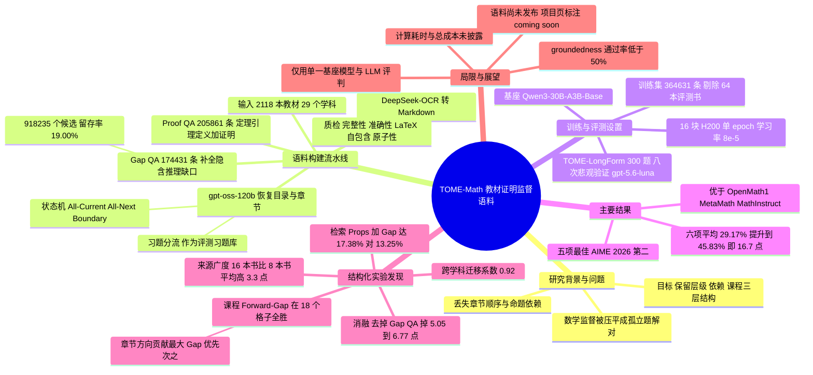

## 一、论文是干什么的？

现在训练大模型做数学，常见做法是把各种来源的材料都拆成一道道「题目加答案」的单独卡片，就像把一本精心编排的教科书撕成一堆散页，再洗牌后给学生看。这样做方便堆数量，但教科书原本最值钱的东西丢掉了：哪一章先讲、哪个定理要用到前面哪个引理、证明里每一步依据哪里。

这篇论文提出了 **TOME-Math**（全称 Textbook-Oriented Mathematical Evidence，可以理解为「以教材为本的数学证据库」）。研究团队把 2118 本大学数学教材，转成了 380,292 条结构化的「证明监督」记录，并且保留了章节顺序、命题与证明的对应关系、依赖引用以及来源出处。有了这些结构信息，作者还研究了两件事：按教材顺序训练（课程学习）是否更有效，以及数据量、教材来源广度对效果的影响。核心结果是：在同一个 30B 基座模型上微调，六项评测的平均分从 29.17% 提高到 45.83%，提升 16.7 个百分点（精确值 16.66），并且在整体上超过了三个公开的数学指令数据集。

**语料是否已经发布？** 截至本综述撰写时（2026-11-13），**语料尚未发布**。论文摘要写的是「我们将发布语料」；[项目主页](https://tome-math.github.io/)上的数据集入口标注为「coming soon」（即将发布）；作者在 Hugging Face 论文页的评论里也写了「The dataset is coming soon」。Hugging Face 论文页目前没有关联任何模型、数据集或 Space，arXiv 页面也没有代码仓库链接。

## 二、核心方法与创新

### 1. 数据怎么造出来的（像把一本书「拆零件再贴标签」）

整条流水线可以想象成一个很细致的图书管理员，分五步把一本 PDF 教材变成训练样本：

1. **看懂整本书**：用 DeepSeek-OCR 把每本 PDF 转成 Markdown 加页面图片。
2. **恢复目录和章节**：用 gpt-oss-120b 逐页区分目录、正文和封面前言，重建层级目录；再用一个「状态机」按顺序读正文，判断每一页属于当前章、下一章还是正好在章节交界处（All-Current、All-Next、Boundary 三种状态），不确定就重试。结果是一组按顺序排好的章节文档。
3. **把习题单独分出来**：每章里的讲解部分和教材自带习题被分开，习题放进一个独立的「习题库」，不参与证明监督数据的生成，而是留作评测用。
4. **抽取 Proof QA（证明问答）**：从讲解部分找出「定理加证明」「引理加证明」「定义加证明」这样的单元，并找出理解该证明需要的更早命题（依赖引用）。
5. **构造 Gap QA（缺口问答）**：教材证明里常有「显然」「易证」这种一笔带过的地方，就像菜谱写「适量盐」。系统会检查每个证明有没有这类隐含或缺失的推理步骤；发现实质性缺口时，就把缺掉的那一步改写成一个自包含的小命题，并补全它的证明，这就是 Gap QA。

最终得到 380,292 条记录，其中 Proof QA 205,861 条，Gap QA 174,431 条。Gap QA 是从 918,235 个候选里留下来的，留存率 19.00%。语料覆盖 29 个数学学科，来自 2,118 本经过规范化和去重的教材（选书依据大学课程大纲并经领域专家审阅）。项目主页另给出章节总数为 66,537 章。

质量把关分两层：结构层面检查目录层级、页面边界、跨页题目是否连续、问答是否对齐、是否自包含；语义层面由一个以原文为依据的 gpt-oss-120b 评审员，从完整性、准确性、LaTeX 格式、自包含性、原子性五个维度打分，其中准确性最关键，编造证明步骤或改动数学关系都算失败。

### 2. 保留了哪三层「结构」

- **层级结构**：保留教材原本的章节与命题顺序。
- **依赖结构**：把定理级的证明题与证明中的缺口（中间证明义务）连接起来。
- **课程结构**：按教材顺序和证明粒度来安排训练顺序。

### 3. 课程学习：像按教材顺序备考，而不是乱序刷题

作者设计了四种出题顺序，使用完全相同的题目、完全相同的 token 预算，只改变「先后顺序」：

| 顺序名称 | 含义（生活类比） |
| --- | --- |
| Shuffle | 全部打乱，像把整本书的散页随便抽着看 |
| Forward–Gap | 按章节从前往后，每个阶段内先学 Gap QA（先补「跳步」的细节）再学其余，最像「按教材顺序，先补细节再做整题」 |
| Reverse–Gap | 章节从后往前，阶段内仍然先学 Gap，用来检验「章节方向」的作用 |
| Forward–Mix | 章节从前往后，但阶段内 Gap 和其他题混在一起，用来检验「Gap 优先」的作用 |

具体做法是把每本书的章节进度归一化。设某条记录所在章节的序号为 $i$，该书共有 $N_b$ 章，则其归一化位置为 $p=i/N_b$，被划入第 $\lfloor 10p \rfloor$ 个阶段，一共十个阶段 $S_0,\dots,S_9$；不同书的同阶段样本交错混合。

### 4. 免训练的「结构化检索」

不更新模型参数，只在做题时给模型塞一些参考材料。比较五种方式：不给材料（Closed）、随机从同一本书抽（Random Same-Book）、只取本章及前几章（Local Chapter）、按章节位置与依赖关系取命题证明（TOME Props Only）、再加上 Gap QA（TOME Props + Gap）。所有带材料的组使用相同的上下文 token 预算，因此差异来自「选得准不准」而不是「给得多不多」。

### 5. 评测怎么打分

作者建了自己的评测集 **TOME-LongForm**：从保留的 64 本教材中取 300 道证明为主的习题，涵盖抽象代数、微分几何、离散数学、数学分析、概率、拓扑六个学科。这 64 本书对应的 15,661 条记录从训练集中剔除，所以训练集实际有 364,631 条，约 1.7092 亿 token（完整语料 195.18M token）。每题采样 16 个解答，由 gpt-5.6-luna 做「参照解答引导的逐步验证」，每个解答被审八次，只要有一次发现实质错误就判错，也就是「悲观聚合」：

$$y_{ij}=\prod_{r=1}^{8}\mathbf{1}\left[e_{ijr}=-1\right]$$

其中 $e_{ijr}$ 是第 $r$ 次审查找到的第一个错误步骤编号，$-1$ 表示没找到错误。通俗讲：八位老师批卷，只要有一位挑出硬伤，这份答卷就不及格。作者还抽了 600 份回答，让数学博士或同等水平研究者做人工校准。此外还用了 TOME-Objective（145 道多学科客观题，按最终答案是否等价评分）、MiniF2F、ProofNet、MATH-500 和 AIME 2026 作补充。

## 三、使用了哪些模型和计算资源？

| 项目 | 论文给出的信息 |
| --- | --- |
| 微调用的基座模型 | Qwen3-30B-A3B-Base，所有实验都用它，未微调的同一检查点作为对照 |
| 教材 PDF 转 Markdown | DeepSeek-OCR |
| 目录与章节恢复、习题分离、命题质量评审 | gpt-oss-120b |
| Proof QA 抽取、依赖引用解析 | gemini-3.1-flash-lite-preview |
| 证明缺口审查（开启思考） | gemini-3-flash-preview（thinking，论文中也写作 gemini-3-flash-preview-thinking） |
| Gap QA 改写与补证 | gemini-3.1-flash-lite-preview；另有 gpt-5-mini 生成了 53.7% 的 Gap QA 记录 |
| 评测时的评判模型 | gpt-5.6-luna（八次审查；MiniF2F、ProofNet 也用它做评判） |
| 模型选型时对比过但未采用的方案 | gemini-3.1-pro-preview-thinking |

生成占比：gemini-3-flash-preview-thinking 生成了 88.9% 的 Proof QA 记录，gpt-5-mini 生成了 53.7% 的 Gap QA 记录，两个数据流使用互不重叠的模型分配。

**计算资源与微调设置（附录 E.2）：**

- 硬件：16 块 NVIDIA H200（2 个节点，每节点 8 块）。
- 优化器 AdamW（$\beta_1=0.9$，$\beta_2=0.95$，权重衰减 0.1）；学习率 $8\times10^{-5}$，衰减到最低 $8\times10^{-6}$；3% 预热加余弦衰减。
- 序列长度 131,072 token，全局 packing；有效批大小 64（每卡微批 1，梯度累积 4）；训练 1 个完整 epoch。四个语料用同样的优化器、学习率调度、序列长度和批大小。
- 对比的公开语料：OpenMathInstruct-1（论文简称 OpenMath1，182 万条，3.68 亿 token）、MetaMathQA（39.5 万条，9694 万 token）、MathInstruct（26.2 万条，6410 万 token）。

**每个完整计算单位的耗时与成本：**

| 计算单位 | 论文给出的信息 |
| --- | --- |
| 整个语料的构建总耗时 | 暂无相关信息 |
| 整个语料的 API 总成本 | 暂无相关信息（论文只给了设计阶段的每本书估算，见下一行；本综述不据此自行推算总额） |
| 每本书的命题抽取成本（设计阶段记录） | 方案 1（gemini-3.1-pro-preview-thinking）40 到 50 美元；方案 2（gemini-3.1-flash-lite-preview）约 5 美元；方案 3（gemini-3-flash-preview-thinking）约 10 美元；方案 2 加 3 的混合约 7 美元。论文说明这些是流水线设计阶段的记录值，且模型分配在开发中有调整，每次运行都有版本记录 |
| 一次完整微调的时长 / GPU 小时 | 暂无相关信息 |
| 一次评测（每题 16 次采样、每解 8 次评审）的耗时与 API 成本 | 暂无相关信息 |
| 课程学习实验（每个学科、每个规模各训练一个模型）的 GPU 与时长 | 暂无相关信息（论文附录未单独给出硬件；是否同为 H200 论文未说明） |

## 四、实验结果

### 1. 全语料对比（表 2，pass@1，单位 %）

四个模型都从 Qwen3-30B-A3B-Base 出发、训练一个 epoch、设置相同，只有监督语料不同。Avg. 是六项分数的无加权平均。

| 训练语料 | TOME-LF | TOME-Obj. | MiniF2F | ProofNet | MATH-500 | AIME-26 | Avg. |
| --- | --- | --- | --- | --- | --- | --- | --- |
| 不微调（基座） | 13.25 | 32.93 | 34.45 | 17.14 | 68.80 | 8.44 | 29.17 |
| OpenMath1（182 万） | 20.16 | 33.86 | 22.87 | 19.25 | 70.40 | 8.21 | 29.13 |
| MetaMath（39.5 万） | 28.73 | 34.66 | 40.70 | 22.55 | 71.20 | 9.98 | 34.64 |
| MathInstruct（26.2 万） | 35.87 | 40.69 | 52.05 | 32.93 | 73.05 | 11.98 | 41.10 |
| TOME-Math（36.46 万） | 43.86 | 43.96 | 57.43 | 42.98 | 76.55 | 10.19 | 45.83 |

大白话解读：

- TOME-Math 在六项里拿到五项最高，AIME 2026 上排第二（MathInstruct 更高）。平均分从 29.17% 到 45.83%，提升 16.66 个百分点，四舍五入为 16.7。
- 它最大的优势出现在偏证明的 TOME-LongForm 和 ProofNet 上，但在 TOME-Objective、MiniF2F、MATH-500 上也领先，说明好处不限于长篇证明。
- 「数据多不一定好」：OpenMath1 的样本数约为 TOME-Math 的 4.8 倍（论文原话），却在六项上全部落后，平均分几乎没有高于基座（29.13 对 29.17）。
- 论文自己提醒：这几个语料在很多方面都不同，所以这个对比**不能单独证明**教材结构就是原因，要靠后面的受控实验来检验。另外 AIME 2026 只有 30 道题，置信区间很宽。

### 2. 免训练结构化检索（表 3，TOME-LongForm，pass@1，%）

| 上下文方式 | 平均 |
| --- | --- |
| Closed（不给材料） | 13.25 |
| Random Same-Book | 14.00 |
| Local Chapter | 14.71 |
| TOME（Props Only） | 15.54 |
| TOME（Props + Gap） | 17.38 |

相同的上下文预算下，用教材结构选证据最好，比不给材料多 4.13 个点；Gap QA 比只给命题再多 1.84 个点。在六个学科里都有提升，数学分析和拓扑涨幅最大（各 6.00 点）。

### 3. 课程学习与数据量缩放（图 4，pass@16）

- 每个学科、每个规模（0.75M、1.8M、2.4M token）下，所有微调后的模型都好于基座。
- 宏平均 pass@16：Shuffle 从 41.04% 升到 42.52% 再到 43.21%；Forward–Gap 从 45.38% 升到 48.98% 再到 50.93%。数据越多越好，顺序排得好又额外更好。
- Forward–Gap 在全部 18 个「学科和规模」格子里都最强，领先 Shuffle 的幅度从 4.34 点扩大到 6.46 点再到 7.72 点。
- 章节方向的贡献最大：Forward–Gap 比 Reverse–Gap 分别高 5.65、7.41、8.50 点；Gap 优先在此基础上再给 2.37、1.91、1.53 点（逐渐减小）。

### 4. 来源广度与跨学科迁移（图 5）

- 同样 0.75M token 预算，把数据摊在 16 本书（Broad–sparse）比集中在 8 本书（Narrow–dense）在每个学科都更好，提升 1.6 到 4.8 点，平均 3.3 点。可以理解为：同样的学习时间，多看几位老师的书比反复啃两三本更有效。
- 每个学科的专才模型拿去考其他学科，用目标专才自身成绩做归一化，宏平均迁移系数为 0.92，其中 30 个有序学科对里有 8 对超过 1.0。迁移系数定义为 $T_{s\to t}=P_{s\to t}/P_{t\to t}$。

### 5. 消融实验（表 4，pass@1，%）

| 变体 | TOME-LF | TOME-Obj. | MiniF2F | ProofNet | MATH-500 | AIME-26 |
| --- | --- | --- | --- | --- | --- | --- |
| 去掉 Gap QA（Forward） | 38.72 | 38.91 | 50.73 | 36.21 | 73.84 | 9.12 |
| 去掉课程（Shuffle） | 39.87 | 40.42 | 53.76 | 39.12 | 75.22 | 9.58 |
| 去掉 Gap 优先（Forward–Mix） | 40.12 | 41.37 | 55.61 | 41.02 | 75.88 | 9.93 |
| 完整配方（Forward–Gap） | 43.86 | 43.96 | 57.43 | 42.98 | 76.55 | 10.19 |

每去掉一个部件，六项成绩全部下降；去掉 Gap QA 在四个证明类基准上掉得最多（5.05 到 6.77 点）。

### 6. 论文自己披露的局限与数据质量信息

- 附录自动审计显示，「依据是否有原文支撑」（groundedness）和「证据对齐」这两个维度，通过率都低于 50%，不通过率为 28.6%；人工复核标记里「无逐字证据」占语料的 48.4%。论文把这些作为质量画像给出，用于指导后续有针对性的复查，并未据此得出数据不可用的结论。
- 语料中精确重复很少（单条记录占 99.15%）。证明生成类任务占 79.0%。语言上本科级别以中文来源为多（93,537 条中文、71,702 条英文、23,500 条混合）。
- 所有训练实验都只用了一个基座模型（Qwen3-30B-A3B-Base）；评测依赖 LLM 评判员，虽然做了人工校准，但仍属于模型评分。

## 五、潜在应用与已落地应用

**已落地应用：暂无相关信息。** 论文只做了研究性验证，语料尚未公开，没有查到任何产品或外部团队使用它的报道。

**潜在方向（以下是基于论文内容的合理推测，不是论文已验证的落地）：**

- 训练更会写证明的数学大模型：Gap QA 把「显然」背后的步骤摊开，适合做小步推理的监督。
- 数学教学辅助：保留了命题依赖，理论上可以做「这个定理要先学哪些引理」的学习路径推荐。
- 检索增强：5.1 节展示了按章节位置和依赖关系取证据，对证明题有效，可用于数学问答系统的知识库构建。
- 数据组织方法论：把顺序、依赖、来源广度当成可调变量来研究数据，可迁移到物理、计算机等同样有教材结构的领域（论文未做此验证）。
- 作为研究平台：研究者可在固定数据下比较不同课程顺序与来源覆盖的影响。

## 六、网络上的讨论与评价

**Hugging Face 论文页（2026-11-13 查看，共 3 条评论）：**

- 提交人 Youqing（名字与第一作者 Youqing Fang 相同，但页面并未明示二者是同一人，本综述不作断定）发布介绍帖，重复了摘要要点，并写明「The dataset is coming soon, stay tuned!」。这是作者方自己的介绍，不是第三方评价。
- 用户 polyarti 留言，称赞保留章节顺序和命题与证明的链接「像是使用教材的正确方式」，并提问：课程顺序本身有多大作用，还是大部分提升只是来自更多监督数据？（本综述无法核实该账号是否为真人。论文中对应的回答是第五节的受控实验：相同数据只改顺序，Forward–Gap 相比 Shuffle 的宏平均 pass@16 高 4.34 到 7.72 点。）
- Librarian Bot 的评论是系统自动推荐相似论文，属于机器自动生成，不是人类评价。

**其他渠道：**

- Hacker News（通过 Algolia 搜索 TOME-Math 与 arXiv 编号）：没有找到相关讨论。
- Reddit：搜索请求被站点拦截（Blocked），暂无法获取。
- GitHub：除了项目主页仓库 tome-math/tome-math.github.io（网站源码）外，没有找到论文的代码或数据仓库。
- X/Twitter、知乎：用网页搜索没有找到相关内容，暂无相关信息。
- 通用网页搜索多次尝试没有找到第三方评述文章。
- 本综述未引用任何 AI 生成的评论站点内容。

整体来说，目前公开可见的社区讨论非常少，本综述中对论文的评价主要来自论文自身披露的数据，而非第三方验证。

## 七、思维导图

