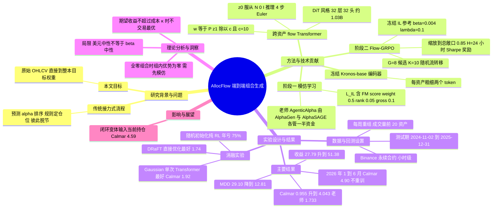

> **风险提示：** 本文是对一篇学术论文的科普综述，文中所有收益、夏普、回撤等数字均来自**历史回测**，回测不等于实盘，过去表现不代表未来结果，更不构成任何投资建议。加密货币永续合约杠杆高、波动大，可能造成本金全部损失。

## 一、论文是干什么的？

想象你是一个基金经理，手里有一笔钱，要同时决定买多少个币、做多还是做空、各占多少仓位。传统做法像「接力赛」：第一棒的模型预测涨跌，第二棒给资产打分排序，第三棒用人工规则把分数换算成仓位。问题是没有任何一棒是直接为「最后赚不赚钱」而训练的，预测准了也可能因为仓位过大、多个仓位互相重复、换仓手续费太高而亏钱。

这篇论文提出 **AllocFlow**：只用一个生成模型，输入是每个资产的原始小时 K 线（开高低收量，即 OHLCV），一次性输出**整本投资组合**（每个资产一个带正负号的权重，正为做多，负为做空）。中间没有预测值、没有 alpha 分数、没有优化器。它先让模型模仿一个已有的策略（老师），再用强化学习（RL）按组合层面的收益去改进，最后在回测里反超了老师。

## 二、核心方法与创新

**先读行情：冻结的 Kronos 编码器。** 论文直接使用预训练好的金融基础模型 Kronos（用的是 Kronos-base 检查点），把每个资产最近的行情压缩成两个「市场 token」（粗粒度和细粒度各一个，对最后 8 步做均值池化）。Kronos 全程**冻结**，只拿它的内部表示，不用它的下一根 K 线预测。N 个资产得到 $2N$ 个 token，再加一个整体市场 token，共 $2N+1$ 个。

**再出持仓：跨资产 flow Transformer。** 这是一个 DiT 风格的流匹配（flow matching）头，32 层、32 个注意力头，约 1.03B 参数。生活类比：流匹配像「把一团随机的雾逐步捏成一座雕塑」。从高斯噪声 $z_0\sim\mathcal{N}(0,I)$ 出发，用模型预测的速度场 $dz_\tau/d\tau=v_\theta(z_\tau,\tau,X_t)$ 走 4 步欧拉积分，得到一个向量，再减去均值（让多空权重相加为零，即美元中性）并除以 $c=10$，得到权重 $w_t$：

$$
w_t=\frac{1}{c}P_t z_1,\quad P_t=I-\frac{\mathbf{1}\mathbf{1}^\top}{N_t}
$$

因为所有资产的 token 在同一个 Transformer 里互相看得见，它能「整本一起考虑」，例如几个高度相关的币同时适合做空时，不会重复下注。

**两阶段训练。**

- 阶段一，模仿学习（IL）：论文自己构造了一个老师策略 AgenticAlpha，把 AlphaGen 和 AlphaSAGE 在训练期挖出的因子各管一半资金，合成一个组合。模型用条件流匹配损失 $\mathcal{L}_{FM}$ 模仿老师的整本持仓，并加上辅助损失，总损失为 $\mathcal{L}_{IL}=\mathcal{L}_{FM}+\mathcal{L}_{score}+0.5\mathcal{L}_{weight}+0.05\mathcal{L}_{rank}+0.1\mathcal{L}_{gross}$。这一步的目的不是复制老师的收益，而是让模型的「候选组合」一开始就合情合理。
- 阶段二，组内相对强化学习（Flow-GRPO）：对同一个历史时刻，模型采样 $G=8$ 个候选组合（用 $K=10$ 步带随机性的流转移），把每个都缩放到总敞口 0.85，再放到同一段未来 $H=24$ 根小时 K 线上算 Sharpe 作为奖励 $R_i$。组内比较谁更好，据此更新模型；同时保留一份冻结的 IL 模型作为参考，防止更新跑偏。参考项系数 $\beta=0.004$，蒸馏项系数 $\lambda=0.1$，比率裁剪 $\delta=10^{-3}$。

**为什么必须先模仿？** 论文做了对照：从随机初始化的头直接做同样的 RL，每年亏 75%。随机的候选组合让组内比较几乎全是噪声，模仿阶段提供了「像样的候选」，组内比较才有信息量。

**关于「端到端」的说法。** 论文的端到端指推理时「K 线进，目标权重出」，冻结的 Kronos 并没有一起训练。回测中下单量由目标权重的变化量决定，手续费由账本统一扣除。

## 三、使用了哪些模型和计算资源？

| 项目 | 原文信息 |
|------|----------|
| 冻结编码器 | Kronos-base（预训练的金融基础模型，论文称其预训练截止于 2024 年 6 月） |
| 动作头 | DiT 风格 flow Transformer，32 层、32 头、头维度 48，约 1.03B 参数，随机初始化 |
| 对照的 Gaussian 单次前向 Transformer | 约 1.0B 参数，与流头参数量匹配 |
| 老师策略的因子来源 | AlphaGen、AlphaSAGE（均为已发表的因子挖掘方法） |
| 是否使用通用 LLM | 否；Kronos 是面向 K 线的基础模型，不是语言模型 |
| GPU 型号与数量 | 暂无相关信息（论文正文和附录均未写） |
| 训练耗时与成本 | 暂无相关信息；仅知纯 RL 对照实验用了 4.8 倍 RL 步数，约等于 IL 加 RL 的总计算量 |
| 推理 | 每个目标组合 4 步欧拉积分，初始噪声由时间戳作种子；单次推理耗时暂无相关信息 |
| 其他设置 | 闭环变体训练 2000 步，学习率 $10^{-5}$，批大小 16；主结果为 5 个随机种子 |

## 四、实验结果

**回测设置（请特别注意）：**

- 数据：Binance 上的加密货币永续合约，小时级 K 线。每周日重新选出过去 60 天累计成交量最高的 20 个资产作为可交易名单（因果重组，不用未来信息）。
- 时间切分：训练与测试严格按时间分开；主测试期为 2024-11-02 至 2025-12-31（约 14 个月）。另有 2026 年 1 月到 6 月六个月，用同一模型不重训直接评估。图 1 展示 2020 年到 2025 年的曲线，虚线标出样本外起点。
- 交易成本：每单位绝对成交权重收取 5 个基点（0.05%）手续费，论文称这是主要交易所基础档 taker 费率及既往论文所用费率中的最大值；论文还称中位半价差只有 0.24 个基点（成交量加权为 0.44，BTC 为 0.006）。所有方法用同样的费用。
- 执行假设：策略是价格接受者，不影响价格；目标在下一根 K 线生效；持仓按 0.1 单位网格取整（名义本金 10，对应权重 0.01 的步长）。
- 指标定义：算术年化净收益、加法式最大回撤（MDD）、日度夏普、Calmar（年化收益除以 MDD）、日均换手（TO）。无风险利率取零。
- 资金费率：只有 2026 年的评估按各合约自己的 4 小时或 8 小时周期结算了交易所公布的资金费率；论文称对原测试期这样结算后各指标仍在种子间波动范围内。

**主结果（论文自报，表 1）：**

| 策略 | 年化收益 % | MDD % | Sharpe | Calmar | 日均换手 |
|------|-----------|-------|--------|--------|---------|
| AlphaGen | 35.42 | 20.60 | 1.242 | 1.720 | 0.248 |
| AlphaSAGE | 31.30 | 23.36 | 1.396 | 1.340 | 1.255 |
| R&D-Agent-Quant | 20.69 | 18.53 | 0.967 | 1.117 | 0.397 |
| AlphaAgent | 29.12 | 26.93 | 1.048 | 1.081 | 0.651 |
| AllocFlow（IL） | 27.79 | 29.10 | 0.954 | 0.955 | 1.143 |
| AllocFlow（RL，5 个种子均值） | 51.38 ± 2.04 | 12.81 ± 1.51 | 2.192 ± 0.086 | 4.043 ± 0.379 | 1.976 ± 0.047 |

大白话：RL 这一步让收益几乎翻倍，回撤降到不到一半，而且是在换手率变高、手续费照扣的情况下做到的。

**对老师与更长测试（论文自报，表 9、表 12）：**

| 对比 | 年化收益 % | MDD % | Sharpe | Calmar |
|------|-----------|-------|--------|--------|
| 老师 AgenticAlpha | 33.92 | 19.57 | 1.472 | 1.733 |
| AllocFlow（RL） | 51.38 | 12.81 | 2.192 | 4.043 |
| 2026 年 1 到 6 月（不重训） | 62.53 | 12.77 | 2.06 | 4.90 |

**消融实验要点（均为论文自报）：**

- 动作头：IL 后 Flow、MLP、单次 Transformer 的 Calmar 相近（0.955、0.912、0.878）；RL 后 Flow 为 4.043，MLP 为 1.307，单次 Transformer 为 0.960。自回归分类头 IL 后亏钱，RL 后没有交易。Gaussian 单次 Transformer 在不同探索尺度 $\sigma$ 下最好的 Calmar 为 1.92。
- 老师换成 MACD 或 Alpha101 #9 后，RL 之后 Calmar 同样提升（如 MACD 12h/26h 由 -0.559 升到 1.856），说明老师本身不必赚钱，但 AgenticAlpha 效果最好。
- 编码器换成 iTransformer：IL 和 RL 后都大幅亏损（年化收益分别为 -141.58% 和 -119.29%）。
- Kronos 自己的预测直接按多头 top-K 规则交易：零样本年化收益 -44.502%，LoRA 微调后 -34.570%。
- 头的深度：12 层 RL 后 Calmar 为 3.728，32 层为 4.043。
- 奖励：Sharpe 奖励的 Calmar 最高（4.043）；累计收益奖励的收益最高（60.62%）；风险调整收益奖励亏钱（-10.63%）。
- 直接可微优化（DRaFT）最好 Calmar 为 1.74；11 种从零训练的纯 RL 方法没有一个达到 BTC 买入持有的夏普（0.55）。
- 闭环变体（把当前持仓作为输入）Calmar 为 4.59；再加不交易区间后 Sharpe 为 2.46、Calmar 为 5.75。

**独立验证情况：** 以上均为论文作者自报。本次检索没有发现第三方独立复现。GitHub 仓库已创建，但本文未核实其是否包含可复现全部结果的代码与模型权重。

**论文自己承认的限制：** 美元中性不等于 beta 中性或风险有界；评估用的解码器没有额外的总敞口硬上限；个别负收益基线的加法回撤超过 100%，只是记账方式的结果，不代表账户还能继续运行；只在加密货币永续合约上测试；奖励阶段是「固定一本组合持有 24 小时」的近似，与真实多期换仓成本并不完全一致。

## 五、潜在应用与已落地应用

潜在应用：多资产组合的自动配置（迁移到股票、期货等市场，论文并未验证）；把已有的因子策略当作老师，再用 RL 精炼；流匹配加组内相对强化学习的「先模仿再强化」思路也可用于其他需要一次生成多个相互关联的连续决策的场景。

已落地应用：暂无证据。论文只做了历史回测，没有实盘报告。回测不等于实盘：真实交易还有滑点、流动性冲击、延迟、保证金与强平、交易所风险等，这些在回测里大多被简化。

## 六、网络上的讨论与评价

- [Hugging Face 论文页](https://huggingface.co/papers/2611.19937)显示 72 个点赞，页面上有 3 条评论（作者贴项目页链接，另有两条简短称赞），外加机器人推荐，没有技术讨论。
- 作者的[项目主页](https://allocflow.github.io/)与 [GitHub 仓库 allocflow/AllocFlow](https://github.com/allocflow/AllocFlow)均存在（星数较少），属于作者自己的宣传材料，不是独立评价。
- 在 Hacker News、Reddit、X、知乎、博客等处，本次搜索未找到公开讨论。

## 七、思维导图

