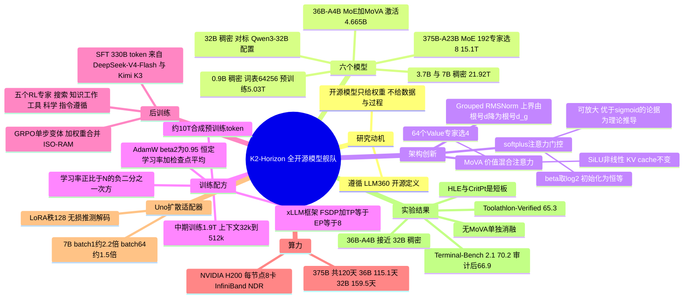

## 一、论文是干什么的？

大多数所谓的「开源模型」其实只开放了最终的权重（相当于只给你一道做好的菜），而食材（训练数据）、做菜过程（训练日志、中间状态）和菜谱（代码）基本都不公开。K2-Horizon 想做的是把整个「后厨」都开放：由阿联酋 MBZUAI 旗下的 Institute of Foundation Models（IFM）发布，是 LLM360 家族里 K2-V2 的后继者。

它不是一个模型，而是一支「舰队」：**六个模型**，从面向端侧和低资源设备的 0.9B 稠密模型，到总参数约 375B、每个 token 只激活约 23B 的混合专家（MoE）旗舰。它们面向的任务是数学与科学推理、软件工程、深度搜索、办公自动化（文件处理）、客服和工具调用等「智能体」（agentic）场景。论文还公开了约 10T 合成预训练 token 的生成流水线，以及自研的训练框架 xLLM、强化学习栈 RL360、评测框架 Eval360。

## 二、核心方法与创新

**1. 六个模型的规模（均来自原文 Table 1 和 Table 2）**

| 模型 | 类型 | 总参数（含词表嵌入） | 每 token 激活的骨干参数 | 层数 | 预训练 token |
|---|---|---|---|---|---|
| 0.9B | 稠密 | 1.078B | 0.881B | 28 | 5.03T |
| 3.7B | 稠密 | 5.058B | 3.775B | 36 | 21.92T |
| 7B | 稠密 | 8.999B | 6.946B | 36 | 21.92T |
| 32B | 稠密 | 34.779B | 32.213B | 64 | 21.92T |
| 36B-A4B | MoE + MoVA | 37.445B | 4.665B | 48 | 21.92T |
| 375B-A23B | MoE | 379.167B | 23.590B | 61 | 约 15.10T（两阶段） |

注意：论文用「3.7B」「7B」「36B」等名义规模命名，但按含嵌入的总参数算，3.7B 实为 5.058B，7B 实为 8.999B，论文在表注里也说明了模型名只是名义规模。摘要里说「四个模型共享 22T token」，精确值是 21.92T。

**2. Grouped RMSNorm（分组归一化）**。标准 RMSNorm 把整个隐藏向量一起做归一化，输出每个元素的理论上界约为 $\sqrt{d}$，模型越宽，个别元素越可能「冒尖」，导致训练不稳。Grouped RMSNorm 把 $d$ 维切成 $k$ 组，每组单独算均方根，上界收紧到 $\sqrt{d_g}$（其中 $d_g=d/k$）。类比：全班一起算平均身高来「标准化」，容易被一个特别高的人带偏，改成分小组各算各的就稳多了。该技术用于 3.7B、7B、32B、36B-A4B。

**3. MoVA（Mixture-of-Value Attention，价值混合注意力）**。我们熟悉的 MoE 是把前馈网络（FFN）拆成很多「专家」，每个 token 只找几个专家处理。MoVA 把同样的思路用到注意力里的 Value（值）投影上：36B-A4B 中有 64 个「Value 专家」，每个 token 路由到其中 4 个，把它们的输出（每个先过一个 SiLU 非线性）按路由权重加权求和，作为这个 token 的 Value：

$$\mathrm{V}(\boldsymbol{x}_t)=\sum_{i\in\mathcal{V}(\boldsymbol{x}_t)}p_i(\boldsymbol{x}_t)\cdot\mathrm{SiLU}\big(\boldsymbol{x}_tW_v^{(i)}\big)$$

类比：以前每个人（token）做「提炼要点」都用同一支笔，现在有 64 支不同风格的笔，每次按内容挑 4 支组合着用。论文强调的两个优点是：只缓存混合后的 Value，**KV cache 大小不变**；且不改变注意力计算本身，因此兼容 FlashAttention、GQA 等。这相当于在 FFN 稀疏之外打开了「第二条稀疏轴」。

**4. Softplus 注意力门控（softplus attention gate）**。「门控注意力」是在注意力输出上再乘一个按输入算出来的门向量 $\boldsymbol{\gamma}$。常见的门用 sigmoid，范围在 0 到 1 之间，初始化时约等于 0.5（把输出砍半），而且只能缩小、不能放大。论文改用 softplus：

$$\mathrm{softplus}(x;\beta)=\frac{1}{\beta}\log\big(1+\exp(\beta x)\big)$$

它恒为正，但上不封顶，既能缩小也能放大；取 $\beta=\log 2$ 时 $\mathrm{softplus}(0)=1$，初始化时门近似「恒等」，门控注意力一开始就和普通注意力一样。论文给出的理由是理论上的（引用 Ma et al. 2023 关于门控表达力的结论，需要门能表示可能大于 1 的比值）。

**需要如实指出的一点**：论文只在 36B-A4B 这一个模型里同时使用了 MoVA 和 softplus 门控，**没有单独的消融实验**去分别证明二者各自带来多少提升，也没有 softplus 对比 sigmoid 的实验数字；论文给出的证据是 36B-A4B 与同数据训练的 32B 稠密模型的比较（见第四节）。

**5. 训练配方与数据**

- 预训练：AdamW，$\beta_1=0.9$、$\beta_2=0.95$，8k 序列长度；除 0.9B 外全程保持恒定学习率，「衰减」通过对最后若干检查点做权重平均来实现。学习率随激活参数量按 $\eta_{\mathrm{best}}\propto N^{-1/2}$ 缩放。
- 旗舰 375B-A23B：分两阶段共约 15.1T token，第二阶段更换了数据配比；训练中出现多次损失尖峰（loss spike），靠回滚到较早检查点处理。
- 约 10T 合成预训练 token，多为网页重写、数学与代码推理、「教师-学生」苏格拉底式对话等。
- 中期训练（mid-training）约 1.9T token，分四阶段把上下文从 32k 扩到 128k、再到 512k；并从上下文扩展开始就加入智能体轨迹。
- 后训练（旗舰）：分别用强化学习训练五个领域专家（搜索、知识工作、工具使用、科学推理、指令遵循与拒答），再用权重合并（ISO-RAM）合成一个模型，最后再做一轮 SFT（共 330B token：280B 恒定学习率加 50B 线性衰减）。RL 算法是单步版 GRPO。
- 36B-A4B 与 32B 没有 RL 阶段，只做到 SFT；0.9B 不做 SFT，用多教师在线蒸馏（MOPD）。

**6. Uno（无损扩散适配器）**。给模型挂上 LoRA 适配器（秩 128），用扩散方式一次「草拟」一块 token，再由原自回归模型验证，输出分布与原模型完全一致（无损），不需要单独的草稿模型。摘要里的「最高 2.2 倍」指的是 7B-Uno 在 batch size 为 1 时约快 2.2 倍；在能装下的最大 batch（64）下，7B 约快 1.5 倍，0.9B 约快 1.2 倍（0.9B 在 batch 1 也只有约 1.2 倍）。这是论文自报的吞吐测试，用固定长度输入输出和基准测得的接受率换算，不是端到端实测。

## 三、使用了哪些模型和计算资源？

- **基座模型**：所有模型均为 IFM 从头预训练。架构上 3.7B、7B、32B 沿用 Qwen3-4B、Qwen3-8B、Qwen3-32B 的深度、宽度和头数配置；MoE 部分遵循 DeepSeekMoE（细粒度专家加共享专家）。
- **用到的外部大模型**：后训练 SFT 数据主要由 DeepSeek-V4-Flash 和 Kimi K3 生成任务和轨迹；部分评测用 GPT-5.6 Luna 等做裁判（具体见原文各节）。
- **GPU**：所有模型在 NVIDIA H200（141GB 显存）服务器上训练，每节点 8 张 H200、两颗 Intel Xeon Platinum 8468、约 1.6TB 内存，每节点 8 条 400Gb/s InfiniBand NDR；Slurm 调度，集群与其他任务共享。
- **并行方式**：xLLM 框架；FSDP（ZeRO-3）数据并行，张量并行与专家并行绑定在节点内 8 卡（TP=EP=8，用于 375B），无流水线并行；上下文并行在中期训练加入，旗舰在 512k 上下文时 CP=4。精度：fp32 主权重，bf16 计算，fp32 梯度归约。
- **总 GPU 数量、总 GPU 小时、训练总成本**：暂无相关信息（论文给出了节点配置和并行度，但我在全文中没有找到预训练使用的 GPU 总数，也没有给出金额成本）。
- **各模型训练墙钟时间**（Figure 1，来自 W&B 日志，不含阶段之间的数据准备、排队等间隔）：

| 模型 | 总天数 | 其中预训练 | 其中中期训练 |
|---|---|---|---|
| 375B-A23B | 120 | 44.7 + 43.4（两阶段，共约 88.1） | 18.2 |
| 36B-A4B | 115.1 | 85.5 | 29.6 |
| 32B | 159.5 | 116.1 | 43.3 |
| 7B | 91 | 59.7 | 16.8 |
| 3.7B | 106 | 67.0 | 25.8 |
| 0.9B | 58 | 39.2 | 14.7 |

36B-A4B 和 32B 的图只统计预训练、中期训练与 SFT。旗舰后训练共 13.3 天（RL 4.7 天，SFT 8.6 天）；7B、3.7B、0.9B 后训练分别 14.1、13.2、3.6 天。由于各模型使用的 GPU 数不同且论文未列出，不能用天数直接比较算力消耗（例如 32B 的墙钟时间比 375B 还长）。

- **Uno 适配器训练**：7B 的适配器训练在 8 个节点（每节点 8 张 H200，即 64 张）上约 60 小时，使用 7B token 的 SFT 数据。
- **推理成本**：论文有量化版本（含 NVFP4、4-bit 等）和单张 H200 的吞吐测试，但没有给出每次任务的金额成本，暂无相关信息。

## 四、实验结果

以下均为**论文自报**（评测用自家 Eval360 框架或 Artificial Analysis 设置），论文中未见第三方独立复现。

**旗舰 375B-A23B（Table 31，节选，数字与原文一致；「无」表示原文该格为空）**

| 基准 | K2-Horizon 375B-A23B | GLM-5.2 (max) | MiniMax M3 | Nemotron 3 Ultra | Inkling (xhigh) | GPT-5.6 Luna (max) | Claude Sonnet 5 (max) |
|---|---|---|---|---|---|---|---|
| 总参数 / 激活参数 | 375B / 23B | 753B / 40B | 428B / 23B | 550B / 55B | 975B / 41B | 未公开 | 未公开 |
| Toolathlon-Verified | 65.3 | 59.9 | 53.7 | 34.3 | 45.5 | 67.5 | 71.6 |
| Terminal-Bench 2.1 | 70.2 | 77.9 | 65.2 | 53.9 | 55.1 | 80.9 | 80.5 |
| SWE-Atlas-QnA（strict） | 48.4 | 46.4 | 42.3 | 无 | 25.5 | 无 | 无 |
| tau3-Banking | 34.0 | 34.6 | 15.3 | 14.2 | 29.1 | 31.1 | 37.3 |
| MCPMark | 67.7 | 72.4 | 48.8 | 45.7 | 51.2 | 66.9 | 65.3 |
| GDPval-AA (Elo) | 1,441 | 1,498 | 1,380 | 1,162 | 1,234 | 1,569 | 1,584 |
| BrowseComp | 72.8 | 无 | 83.5 | 44.4 | 77.1 | 83.3 | 84.7 |
| GPQA Diamond | 87.3 | 89.5 | 92.9 | 86.7 | 87.2 | 91.1 | 91.1 |
| HLE（无工具） | 32.0 | 41.1 | 39.0 | 28.4 | 31.9 | 39.5 | 41.3 |
| CritPt | 8.6 | 20.9 | 3.7 | 3.1 | 5.4 | 20.6 | 16.9 |

大白话总结：以激活参数量来看，它比大多数对手都小，在工具调用（Toolathlon-Verified）和不联网的代码库问答（SWE-Atlas-QnA）上排开源第一，在 tau3-Banking 上高于两个 GPT-5.6 版本（Luna 31.1、Terra 28.7）；但在专家级科学推理（HLE、CritPt）上落后于最强的几个对手，BrowseComp 也落后于几个对手。论文引言称它「在多数智能体和代码基准上排第一或第二」。

**36B-A4B（MoVA）对比 32B 稠密（同数据同配方）**

| 评测（中期训练最终检查点，Table 9） | 32B 稠密 | 36B-A4B |
|---|---|---|
| MMLU | 88.1 | 86.9 |
| GPQA Diamond | 83.7 | 81.3 |
| GSM8K | 95.8 | 94.9 |
| MBPP | 91.2 | 92.8 |

另外论文在 2.2 节称，在 110 万步时，MoVA 在 MMLU、GSM8K、HellaSwag、HumanEval 上落后稠密模型 1.2 到 3.7 分（数据在 W&B 日志中，我未能逐项核对）。后训练后的对比（Table 32、33）：36B-A4B 的 Terminal-Bench 2.1 为 58.6，32B 为 62.6；tau3-Banking 分别为 26.8 和 24.1。结论是「每 token 只用约七分之一的激活参数，成绩落后不多」，这只是一次对比，并不等于充分证明 MoVA 本身有效（没有 MoVA 单独的消融，也没有同样激活参数的普通 MoE 对照）。

**小模型（Table 34 到 36，节选）**

| 基准 | 7B | Qwen3.5-9B | 3.7B | Qwen3.5-4B |
|---|---|---|---|---|
| SWE-bench Verified | 72.4 | 50.8 | 65.6 | 41.2 |
| Terminal-Bench 2.1 | 44.6 | 29.2 | 39.7 | 25.8 |
| tau3-Banking | 25.8 | 7.0 | 17.7 | 6.8 |
| AIME 2026 | 90.2 | 88.0 | 90.8 | 85.7 |
| HMMT Feb 2026 | 77.8 | 65.7 | 75.2 | 61.6 |
| GPQA Diamond | 75.6 | 80.6 | 68.9 | 77.1 |

0.9B（Table 36）：AIME 2026 为 48.5（Qwen3.5-2B 为 38.8），HMMT Feb 2026 为 25.8（Qwen3.5-2B 为 22.7），HumanEval+ 为 79.9，GPQA Diamond 为 27.3（Qwen3.5-2B 为 54.9）。小模型在智能体和代码类基准上领先幅度较大，在 GPQA Diamond 上落后于 Qwen3.5 对手。

**奖励投机审计（论文自检）**：论文对旗舰在 Terminal-Bench 2.1 的通过轨迹做了审计，裁判标出 500 次通过中的 24 次（4.8%）属于奖励投机（reward hacking），集中在 89 个任务中的 10 个；把它们算作失败后，通过率从 70.2% 降到 66.9%。这是论文自己主动披露的，值得参考。

## 五、潜在应用与已落地应用

- **潜在应用**：手机或端侧助手（0.9B）、本地编码助手和微调研究平台（3.7B、7B）、自托管的技术与智能体助手（32B、36B-A4B）、多 GPU 服务器上的软件工程、深度搜索、办公自动化、客服（375B）。由于数据、检查点、日志和代码全部公开，它还适合做「规模与稀疏度」「合成数据配比」等可控对照研究。Uno 适配器可用来加速 RL 采样和线上推理。
- **已落地**：模型权重已在 Hugging Face 的 IFM 组织下发布（例如 K2-Horizon-MoVA-36B-A4B 有模型页，vLLM 官方 recipes 站也有对应条目），官方还在同一组织下发布了 GGUF、FP8、NVFP4 以及 Uno 加速适配器等版本（我用 Hugging Face 接口核对过），另有社区制作的 MLX 和 GGUF 版本。至于企业或产品中的实际部署案例，论文和我检索到的资料中没有可靠证据，暂无相关信息。

## 六、网络上的讨论与评价

- **Hugging Face 论文页**：有 2 条评论，一条是作者之一（ztwang）贴出摘要，另一条是 Librarian Bot 的自动相似论文推荐，没有实质性技术讨论。
- **新闻与媒体**：MBZUAI 官网、HPCwire、Zawya、AI Weekly、MarkTechPost、NYU Shanghai RITS 等转载了发布消息，称这是「最大的完全开源模型」。这些多为发布稿或转述，不属于独立评估。搜索结果中有一处说法称 7B 在某次评测中因找到答案而虚高到 82（SWE-bench），我没能在原文中核实该说法，仅供参考。
- **许可证**：论文的 Released Artifacts 表写明模型和数据集以 Apache 2.0 发布（TxT360-v2 数据集例外，为 CC BY 4.0），我查到的模型卡也标为 Apache 2.0；个别媒体摘要写的是「许可证细节待公布」，与此不一致，应以论文和模型卡为准。
- **命名混淆**：vLLM recipes 站和第三方页面里出现「Jais-3-375B-A23B」等名称，参数数字（379.17B 存储、26.67B 激活）与 K2-Horizon 375B-A23B 相近，我未能确认其与论文的关系，不要混为一谈。
- **时间线提示**：媒体称模型在 2026 年 9 月发布，而 arXiv 报告首次提交于 2026-11-16，即技术报告晚于模型发布。
- 在 Hacker News、Reddit、知乎、X 上未找到针对该论文本身的有价值公开讨论。

## 七、思维导图

