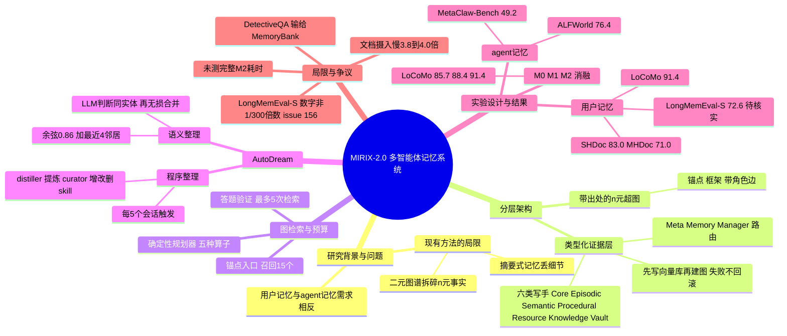

## 一、论文是干什么的？

大模型智能体（agent）如果要陪用户聊上几个月，或者在许多相似任务里积累经验，就需要**长期记忆**。现有做法各有短板：把对话压缩成「事实摘要」的系统很省空间，但被丢掉的细节（名字、日期、次数）就找不回来了；把所有原始记录都存下来的系统不丢信息，但记录越积越多，检索越来越慢、越来越杂；还有把记忆塞进模型参数的方法，需要训练，也没法用在闭源模型上。

MIRIX-2.0 想同时做到三件事：**实用**（不用训练、能接闭源模型、答案能追溯到原始记录）、**准确**（细节和事件之间的联系不丢）、**高效**（每个问题要查看的证据量不会随历史变长而增长）。可以把它想象成一个**档案馆加索引卡**：原始档案（完整记录）一页不改，永远保存；索引卡（超图）只负责告诉你该翻哪几页；夜里有个整理员（AutoDream）只会把写重了的索引卡合并，绝不去涂改档案本身。

这是 MIRIX 初代（Wang and Chen, 2025）的升级版：保留「多 agent 分管多种记忆」的设计，但重新设计了记忆如何存储、索引、检索和整理。作者单位均标注为 MIRIX AI，论文页面注明代码已公开。

## 二、核心方法与创新

### 1. 六类记忆与各 agent 分工

一个**元记忆管理器**（Meta Memory Manager）先读每条新输入，决定要更新哪几类记忆；每一类记忆各有自己的「写手」agent，负责这一类记忆的格式和更新操作。论文附录表 5 给出六类记忆：

| 记忆类型 | 保存什么 | 是否进超图索引 |
|---|---|---|
| Core 核心记忆 | 用户与 agent 的持久状态 | 否 |
| Episodic 情景记忆 | 有时间的具体事件 | 是 |
| Semantic 语义记忆 | 长期事实与概念 | 是 |
| Procedural 程序记忆 | 可执行的流程、技能 | 否 |
| Resource 资源记忆 | 文档、多模态材料 | 否 |
| Knowledge Vault 知识保险库 | 敏感的原文值 | 否 |

只有情景和语义两类进入超图，因为跨记忆的关联遍历主要依赖事件和关系证据；其他类型走各自的专用检索通道。写入时，记录先提交到向量数据库（证据层，是「系统的权威记录」），然后才去建图；建图失败只会记日志，不会回滚已存的记忆。

### 2. 带出处的 n 元超图（provenance hypergraph）

普通知识图谱用「主语-谓语-宾语」三元组，一件涉及多人多物的事会被拆成碎片。MIRIX-2.0 的超图包含三种东西：**锚点**（实体或概念，如某个人、某个地点）、**事实框架**（把一件事的所有参与者及其角色放在一个框里，例如一次航班有出发地、目的地、航空公司、同行人）、以及带角色的连接边。每个事实框架都记录它引用了向量库里的哪些行，所以答案能追溯到原文。日期、价格、数量作为「字面值」挂在框架上，而不是变成锚点。

一个有趣的设计是**事件身份**：重复提到同一件有日期的事，会合并到同一个框架；但两件措辞相似、没有日期的事（比如不同日子的两次跑步）会保持分开。

### 3. 带预算的图检索

检索被当作「构造一个有上限的证据集」。一个确定性的规划器先判断问题类型（single、temporal、intersection、list-union、count 五种），并设定预算：基础召回行数和被引用行数，从单值查找的 6 行和 4 行，到计数题的 8 行和 12 行。随后从问题匹配的锚点（先召回 15 个）进入图，沿两条证据通道展开，再把图事实和它们引用的原始行融合返回。所以问题要看的证据量由设计保证有界，不随历史变长。回答时 agent 最多可调用检索 5 次，再由规则检查是否需要补搜一次并重写答案。

### 4. AutoDream：写入之外的整理

- 语义记忆方面，AutoDream 只**合并重复的实体锚点**：对新写入的语义行相关的锚点，找最近的 4 个同类邻居，余弦相似度要不低于 0.86，再让 LLM 判断是不是同一个实体。合并只改图的连接，不改任何已存记录，所以不会毁掉证据。否定判断会被缓存，避免重复花钱。
- 程序记忆方面，AutoDream 反过来是**提炼**：每满 5 个任务会话，后台启动，一个 distiller 根据会话记录里的引文判断成败，提炼出「值得复用的经验」和「该避免的错误」，再由 curator 创建、修改或删除技能（skill），修改时可引用其所依据的经验。

### 5. 与 MIRIX 初代的区别

论文把初代（M0，扁平向量记忆，无图、无 AutoDream）作为消融基线，标为 MIRIX-1.0。2.0 的变化包括：加入带出处的 n 元超图索引和预算检索（M1）、加入 AutoDream 离线整理（M2）、并首次让同一个存储同时服务用户记忆（个性化）和 agent 记忆（技能精炼）。需要说明，M1 和 M2 是 MIRIX-2.0 的配置，不是先后发布的版本。

## 三、使用了哪些模型和计算资源？

| 项目 | 原文信息 |
|---|---|
| 用户记忆评测的回答与抽取模型 | gpt-4.1-mini，temperature 0，seed 42 |
| 主题抽取模型 | gpt-4.1-nano |
| 嵌入模型 | text-embedding-3-small（外部基线保留各自默认嵌入） |
| LoCoMo、LongMemEval-S 的评判 | gpt-4o-mini，3 次投票取多数 |
| agent 记忆实验的骨干模型 | ALFWorld 用 GPT-6 Luna 与 GPT-5.6 Luna；WebShop 用 GPT-6 Luna；MetaClaw-Bench 用 GPT-5.2 和 Qwen3.6-35B-A3B（模型名按原文照录） |
| 微调 | 无，论文称不微调任何模型 |
| GPU 型号与数量 | 暂无相关信息（原文未找到，开源模型运行所用硬件也未说明） |
| 图数据库 | 附录提到节点和边数量按 Neo4j 统计 |

耗时（论文附录表 12，均不含 AutoDream，即只反映 M1 配置，不代表完整的 M2）：

| 基准 | 方法 | 总摄入时间（秒） | 每题回答时间（秒） | 回答 token |
|---|---|---|---|---|
| SHDoc | HyperMem | 5,665 | 10.55 | 3.79M |
| SHDoc | MIRIX-1.0 (M0) | 6,227 | 3.76 | 763K |
| SHDoc | MIRIX-2.0 (M1) | 23,784 | 5.45 | 1.40M |
| MHDoc | HyperMem | 11,031 | 10.65 | 3.06M |
| MHDoc | MIRIX-1.0 (M0) | 13,792 | 7.46 | 1.23M |
| MHDoc | MIRIX-2.0 (M1) | 55,301 | 9.01 | 1.33M |
| Detective | HyperMem | 11,653 | 13.05 | 0.35M |
| Detective | MIRIX-1.0 (M0) | 10,321 | 5.11 | 706K |
| Detective | MIRIX-2.0 (M1) | 39,491 | 7.24 | 1.16M |
| LoCoMo | HyperMem | 69,467 | 9.70 | 16.5M |
| LoCoMo | MIRIX-2.0 (M1) | 21,416 | 5.46 | 15.7M |
| LongMemEval-S | HyperMem | 170,224 | 10.73 | 4.10M |
| LongMemEval-S | MIRIX-2.0 (M1) | 70,626 | 10.10 | 4.02M |

M1 构建的图规模从 LoCoMo 的 23,820 个节点、32,394 条边，到 LongMemEval-S 的 181,131 个节点、205,428 条边。agent 记忆实验按「每次运行」统计 token（见下节表格）。金额成本：暂无相关信息。需要注意：完整系统（含 AutoDream）的耗时和成本论文明确说**没有测量**。

## 四、实验结果

以下数字均为论文自报；用户记忆实验为单次运行并部分由 LLM 评判，agent 实验取三次运行平均，部分基线直接引用其原作者报告值（例如 MetaClaw-Bench 上 GPT-5.2 的基线）。未见独立第三方复现。

### 1. 对话记忆：LoCoMo（1,540 道非对抗题）

| 方法 | 总体 | Multi-hop | Temporal | Open | Single-hop |
|---|---|---|---|---|---|
| mem0 | 82.9 | 80.5 | 80.4 | 66.7 | 86.6 |
| A-Mem | 68.3 | 68.8 | 55.5 | 61.5 | 73.8 |
| MemoryBank | 59.5 | 70.9 | 14.6 | 52.1 | 73.6 |
| Graphiti | 58.4 | 65.2 | 37.1 | 53.1 | 64.9 |
| HyperMem | 91.0 | 91.1 | 84.4 | 76.0 | 95.2 |
| MIRIX-1.0 (M0) | 85.7 | 83.3 | 85.0 | 70.8 | 88.3 |
| MIRIX-2.0 (M1，仅图) | 88.4 | 89.0 | 86.0 | 71.9 | 91.1 |
| MIRIX-2.0 (M2，图加 AutoDream) | 91.4 | 91.8 | 89.4 | 74.0 | 94.1 |

大白话：加图让总体从 85.7 涨到 88.4，加 AutoDream 再涨到 91.4。但相对最强基线 HyperMem 只高 0.4 个点，且 HyperMem 在 Open 和 Single-hop 上分数仍更高；HyperMem 的 91.0 是作者自己跑出来的，低于它自己报告的 92.7。

### 2. LongMemEval-S（300 题）

| 方法 | 准确率 |
|---|---|
| mem0 | 56.3 |
| A-Mem | 45.0 |
| MemoryBank | 39.7 |
| Graphiti | 23.0 |
| HyperMem | 58.3 |
| MIRIX-1.0 (M0) | 58.8 |
| MIRIX-2.0 (M1) | 70.0 |
| MIRIX-2.0 (M2) | 72.6 |

图索引贡献 11.2 个点，AutoDream 再加 2.6 个点，比 HyperMem 高 14.3 个点。

> **注意：** 这一行的 58.8（M0）和 72.6（M2）正受到社区质疑，详见第六节：LongMemEval-S 只有 300 题，按论文所述的评分方式，准确率应是 1/300 的整数倍，而这两个数字都不是。在作者回应之前，建议把这两个数字当作「待核实」。

### 3. 文档问答（MemoryAgentBench，M1 配置，AutoDream 关闭）

| 方法 | SHDoc | MHDoc | Detective |
|---|---|---|---|
| mem0 | 48.0 | 22.0 | 53.5 |
| A-Mem | 14.0 | 20.0 | 62.0 |
| MemoryBank | 34.0 | 28.0 | 67.6 |
| Graphiti | 50.0 | 43.0 | 54.9 |
| HyperMem | 52.0 | 49.0 | 66.2 |
| MIRIX-2.0 | 83.0 | 71.0 | 64.8 |

单跳、多跳文档题分别领先 HyperMem 31.0 和 22.0 个点，但在 DetectiveQA 上输给 MemoryBank 和 HyperMem。这就是摘要里说的「五个 QA 基准中四个最强」。

### 4. 个性化生成（MemoryCD，100 个 Home_and_Kitchen 用户）

跨领域评论摘要上，MIRIX-2.0 四项指标全部最高：ROUGE-L 为 .1510（最强基线 .1430），BLEU-4 为 .0209（最强基线 .0162）。单领域设置里它在 ROUGE-1 和 ROUGE-L 领先，BERTScore 并列最高，BLEU-4 则长上下文方法更高。论文也承认这些指标不直接衡量事实一致性或用户满意度，并且其记录不能区分 M0、M1、M2，所以无法据此估算 AutoDream 的贡献。

### 5. agent 记忆（三次运行平均）

| 基准与骨干 | 无记忆 | ReasoningBank | AWM | MIRIX-2.0 |
|---|---|---|---|---|
| ALFWorld，GPT-6 Luna | 69.4 | 66.9 | 73.6 | 76.4 |
| ALFWorld，GPT-5.6 Luna | 54.2 | 52.2 | 58.0 | 61.7 |
| WebShop，GPT-6 Luna | 31.9 | 25.7 | 36.0 | 37.4 |

MIRIX-2.0 在 ALFWorld 的标准差较大（GPT-6 Luna 下为 6.2，GPT-5.6 Luna 下为 14.0 个点），论文自己也说三次运行不足以证明相对 AWM 的优势稳定。GPT-6 Luna 下它在 Clean 和 Heat 上提升明显（Clean 60.2 到 74.2，Heat 47.8 到 73.9），但 Pick、Look、Pick Two 反而低于无记忆。ReasoningBank 在两个基准上都低于无记忆。

MetaClaw-Bench Part I（346 题，30 天）：

| 模型 | 方法 | 准确率 | 文件检查完成率 |
|---|---|---|---|
| GPT-5.2 | 基线 | 41.1 | 14.7 |
| GPT-5.2 | MetaClaw Skills | 44.0 | 17.1 |
| GPT-5.2 | MIRIX-2.0 | 49.2 | 27.7 |
| Qwen3.6-35B-A3B | 基线 | 40.3 | 12.1 |
| Qwen3.6-35B-A3B | MetaClaw Skills | 51.8 | 30.8 |
| Qwen3.6-35B-A3B | MIRIX-2.0 | 52.7 | 30.8 |

在开源骨干上优势很小（52.7 对 51.8，完成率持平）。

### 6. token 成本（GPT-6 Luna，每次运行，百万 token）

| 基准 | 方法 | 训练 token | 测试 token |
|---|---|---|---|
| ALFWorld | 无记忆 | 0 | 2.147 |
| ALFWorld | ReasoningBank | 1.747 | 3.351 |
| ALFWorld | AWM | 2.749 | 3.674 |
| ALFWorld | MIRIX-2.0 | 2.253 | 3.813 |
| WebShop | 无记忆 | 0 | 4.238 |
| WebShop | ReasoningBank | 2.010 | 6.620 |
| WebShop | AWM | 1.909 | 5.448 |
| WebShop | MIRIX-2.0 | 1.815 | 4.975 |

WebShop 上它用的 token 在记忆方法里最少；ALFWorld 上测试 token 却是记忆方法里最多的。

### 7. 论文自述的局限

消融是成组添加组件的，没有单独拆出 n 元框架、引用行、事件身份、答题验证等；用户记忆结果为单次运行；部分基线为作者报告值；检索上界只约束「检查的证据量」，不是随历史增长实测的延迟；文档摄入比扁平记忆慢约 3.8 到 4.0 倍。

## 五、潜在应用与已落地应用

潜在应用：长期陪伴型个人助理（记住用户的日期、偏好、经历）；需要从历史任务里积累技能的任务型 agent（网购、家务模拟、办公任务）；需要可追溯、可审计答案的场景，因为每条图事实都能指回原始记录。论文伦理部分建议部署时让用户能查看、更正、删除记忆，敏感原文放进不被索引的 Knowledge Vault，并在高风险场景由人审核合并和技能。

已落地情况：初代 MIRIX 有公开仓库 [Mirix-AI/MIRIX](https://github.com/Mirix-AI/MIRIX)（我用 GitHub API 查到：Apache-2.0 许可证，约 3,508 个 star，最近一次推送为 2026-11-11），论文还给出了官网 [mirix.io](https://mirix.io/)。但本次未核实到「MIRIX-2.0 已在真实产品中大规模部署」的证据，论文自己也说实用性建立在设计与评测协议上，而不是实际部署。仓库页面显示的描述仍是初代的屏幕活动助手介绍，是否已包含 2.0 的全部功能，我没有逐一核对。

## 六、网络上的讨论与评价

我检索了论文标题和 arXiv 编号。除 hyper.ai 的摘要页和对初代 MIRIX（arXiv 2507.07957）的介绍外，主要的公开讨论在 HuggingFace 论文页和作者的 GitHub 仓库。Hacker News、Reddit、X、知乎上：未找到公开讨论。

**HuggingFace 论文页**（票数 55，此后可能变动）有 4 条评论：

- 作者发帖，列出主要数字。
- 一位用户认为把完整记录当作「系统记录」的设计合理，并问开启 AutoDream 后文档问答会怎样。
- 一条重要质疑：LongMemEval-S 共 300 题，论文说用 gpt-4o-mini 三次多数投票评分，那么每个准确率都应是 1/300 的整数倍。五个基线和 M1（70.0）确实是，但 M0 的 58.8 和 M2 的 72.6（摘要里的头条数字）都不是：最近的取值分别是 58.67 或 59.00，以及 72.33 或 72.67。这两个数字都符合 k/900，与「把三次评判投票（或三次运行）取平均」的算法吻合，但提问者明确说他不确定实际做法，并指出论文的局限性一节称用户记忆结果来自单次运行，所以三次运行取平均也并不自洽。（以上均按四舍五入到一位小数计算。）
- Librarian Bot 的相似论文推荐。

**GitHub issue：** HF 评论者与下面 issue 的提问者用户名相近，很可能是同一方，所以不宜当作两个独立来源。上面的质疑同时被提交到 MIRIX 仓库的 issue #156（标题为 LongMemEval-S Table 7: 58.8 (M0) and 72.6 (M2) are not multiples of 1/300），提问者还指出 LoCoMo 的评判脚本是每个答案只调用一次评判模型，而不是三次投票。另外他指出，公开的 LongMemEval-S 评测脚本（evals/mab/llm_judge_mab.py）用的是 gpt-4o 单次调用，而不是论文写的 gpt-4o-mini 三次多数投票；不过评论者也说明，他无法确定表 7 是否就是由这些脚本产生的。我通过 GitHub API 核实该 issue 存在，状态为 open。另有一位用户在 issue 下独立复核了论文口径和公开评测代码，得出类似的一致性疑问（他自己说明未重跑 300 题，只是一致性检查）。截至我检索时（2026-11-20），两条评论都来自仓库外的用户，没有看到论文作者的回应。

这意味着：LongMemEval-S 上「72.6，领先 HyperMem 14.3 个点」这类结论，可能存在评分口径不一致的问题，需要等作者澄清。这也提醒读者，论文中不同基准、不同方法行的评分方式不一定相同。

读者可以注意的另几点（均出自论文本身）：HyperMem 的对比数字是作者自己重跑的；LoCoMo 上领先幅度很小；AutoDream 的收益只在对话基准上有直接消融，文档问答和耗时测量都没有包含它。

## 七、思维导图

