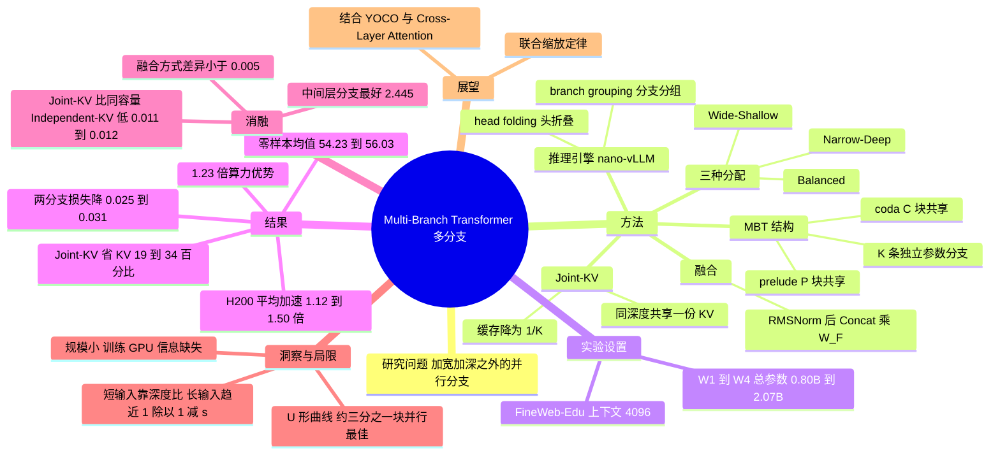

## 一、论文是干什么的？

今天的大语言模型要变强，常见做法有两种：把每一层做得更**宽**，或者把层数堆得更**深**。这篇论文提出第三个方向：**分支**（branching），也就是让几条完整的 Transformer 子网络同时并行地处理同一份输入，最后再把结果合并。

可以把它想成一家餐厅的后厨。传统 Transformer 是一条流水线：切菜、炒菜、装盘，每道工序必须等前一道做完。Multi-Branch Transformer（下称 MBT）则是前面有一个共用的备菜区（prelude），中间分出两三个灶台同时各炒各的（branches），最后回到共用的装盘区（coda）把菜合在一起。灶台同时开火，所以整条线上「必须排队等待」的步骤变少，上菜更快。

论文还解决了一个实际问题：长文本推理时，模型要把每一层的 Key 和 Value 存起来（KV cache），非常占显存。MBT 提出 Joint-KV，让同一深度的各分支共用一份 KV 缓存，既省显存又加速解码。

## 二、核心方法与创新

### 1. 分支如何划分与合并

输入 token 先经过 $P$ 个共享的 prelude 块，得到 $H=\mathcal{P}(X)$；然后进入 $K\geq 2$ 条独立参数化的分支 $Z_i=\mathcal{G}_i(H)$，每条分支是若干个串行的完整 Transformer 块；最后融合并通过 $C$ 个共享的 coda 块。每个块都是「因果注意力 + MoE 前馈」。整体写成：

$$\widehat{Y}=\operatorname{Dec}\bigl(\mathcal{C}(\mathcal{F}(Z_1,\ldots,Z_K))\bigr)$$

融合函数是最简单的一种：对每条分支输出各自做 RMSNorm，沿隐藏维度拼接，再用一个无偏置的线性层 $W_F$ 投影回共享宽度 $d$：

$$\mathcal{F}(Z_1,\ldots,Z_K)=\operatorname{Concat}\bigl(\mathcal{N}_1(Z_1),\ldots,\mathcal{N}_K(Z_K)\bigr)W_F$$

融合后直接进入 coda，没有额外的分支残差连接。物理块数与「串行深度」的关系为：

$$L_{\mathrm{physical}}=P+\sum_{i=1}^{K}L_i+C,\qquad D=P+\max_i L_i+C$$

也就是说，参数量按所有块计，但推理时需要排队的步数只按最长的那条分支计。

### 2. 三种宽度-深度分配（保持训练算力相当）

| 变体 | 做法 |
|---|---|
| Wide-Shallow | 保持每个块的宽度，把中间的块平分到各分支（分支变浅） |
| Narrow-Deep | 每条分支保留原模型的完整深度，但块变窄 |
| Balanced | 介于两者之间：分支宽度和深度都取中间值 |

后两种通过调整残差宽度与 MoE 维度来对齐训练 FLOPs，专家总数、top-$k$ 不变。论文发现 3 到 4 个分支时若坚持 Narrow-Deep，宽度会太小、质量变差，所以最终配方用 Balanced。

### 3. Joint-KV：怎样共享 KV 缓存

默认的 Independent-KV 中，每条分支的每个块都用自己的输入算 K 和 V 并各自缓存，分支越多缓存越多。Joint-KV 则在每个深度，把所有分支的（归一化后的）输入拼接起来，用**一个**投影矩阵算出共享的 K、V，而每条分支仍保留自己的 Query：

$$\mathrm{KV}^{\rm shared}_{\ell}=\frac{1}{\sqrt{K}}[\bar{S}_{1,\ell};\ldots;\bar{S}_{K,\ell}]W^{\rm shared}_{\ell}$$

其中 $W^{\rm shared}_{\ell}\in\mathbb{R}^{(Kd_b)\times(2h_{\mathrm{KV}}d_h)}$。论文指出，Joint-KV 与 Independent-KV 的 KV 投影参数量和矩阵乘 FLOPs 相同；在固定分支深度和 KV 维度下，分支区域的缓存只有 Independent-KV 的 $1/K$。共享只发生在同一深度的分支之间，不跨层。

### 4. 推理引擎：branch grouping 与 head folding

引擎基于 nano-vLLM 实现，有两个关键机制：

- **Branch grouping**：把各分支同一深度的块打包成一个批量执行阶段，串行阶段数从 $L_{\mathrm{physical}}$ 降到 $D$。例如 4 分支 W3 Balanced MBT 有 24 个物理块，只需 12 个串行阶段，而 Standard 需要 16 个。
- **Head folding**：把分支维度折叠进 query head 维度，让所有分支用一次 GQA 注意力调用读取同一份共享 KV，避免重复读显存。注意力函数本身不变。

论文给出的加速估计公式为：

$$S\approx\frac{F+M}{F/r_{\mathrm{d}}+(1-s)\,M}$$

$F$ 是串行块的固定开销，$M$ 是 Standard 读 KV 的时间，$r_{\mathrm{d}}$ 是深度比，$s$ 是 KV 节省比例。短输入时加速主要来自深度比，长上下文时加速逼近 $1/(1-s)$。

### 5. 参数量与 FLOPs 是否对齐

对齐，但方式要分清：

- Wide-Shallow 与 Standard 的块宽度、物理块数一致，总参数量几乎相同（W1：0.799B 对 0.801B；W4：2.074B 对 2.077B），训练 FLOPs 也几乎一致（论文称几乎相同）。
- Narrow-Deep 与 Balanced 通过改宽度来匹配 Standard 的训练 body FLOPs（body 不含 LM head，含注意力、MoE、宽度桥接和融合投影）。例如 W3：Standard body 为 1.5032 PFLOP-days，Balanced 2 分支为 1.5301，3 分支 1.5160，4 分支 1.5148，是「相近」而非完全相等。
- 论文 A.2 说明 FLOPs 的统计口径：乘加算 2 FLOPs，训练矩阵运算近似为前向的 3 倍，不含逐元素运算、优化器、通信等。1 PFLOP-day 等于 $8.64\times 10^{19}$ FLOPs。

## 三、使用了哪些模型和计算资源？

- **基座模型**：没有使用现成 LLM，全部是论文自己从零预训练的小型 MoE Transformer。分 W1 到 W4 四个规模，标准模型总参数 0.80B 到 2.07B，激活 body 参数 139M 到 394M（总参数含词表，激活参数不含）。
- **架构细节**：pre-RMSNorm、GQA（Q:KV 头比 2:1，head 维度 64）、Q/K 归一化、RoPE（base 500,000）、注意力输出 sigmoid 门控；每个块含 latent MoE，64 个 SwiGLU 专家、top-8 路由，用 Quantile Balancing 做负载均衡（无辅助损失）。
- **数据与规模**：FineWeb-Edu，Llama 3 分词器（词表 128,256），上下文 4,096；训练 token 数为 27.845B、41.088B、57.942B、78.841B（W1 到 W4），约 200 tokens per parameter。
- **优化**：BF16、AdamW（$\beta=(0.9,0.95)$，权重衰减 0.1，梯度裁剪 1.0），1% 线性 warmup 后余弦衰减到峰值的十分之一；全局 batch 为 128 序列（W1/W2）和 256 序列（W3/W4）。
- **训练用的 GPU 型号与数量、训练耗时、费用**：暂无相关信息（正文与附录均未找到）。论文只以 PFLOP-days 报告训练算力，如 Table 11 中各配置 body 约 0.37 到 2.80 PFLOP-days。
- **推理基准**：单张 NVIDIA H200；提示长度 4K（来自 FineWeb-Edu）及 16K、64K、128K（来自 RULER），每个请求生成 1K token，温度 1.0、top-$p$ 0.95；并发请求数 $N$ 取 1、8、64（64K 取 1、8、32；128K 取 1、8、16）。每个请求的绝对耗时：暂无相关信息（论文报告的是相对 Standard 的吞吐比值）。

## 四、实验结果

### 1. 两分支 Wide-Shallow：质量更好（论文自报）

| 规模 | 最佳分配 $P/(A+B)/C$ | Standard 损失 | MBT 损失 |
|---|---|---|---|
| W1 | 4/(2+2)/4 | 2.653 | 2.622 |
| W2 | 5/(2+2)/5 | 2.554 | 2.525 |
| W3 | 5/(3+3)/5 | 2.471 | 2.444 |
| W4 | 6/(3+3)/6 | 2.392 | 2.367 |

大白话：把大约三分之一的块放进两条并行分支，损失下降 0.025 到 0.031；放进分支的比例提高到约 79%，质量才降到与 Standard 持平（呈 U 形）。按拟合的幂律 $\mathcal{L}(C)=AC^{-\alpha}$ 反推，Standard 需要约 1.23 倍的 body 训练算力才能追平。下游 9 项零样本任务（HellaSwag、ARC-E、ARC-C、OBQA、SciQ、WinoGrande、BoolQ、LAMBADA、PIQA）上，W1 到 W4 平均准确率从 54.23% 升到 56.03%，9 项全部更好。

### 2. 更多分支与 Balanced（论文自报）

以 W3 为例（Standard 损失 2.471）：

| 变体 | 分支数 | 损失 |
|---|---|---|
| Wide-Shallow | 2 / 3 / 4 | 2.445 / 2.457 / 2.451 |
| Balanced | 2 / 3 / 4 | 2.436 / 2.446 / 2.449 |

从 2 个分支增加到 3 或 4 个，验证损失平均变化小于 0.006，且所有配置都优于 Standard；Balanced 在每个规模和每个分支数下都优于对应的 Wide-Shallow。

### 3. Joint-KV：省缓存，质量基本不掉（论文自报）

| 规模（Standard 损失，KV 缓存） | K | Independent 损失 | Joint 损失 | Joint-KV 节省 KV |
|---|---|---|---|---|
| W4（2.392，49.5 KiB/token） | 2 | 2.363 | 2.361 | 23.74% |
| W4 | 3 | 2.366 | 2.366 | 28.79% |
| W4 | 4 | 2.367 | 2.364 | 31.82% |

12 个 Joint-KV 模型的损失全部低于 Standard。下游 9 项平均：2 / 3 / 4 分支 Joint-KV 为 55.92% / 55.56% / 55.47%，Standard 为 54.23%。全部规模下 KV 节省为 18.75% 到 34.38%（摘要与引言写作 19 到 34%）。论文称 Joint-KV 模型与 Standard 达到同等验证损失所需的 Standard 训练 body 算力为 1.16 到 1.26 倍。

### 4. 推理加速（论文自报，单张 H200）

- 4 分支 Joint-KV MBT，四个规模平均：从单个 4K 请求的 1.12 倍，到 16 个并发 128K 请求的 1.50 倍；在每个规模与设置下都至少快 1.08 倍。2 分支平均为 1.01 到 1.32 倍。
- 摘要称最高提升 51.4%（64K 输入、8 并发）；附录 Table 16 中 W2、4 分支、64K、N=8 的单元格为 1.51。
- 需要留意的不一致：同一张 Table 16 里还有更高的数值，例如 W2、4 分支、128K、N=8 为 1.60。摘要的 51.4% 因此似乎并非全表最大值，论文没有解释这一口径，这里如实指出。
- 工程细节：W1 的 2 分支只比 Standard 少 1 个串行块，加速不足以抵消 MBT 专属操作（每步增加 130 到 190 微秒），所以在短输入下比 Standard 慢（例如 W1、2 分支、4K、N=1 为 0.96）。
- Engine ablation（4 分支 W3）：朴素引擎（逐块执行、每分支一次注意力）在所有设置下都比 Standard 慢；只有 branch grouping 加 head folding 同时使用，才在所有设置下都更快。

### 5. 消融（论文自报）

- 宽度/深度对照：Wide-Shallow MBT 在四个规模上都优于「全局宽浅」和「局部宽核心」两个对照；Narrow-Deep MBT 也优于 Standard，拟合指数 $\alpha=0.0548$，高于 Wide-Shallow 的 0.0515。
- 固定缓存大小时：Joint-KV 比 Independent-KV 的验证损失低 0.011 到 0.012，额外投影增加的 body 算力不到 0.6%。
- 融合方式：6 种学习型融合（门控、联合 MLP、低秩双线性、联合 SwiGLU、token softmax、拼接投影）损失相差不到 0.005（W3，约 2.444 到 2.448）；无投影的归一化求和为 2.458，对比拼接投影的 2.445。
- 分支位置（W3）：中间 2.445，早层 2.458，晚层 2.464，中间最好。

以上全部为论文自报，暂无独立复现结果。实验规模较小（最大 2.07B 总参数、约 79B token），论文也未验证更大规模，结论外推需谨慎。

## 五、潜在应用与已落地应用

**潜在应用**（论文结论部分提出的方向与合理推断）：

- 长上下文、高并发的在线服务：KV 缓存小、解码更快，对显存受限的部署有吸引力。
- 与 YOCO、Cross-Layer Attention 等跨层共享 KV 的方法结合，进一步压缩缓存。
- 多模态：不同分支可分别承担文本、图像、音频等主干。
- 分支可分布到多卡（branch parallelism），论文讨论了其通信方式，适合需要分片放入显存且互联带宽高的场景。
- 联合缩放定律：把分支数、分支深度和隐藏维度一起纳入算力预算优化。

**已落地应用**：未找到。论文只给出开源代码和 Hugging Face 模型集合，暂无证据表明已用于商业产品或大规模生产部署。

## 六、网络上的讨论与评价

- [HuggingFace 论文页](https://huggingface.co/papers/2611.19800)：44 票（此后可能变动）；页面上仅有作者自评和机器人评论，没有实质性讨论。
- 代码仓库 [GaotangLi/Multi-Branch-Transformer](https://github.com/GaotangLi/Multi-Branch-Transformer)：本次查询时约 13 星，最近一次推送为 2026-11-18。
- 二手转述：[AI Weekly](https://aiweekly.co/editors-blog/found-first-multi-branch-transformer-cuts-kv-cache-up-to-34-boosts-throughput-up) 与 [hyper.ai](https://hyper.ai/en/papers/2611.19800) 有摘要性介绍，基本复述摘要数字，不含独立评测。
- Hacker News、Reddit、X/Twitter、知乎等：未找到公开讨论。

## 七、思维导图

