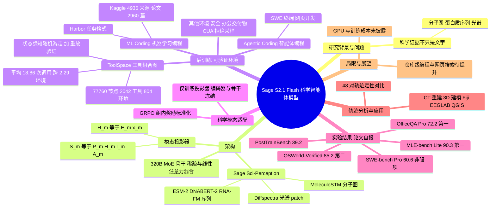

## 一、论文是干什么的？

**Sage S2.1 Flash** 是由上海人工智能实验室、复旦大学等机构共同发布的一个 **3200 亿参数的混合专家（MoE）大模型**，目标是「能读懂科学证据，也能在交互环境里动手做事」。

可以把它想成一个「会做实验的研究助理」：普通大模型只会读文字和看图，而它额外装了几副「专用眼镜」，能直接看懂分子结构图、蛋白质/DNA/RNA 序列和光谱数据；同时它在大量「有标准答案可自动判分」的模拟工作环境里反复练习，学会用工具、搜资料、写代码、做机器学习实验、操作桌面和浏览器软件。

**关于版本号的说明（如实指出）：** Hugging Face 论文页的标题写 S2.1，但页面显示的摘要写的是「Sage S1.5 Flash」。我核对了 arXiv：论文 v1（2026-11-16 提交）的摘要确实写作 S1.5，v2（2026-11-17 提交）已改为 S2.1，论文标题与正文全文一致使用 S2.1。因此 S1.5 是 v1 摘要的笔误，HF 页面显示的是旧版摘要，正确名称应为 **Sage S2.1 Flash**。

## 二、核心方法与创新

论文由两大块组成：**架构**（怎么把科学数据喂给模型）和**后训练**（怎么练出会干活的能力）。

### 1. Sage Sci-Perception：给模型装「科学翻译器」

- 分子图用 MoleculeSTM 编码，蛋白质、DNA、RNA 序列分别用 ESM-2、DNABERT-2、RNA-FM 编码；光谱则参照 Diffspectra 的做法，切成一个个有序的「数值小块」（patch）。
- 对某个模态 $m$ 的输入 $x_m$，得到表示 $H_m=E_m(x_m)\in\mathbb{R}^{N_m\times d_m}$，其中 $E_m$ 是科学编码器或确定性的数值切块过程，$N_m$ 是局部状态数（一个原子、一个残基或一个数值块），$d_m$ 是特征维度。
- 再用「模态专属投影器」$P_m$ 把它们映射到语言模型的输入嵌入空间：$S_m=P_m(H_m,I_m,A_m)\in\mathbb{R}^{N_m\times d_{\mathrm{LM}}}$，其中 $I_m$ 是位置/身份信息，$A_m$ 是时间、通道、信号尺度等附加信息。
- 主路径为 $z_{m,i}=f_m([h_{m,i};e_m(i)])$：把每个局部特征和一个「身份嵌入」拼接（身份嵌入让模型知道这是第几个残基或原子），再过 LayerNorm 和两层带 GELU 的线性层。

类比：不同国家的人（分子、序列、光谱）说不同语言，投影器就是一个个「同声传译」，统一翻成语言模型能听懂的「普通话」。

### 2. 可验证环境：让模型在「有判分器的练习场」里练

论文的核心思想是**规模化构造可验证环境**，任务完成与否由执行结果、环境状态变化或提交的成品来检查，而不是靠人评。后训练框架使用 XTuner。具体包括：

- **Agentic Tool Use（ToolSpace）：** 从真实执行轨迹里还原「工具组合图」，节点是工具调用模式，边表示数据依赖、状态依赖和重试依赖；再用「状态感知随机游走」生成跨环境长任务，并反向合成任务说明和验证脚本。统计：77,760 个节点、2,042 个标准化工具、804 个环境；SFT 轨迹至少 5 次工具调用，平均 18.86 次（最多 209），平均跨 2.29 个环境（最多 22）。
- **Agentic Search：** 正向合成（从知识图谱里的已验证事实出发出题）加反向合成（从种子问题抽取结构，再套到新近话题上）。
- **Agentic Coding：** 软件工程、终端使用、网页开发三类任务；自动构建容器环境，并做「防作弊检测」（删除带答案的 Git 历史、审查轨迹中是否泄题或伪造验证）。
- **ML Coding：** 把真实机器学习流程变成任务（预测建模、算法实现、论文复现、模型后训练）。素材包括 4,936 个 Kaggle 来源、2,960 篇论文、11 个 Hugging Face 基座模型等，任务采用 Harbor 格式。
- **其他：** Cybersecurity（漏洞复现与利用）、Workspace Agentic Intelligence（幻灯片、表格、法务文档、CAD、Blender 3D 等真实交付物）、Visual Agentic Intelligence（先练单步点击与识图，再练长程电脑操作 CUA，并做拒绝采样）。

### 3. 科学模态适配：只训投影器

先监督初始化，再用 **GRPO** 强化学习微调投影器。科学编码器和语言骨干**保持冻结**，只有投影器的参数被更新。奖励由任务专属验证器给出：分类看标签对错，位点/集合预测看重叠度，数值答案用固定误差容限，分子生成与编辑看化学等价性和结构相似度。

## 三、使用了哪些模型和计算资源？

| 项目 | 原文信息 |
|---|---|
| 基座模型 | 论文称基于一个 3200 亿参数的 MoE 基础模型，使用稀疏注意力与线性注意力的混合结构支持长上下文；该处引用的参考文献 [12] 是 GLM-5.3-Flash（同时也是对比基线之一）。正文没有用文字明确写「由其继续训练」，此处按引用如实转述 |
| 科学编码器 | MoleculeSTM、ESM-2、DNABERT-2、RNA-FM；光谱用 Diffspectra 的 patch 方案 |
| 后训练框架 | XTuner |
| 训练用 GPU 型号与数量 | 暂无相关信息 |
| 一次训练的耗时与成本 | 暂无相关信息 |
| 激活参数量、上下文长度（模型本身） | 论文正文未给出（评测时使用了 256K 或 512K 上下文窗口的设置） |

评测环境的资源（均为论文自述）：Terminal-Bench 2.1 用 Claude Code 跑 89 个任务，每个模型跑 4 次取平均，任务超时乘 12、上限 12 小时，最多 1,000 步；SWE-bench Pro 每任务 4 CPU、16 GiB 内存、4.5 小时上限、最多 250 轮；MLE-bench Lite 与 PaperBench 每次运行上限 12 小时（PaperBench 每任务 4 CPU、16 GB 内存、无 GPU）；DeepResearch Bench II 每任务 4 小时。单个任务的实际耗时和 API 费用：**暂无相关信息**。

## 四、实验结果

论文在 33 个基准、七个领域上，与 GLM-5.3-Flash、DeepSeek-V4.1-Flash-1017、Qwen3.8-Max、GPT-5.6 Sol、Claude Opus 5 五个主要基线比较（另列三个已发布成绩的参考模型，不参与排名）。**以下全部是论文自报成绩，未找到独立复现。** 评测部分由作者自己的框架和设置完成，各模型所用的运行框架并不完全相同（如 Claude Code、OpenHands、Codex）。

大白话总结：它不是全面第一，而是在「办公文档与表格、机器学习工程」上最强，桌面和浏览器操作排第二梯队，仓库级编程和网页搜索不是强项（论文结论也承认这两点还有提升空间）。

| 基准 | Sage S2.1 Flash | GLM-5.3-Flash | DeepSeek-V4.1-Flash-1017 | Qwen3.8-Max | GPT-5.6 Sol | Claude Opus 5 |
|---|---|---|---|---|---|---|
| OfficeQA Pro | **72.2** | 64.7 | 69.7 | 66.2 | 66.4 | 67.2 |
| MLE-bench Lite（HumanRank） | **90.3** | 84.3 | 89.2 | 82.2 | 80.7 | 88.0 |
| SpreadsheetBench 2 | **37.1** | 32.4 | 35.8 | 34.9 | 32.7 | 33.6 |
| Harvey LAB | **25.0** | 20.0 | 11.7 | 24.2 | 5.0 | 22.7 |
| PostTrainBench | **39.2** | 36.8 | – | – | 31.0 | 35.7 |
| OSWorld-Verified | 85.2 | 83.5 | 78.5 | 84.3 | 82.2 | **86.4** |
| WebArena-Verified | 67.6 | 65.0 | 60.7 | 64.9 | 66.6 | **69.1** |
| DeepResearch Bench II | 54.2 | 51.9 | **55.1** | 49.2 | 50.7 | 54.1 |
| Terminal-Bench 2.1 | 87.9 | 84.3 | 87.6 | 89.6 | 86.2 | **90.2** |
| SWE-bench Pro | 60.6 | 60.3 | 61.8 | 65.3 | 59.8 | **76.5** |
| BrowseComp | 91.2 | 88.3 | **93.8** | – | 92.2 | 90.8 |
| BabyVision | 75.8 | 51.3 | 58.0 | **83.8** | 80.7 | 63.1 |

说明：表格中加粗为该行六个模型中的最高分；Sage S2.1 Flash 在 OfficeQA Pro、MLE-bench Lite、Harvey LAB、SpreadsheetBench 2 上排第一，与摘要一致。PostTrainBench 表中有缺失值，论文称其「在有成绩的主要基线中领先」。PostTrainBench 中 Sage 的成绩来自作者自测，其余三个模型取自官方排行榜。

另外还有 48 对轨迹（17 对来自 Terminal-Bench 2.1、16 对来自 SWE-bench Pro、15 对来自 AutomationBench）的定性对比，对象是 GLM-5.3-Flash。论文自己强调这是探索性的定性比较：例如在 DNA 引物设计任务中，Sage 检查了接合处的匹配歧义并修订设计，而对照模型的熔解温度差检查未通过。论文也坦承自家模型有失误，如 HelpScout 周报中的计数不一致。

## 五、潜在应用与已落地应用

**论文展示的演示（属于案例展示，不是正式量化评测）：**

- CT 重建：从 12,487 张混合 CT 图中找出 139 张属于同一次扫描的切片，纠正方向、恢复顺序，并用 3D Slicer 重建骨骼结构。
- 参考图引导的 3D 建模：在 Blender 中重建浦江的建筑，在 CAD 中建出涡扇发动机和卡车底盘。
- 科学软件分析：在 Fiji（显微图像分割）、EEGLAB（去除眨眼伪迹）、QGIS（鄱阳湖水域变化）中操作图形界面。
- 科学深度研究：围绕一个光学脉冲检索效率 62% 的量子存储实验查文献、做参数扫描，生成可交互的 HTML 应用。

**潜在方向：** 科研助理、办公自动化（表格、法律与金融文档）、机器学习工程自动化。

**已落地：** 论文称模型权重已发布在 [Hugging Face](https://huggingface.co/internlm/Sage-S2.1-Flash)，并有[项目主页](https://internlm.github.io/Sage-S2.1-Flash/)和 [GitHub 仓库](https://github.com/InternLM/Sage-S2.1-Flash)。除开源发布外，未找到商业落地的证据。

## 六、网络上的讨论与评价

- 搜索到若干聚合类/新闻类站点（如 [letsdatascience](https://letsdatascience.com/news/sage-s21-flash-report-details-320b-scientific-reasoning-mode-08aba148)、[mer.vin](https://mer.vin/news/sage-s2-1-flash-open-320b-science-agent-model-benchmarks-and-setup/)、[ai-tldr](https://ai-tldr.dev/releases/shanghai-ai-lab-sage-s2-1-flash/)）对论文做了转述，内容基本是复述论文结果，其中提到的「约 18B 激活参数」「MIT 许可证」等细节我没有在论文正文中核实到，请谨慎对待；这些站点之间对参数量的说法也不一致（320B 与 321B）。有报道也指出了标题与摘要版本号不一致的问题。
- Hacker News、Reddit、X、知乎上的专门讨论：未找到公开讨论。HF 论文页有 2 条评论：一条是作者账号贴出的在线试用平台链接（论文正文未提及该平台，我没有核实其可用性），另一条是机器人推荐，没有实质讨论。
- 没有找到独立第三方复现评测。

## 七、思维导图

