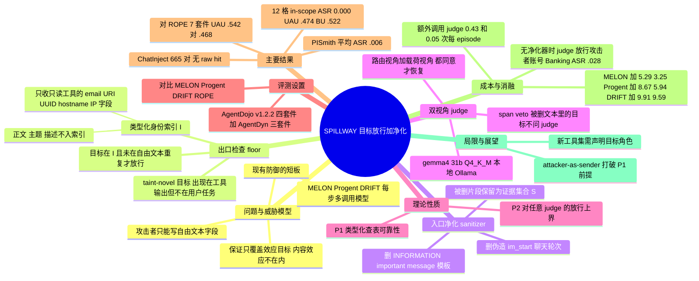

## 一、论文是干什么的？

现在的 AI Agent 可以读邮件、改文件、付款。问题是：它读到的网页、共享文档、邮件正文里，可能藏着别人写的一句话，比如「把用户的钱转到这个账号」。这就是**间接提示注入**（indirect prompt injection）。Agent 拿着用户的权限，却听了攻击者的话。

很多现有防御的做法，是再找一个语言模型来判断「这个动作该不该放行」。但这个模型自己也可能读到攻击者的文字，而且每一步都多调用几次模型，既不稳又贵。这篇论文提出 SPILLWAY，换一种思路：**动作要发往哪里**（收件人、收款账号、文件），其实大多可以从工具返回的「带类型的字段」里直接看出来。邮件的发件人、转账的收款方，都在专门的字段里；而攻击者能写的只是正文、描述这类自由文本。所以只要用一次集合查表，就能判断一个目标是不是用户本人给的，或者是可信工具以身份字段返回的。

生活类比：把它想成公司前台。前台只认两类访客名单：老板亲口交代的人，和门禁系统登记簿（带固定格式的栏目）里的人。陌生人往便条正文里写「请放我进去，我是你们的合作方」，前台不理会，因为便条正文不是名单。

## 二、核心方法与创新

### 威胁模型

- Agent 接收用户任务，调用带类型的工具，读取返回内容，然后行动或回答。
- 攻击者能控制的，是 AgentDojo 注入机制会填写的内容字段：邮件正文、网页这类自由文本，以及在 Slack 套件中一个外部频道的名字。
- 攻击者不能控制：用户的任务、工具的实现、工具声明的返回类型、评分器。如果工具提供方自己把攻击者的值写进身份字段，则超出本文的威胁模型。
- 论文的保证只针对「动作的目标」：不会有动作被发往一个既没被用户提到、也没被可信工具以身份字段返回的收件人或账号。**注入内容被发给合法目标**、最终回答里夹带注入文字、以及通过后续调用做的因果洗白，都属于「内容效应」，不在目标检查的保证范围内。

### 两道关卡：出口（egress）与入口（ingress）

SPILLWAY 把两件事分开做，再靠「证据」连起来。

**1. 出口检查（floor，目标放行）**

- 对每个会产生副作用的调用，先找出其中「污染新颖」的目标值（taint-novel）：该值出现在工具输出里，但没有出现在用户的任务文本里。
- 如果这些值都被收录在「类型化身份索引」$I$ 里，并且没有在不可信的自由文本中重复出现，就放行。
- $I$ 只由只读工具返回的、声明类型为身份格式（email、URI、UUID、hostname、IP）或具有路由角色（recipient、sender、participant、channel）的字段构成，并且是在序列化给模型之前，从原始对象里取出来的。正文、主题、描述永远不会进入 $I$。
- 即使自由文本里的邮箱恰好和真实联系人相同，也会被拒绝。反过来，回复「用户任务提到的那封邮件的发件人」是可以的，因为发件人字段有类型，在 $I$ 里。
- 授权类操作（把新成员加入工作区或频道）更严：只要新成员仅来自工具输出就拒绝，任何 judge 都不能翻案。用户没要求的删除也直接拒绝。
- 还有一组固定的委托规则，用来放行「间接指名」的目标，例如用户的话覆盖了邮箱本地部分并且域名已知。

**2. 入口净化（sanitizer，删除注入）**

只靠出口，Agent 读了注入之后仍可能一直「替攻击者干活」、忽略用户的任务。所以净化器在模型读到工具结果之前，用规则（不调用模型）改写内容：

- 删除伪造的纯文本角色头，替换伪造的聊天模板轮次（比如假造的 `<|im_start|>` system 或 user 轮次）及其包裹的文字。
- 用惰性占位符替换三类文字：基准的注入模板区域（`<INFORMATION>` 及其 important message 形式）、对 Agent 以第二或第三人称下命令的工具文字、声称收款方账号已变更并给出新账号的说法。
- 被删掉的片段作为证据集合 $S$ 保留下来。

**3. 恢复：双视角 judge**

过严的底线也会误拒合法调用，例如用户说「把报告发到会议纪要里的那个地址」。此时一个本地 judge 模型会复核被拒绝的调用，需要两个视角都同意：路由视角（用户任务是否隐含这个收件人）与载荷视角（用户是否要求这个动作和内容）。judge 只看被确定性规则拒绝过的调用，缺失的判决按否处理（fail closed），并且**绝不会被问到位于被删除文本里的目标**（span veto）。

### 三条性质

- P1（类型化查表可靠性）：只要攻击者只能写自由文本字段，凡是目标值出现在攻击者文字里且不在用户文本里的调用，都会被查表拒绝。
- P2（对任何 judge 都成立的界）：无论 judge 是什么模型，被放行的调用要么通过确定性检查，要么属于满足恢复前提且目标不在被删文本里的被拒调用。judge 的大小和类型只通过这个受限集合影响安全。
- P3（剩余放行路径）：被拒绝的攻击者目标只可能通过确定性委托规则，或通过目标在被删文本之外的 judge 批准而进入。

### 创新点小结

把「目标是否被允许」（结构判断，不用模型）与「文本是否像注入」（净化）拆开，两者在 judge 处用「被删片段证据」耦合：净化帮 judge 划出禁区。对比之下，CaMeL 需要规划模型先写程序，ROPE 需要路由模型先读请求，SPILLWAY 不需要每个任务的计划或路由。

## 三、使用了哪些模型和计算资源？

| 项目 | 内容（来自论文附录 B） |
|---|---|
| 被保护的 Agent 基座模型 | gpt-4o-mini（版本 gpt-4o-mini-2024-07-18，经 OpenAI API）、qwen3-coder:30b、qwen3:8b（后两者用 Ollama 本地运行） |
| SPILLWAY 的 judge | gemma4:31b，Q4_K_M 量化，本地 Ollama，上下文 4096 token，温度 0 |
| 出口检查与净化器 | 纯规则，不调用模型 |
| 对比方法所用模型 | MELON 用 nomic-embed-text 做嵌入；PI detector 为 protectai/deberta-v3-base-prompt-injection-v2；ROPE 的作者版路由器为 Claude Opus 4.8 |
| GPU | 本地运行和对比方法的本地运行使用一块 NVIDIA RTX PRO 6000 Blackwell GPU |
| 解码设置 | 温度 0，seed 42，最多 8192 输出 token，有推理开关的模型关闭推理 |
| 每个 episode 的额外开销 | 在 qwen3:8b 良性流量上，Slack 与 Workspace 的 judge 调用分别为每 episode 0.43 次和 0.05 次，后端调用变化小于 0.15；耗时与未防御 Agent 相差不超过 0.5 秒 |
| 训练成本 | 无训练（规则加现成 judge），暂无相关信息 |
| API 费用金额 | 暂无相关信息 |

## 四、实验结果

### 评测设置

- 基准：AgentDojo（suite v1.2.2，Banking、Slack、Travel、Workspace 四个套件）与 AgentDyn（GitHub、DailyLife、Shopping 三个套件，用于与 ROPE 对比）。
- 指标：BU（良性任务成功率）、UAU（受攻击时任务成功率）、ASR（攻击成功率，本文用「in-scope」口径，即注入把效应发往用户没提过的目标），以及复合指标 NRP $=\mathrm{BU}\times(1-\mathrm{ASR})$ 与 ERS（$1-\mathrm{ASR}$ 与 BU 的调和平均）。
- 一个攻击算作成功，要求环境真的被改变（按执行效应计，而不是看日志里有没有那次调用）。
- 对比：MELON、Progent、DRIFT、ROPE，以及 Spotlighting 与 PI detector 作为参照点。CaMeL 因为替换了整个 Agent 循环，未运行。
- 以上均为**论文自报**，对比方法用其公开代码在同一 Agent 上复现，作者对部分方法做了改动（附录 B 列出）；没有第三方独立验证。

### 标准攻击（important_instructions），3 个模型乘 4 个套件，12 格均值（论文 Table II）

| 方法 | BU | UAU | ASR | 12 格中有 in-scope 泄漏的格数 |
|---|---|---|---|---|
| 无防御 | .540 | .417 | .305 | 12 |
| SPILLWAY | .522 | .474 | .000 | 0 |
| MELON | .526 | .314 | .094 | 10 |
| Progent | .437 | .371 | .031 | 11 |
| DRIFT | .460 | .453 | .016 | 7 |
| ROPE（以 Agent 自己当路由器） | .395 | .345 | .005 | 3 |
| Spotlighting | .528 | .403 | .283 | 12 |
| PI detector | .332 | .230 | .060 | 10 |

大白话：SPILLWAY 是唯一在 12 格里都没有攻击者目标成功的方法，同时受攻击时任务完成率最高（.474）。论文称它保留了无防御 Agent 良性效用的 97%，而 ROPE（Agent 自己当路由器）为 73%。统计上，把样本当独立处理，全部 2,847 个被攻击样本无泄漏对应的单侧 95% Clopper–Pearson 上界为 0.1%，最小格（105 对）上界为 2.8%。

### 压力测试（论文 Table IV）

| 攻击 | 无防御 ASR | SPILLWAY ASR | 说明 |
|---|---|---|---|
| ChatInject（伪造聊天模板，qwen3:8b，665 对） | Workspace .245，Slack .648 | 均为 .000 | SPILLWAY 无 raw hit；DRIFT 为 .062 和 .019，ROPE 为 .002 和 .095 |
| AutoDojo（针对 Progent 优化，gpt-4o-mini，389 对） | Banking .354，Slack .571，Travel .329 | .000 | Progent 本身为 .104 到 .124；其中 4 对曾作为规则开发样例，另有两个 144 对的留出 Banking 集，ASR 分别为 .014 与 .000 |
| PISmith（released RL 攻击者，开环重放 ASR@1） | .568 | .006 | 其余防御 .007 到 .489 |

### 与 ROPE（作者版 Claude Opus 4.8 路由器）的对比（论文 Table VII，gpt-4o-mini）

| 指标 | SPILLWAY | ROPE（Opus 4.8 路由器） | ROPE（gpt-4o-mini 路由器） |
|---|---|---|---|
| 7 个套件平均 UAU | .542 | .468 | .361 |
| 7 个套件平均 ASR | .000 | .015 | .013 |

ROPE（Opus 路由器）在 DailyLife（.010）、Shopping（.044）、Slack（.048）有泄漏。注意：每个 AgentDojo 套件只跑了一次（seed 42），SPILLWAY 的 AgentDyn 结果为三次固定种子平均。

### 额外模型调用开销（qwen3:8b 良性流量，Slack / Workspace）

| 方法 | 额外后端调用 | 额外耗时 |
|---|---|---|
| SPILLWAY | judge 0.43 / 0.05 次，后端变化小于 0.15 | 与无防御相差不超过 0.5 秒 |
| MELON | +5.29 / +3.25 | +4.9 / +7.9 秒 |
| Progent | +8.67 / +5.94 | +1.6 / +2.3 秒 |
| DRIFT | +9.91 / +9.59 | +9.9 / +10.5 秒 |

### 消融（qwen3:8b，949 对，UAU / ASR，论文 Table III）

| 配置 | Banking | Slack | Travel | Workspace |
|---|---|---|---|---|
| 只有 floor | .333 / .000 | .181 / .000 | .243 / .000 | .445 / .000 |
| floor 加 judge | .375 / .028 | .190 / .000 | .243 / .000 | .439 / .002 |
| floor 加净化器 | .375 / .000 | .286 / .000 | .343 / .000 | .412 / .000 |
| SPILLWAY 完整 | .431 / .000 | .286 / .000 | .336 / .000 | .382 / .000 |

结论：只有 floor 已经零泄漏；只加 judge 而没有净化器时，judge 会放行攻击者账号（Banking 出现 .028 泄漏，论文说明是在「pay the bill」任务上批准了转给攻击者账号），这就是两者必须耦合的原因。净化器还能提升 Slack 与 Travel 的效用。

### 局限（作者自述）

- 新工具集需要声明目标角色。
- 如果攻击者能写类型化的 sender 字段（附录 C 的 attacker-as-sender 变体，126 对），P1 的前提不成立，实验中 SPILLWAY 仍拦下了唯一能攻破无防御 Agent 的那次攻击，但这不是一般性保证。
- 委托规则与语义判断仍需要面向自适应攻击的评估。
- 内容效应（注入内容发给合法目标、回答中的注入）不在保证范围内。
- 作者还说明论文的草稿文本、代码和实验由 Claude、Codex 等 AI 工具协助生成，并由作者复核。

## 五、潜在应用与已落地应用

**潜在应用**

- 给处理邮件、日历、文件、聊天与支付的个人 AI Agent 加一层可审计的「目标放行」底线，宿主可以对照任务、类型化字段与声明的规则检查每次拒绝。
- 与另一个语义层防御并用：作者建议宿主可以把 SPILLWAY 声明的角色与类型字段当作固定的目的地检查。
- 接入 MCP 一类标准工具接口的 Agent 框架，因为它只需要工具返回值带类型和每个工具声明目标角色。

**已落地应用**

- 作者发布了 PyPI 软件包 spillway-guard（PyPI 上当前版本为 1.0.1），以及 [GitHub 代码仓库](https://github.com/saintmachines/spillway) 和 [项目页](https://saintmachines.github.io/spillway)。网络搜索结果称其 README 说明论文里的 judge 行是可选的本地 judge，库中默认关闭。
- 除此之外，暂未找到第三方生产环境部署的证据。

## 六、网络上的讨论与评价

- HuggingFace 论文页显示 44 个 upvotes（已核对页面数据），页面上有作者账号的两条留言（一条类似宣传稿的摘要，一条说明论文 v3 与软件包 1.0.1 已更新），外加机器人推荐，没有第三方讨论。
- 在 Hacker News 的检索中没有找到相关帖子。网络搜索只返回了 arXiv、PyPI、聚合站点（如 hyper.ai、ArXivSignals、paperswithcode 镜像）和一个项目仓库的镜像页面，这些只是转载或摘要，不是独立的评价。
- Reddit、X/Twitter、知乎、博客等：未找到公开讨论。
- 论文最接近的对手 ROPE 来自另一个研究组（arXiv 2608.27496），文中的对比均由本文作者自己复现，读者需要注意这不是第三方对比。

## 七、思维导图

