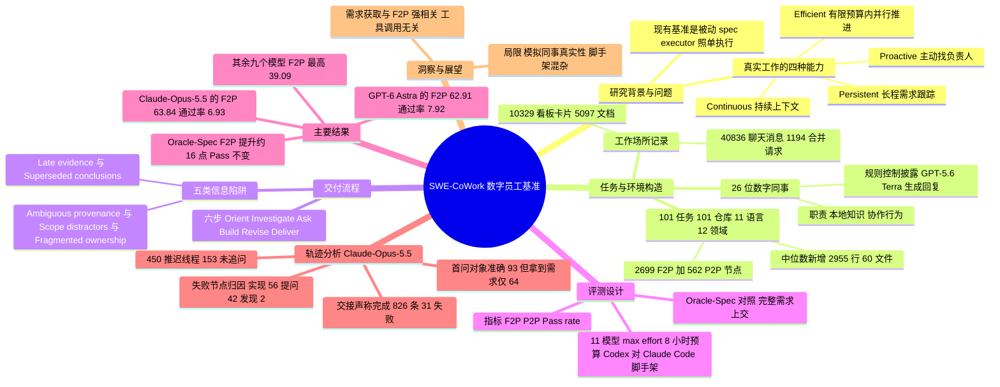

## 一、论文是干什么的？

现在大家评测编程 AI，常用的做法像「发一张写得清清楚楚的工单，让 AI 照着改代码」。但真实的软件公司不是这样：你刚接手一个同事留下的活，只收到一张很短的交接便条（中位数只有 206 个词），真正的需求散落在看板卡片、设计文档、聊天记录、代码评审和 CI 记录里，还有一部分只存在于某位同事的脑子里。更麻烦的是，这些材料还会互相矛盾：旧方案被新文档推翻了，日志标题写的是一次运行，内容却来自另一次运行。

这篇论文提出 **SWE-CoWork**，把编程智能体当成「新入职的数字员工」来考核。每个任务让智能体进入一个模拟的工程组织：一个真实的开源仓库，加上 26 位由大模型扮演的数字同事和一整套工作记录。智能体必须自己搞清楚「到底要做什么」，向对的人提问，再写代码、验证，最后交一份交接说明。成绩由藏起来的可执行测试来判定。

用生活类比：以前的考试像「给你一道写明所有条件的应用题」；SWE-CoWork 更像「把你扔进一家公司，只给一张便条，让你自己去问同事、翻档案、把活干完并汇报」。

论文的核心发现是：**写出大部分功能**和**把整个任务做对**之间有巨大鸿沟。最强的两个模型能通过约 63% 的新功能测试，但完整完成的任务不到 8%。

## 二、核心方法与创新

### 1. 任务是怎么构造的

- 规模：101 个开发任务，对应 101 个上游真实仓库，覆盖 11 种编程语言、12 个应用领域（Web 框架、编译器、游戏、支付、科学计算等）。其中 11 个任务涉及多种语言的实质性修改。
- 每个任务是一次「累计升级」式的大改动：中位数的参考答案新增 2,955 行生产代码，涉及 60 个文件（不含测试、文档、配置等）。
- 每个任务平均 32.3 个验证测试节点（中位数 32），其中新功能测试（F2P，即修改前失败、修改后应通过）平均 26.7 个，旧行为保持测试（P2P，即修改前后都应通过）平均 5.6 个。全基准共 2,699 个 F2P 节点、562 个 P2P 节点，合计 3,261 个可执行检查。
- 每个任务都配有一份 Oracle-Spec 文档，把测试所编码的全部需求逐条列出，用于后面的对照实验。

### 2. 数字员工

每个任务围绕仓库建立 26 位数字同事（全基准共 2,626 份员工档案），涉及一个目标项目和四个邻近项目。每位员工有三个属性：

- **职责**：对哪个模块或决定负责。
- **本地知识**：自己能解释哪些需求，哪些问题要转给别人。
- **协作行为**：可能要求你先给复现步骤或调用路径，一次只谈一个话题，或者先推迟回答、等你追问。

关键设计是：**环境（规则）决定每一步能披露什么信息，大模型只负责把话说出来**。这样不同智能体面对的同事行为是受控的，不会因为模拟同事乱说而结果飘忽。每个任务中位数有 6 位同事掌握着决定测试结果的需求。

### 3. 从需求澄清到交接的完整流程

智能体拿到的是一张入职便条（说明开发目标、不许改现有测试、邻近项目不在范围内、历史术语可能与现仓库不同）。典型流程分六步，并且会交错进行：

1. **Orient（定位）**：读便条、看仓库、确定目标项目和初始范围。
2. **Investigate（调查）**：搜看板、文档、聊天、历史，核对记录来源和版本，追踪被改名的接口。
3. **Ask（提问）**：找到负责某个未决问题的人，带着代码证据去问，处理转介和「请先给复现」。
4. **Build and verify（实现与验证）**：写代码、跑测试、检查回归。
5. **Revise（修订）**：看新消息和新证据，必要时回头改实现。
6. **Deliver（交付）**：写交接说明，列出确认的需求、改动、验证结果和未解决问题。

智能体通过专用工具接口与工作场所交互：查员工目录、看项目看板、打开带版本的文档、搜索和读取聊天、给同事发消息、查看合并请求和 CI 记录、检查新动态。

论文还给了一个真实案例（Task 094，PHP 时间记账应用 Kimai）：智能体先把 5,400 秒正确换算成 1.5 小时，但设计文档没说这个功能怎么开启，于是它去问导出模块的负责人，答复改变了补丁的行为。这说明需求发现和编码是交错的，而不是先问完再写。

### 4. 五类职场信息陷阱

- **Late evidence（迟到的证据）**：开工后才出现的追踪记录或版本更正。
- **Superseded conclusions（被取代的结论）**：旧草案仍可搜到，但已有新版本更正。例如 Stencil 项目里，草案提议没有源映射时返回空对象，已发布的第三版却要求该字段保持 undefined。
- **Ambiguous provenance（来源含糊）**：日志附件标题写 RUN-98752，内容却是 RUN-20547 的输出。
- **Scope distractors（范围干扰项）**：已取消的卡片、重复卡片、被否决的方案、邻近项目。
- **Fragmented ownership（责任分散）**：同事了解相邻接口，却无权决定；要转给真正的负责人。

### 5. 对照实验与轨迹分析

- **Oracle-Spec 对照**：对 Seed Evolving 和 GPT-6 Astra，一开始就把完整需求给它们，且没有同事可问；仓库、测试、脚手架和执行预算保持不变。这样可以区分「没问到需求」和「拿到需求也做不好」。
- **Claude-Opus-5.5 轨迹分析**：因为它的 F2P 最高，论文对其 101 条运行轨迹做了逐需求追踪，结合同事披露日志和一个基于评分细则的大模型轨迹评审员，查看需求是在发现、提问还是实现阶段丢失的。

### 6. 指标

设任务 $i$ 通过的 F2P 节点数为 $f_i$、总数为 $F_i$，则论文是把节点跨任务汇总后再算比例，即

$$\mathrm{F2P}=\frac{\sum_i f_i}{\sum_i F_i}$$

P2P 同理。**Pass rate** 则是「所有 F2P 和 P2P 节点在同一次运行中全部通过」的任务占比。因为是按节点汇总，测试节点多的任务权重更大。（以上是根据论文文字描述对指标的重述，并非逐字抄录公式。）

## 三、使用了哪些模型和计算资源？

**被测的 11 个模型（均为论文中的名称，在 max effort 档位评测）：** Claude-Opus-5.5、GPT-6 Astra、Seed 2.1 Pro、Seed Evolving（字节火山引擎）、Kimi K3、DeepSeek V4 Pro、DeepSeek V4.1 Flash、GLM 5.3、GLM 5.2、Qwen3.8-Max、Qwen3.8-Flash。

**脚手架：** GPT-6 Astra 使用 Codex 脚手架，其余十个模型使用 Claude Code 脚手架。这意味着 GPT-6 Astra 与其他模型之间的比较同时混入了脚手架差异，读数字时要留意。

**数字同事的大模型：** 所有运行中数字员工都由 GPT-5.6 Terra（high reasoning effort）驱动，所以所有被测智能体面对的是同一个同事模型。

**执行预算：** 每个任务有 8 小时的执行（墙钟时间）预算上限。

**每任务耗时（论文 Table 9，每次运行的中位数，墙钟小时，上限 8）：**

| 模型 | 中位耗时（小时） | 中位工具调用数 | 中位发给同事的消息数 |
|---|---|---|---|
| GPT-6 Astra | 3.00 | 182 | 18.5 |
| Claude-Opus-5.5 | 5.01 | 213 | 22 |
| GLM 5.3 | 2.46 | 785 | 21 |
| Qwen3.8-Max | 8.00 | 696 | 6 |
| Seed Evolving | 4.46 | 503 | 9 |
| Qwen3.8-Flash | 5.53 | 902 | 10 |
| Kimi K3 | 1.41 | 301 | 8 |
| DeepSeek V4.1 Flash | 8.00 | 1603 | 4.5 |
| Seed 2.1 Pro | 2.50 | 229 | 8 |
| GLM 5.2 | 2.06 | 361 | 5 |
| DeepSeek V4 Pro | 0.90 | 150 | 0 |

**Token 用量：** 在有遥测数据的九个模型中，Claude-Opus-5.5 每次运行的输入 token 中位数为 4757 万（47.57 million，未做上下文压缩），GPT-6 Astra 为 2032 万（20.32 million）；这些数字包含对保留上下文的重复处理。DeepSeek V4 Pro 和 Seed 2.1 Pro 的 token 数据不可用。

**GPU 型号与数量：** 暂无相关信息（论文没有说明）。
**单任务的金钱成本：** 暂无相关信息（论文没有给出费用数字）。
**基准构建本身的耗时和成本：** 暂无相关信息。

## 四、实验结果

### 主结果（论文自报，CoWork 设置，101 个任务）

| 模型 | F2P (%) | P2P (%) | Pass rate (%) |
|---|---|---|---|
| Claude-Opus-5.5 | 63.84 | 93.24 | 6.93 |
| GPT-6 Astra | 62.91 | 89.15 | 7.92 |
| Seed Evolving | 39.09 | 94.48 | 0.99 |
| Qwen3.8-Max | 35.70 | 91.80 | 0.00 |
| GLM 5.3 | 31.27 | 87.72 | 0.99 |
| Qwen3.8-Flash | 30.70 | 93.40 | 0.00 |
| DeepSeek V4.1 Flash | 28.20 | 94.30 | 0.00 |
| Kimi K3 | 27.08 | 84.88 | 0.99 |
| GLM 5.2 | 24.40 | 95.20 | 0.00 |
| Seed 2.1 Pro | 21.01 | 81.85 | 0.00 |
| DeepSeek V4 Pro | 13.04 | 90.21 | 0.00 |

大白话：前两名能做出大约三分之二的新功能，但整个任务一次做对的只有 6.93% 和 7.92%（按 101 个任务算，约 7 个和 8 个）；其余九个模型几乎全军覆没，最好也只有 1 个任务完整通过。P2P 普遍较高（81.85% 到 95.20%），说明不破坏旧功能相对容易，难的是交付新需求。

### 给出完整需求会怎样（Oracle-Spec 对照，论文自报）

| 指标 | Seed Evolving CoWork | Seed Evolving Oracle | GPT-6 Astra CoWork | GPT-6 Astra Oracle |
|---|---|---|---|---|
| F2P | 39.09 | 55.76 | 62.91 | 78.84 |
| P2P | 94.48 | 89.50 | 89.15 | 91.81 |
| Pass rate | 0.99 | 0.99 | 7.92 | 7.92 |

F2P 提升约 16 个百分点（16.67 与 15.93），但完整通过率一点没变。即使拿到全部需求，Seed Evolving 仍有 44% 的 F2P 节点没过，GPT-6 Astra 仍有 21%。这说明瓶颈不只是「没问到」，还有实现和验证。另外，Seed Evolving 的 P2P 通过率反而从 94.48% 降到 89.50%（下降 4.98 个点）：论文称它在拿到完整规格后实现了更多新行为，但保住的原有行为更少。

### 需求获取与交付的关系

- 各模型「从同事处拿到需求的比例」与 F2P 强相关，工具调用次数则几乎无关。GPT-6 Astra 和 Claude-Opus-5.5 分别拿到 67.8% 和 64.2% 的「仅同事掌握的需求」；DeepSeek V4 Pro 只拿到 1.8%（它每次运行发给同事的消息数中位数为 0，论文把这类行为称为被动的 spec-executor，即照单执行者）。
- 有的模型（Qwen3.8-Max、DeepSeek V4.1 Flash）用满 8 小时、动用成百上千次工具调用，拿到的需求却不如领先模型。
- 领先模型往往在更少的工具调用后就开始写第一处代码，并且更频繁地与同事沟通（这是跨模型相关性，论文强调并不能证明因果）。

### Claude-Opus-5.5 的 101 条轨迹（论文自报）

| 现象 | 数字 |
|---|---|
| 首个问题问对负责人的比例 | 平均 93% |
| 拿到的「同事持有需求」占比（共 2,176 条） | 64% |
| 提了但没拿到 / 已联系的人但没提 / 从未联系的人 | 16% / 17% / 3% |
| 已披露需求对应的 F2P 通过率 vs 未披露 | 68.8% vs 49.8% |
| 失败的 F2P 节点归因：实现 / 提问 / 发现 | 56% / 42% / 2% |
| 对方推迟回答的线程共 450 个，其中追问了 297 个，最终披露 205 个 | 153 个未追问 |
| 未追问线程在被推迟时剩余预算中位数 | 7.1 小时 |
| 过早停止（仍有可做的工作） | 49 次，其中 48 次为自主停止，剩余预算中位数 2.8 小时 |
| 交接时声称完成的 826 条需求中测试失败的 | 255 条，约 31% |
| 禁止修改现有测试的 94 份任务简报中，补丁仍改动了现有测试的 | 15 个 |
| 每次运行联系同事数中位数 / 用时中位数 | 6 位 / 5.0 小时（共 8 小时预算） |

形象地说：这位「新员工」几乎总能找对人，但问到一半就不再追问，写完代码也不一定写对，交接时还有近三分之一的「已完成」是假的。

### 独立验证情况

以上全部是论文自报数字，我没有找到独立复现。HF 论文页上有读者 victor-checkpaper 指出：Figure 7(c) 中 16 + 415 + 548 = 979 个失败节点，而 Figure 7(b) 与 Table 2 推出至多 976 个；并称 Table 2 中有六个值与声明的 2,699 / 562 总数对不上，三个 P2P 值更符合 561。该质疑同时提交到了作者的 GitHub 仓库（TokenWave-AI/swe-cowork-bench 的 issue #1，已关闭，我用 GitHub API 核实过）。作者方的协作者回复说：Figure 7(c) 中一个 F2P 节点可以对应多条需求、多个失败阶段，阶段计数可以重叠，所以总和可以超过去重后的失败节点数，并承认「earliest observed loss stage」这个图注有误导性；Table 2 的出入是显示精度问题（先四舍五入到一位小数、再按两位小数显示），所有模型都是按 2,699 个 F2P 和 562 个 P2P 节点评测的。两点都会在下一版中澄清，提问者回复称按一位小数核对后成立。所以这不是结果有误，而是图注和表格格式的问题。

## 五、潜在应用与已落地应用

**潜在应用：**

- 作为训练和评测「能协作的软件工程智能体」的测试台：不只考写代码，还考追问、核对版本、跟踪未决问题、诚实汇报。
- 指导智能体产品设计：论文建议显式跟踪每条需求的负责人、未决问题、实现状态、验证证据和交接声明（论文明确说此做法是否有效仍是开放问题）。
- 用于研究多智能体团队协作，论文提到可扩展到评估自主编程智能体团队。
- 人类工程师可借鉴其五类信息陷阱做新人交接培训。

**已落地应用：** 未找到证据表明已有产品或公司采用。论文开源了代码、数据集和项目页，属于研究资源。

## 六、网络上的讨论与评价

- **HuggingFace 论文页**：有几条评论。用户 polyarti 称「领先模型通过约 63% 测试却完成不到 8% 任务，很符合把真实交接交给智能体时的感受」，并追问问得少的智能体是否更容易虚报完成；victor-checkpaper 提出了上文所述的计数核对问题；Librarian Bot 自动推荐了相似论文。
- **DEV Community**：一篇 [SWE-CoWork tests coding agents as collaborators in simulated organisations](https://dev.to/paragonaimag/swe-cowork-tests-coding-agents-as-collaborators-in-simulated-organisations-2egn)，由 Paragon 发布，对论文做了摘要，自述含 AI 辅助，主要保留意见是「模拟同事是否真实到足以预测真实组织中的表现」。另有一篇综述类文章 [Recent AI Research Reveals Gaps in Coding Agents and Advances Scientific Modeling](https://dev.to/pneumetron/recent-ai-research-reveals-gaps-in-coding-agents-and-advances-scientific-modeling-4bm) 也在搜索结果中出现。
- Hacker News、Reddit、X、知乎：未找到公开讨论。
- 相关链接：[项目页](https://tokenwave-ai.github.io/swe-cowork-page)、[代码仓库](https://github.com/TokenWave-AI/swe-cowork-bench)、[数据集](https://huggingface.co/datasets/Tokenwave-AI/swe-cowork)。

## 七、思维导图

