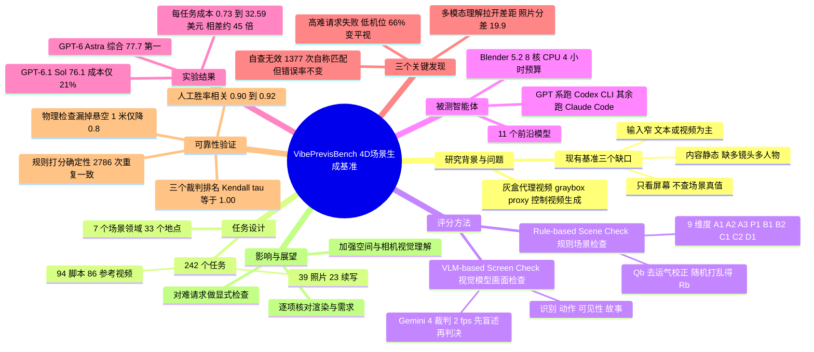

## 一、论文是干什么的？

现在很多可控视频生成模型（比如论文里提到的 Seedance 2.5）有一种玩法：先给它一段**灰盒代理视频**（graybox proxy video），也就是没有贴图、只有简单方块和假人的粗糙 3D 预览，它会保持其中的布局、人物动作、镜头运动和剪辑点，再在上面「上色」生成逼真的视频。这类似电影行业的**预演**（previs）：导演先用粗糙模型排好戏，再正式开拍。

过去做这种预演需要熟练的 3D 美术花很多时间。现在可以让**编程智能体**（coding agent，比如在 Codex CLI、Claude Code 里跑的大模型）直接写 Blender 的 Python 代码，搭出一个会随时间变化的 3D 场景（也就是 4D 场景），再渲染成代理视频。问题是：怎么知道智能体搭得好不好？这篇论文就是做了一把「尺子」，叫 VibePrevisBench。它共有 242 个任务，每个任务给智能体一份「导演的需求」，让它交出可执行的 Blender 程序和渲染好的代理视频，再检查两件事：场景本身对不对，以及观众在画面上看不看得出来对。

打个比方：这就像让一个装修队按图纸搭一个会动的样板间。验收时既要拿卷尺量（墙在不在、人站得对不对、镜头高度对不对），也要让一个路人看一眼视频（能不能认出这是厨房、能不能看懂人在干什么）。

## 二、核心方法与创新

### 任务怎么定义

每个任务给智能体一份英文需求、可选的媒体素材、一份带编号的「地点与对象清单」，以及输出要求（帧数、帧率、分辨率）。智能体要交出一个 Blender 程序，评测方把它重新运行一遍，导出每一帧里每个对象的有向包围盒、相机轨迹和剪辑点，再渲染出代理视频。

### 四种输入

| 输入类型 | 任务数 | 给智能体什么 |
|---|---|---|
| 剧本（script） | 94 | 只有文字，没有距离和角度 |
| 参考视频（reference video） | 86 | 一段真实视频，需求里只列出对象编号 |
| 照片（photo） | 39 | 一到五张照片，要还原空间 |
| 续写（continuation） | 23 | 给开头第一帧，描述接下来几秒 |

合计 94 加 86 加 39 加 23 等于 242。任务覆盖 7 个场景领域和 33 个地点。

### 两种评分维度

**规则化场景检查**（Rule-based Scene Check）：重新运行智能体的代码，把导出的 4D 场景和隐藏的标准答案事实对比，分九个维度：

| 编号 | 维度 | 检查什么 |
|---|---|---|
| A1 | Entities 实体 | 该有的人和物是否存在、类别和数量对不对 |
| A2 | Layout 布局 | 相对位置、距离、前后、靠墙等 |
| A3 | Spaces 空间 | 地点的范围以及它们怎样连通 |
| P1 | Picture structure 画面结构 | 每个镜头的深度、法线、分割等与参考帧对比（仅照片、续写、视频任务有） |
| B1 | Routes 路线 | 每个人随时间走到哪、经过哪些地点 |
| B2 | Events 事件 | 事件是否发生、何时、顺序、姿态 |
| C1 | Camera 相机 | 每个镜头的位置、高度、朝向、镜头焦段、运动 |
| C2 | Cuts 剪辑 | 镜头数、切换时间、顺序和时长 |
| D1 | Physical validity 物理合理性 | 有无穿模、悬空、瞬移、尺寸不合理 |

外观（颜色、材质）完全不检查，因为外观由后续的视频生成模型负责。

打分方式有几个巧思。每个事实的得分在 0 到 1 之间，误差在容差内得满分，超出后线性扣分。然后每个事实块做**去运气校正**：

$$Q_b=\mathrm{clip}\left(\frac{P_b-R_b}{1-R_b}\right)\kappa_b$$

其中 $P_b$ 是该块的原始平均分，$R_b$ 是「把智能体自己的物体在每个地点内随机打乱」后得到的分数（也就是瞎摆能拿多少分），$\kappa_b$ 是所需对象确实存在的比例。这样随机布局得 0 分，乱加杂物也不会占便宜，缺少对象会被扣分。最后 $\mathrm{Scene}=100\cdot\frac{1}{|D_\tau|}\sum_{d\in D_\tau}Q_d$，在该任务涉及的维度上取平均。

另外有三道「门」：程序能独立运行、完整渲染出视频、能在 Blender 里重新打开。任何一道没过，两项分数都记 0，而且仍然计入平均，所以智能体不能靠放弃难题占便宜。

**VLM 屏幕检查**（VLM-based Screen Check）：由裁判模型 Gemini 4 以每秒 2 帧观看代理视频（照片任务还会看一段评测方渲染的环绕视频），而且看不到智能体名字和对象名字。它先在不知道需求的情况下「盲述」视频内容，再拿到需求和由标准答案生成的检查清单，只对规则检查已通过的项目打分（yes 为 1，partial 为 0.5，no 为 0）。分四个维度：

- 识别（V1 Recognition）：盲述里能不能认出这个对象或地点
- 动作可读性（V2 Action readability）：观众能不能看懂这是什么动作
- 可见性（V3 Visibility）：关键时刻人和物是否清晰可见，不被遮挡、不太小
- 故事（V4 Story beats）：盲述里是否复述出了故事要点

照片任务只用识别一项。总分为 $(\mathrm{Scene}+\mathrm{Screen})/2$。

### 任务怎么造出来

分三步：先从超过 2.7 万个源视频里筛选，留下 1.8k 个片段，其中 388 个通过 VLM 检查，再由人工挑选；剧本由模型先搭好场景再写，并让 Claude 和 DeepSeek 两个系列的「盲读者」只读剧本、写出东西在哪儿、何时发生，两人都复原不出来的断言会被改写或删除；标准答案来自场景设定、扫描数据集的 3D 框，或 4D 重建流水线，无法验证的事实标为「不可评分」。最后，11 个智能体先把候选任务都跑一遍，区分不出智能体的任务被剔除。所有任务、素材、标准答案和打分器用校验和冻结，保证分数可复现。

### 任务统计

- 简报长度 153 到 1200 词，中位数 368 词；输出视频 6 到 60 秒，中位数 40 秒
- 88% 的任务有两个或以上镜头，80% 有运动相机，79% 有两人或以上，69% 有手与物体的交互
- 每个任务 20 到 2175 个检查项，中位数 408，共约 9.9 万个检查项（由 84.4k 个可评分事实展开而成）

## 三、使用了哪些模型和计算资源？

这篇论文是基准论文，没有训练新模型，被测的是现成的前沿大模型，下面的名称全部照抄论文原文。

**被测的 11 个编程智能体**（推理强度为论文表 2 所给）：

| 智能体 | 推理强度 | 运行环境 |
|---|---|---|
| GPT-6 Astra | max | Codex CLI |
| GPT-6.1 Sol | max | Codex CLI |
| GPT-5.6 Sol | max | Codex CLI |
| Gemini 4 Argon | high | Claude Code |
| Opus 5.5 | high | Claude Code |
| DeepSeek V4.1 Flash | max | Claude Code |
| Kimi K3 | xhigh | Claude Code |
| Gemini 3.8 Flash | high | Claude Code |
| GLM 5.3 Flash | high | Claude Code |
| Doubao Seed 2.1 Pro | max | Claude Code |
| Muse Spark 1.3 | xhigh | Claude Code |

**裁判与其他模型**：VLM 裁判为 Gemini 4；为检验可靠性，还用 GPT-6.1 Sol 和 Qwen3.8 Omni Flash 重新打分；剧本构造时用 Claude 和 DeepSeek 系列做盲读者。

**运行环境**：每次运行在沙箱里进行，使用 Blender 5.2、8 个 CPU 核，没有 GPU；智能体有 4 小时预算，不能联网、不能用外部素材、接触不到打分器；每个任务只跑一次。共 11 乘 242 等于 2662 次运行。

**单任务耗时与成本**（论文表 9，242 个任务的平均值；费用按 2026 年 10 月下旬官方标价，根据 API 中转日志逐请求计算）：

| 智能体 | 轮数 | 工具调用 | 墙钟分钟 | 输入百万 token | 输出千 token | 费用（美元） | 失败次数 |
|---|---|---|---|---|---|---|---|
| GPT-6 Astra | 71 | 70 | 93 | 11.2 | 149 | 32.59 | 0 |
| GPT-6.1 Sol | 62 | 60 | 105 | 10.7 | 195 | 6.71 | 0 |
| Gemini 4 Argon | 49 | 85 | 73 | 5.8 | 181 | 4.45 | 2 |
| Opus 5.5 | 47 | 61 | 54 | 6.7 | 137 | 7.82 | 0 |
| GPT-5.6 Sol | 82 | 81 | 39 | 6.8 | 54 | 6.19 | 0 |
| DeepSeek V4.1 Flash | 131 | 141 | 91 | 27.9 | 261 | 1.89 | 0 |
| Kimi K3 | 106 | 129 | 196 | 20.6 | 226 | 17.66 | 4 |
| Gemini 3.8 Flash | 143 | 141 | 88 | 16.0 | 166 | 2.73 | 0 |
| GLM 5.3 Flash | 91 | 116 | 89 | 12.7 | 135 | 0.73 | 3 |
| Doubao Seed 2.1 Pro | 143 | 168 | 116 | 22.8 | 143 | 5.96 | 1 |
| Muse Spark 1.3 | 88 | 130 | 108 | 7.8 | 157 | 3.84 | 4 |

也就是说，一个任务平均耗时从 39 分钟（GPT-5.6 Sol）到 196 分钟（Kimi K3），成本从 0.73 美元（GLM 5.3 Flash）到 32.59 美元（GPT-6 Astra），相差约 45 倍。轮数越多分数越低（11 个智能体上的 Spearman 相关系数 $\rho=-0.77$），输出 token 数与分数几乎无关（$\rho=0.11$）。

评测裁判（Gemini 4）单次打分的耗时和费用：暂无相关信息。基准构建本身的人力和算力开销：暂无相关信息。

## 四、实验结果

以下全部是**论文自报**的数字。作者给出了若干可靠性检验（见后），但没有第三方独立复现。

### 主结果（表 2）

| 智能体 | 规则检查 剧本 | 规则检查 照片 | 规则检查 续写 | 规则检查 视频 | 规则检查 总计 | 屏幕检查 总计 | 综合 |
|---|---|---|---|---|---|---|---|
| GPT-6 Astra | 85.6 | 55.8 | 79.8 | 56.8 | 70.0 | 85.4 | 77.7 |
| GPT-6.1 Sol | 84.4 | 55.3 | 78.1 | 56.0 | 69.0 | 83.1 | 76.1 |
| Gemini 4 Argon | 82.1 | 57.1 | 78.5 | 55.8 | 68.4 | 81.7 | 75.0 |
| Opus 5.5 | 83.0 | 59.8 | 78.2 | 53.9 | 68.4 | 79.8 | 74.1 |
| GPT-5.6 Sol | 80.8 | 44.2 | 73.0 | 49.0 | 62.9 | 77.5 | 70.2 |
| DeepSeek V4.1 Flash | 80.1 | 43.2 | 73.0 | 45.7 | 61.3 | 77.9 | 69.6 |
| Kimi K3 | 81.3 | 42.4 | 73.9 | 45.2 | 61.5 | 73.5 | 67.5 |
| Gemini 3.8 Flash | 78.6 | 43.1 | 71.4 | 46.2 | 60.7 | 68.7 | 64.7 |
| GLM 5.3 Flash | 76.0 | 39.9 | 71.0 | 42.6 | 57.8 | 69.5 | 63.7 |
| Doubao Seed 2.1 Pro | 73.6 | 40.4 | 65.7 | 42.2 | 56.3 | 66.2 | 61.3 |
| Muse Spark 1.3 | 77.4 | 40.5 | 67.2 | 40.1 | 57.2 | 65.0 | 61.1 |

大白话解读：

- 最强的 GPT-6 Astra 综合 77.7，前四名（GPT-6 Astra、GPT-6.1 Sol、Gemini 4 Argon、Opus 5.5）比其余智能体至少高 3.9 分；但 10 对相邻名次里有 5 对在统计上分不开。
- 没有智能体真正「做满分」：规则检查得分达到 90 的任务只有 35 个（共 242 个）；把 11 个智能体每题取最好，综合分也只有 80.6。
- 性价比：GPT-6.1 Sol 以 21% 的成本拿到领先者 98% 的分数；DeepSeek V4.1 Flash 以 6% 的成本拿到 90%；Kimi K3 成本排第二，分数却排第七。
- 排名稳健：在 18 种打分变体下，Kendall $\tau\ge0.85$，GPT-6 Astra 始终第一。

### 三个主要发现

1. **多模态理解拉开差距**：最好与最差智能体的规则检查分差，在纯文字剧本上是 12.0，在照片上是 19.9。在照片任务上，画面结构和相机两项占前四名与其余七名分差的 63%，实体和布局只占 9%。给 DeepSeek V4.1 Flash 在 5 个视频任务上换成由标准答案生成的文字描述（oracle caption），综合分提高 15.6，说明瓶颈在「看懂图像和视频」而不是「搭场景」（注意这只是 5 个任务的小样本消融）。
2. **只会基本功，难的要求就垮**：参考视频是低机位时，66% 的镜头被做成了平视；围绕主体的环绕运镜只有 4% 保持为环绕，47% 变成了横移；一半的视频和续写任务比参考多出镜头；只在文字里提到的物体有 35% 缺失。相比之下，常规平视镜头只错 9%，跟拍和推进只错 5% 到 8%，清单里列出的物体缺失 11%。
3. **会看自己的渲染，但改不对**：智能体每次运行查看 13 到 40 张图，看得最多的三分之一比看得最少的三分之一多看 3.3 倍图，分数中位数只高 0.8。在 2582 次渲染后带评论的运行里，有 1377 次智能体声称「渲染符合参考」，但这些运行在相机角度、运镜和事件上的错误率与其他运行一样高。

### 评测可靠性检验（论文自报）

- 规则打分是确定性的：2786 次重复打分结果完全一致。
- 注入缺陷实验：把所有动作延迟 4 秒，规则分降 9.8；相机偏航 90 度，降 3.6（若同时重投影图像缓冲，降 21.0）。但物理合理性检查漏掉了悬空：把人抬高 1 米只降 0.8 分，这是论文自己承认的弱点。
- 换裁判：用 GPT-6.1 Sol 和 Qwen3.8 Omni Flash 重新打分，与 Gemini 4 在智能体层面的 Spearman 相关为 0.94 到 0.96，排名完全一致；Gemini 4 对自家系列偏高约 1.3 分。
- 人工对比：242 对视频中，标注者选出更易理解的一个，各智能体胜率与各裁判打分的 Spearman 相关为 0.90 到 0.92。
- 同系列升级：GPT-5.6 Sol 到 GPT-6.1 Sol，规则分提高 6.1；Gemini 3.8 Flash 到 Gemini 4 Argon，提高 7.7；增益主要在视觉输入上（照片上提高 11 到 14，剧本上只有 3 到 4）。GPT-6.1 Sol 到 GPT-6 Astra（同代更大档位，成本约 5 倍），总提高 1.0。

## 五、潜在应用与已落地应用

**潜在应用**：

- 影视和广告预演：让智能体按剧本或分镜自动搭出可视化预览，再交给 Seedance 一类视频模型上色。
- 为可控视频生成提供「更准的底稿」：论文图 2 显示，生成的真实感视频会继承代理视频的相机和布局错误，所以代理视频质量直接决定最终视频。
- 作为智能体研发的诊断工具：论文指出需要加强空间和相机的视觉理解、对高难度请求做显式检查、对照需求逐项核对渲染结果。

**已落地应用**：基准本身已公开，见[项目主页](https://vibeprevisbench.github.io/)和 [GitHub 仓库](https://github.com/vibeprevisbench/vibeprevisbench)，数据集托管在 [Hugging Face](https://huggingface.co/datasets/Kling-Keye/vibeprevisbench)。第三方新闻稿 [Blockchain.News](https://blockchain.news/news/vibeprevisbench-4d-scene-generation) 称仓库提供一条命令的评测工具和排行榜，该说法我未逐项核实。除此之外，未发现把该基准用于生产流程的公开案例。

## 六、网络上的讨论与评价

- [Hugging Face 论文页](https://huggingface.co/papers/2611.15789)：87 票；评论区有作者团队账号 Kling-Keye-Official 的留言，一位用户 MLSystemsRI 评论认为「重新运行代码并对照隐藏事实检查场景」是值得保留的部分，渲染看起来对不代表底层场景对，并追问九个维度里智能体错得最多的是哪个（我在页面上未看到作者回复）；另有 Librarian Bot 自动推荐相关论文（如 VibeVideoBench、4DCodeBench 等）。
- [Blockchain.News](https://blockchain.news/news/vibeprevisbench-4d-scene-generation)：一篇转述式新闻稿，复述了 242 个任务、四类输入的设定。
- 另需注意：HF 页面上的摘要写的是「4D scene reconstruction（重建）」且作者列表多一位 Wentao Zhang，而 arXiv v2 的摘要写的是「4D scene generation（生成）」、作者为 21 人（不含 Wentao Zhang），推测是 v1 与 v2 的差异，论文未说明。
- 在 Hacker News、Reddit、X、知乎上：未找到公开讨论。

## 七、思维导图

