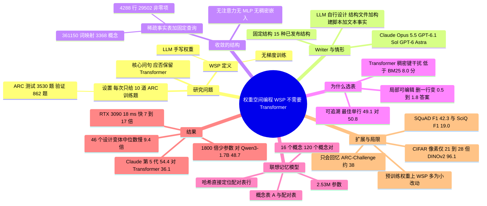

## 一、论文是干什么的？

平时我们得到一个神经网络，靠的是**梯度下降**：喂大量数据，让优化器一点点调整权重。这篇论文研究另一种做法，叫**权重空间编程**（Weight-Space Programming，简称 WSP）：让一个大语言模型（LLM）像程序员写代码一样，**直接动手写出另一个模型的全部权重**，不做任何梯度训练，也不在数据上拟合。

论文问了一个很直接的问题：既然不再用梯度下降，Transformer 当初被选中的理由（容易用梯度训练、在 GPU 上跑得快）就不成立了，那还应该继续用 Transformer 吗？

打个比方：Transformer 像一座结构复杂、靠机器自动浇筑的大楼，知识被「揉」进整体里，谁也说不清哪块砖对应哪条知识。而 LLM 手写权重时更像在整理**卡片箱**：一张卡片写一条事实，要改就改那一张。论文发现，三个前沿 LLM 在可以自由设计结构时，**不约而同地做出了卡片箱**（稀疏事实表加一套固定的查表流程），而不是 Transformer。

## 二、核心方法与创新

**1. 实验设置。** 每个 LLM（论文称为 writer）只拿到 10 道带答案的 ARC 训练题（ARC-Easy 和 ARC-Challenge 各 5 道）、一个没有外网的沙箱，以及任务说明。它不能看到测试准确率，也不能做梯度训练或在数据上做统计拟合。评测在 ARC 合并测试集的 3,530 道四选一科学题上进行，由主机在另一个沙箱里完成。

**2. 两种对照情形。**

- 固定结构：LLM 在随机初始化的已发布结构上写权重（共 15 种已发布结构，含 Transformer、状态空间模型、RNN），或者给一个小的两层 Transformer，让它写每一个权重。
- LLM 自行设计：LLM 自己写结构文件、构建脚本和纯文本知识文件，在 CPU 上编译成张量。

**3. 谱系（lineage）。** 每一代有两次运行，下一代从验证集（862 道 ARC 验证题）上准确率更高的那个父模型出发继续改进，最多到第 10 代，或某一代没能提高最佳验证准确率时停止。

**4. 三个 LLM 收敛到同一种模型。** 稀疏事实表加固定查询流程，没有注意力、MLP 或稠密嵌入。以 Claude Opus 5.5 的第 1 代模型为例：361,150 个词映射到 3,368 个概念，匹配 4,288 行事实表（29,502 个非零项），取得分最高的几行，再做一次用相关概念扩展的二次查询，并加上否定、绝对词、词序等规则。

**5. 为什么选表？** 论文认为没有梯度时，写权重的 LLM 需要两个性质：

- **可追溯**：每个预测都来自少数几行可指认的文字。
- **局部可编辑**：增删一行，只影响依赖这一行的预测。

**6. 联想记忆视角。** Transformer 本身可看成联想记忆的堆叠，查询 $x$ 通过键 $k_i$ 取回值 $v_i$：

$$f(x)=\sum_{i=1}^{M}v_i\,\sigma(k_i^\top x)$$

Transformer 的键是稠密且互相重叠的，召回时会混入别的记忆（干扰）；LLM 设计的表用只有约 7 个非零项的稀疏键加硬性 top-k 选择，几乎不重叠。其选项得分为

$$s_c=\max_i\,(k_i^\top q)(k_i^\top o_c)$$

其中 $q$ 是问题的概念向量，$o_c$ 是选项 $c$ 中问题里没有的概念。

**7. 作者提出的联想记忆模型（Associative-memory-based）。** LLM 设计的模型要对每个问题给每条事实打分，所以事实越多越慢，而且 GPU 上要启动很多 kernel。作者于是固定前向流程，只让 LLM 写词表、纯文本文件和构建脚本，编译成两张表：概念表 $A$（一阶记忆）和配对表（二阶记忆）。配对表的行地址由哈希直接给出：

$$h(a,b)=(ap+b)\bmod H$$

每个问题取最强的 $J=16$ 个概念，组成 120 个概念对，召回与得分为

$$r=\sum_{(a,b)\in P(q)}q_aq_b\,t_{h(a,b)}+\mu A^\top q,\qquad s_c=o_c^\top r$$

这样每题成本与事实条数无关。Claude Opus 5.5 第 1 代的这个模型：40,312 个词映射到 3,805 个概念，$A$ 有 206 万个非零项，配对表 $H=1{,}048{,}576$ 行，总参数 2.53M。

## 三、使用了哪些模型和计算资源？

| 项目 | 内容 |
|---|---|
| 写权重的 LLM（writer） | Claude Opus 5.5（高推理强度）、GPT-6.1 Sol、GPT-6 Astra；附录提到个别地方还用了 Claude Fable 5.2（论文称 where stated） |
| 对照的已发布结构 | 15 种，参数量 129M 到 2.6B，含 Transformer、Mamba-2、RWKV-7 等；预训练检查点如 Gemma 3 270M、UltraBERT、Qwen3-0.6B、Qwen3.5-0.8B 等 |
| 推理计时硬件 | 一块 RTX 3090（3,530 道测试题的 GPU 时间） |
| 写权重过程 | 沙箱内 CPU 运行，限制 2 GB 内存；评测沙箱限制 6 GB 和 20 分钟（已发布结构 16 GB） |
| 梯度下降基线 | AdamW 或 Adam；不小于 0.5B 的 Transformer 微调用 LoRA rank 16；训练所用 GPU 型号和数量暂无相关信息 |
| 每次写权重的成本 | 以 API 价格折算的美元成本（含思考 token），见下表 |
| 每次写权重的耗时 | 论文只说达到输出 token 预算或墙钟时间上限即停止；具体时长暂无相关信息 |

写权重的 LLM 成本（论文自报，Table 3；谱系的成本是累计到该代为止）：

| Writer 与模型 | 成本 |
|---|---|
| Claude Opus 5.5，LLM 设计第 1 代 | 约 29 美元 |
| Claude Opus 5.5，LLM 设计第 5 代 | 约 144 美元 |
| Claude Opus 5.5，联想记忆模型第 1 代 / 第 5 代 | 约 28 美元 / 约 96 美元 |
| GPT-6.1 Sol，LLM 设计第 1 代 / 第 7 代 | 约 6 美元 / 约 45 美元 |
| GPT-6 Astra，LLM 设计第 1 代 / 第 5 代 | 约 41 美元 / 约 266 美元 |
| GPT-6 Astra，联想记忆模型第 8 代 | 约 490 美元 |

## 四、实验结果

大白话：LLM 自己设计的表模型，比同一个 LLM 写进 Transformer 的版本准确率高很多，参数还少得多；用梯度下降从随机初始化训练同类模型反而接近乱猜。但预训练后微调的模型仍然远远更准，WSP 只是在没有预训练这个条件下占优。

**主结果（ARC 测试准确率，论文自报，%，Table 3）：**

| 模型 | 参数量 | Easy | Challenge | 全部 |
|---|---|---|---|---|
| 梯度下降随机初始化：最佳已发布结构 Mamba-2 130M | 129M | 24.7 | 24.3 | 24.6 |
| 梯度下降：LLM 设计尺寸的两层 Transformer | 3.33M | 31.2 | 27.0 | 29.8 |
| 梯度下降：同尺寸最佳小网络 MLP | 3.34M | 35.8 | 26.4 | 32.7 |
| 预训练并微调：Qwen3.5-0.8B | 752M | 87.0 | 72.1 | 82.1 |
| Claude Opus 5.5 写入给定两层 Transformer（3 种宽度） | 0.08M 到 3.96M | 40.0 | 28.2 | 36.1 |
| Claude Opus 5.5 LLM 设计，第 1 代 | 0.94M | 59.0 | 34.2 | 50.8 |
| Claude Opus 5.5 LLM 设计，第 5 代 | 3.35M | 62.6 | 37.8 | 54.4 |
| Claude Opus 5.5 联想记忆模型，第 1 代 | 2.53M | 55.9 | 36.9 | 49.6 |
| Claude Opus 5.5 联想记忆模型，第 5 代 | 6.24M | 59.0 | 38.9 | 52.4 |
| GPT-6.1 Sol LLM 设计，第 7 代 | 0.77M | 54.1 | 33.7 | 47.4 |
| GPT-6 Astra LLM 设计，第 5 代 | 0.55M | 52.3 | 33.9 | 46.2 |

**关键数字的来源：** 摘要中「少约 1,800 倍」是用 Claude Opus 5.5 写出的最佳已发布结构 Qwen3-1.7B（1.72B 参数，测试准确率 48.7%）除以 LLM 设计模型的 0.94M 参数；「约 680 倍」则是除以联想记忆模型的 2.53M。

**为什么是表（机制验证）：**

| 检验 | 结果 |
|---|---|
| 每个选项只保留得分最高的一条事实 | 49.1%，对比完整模型 50.8% |
| 删除一行后重建，变化的答案数 | 表模型平均 0.5 到 1.8 个；写入的 Transformer 第一次运行为 4.8 个，第二次运行因脚本从同一随机流取向量而约 38% 答案变化 |
| 对比 BM25（对它自己写的文本做关键词检索） | Claude Opus 5.5 的 6 个写入 Transformer 平均比 BM25 低 8.0 分，LLM 设计模型第 1 代高 3.7 分 |
| 禁止写练习题 | 约掉 1 分（49.5%） |
| 禁止写事实行 | 约掉 5 分（45.6%），且非零值多 100 倍以上 |

**速度（RTX 3090，3,530 题，Table 7）：** 联想记忆模型第 1 代和第 5 代都是 0.018 秒，比同尺寸 Transformer 快 7 倍和 17 倍；而 LLM 设计的模型第 1 代 0.566 秒（比 Transformer 慢 11 倍）、第 5 代 15.8 秒（慢 90 倍）。在 46 个 LLM 设计变体中，只有 1 个快于同尺寸 Transformer，中位数慢 9.4 倍。联想记忆模型的准确率在 Claude Opus 5.5 的 10 个模型里为 49.6% 到 52.8%，与 LLM 设计的模型相差约 3 个百分点以内。

**其他任务：**

| 任务 | 结果 |
|---|---|
| SciQ（沿用 ARC 模型） | 第 1 代 47.7%，第 5 代 50.1% |
| OpenBookQA / MMLU | 30% 到 36% / 接近 25% 随机水平 |
| SQuAD 1.1（F1） | LLM 设计 42.3；写入 Transformer 33.2；梯度训练 Transformer 16.1；无模型参考 18.8 |
| SciQ 生成（F1） | LLM 设计 19.0；写入 Transformer 7.6；梯度训练 Transformer 10.0；无模型参考 17.0 |
| CIFAR-10 原始像素 | 21% 到 28%（随机 10%），WSP 在这里不奏效 |
| CIFAR-10，用 DINOv2 token | 96.1%（准确率主要来自编码器） |
| AG News | 无数据写出的四种结构约 84% |
| 预训练权重上做 WSP | 87 次运行中 48 次改动不到 1% 的权重；超过 72% 的检查点从不被覆盖 |

以上均为**论文自报**，未见独立复现。论文自己指出的局限：只做回忆而不做多步推理，ARC-Challenge 约 38% 而 ARC-Easy 约 63%；LLM 也可能只是因为熟悉检索才选表，数据无法区分（但禁止行表后它仍选了用叠加随机高维向量的键值记忆）。

## 五、潜在应用与已落地应用

**潜在应用**（论文提出的方向）：

- 标签稀缺的领域，用写出的网络当初始化：AG News 只用 100 篇标注文章时，写出的网络初始化后最高 84.7%，随机初始化最高 63.6%。
- 可审计、可逐行编辑的小型知识模型。
- 面向查表的硬件（近存计算、FPGA、内容寻址存储器）上运行写出的模型。
- 论文的未来方向：写入计算与比较能力、从写出的联想记忆模型出发再做梯度训练、加入词序以生成文本、用按准确率、成本、大小和速度打分的自动代际搜索。

**已落地应用：** 暂无相关信息。论文为 arXiv 预印本，代码与项目页已公开（[GitHub](https://github.com/effl-lab/Weight-Space-Programming)、[项目页](https://wsp-no-transformer.github.io/)），但未见产品化案例。

## 六、网络上的讨论与评价

- Hugging Face 论文页：票数 55；页面上的 AI 摘要与论文结论一致，仅有作者的一句自评和机器人评论，没有实质性讨论。
- 搜索到的页面主要是摘要镜像，如 [hyper.ai](https://hyper.ai/en/papers/2611.22055) 和 [explainx.ai 博客](https://explainx.ai/blog/weight-space-programming-no-transformers-postech-arc-2026)；Hacker News、Reddit、X、知乎上未找到针对该论文的讨论。
- 总体来说：**未找到有深度的公开讨论或独立复现**。

## 七、思维导图

